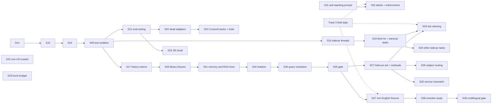

# Qube Knowledge Retrieval — Follow-up Plan (S14+)

**Status:** Plan of record for the work after S1–S13 · created 2026-11-25 · Phases 0–1 merged (PRs #75, #76); Phase 2 complete (S21–S23), in review
**Predecessor:** `docs/knowledge_retrieval_quality_assessment.md` (the assessment, the S1–S13 plan in its §12, and its progress log). That document is now the closed record of S1–S13; this one carries everything after it.
**Audience:** Engineering, and any new session resuming this work. Start with §7 "Resuming work in a new session".

References such as "V24", "D21" or "§12.4 S8" point into the predecessor document. Numbering continues from it: stages **S14+**, owner decisions **D23+**, validated findings **V33+**.

---

## 1. Purpose and scope

S1–S13 shipped the relevance gate, query resolution, wider recall, the evidence pack, grounding telemetry, robustness fixes and the S13 consolidation (main, PR #73). This plan covers everything they left open:

| Source | Items |
|---|---|
| S13 follow-ups (predecessor §12.4 S13, progress log) | Crossref in the discipline packs; the institutional adapters that return 0 rows (V30); tighter trial-name matching (V31) |
| Future iterations (predecessor §12.7) | Library and memory retrieval (D5); multilingual retrieval (D4); how-to questions sent to scholarly sources ("service mismatch") |
| Carry-overs (predecessor progress log, "Carry-overs") | Sidecar `<think>` truncation (D9); sidecar thread counts (V18); history windowing by tokens (V20); the native engine's `max_tokens` clamp (V21); shadow slot logs and the steering decision (D11); `active_topic` → `subject`; citation enforcement (D13); citation stacking; DuckDuckGo burst budget (V27); reranker in the frozen build (S3); non-US `@trusted` fixtures (V28); chapter-numbered duplicate titles; pool-relative metrics; `test_v2_scientific_bundle` live requests |
| Acceptance rows still **Partial** | S4 (irrelevant kept 8–9 % vs ≤ 5 %), S8 (scientific recall never measured), S9 (LLM resolves 50 % of residuals vs ≥ 70 %). S5 is superseded by S6 |
| Documentation | Out-of-date status lines in the predecessor (closed in S14) |

Out of scope unless the owner adds it: new knowledge services, UI redesign, and changes to the D1–D22 decisions without new evidence.

## 2. Starting state (2026-11-25)

- **Code.** `main` at `0e6944a` (Release 1.3.60) contains S1–S13 as the squash commit `c651eb2` (PR #73), after the phase 0/1 WIP in `f5949e2` (PR #72). The per-stage commits (S1 `2fda486` … S13 `f2492bc`, S8 live re-run `2800b62`) exist only on `feat/knowledge-retrieval-quality`; keep that branch, or its hashes stop resolving. Its merge base with `main` is still `2f4b180`, so a PR from it would show all of S1–S13 again: new work branches from `main`.
- **Release.** 1.3.60 is the first release that ships the reranker (D1) and the spelling variant (D6).
- **Offline eval** (re-run 2026-11-25 on this code; all six replays match `kq_s13_*`, 63 fixtures). Cells: P@k · nDCG@5 · irrelevant kept · relevant recall · abstain correct.

  | Ranker | production queries | standalone queries |
  |---|---|---|
  | token (reranker-free fallback) | 0.72 · 0.75 · 0.28 · 0.81 · 0.86 | 0.77 · 0.74 · 0.23 · 0.80 · 0.92 |
  | embed | 0.74 · 0.76 · 0.26 · 0.83 · 0.86 | 0.79 · 0.76 · 0.21 · 0.84 · 0.92 |
  | ce (shipped, `--pool-mode widened`) | 0.92 · 0.71 · 0.08 · 0.78 · 1.00 | 0.94 · 0.71 · 0.06 · 0.83 · 1.00 |

- **Tests.** The S1–S13 stage test files: 428 passed (2026-11-25). Full suite on `main` `0e6944a`: 4233 tests collected, so **4228 pass** plus the 5 known failures listed in §7. The S13 log's "4209 passed" undercounted; the true S13 figure is 4216 (V34).
- **Field data: none yet.** `~/.qube/logs/qube.log` holds 0 `[QuerySlots] shadow` lines, `llm_debug.log` 0 `citation_grounding` events (last written 2026-11-24 16:48), `routing_debug.log` 1 `query_slots_gate`, and `web_search.log` is empty because the web-search audit log is off. Decisions that need real use start with Track 0 (§4).

## 3. Rules

- **The predecessor's §12.5 rules 1–7 and its working agreement apply unchanged:** one stage at a time; fallback-first; no assertion changed just to pass; telemetry before enforcement; every stage logs before / after metrics; a false assumption stops the stage; no category may regress by more than 1 fixture or 5 points.
- **Branches and PRs.** One branch per phase, from `main` (`feat/kr-followups-phase<N>`), one PR per phase, one or more commits per stage. Ask before every commit and push.
- **Commit messages:** a one-line summary ending in "(SN)", a bullet body, a short metrics paragraph, then `Co-Authored-By: Claude Opus 5.5 <noreply@anthropic.com>`.
- **Documentation.** Each stage adds an "As built (date)" block under its entry in §6, progress-log rows in §8 (deliverables, acceptance with ✓ / ✗ / **Partial**, tests with the full-suite count, baselines), and updates "Last reviewed". New findings become V-rows and owner decisions become D-rows (§8). The plan text in §5–§6 may be amended only by a recorded D-row or a stage's "As built" deviation.
- **Predecessor document.** Closed. Only factual corrections go there, never into its §1–11.
- **Privacy.** Real-use logs stay on the owner's machine. Only aggregate counts and metrics go into this document. Scripts that read real-use logs stay outside the repo. No real conversation text is committed: committed corpora use fixture-generated text, as S11 did, unless the owner decides otherwise. Adapters keep the generic contact `local@qube.app`.

## 4. Track 0 — field data (runs throughout)

Several decisions need data only real use produces. Collection starts now and runs in parallel with every phase. The owner uses the app normally (`@evidence`, `@internet`, `@trusted`, plain web turns, multi-turn follow-ups).

| Signal | Where it lands | Needs | Used by |
|---|---|---|---|
| Shadow LLM slots: `[QuerySlots] shadow {json}` | `~/.qube/logs/qube.log` | Sidecar enabled and loaded (`qube.sidecar.query_slots_shadow_enabled`, default on) | S29 |
| Slot gate per turn: `retrieval_outcome.query_slots_gate` | `~/.qube/logs/routing_debug.log` | Routing debug log on | S29 (invocation rate) |
| Citation grounding: `"event": "citation_grounding"` | `~/.qube/logs/llm_debug.log` (default on) | Reranker on | S31, S32 |
| Retrieval traces: rerank skip reasons (incl. `non_english`), sufficiency, `rerank_dropped`, discovery block cause | `~/.qube/logs/web_search.log` | **Settings → Privacy & data → Web search log** on (`qube.diagnostics.web_search_audit_log_enabled`, default off); query hashing optional | S26, S37, general |

- **Read with** `core/knowledge/retrieval_trace_reader.read_retrieval_traces` (it joins grounding events to their traces), or the Retrieval Inspector.
- **Checkpoint.** At the start of each phase, record the counts per signal in the progress log, so every data-dependent decision states how much data it rests on.

## 5. Phases and execution order

| Phase | Theme | Stages | Changes behaviour | Owner decisions expected | Size |
|---|---|---|---|---|---|
| 0 | Housekeeping and release safety | S14–S16 | Barely | Release CI change; the V21 fix | S |
| 1 | Fixes under every turn | S40, S17–S20 | Yes | Sidecar thread defaults; each re-enabled sidecar task | M–L |
| 2 | Scholarly routing and adapters | S21–S23 | Yes | Keep / gate / drop per adapter; Crossref in packs | M |
| 3 | Measurements that need live runs | S24–S26 | Maybe | Quota days; trusted scope (D19); burst budget | S–M |
| 4 | Follow-up understanding | S27–S30 | Yes | Slot steering; service routing | M |
| 5 | Citation faithfulness | S31–S32 | Yes | Prompt change; human labelling; enforcement | M |
| 6 | Library and memory retrieval | S33, S41, S34, S36, S35 | Yes | Scope; each V67 memory fix (D42); "not found in your documents" wording | L |
| 7 | Reranker study and multilingual | S37–S39 | Yes | Model choice and download size | L |

**Execution order (agreed 2026-11-25):** Phase 0 → 1 → 2 → 6 → 4 → 5 → 7, with Phase 3's live sessions run whenever the API quotas allow (first run of a UTC day for OpenAlex; DuckDuckGo searches ≥ 5 min apart).

- Phases 0 and 1 come first: release safety, and fixes that later phases depend on (the sidecar for S29, the history budget for Phase 6).
- Phase 2 fixes live defects in scholarly routing (§6 S22).
- Phase 6 comes before 4 and 5 for two reasons. Library has had the most recent product work (#67, #68, #71), and its relevance floors are the kind V4 found dead on the web path. Its long run also gives Track 0 time to collect the data that Phases 4 and 5 decide on.
- Stage numbers follow phase numbers, not execution order. S40 was added after the plan was numbered (D25) and runs first in Phase 1. S41 was added in Phase 6 (D42) and runs between S33 and S34. S36 runs before S35 (D50), so the gate is measured on resolved follow-ups.

## 6. Stage details

### Phase 0 — Housekeeping and release safety

#### S14 — Follow-up plan and predecessor close-out

- **Why:** the predecessor's status lines are out of date, and the post-S13 work needs a plan of record.
- **Changes:**
  - this document;
  - in the predecessor: a header pointer to this document; the "Resuming" heading and state (PR #73 → `c651eb2`, 1.3.60, branch kept); the full-suite reference updated to S13's 4209; the phase Summary table; the Git reference table; the "Last reviewed" line; a pointer from §12.7.
- **Acceptance:** documentation only; the predecessor's §1–11 are unchanged (`git diff` shows no edit above §12).

#### S15 — Reranker and spelling data in the packaged app

- **Why:** both features fail silently by design, so a packaging gap would not show as an error.
  - *Reranker:* 1.3.60 is the first release with the reranker. `qube.spec` adds the hidden import `fastembed.rerank.cross_encoder` (S3), but S3's frozen-build smoke test was never run, and no release smoke step loads the reranker. `rerank` never raises: a missing module puts every packaged user on the unscored legacy path, with no gate and no error.
  - *Spelling (suspected, to verify):* `core/knowledge/spelling.py` loads `pyspellchecker`'s word list (`spellchecker/resources/en.json.gz`) at runtime. `qube.spec` does not collect `spellchecker` data files (its `collect_data_files` list has no such entry), and the installed PyInstaller hooks have none for it. If the data is missing, `SpellChecker(language="en")` fails, `_get_checker` switches the feature off, and the S8 spelling variant (D6) never runs in packaged builds.
- **Changes:**
  1. Verify the published 1.3.60 artifacts (Linux first; Windows and macOS where they can be opened here): is `fastembed/rerank` present, is `spellchecker/resources/en.json.gz` present, and does the frozen binary load both? Record the result as a V-row.
  2. Fix `qube.spec` as needed (e.g. `collect_data_files("spellchecker")`, limited to `en.json.gz` if size matters).
  3. Add a release smoke check that the frozen binary can import the reranker module and build an English `SpellChecker`. It needs no model download: the model itself arrives through bootstrap. Covers Linux dist, Windows dist and macOS DMG through the existing smoke scripts (`scripts/release/smoke_linux_dist.sh`, `smoke_dist.ps1`, `smoke_dmg.sh`).
- **Risks:** release CI time; a smoke check that needs network. The check must be offline.
- **Acceptance:** findings recorded; the smoke check fails on a build without the files and passes on a fixed build; a patch release if 1.3.60 is affected (owner decision).
- **Decisions:** the release CI change; whether a patch release is needed.
- **As built (2026-11-25):**
  - **1.3.60 inspected (V33).** The Linux x86_64 CPU tarball and the macOS arm64 DMG were downloaded with `gh release download` and listed without running anything from them: `tar -t`, `7z l` for the DMG, and `pyi-archive_viewer -r -b` for the module archive inside the Linux executable. `SHA256SUMS.txt` covers only the three Windows installers, so these two could not be checksum-verified (carry-over in §7).
    - *Reranker:* `fastembed.rerank.cross_encoder` and its five submodules are in the module archive, and `onnxruntime` ships too. The model is not in the bundle, by design (bootstrap download).
    - *Spelling:* the `spellchecker` modules ship, but `spellchecker/resources/` is **absent** from both artifacts. Control: `language_tags/data`, which the same spec collects, is present in both (16 files each). pyspellchecker reads its word list with `pkgutil.get_data("spellchecker", "resources/en.json.gz")`; without the file that raises `FileNotFoundError`, re-raised as `ValueError: The provided dictionary language (en) does not exist!`. `spelling._get_checker` catches it, logs one INFO line and switches the feature off. **The D6 spelling variant has never run in a packaged build.**
    - *Reproduced* with two minimal frozen builds (PyInstaller 6.22.2, local): without the data, that `ValueError`; with `collect_data_files("spellchecker", includes=["resources/en.json.gz"])`, "inteligence" → "intelligence".
    - *Windows* was not opened: its Inno Setup installer cannot be listed here. It builds from the same spec with no platform-specific data entries, so it is taken to be the same.
    - *Sweep for the same class of gap:* every module that S1–S13 added or changed is in the module archive except `core.knowledge.quality_eval` (eval only). Every third-party import resolves except PyQt6 (compiled extensions, stored outside the archive) and `brotli` (optional, absent in the dev venv too, unchanged since 1.3.54). S1–S13 code reads no runtime data files other than test fixtures.
  - **Fix.** `qube.spec` collects only `resources/en.json.gz` (650 KB of the package's 7 MB; only English is used) and stops the build if the file is not found, rather than shipping without it.
  - **Self-check.**
    - `core/bundle_self_check.py` adds `Qube --self-check-bundle <result.json>`. `qube_entry.run()` dispatches it first, before validation bookkeeping, Qt, the single-instance guard or any model.
    - Checks: the reranker import that `rerank._load_model` performs, and spelling end to end (`spelling.correct_word("Inteligence")` must give "Intelligence").
    - It writes JSON and exits 0 or 1, and needs no network, model or settings. Normal launches pay about 2 ms for the import.
  - **Smoke scripts.** `smoke_linux_dist.sh` and `smoke_dist.ps1` run the self-check after their CUDA branch (CUDA CI still runs only the bundle-layout check, as before); `smoke_dmg.sh` runs it on the mounted, signature-checked app. `release.yml` is unchanged. It runs only on `v*` tags, so CI first exercises these steps at the next release.
  - **Verified on a full local build** (`pyinstaller qube.spec`, PyInstaller 6.22.2, Python 3.12, Linux CPU; 58 s; output outside the repo). The bundle holds only `spellchecker/resources/en.json.gz`. `Qube --self-check-bundle <file>` under a throwaway HOME: `frozen: true`, `reranker_module` ok, `spelling_en` ok ("Intelligence"), exit 0, 1.1 s, nothing written to `~/.qube`. **Negative control:** the same code built with the 1.3.60 spec has no `spellchecker/` data, and the self-check reports `spelling_en: spell checker unavailable` and exits 1, so the new smoke step would have failed the 1.3.60 release job.
  - **Not run here:** the PowerShell script (no `pwsh` on this machine), the macOS script (no macOS), and the full Linux smoke script, whose stale-process cleanup kills any process named `Qube` on the machine. Its self-check command was run directly instead, as above.

#### S16 — Test hygiene and the engine clamp

- **Changes:**
  - `tests/test_scientific_evidence.py::test_v2_scientific_bundle` runs `run_v2_web_retrieval` against live adapters from local preferences (Europe PMC and others are not mocked). Mock the adapters and keep its assertions (bundle service, PubMed call, ≥ 1 source with a DOI).
  - V21: `workers/native_llama_engine.py` (~line 1768) does `int(getattr(self._llama, "n_ctx", 0) or …)`; in llama-cpp-python 0.3.35 `n_ctx` is a method, so `int()` raises and the `max_tokens` clamp is always skipped (`[OutputTokenBudget] clamp skipped`). Call it when callable, as `loaded_n_ctx()` already does (~line 501). llama-cpp itself cuts `max_tokens`, so this removes log noise and makes the clamp do what its code says.
- **Tests:** a unit test for the clamp with a callable `n_ctx`; the mocked test runs offline.
- **Acceptance:** the test makes no network calls; the clamp runs (no "clamp skipped" line in a smoke turn); the full suite matches the reference.
- **Decisions:** the V21 fix (engine owner).
- **As built (2026-11-25):**
  - **Hermetic scientific test (V35).** A probe that records and refuses every DNS lookup and socket connect showed `test_v2_scientific_bundle` reaching six live hosts on every run: `tools.cdc.gov`, `data.cdc.gov`, `ghoapi.azureedge.net` (WHO), `clinicaltrials.gov`, `api.fda.gov` and `www.ebi.ac.uk` (Europe PMC). Discipline routing for a medical question picks them on top of the three mocked adapters, and the test still passed offline because adapters swallow their own errors.
    - Now every adapter in `SEARCH_FUNCTIONS` (58) is replaced by an empty fake; PubMed and OpenAlex keep their fixture rows, and the original assertions are unchanged.
    - The test also asserts that no DNS lookup or connect is attempted. The same guard around the old three-adapter mapping records the six hosts, so the assertion catches a regression.
  - **Engine clamp (V21 → V36).** The clamp moved into `NativeLlamaEngine._clamp_max_tokens_for_prompt` and reads the window through `loaded_n_ctx()`, which calls `n_ctx()` and falls back to the loaded, then the requested window. The log lines are unchanged.
    - *Before:* `int(<bound method>)` raised `TypeError`, so every clamp was skipped and `max_tokens` reached llama-cpp unclamped. llama-cpp cut it to `n_ctx − prompt` itself, so nothing overflowed. This machine's `llm_debug.log` holds 17 "clamp skipped" lines, all this `TypeError`, and no clamp line.
    - *Behaviour change:* when the requested `max_tokens` does not fit, it becomes `n_ctx − prompt − 64` (at least 256), 64 tokens below llama-cpp's own cut. `effective_max_tokens`, which the truncation notice compares against, is now that real budget rather than the unclamped request, so a long prompt that leaves little room can now trigger the notice heuristic where it could not before.
    - *Real model:* Qwen3-1.7B Q6_K on CPU, `n_ctx=2048`, a 1500-token prompt. `type(llm.n_ctx)` is `method`; the clamp gives 4096 → 484 with and without the user cap, logs one `[OutputTokenBudget] max_tokens 4096 -> 484` line, and no "clamp skipped". This calls the method on a real `Llama`; it is not a full app turn.
  - **Tests write into the real `~/.qube` (V37).** Found because `~/.qube/models/search/reranker.download_failed` appeared during the S15 suite run. An audit hook on a full run recorded every write, remove and mkdir under `~/.qube`, per test.
    - Fixed here, as it is this plan's code (S3's back-off marker): `test_reranker_failure_is_reported_not_fatal` wrote the marker into the real `models/search/`, and `test_balanced_search_also_downloads_missing_reranker` deleted it on its success path, so a real failure marker could vanish during a test run. Both now patch `reranker_dir` to `tmp_path` and assert the marker is written or cleared there. With the audit hook, the S16 test files make no write or remove under `~/.qube`.
    - The rest is listed in V37 and is fixed suite-wide by the new stage S40 (D25).
  - **Flaky Qt test (V38).** `test_surface_fill_phase1.py::test_transcript_wallpaper_host_refresh_callback` leaves a background-build callback queued; when it fires after its widget is gone, Qt reports "wrapped C/C++ object of type BackgroundBuildBridge has been deleted". It hit that test itself (FAILED) in the audited run and the next test, `test_surface_fill_phase2.py::test_bundled_wallpaper_assets_exist` (setup ERROR), in the clean run. On a clean worktree of `1b6fb88` the phase-1 file fails this way in 3 of 6 runs. Pre-existing and untouched; §7 lists it as known-flaky.
  - **Full suite** (`-m "not packaging"`, final run, after the marker-test fix): **4251 passed** of 4256 collected (S15: 4244 of 4249, +7 clamp tests) and the 5 known failures; the V38 test passed and then errored at its own teardown. Qt teardown abort as before. The two earlier runs (audited, and clean before the marker fix) gave 4250, because V38 cost one result in each.

### Phase 1 — Fixes under every turn

#### S40 — Keep the test suite out of the real `~/.qube` (V37, D25)

- **Why:** a full run writes into the developer's own data directory (V37): `settings.json`, `model_performance_store.json` (a fake model entry accumulates there), companion state, `logs/`, bootstrap trace files and model markers. Later phases measure from those logs (Track 0) and from local stats, so the suite must not touch them.
- **Changes:**
  - In `tests/conftest.py`, before any app module is imported: point `HOME` (and `LOCALAPPDATA` on Windows) at a per-session temp directory, so `core.paths.user_data_root()` and the 37 direct `Path.home()` / `expanduser("~")` lines in `core/`, `workers/` and `ui/` resolve there. Copy nothing in.
  - Reset module-level switches that leak between tests, starting with `core.bootstrap_trace._ENABLED` (it made `test_knowledge_rerank` write trace files, V37).
  - Fix any test that relied on the real home directory, without weakening its assertions.
- **Tests:** re-run the S16 audit hook over the full suite; it must record **zero** writes, removes or mkdirs under the real `~/.qube`.
- **Risks:** tests that read real models or settings by accident (the S4 reranker fixture already hides the installed model); Windows CI, where `user_data_root()` reads `LOCALAPPDATA`; paths computed at import time before the fixture runs.
- **Acceptance:** zero real-home writes in the audit; the full suite matches the reference; Windows and macOS CI unchanged.
- **Decisions:** none beyond D25.
- **As built (2026-11-25):**
  - **Throwaway home.** `tests/conftest.py` runs `_isolate_user_home()` at import, before any app module is imported. It points `HOME` at `mkdtemp(prefix="qube-test-home-")`, plus `USERPROFILE`, `LOCALAPPDATA` and `APPDATA` on Windows, and puts `XDG_CONFIG_HOME`, `XDG_DATA_HOME` and `XDG_STATE_HOME` inside it, since the QSettings migration and other XDG users would otherwise keep the real home. A cache directory set in `XDG_CACHE_HOME` is left alone. The directory is removed in `pytest_sessionfinish`.
  - **One change from "copy nothing in".** An installed reranker (88 MB, 0.04 s) is copied in, not linked. The two `real_reranker` tests then still run on a developer machine, and no test can change the real model. CI has no model, so nothing is copied there.
  - **Trace switch.** The autouse fixture `_restore_bootstrap_trace_switch` restores `core.bootstrap_trace._ENABLED` and `QUBE_BOOTSTRAP_TRACE`, and removes any console handler a test added (resetting propagation and level).
  - **No test needed changing.** One known failure goes away (V41).
  - **Audit tool.** `tools/pytest_home_audit.py` is the S16 audit hook as a committed plugin; §7 has the command.
  - **Tests.** `tests/test_s40_home_isolation.py` (new, 6 tests):
    - the home is a throwaway directory, with `user_data_root()`, `models_root()` and the settings path inside it;
    - the reranker copy is a real directory;
    - a test that enables the trace leaves the next test with the state from before. Checked negatively: with the fixture's autouse turned off, that test fails.
  - **Cleanup.** The S16 and S17 suite runs before this fix had re-added the fake `registry-model.gguf` entry (2 requests) to the owner's `model_performance_store.json`. It was removed again, with a backup.
  - **Not run here:** Windows and macOS CI, where `LOCALAPPDATA` / `USERPROFILE` and the macOS home are the paths that change.

#### S17 — Token-aware history windowing (V20)

- **Why:** `LLMWorker._bound_session_history` (`workers/llm_worker.py` ~line 1429) keeps the last `max_history_messages` messages (default 10, 2–100), each capped at `CHAT_HISTORY_SINGLE_MESSAGE_MAX_CHARS`. Ten 1500-char turns already reach 4226–4292 real tokens: a 4k window overflows before any retrieval, and the S10 budget then sits at its 1000-char floor. Phase 6 adds library context to the same window.
- **Changes:** after the message-count window, trim the oldest messages until the history fits a token budget derived from the loaded `n_ctx`. Reuse the S10 estimate (`core/retrieval_budget.py`: 4.0 ASCII chars per token, one token per non-ASCII character), and keep the existing first-message-must-be-user rule and the memory v7 salvage hook. Split the window between history and retrieval explicitly, so neither starves the other.
- **Risks:** losing context the user expects on long threads; models with large windows must behave exactly as today.
- **Tests:** the S10 4k / 8k / 32k matrix with real tokenizers (Gemma 4 E4B, Qwen3.5-9B, Phi-4-mini) and history sizes up to the overflow case; unchanged output when everything fits.
- **Acceptance:** no prompt over `n_ctx` minus the answer reserve on the matrix; ≥ 8k windows unchanged on every existing test.
- **As built (2026-11-25, branch `feat/kr-followups-phase1`, stacked on Phase 0):**
  - **Where.** `core/retrieval_budget.py`: `history_token_budget`, `fit_history_to_token_budget`, `HistoryWindow`. Its fixed costs are a shared helper that S10's `retrieval_char_budget` now uses too, with the same numbers. In the worker, `_fit_history_for_turn` runs where the S10 budget is computed: after the sources are known, and before the retrieval budget, which then sizes the block from the kept history. The follow-up resolver, discourse state, query expansion and shadow slots still see the message-count window, unchanged.
  - **Budget.** The room is `n_ctx` − answer reserve − prompt overhead (skills, attachment and tool context included) − 128-token margin, as in S10. On a turn with sources, retrieval keeps `min(its cap, half the room)`, where the cap is 8000 chars = 2000 tokens, and history gets the rest. On a turn without sources, history gets the whole room. Unknown `n_ctx` means no limit.
    - With a 1200-char skills budget: 4k → 1444 tokens of room, so 722 for history with sources and 1444 without; 8k → 2516 / 4516; 32k → 25 044 / 27 044.
  - **Fit.** Newest message first.
    - The current question is always kept. If it alone exceeds the budget, the result is `over_budget` rather than an empty history.
    - If the next message does not fit whole, it is not an assistant turn, and at least 128 tokens remain, its head is kept with the existing "[…message truncated for context window]" marker. This is what keeps the last exchange on a small window.
    - A leading assistant message is still dropped. Kept messages are the original dicts (a truncated one is a copy), and messages older than the cut are never tokenized.
  - **Counting (V39; a change from the plan text, which said to reuse the S10 estimate).** On the native path the worker counts history with the loaded model's tokenizer: `NativeLlamaEngine.count_tokens` calls `llama_tokenize` on the vocabulary only and does not touch the context.
    - The same counter feeds the S10 budget's history term and its block re-fit, which until now re-fitted only non-ASCII blocks.
    - External engines keep the estimate. If a count fails, that text falls back to the estimate.
  - **Trace.** `decision["history_window"]` holds kept, dropped, tokens, budget_tokens, reason, truncated and counter. It is persisted in the routing-debug `retrieval_outcome`. When anything is dropped or truncated, the log shows `[LLM] Chat history token-fitted: kept … of … messages (…)`.
  - **Behaviour change.** Only when history and a full retrieval block do not both fit. Example: the S10 test history, estimate counter:
    - *4k, 10 × 1500 chars, with sources:* before, the block was at its 1000-char floor and the prompt overflowed the window. Now 3 of 11 messages are kept (the last exchange, one message truncated) and the block gets 2888 chars.
    - *8k, same history, with sources:* 7 of 11 messages kept, block 8000 chars (S10 alone: all 11 kept, block 2652).
    - *8k without sources, and 32k at every size up to 10 × 1500:* unchanged.
  - **Real-tokenizer matrix** (scratch script, not committed). Gemma 4 E4B, Qwen3.5-9B and Phi-4-mini tokenizers (vocab-only) × 4k / 8k / 32k × 7 history sizes (up to 30 × 1500 and 10 × 14 000 chars) × with and without sources: 126 cases. History and sources are English prose from the predecessor document with markdown stripped, number tables included.
    - Pipeline as on the native path (model counter, one block re-fit): **0 of 126** over `n_ctx` − answer reserve.
    - Estimate only (the external path): 5 cases over, all 8k with 30 × 1500, using up to 1270 of the 2048-token reserve. No prompt reaches `n_ctx`.
  - **Known limits.**
    - A boundary assistant message is not truncated, since it would lead the history. So with 10 × 14 000-char turns, 4k keeps only the question.
    - The fixed prompt overhead stays an estimate.
    - External engines count by the estimate (V39).
  - **Not changed:** memory v7 salvage, which does not work with or without S17 (V40); it is fixed in Phase 6 (D26).

#### S18 — Sidecar thread counts (V18)

- **Why:** the sidecar's `Llama(...)` (`workers/sidecar_llm_worker.py` ~line 289) passes no thread counts, so llama-cpp-python uses `n_threads = cpu_count // 2` and `n_threads_batch = cpu_count` (SMT included). Measured on the dev laptop: prompt evaluation 63 tok/s at 16 batch threads vs 177 at 8, total p50 5.1 s → 2.3 s. The `inference_transparency` snapshot reports `os.cpu_count()` as `n_threads`, not the model's values.
- **Changes:** pass `n_threads_batch` (and `n_threads`) from the physical core count (`psutil.cpu_count(logical=False)`, already used by `rerank.reranker_threads`; `core/cpu_threads.py` currently detects logical cores only), with a cap that leaves headroom for the main model. Report the real values in the snapshot.
- **Risks:** CPUs without SMT, Apple P / E cores, low-core machines, and contention with the main model during a turn.
- **Tests:** thread selection per CPU shape (mocked psutil); snapshot values.
- **Acceptance:** sidecar prompt evaluation measured before and after on the dev machine, plus at least one other CPU shape if available; no regression in title latency.
- **Decisions:** the default (inference-settings owner).
- **As built (2026-11-25, D27):**
  - **Selection.** `core/cpu_threads.sidecar_llama_threads()` returns `n_threads = min(4, cores)` and `n_threads_batch = cores`. Here `cores` is the physical core count (`psutil.cpu_count(logical=False)`, falling back to half the logical count), capped at the CPUs the process may run on (`os.sched_getaffinity`), because psutil reports the host's cores under `taskset` or in a container.
  - **Wiring.** `workers/sidecar_llm_worker._load_cognition_model` passes both values to `Llama(...)` and logs them on load (`threads=4/8`). The inference-transparency snapshot reports the values the `Llama` holds (`n_threads`, plus the new `n_threads_batch`) instead of `os.cpu_count()`, and the Settings row reads "… on CPU (n_gpu_layers=0, threads 4 / 8 prompt)". The native engine's snapshot is unchanged.
  - **Measured** (Qwen3-1.7B Q6_K, CPU-only llama-cpp-python 0.3.35, Ryzen 7 7840HS, 8 cores / 16 threads; 805-token prompt, median of 3 after a warm-up):

    | Threads (decode / prompt) | Prompt eval | Decode | Title p50 (real `run_title_generation`, profile B, 5 runs) |
    |---|---|---|---|
    | llama-cpp default (8 / 16) | 56 tok/s | 27.0 tok/s | 9270 ms |
    | 8 / 8 | 157 tok/s | 25.6 tok/s | — |
    | 6 / 6 | 139 tok/s | 25.8 tok/s | — |
    | 4 / 4 | 104 tok/s | 24.9 tok/s | — |
    | **4 / 8 (shipped)** | **164 tok/s** | 24.9 tok/s | **2842 ms** |

    Both configurations produce the same title ("Heat Pump vs Gas Boiler").
  - **Second CPU shape.** The process was pinned to 4 distinct cores (`taskset -c 0,2,4,6`), where the selection gives 4 / 4. Against llama-cpp's defaults (8 / 16): prompt 98 → 103 tok/s, decode 18.3 → 24.6 tok/s, title p50 4658 → 4376 ms.
  - **Contention (V42).** A stand-in main model (Phi-4-mini, CPU, 6 threads, the owner's setting) decoded throughout while the sidecar evaluated prompts:
    - with the defaults, the main model fell from 14.1 to **2.7 tok/s** and the sidecar managed 31 tok/s;
    - with 4 / 8, the main model ran at 9.8 tok/s and the sidecar at 76 tok/s;
    - with 4 / 4, 10.6 and 49 tok/s.

    This overlap happens in practice: the S9 shadow slot extraction runs on a background thread during the turn.
  - **Not measured:** GPU builds (this venv's llama-cpp has no offload), Apple P / E cores (psutil counts E cores as physical, so the prompt threads include them), and the main engine (V43, D28).

#### S19 — Sidecar `<think>` fix: mechanism and retrieval-related tasks (D9 follow-through)

- **Why:** on Qwen3, every sidecar task on the raw path (`SidecarLlmWorker._complete_prompt`, ~line 513) returns only `<think>`. Under `/no_think` the model opens an empty think block, and the `"\n\n"` stop from `cognition_stop_tokens` ends generation there. Only titles (chat path) and the S9 `query_slots` task (pre-filled) work. Affected tasks: `source_digest`, `contradiction_judge`, `reflection_label`, `episode_summary`, `ingest_blurb`, `companion_line` and raw prompts (`query_rewrite` is off, D10).
- **Changes:**
  - one mechanism: a per-task opt-in that pre-fills the empty think block on the raw path for Qwen3 formats, exactly as S9 does for `query_slots`;
  - then evaluate and enable the retrieval-related tasks first: `source_digest` and `contradiction_judge`. Each gets fixtures, an output-quality check and latency at S18's thread settings, and is enabled only with an owner D-row. The S9 spot check of `source_digest` without the stop produced an off-topic summary, so working output is not assumed.
- **Risks:** turning on behaviour that has never run in production (why D9 chose a scoped fix).
- **Tests:** recorded completions replayed offline, as `tests/fixtures/query_slots_recorded_s9.json` does; per-task parser tests.
- **Acceptance:** per task: success rate, quality on its fixtures, p95 latency, and an owner decision to enable, keep off, or retire.
- **As built (2026-11-25, D29, D30):**
  - **Mechanism.** `core/cognition_prompt_adapter.prefill_qwen3_empty_think()` appends `QWEN3_EMPTY_THINK` to a ChatML prompt that ends at the assistant header, for Qwen3 models only. `core/sidecar_prompts.QWEN3_THINK_PREFILL_TASKS` is the per-task opt-in that `build_prompt_for_task` checks. **It ships empty** (D29, D30), so no task's prompt changes. `query_slots` now uses the same helper; its prompt is byte-identical (S9 tests unchanged).
  - **Fixture.** `tests/fixtures/sidecar_tasks_recorded_s19.json` holds completions from the bundled Qwen3-1.7B-Q6_K, recorded through the real `SidecarLlmWorker._complete_prompt` (shipped params and stops, S18 threads 4 / 8):
    - **judge:** 36 synthetic fact pairs, 12 per class (duplicate, contradiction, complement), each recorded:
      - as shipped;
      - pre-filled (3 runs);
      - pre-filled with the definitions `EnrichmentWorker._judge_contradiction` builds but never sends (3 runs).
    - **judge gate:** each pair's position relative to the pre-judge gate, computed with the "balanced" embedder and a LanceDB table exactly as `_find_duplicate` searches.
    - **digest:** 6 cases of five chunks each from this repo's docs (4.7–5.6 KB, 1309–1476 prompt tokens), each recorded:
      - as shipped;
      - pre-filled (2 runs);
      - pre-filled without the `"\n\n"` stop (1 run).
    - **turn cost:** what the shipped digest costs a turn.

    `tests/test_s19_sidecar_think_prefill.py` replays all of it through the real parsers and `_judge_contradiction`, and pins every number below.
  - **contradiction_judge** (V44, V45, V46):
    - As shipped, 36 of 36 completions are `<think>`. The production fallback then answers "duplicate" for 35 pairs; the one exception is a keyword-rule hit (likes / dislikes).
    - Pre-filled, the outputs are clean single words, stable across repeats (36 of 36; with definitions 35 of 36), at p50 472 ms / p95 546 ms (with definitions 737 / 856 ms).
    - Label accuracy over all 36 pairs: shipped 13, pre-filled 21, with definitions 22.
    - Only 19 pairs reach the judge (11 of 12 duplicates, 6 of 12 contradictions, 2 of 12 complements), and both "duplicate" and "contradiction" replace the old row. Scored by storage action on those 19 pairs, **the shipped fallback is right 17 times, the pre-filled judge 11, and the definitions variant 8**. The working judge calls 7 of 11 paraphrases "complement", which keeps near-duplicate rows side by side.
  - **source_digest** (V44, V47, V48):
    - As shipped, 6 of 6 completions are `<think>`, and each run still spends 7.9–9.2 s evaluating the prompt.
    - Pre-filled, all 12 runs stop after source [1]: the model writes a blank line between sources and the `"\n\n"` stop ends there. The parser rejects every run (`citation_ids_missing`). The text it did write is faithful to source [1].
    - Pre-filled runs take 11.0–15.2 s (p50 11.8 s, p95 15.2 s) against a 1.5 s foreground timeout (the setting's maximum is 10 s).
    - Without the `"\n\n"` stop, all 6 runs hit the 400-token limit (25.8–27.3 s). 3 still miss source ids, 2 cite a `[6]` when there are five sources, and the parser keeps only the first 1200 chars.
    - **What it costs today:** `digest_rag_context` through the real client blocked the turn for 1501–1502 ms in 6 of 6 cases, and applied nothing (`timeout`). The sidecar then stayed busy for 8.2–9.4 s, overlapping the main model's answer (V42).
  - **Default change (D30).** `qube.sidecar.source_digest_enabled` now defaults to off (`DEFAULT_SIDECAR_SOURCE_DIGEST_ENABLED`). It has no Settings toggle, and an explicit `true` in `settings.json` still turns it on. Output is unchanged, since the digest was never applied; eligible turns no longer wait 1.5 s. `docs/sidecar_tasks.md` §6 notes it.
  - **Not measured:**
    - how often turns are eligible (≥ 4096 chars of retrieved context): the logs record digest outcomes only at debug level;
    - the real distribution of fact pairs reaching the judge: synthetic pairs, labelled by hand.

#### S20 — Sidecar `<think>` fix: remaining tasks

- Same method as S19 for `reflection_label`, `episode_summary`, `ingest_blurb`, `companion_line` and raw prompts. These are outside retrieval quality. They are here because they share S19's mechanism and are broken in production today, and they can be reordered or handed off by owner decision.
- **As built (2026-11-25, D31–D33):**
  - **Mechanism.** The opt-in now applies at the single exit of `build_prompt_for_task`, so prompts from their own builders (companion lines) are covered too; titles are excluded explicitly. `QWEN3_THINK_PREFILL_TASKS` ships `{ingest_blurb, episode_summary}`.
  - **Fixture.** `tests/fixtures/sidecar_tasks_recorded_s20.json` was recorded the same way as S19's:
    - 20 synthetic memories, 4 per reflection label;
    - 8 synthetic conversations: 5 real tasks and 3 small talk;
    - 19 ingest samples: the real first ingest chunk of repo docs, 6 of them heading-only, plus joined samples for those 6;
    - 6 companion payloads (v1, the default path) with 3 runs each.

    `tests/test_s20_sidecar_tasks.py` replays it through the production parsers, `MemoryReflectionWorker._call_llm` / `_parse_label`, and `EnrichmentWorker._summarise_session_now`.
  - **ingest_blurb** (V50, D31):
    - **As shipped:** 0 of 19 blurbs (`<think>`). The owner's library shows the same: 76 documents, 0 blurbs.
    - **Pre-filled:** 19 of 19 blurbs. They are grounded when the first chunk has content: overlap with the sample is 0.40–0.89 across 13 of 13 cases, all accurate on reading. They are invented when the first chunk is only a heading (16–32 chars): overlap 0.00–0.29 in 6 of 6, for example "an executive assessment of the company's financial performance".
    - **The fix:** `core/sidecar_prompts.build_ingest_blurb_sample()` joins the first chunks up to 2500 chars, and `workers/ingestion_worker.py` uses it. On the 6 heading-only cases this gave overlap 0.60–0.85, with every blurb on topic.
    - **How common:** 6 of the owner's 76 documents have a first chunk under 100 chars, and 35 under 200.
    - **Latency:** p50 1.6 s, p95 3.5 s; about 5 s with the joined sample (634–683 prompt tokens), in the background.
    - New imports only; existing documents are not backfilled.
  - **episode_summary** (V51, D32): runs only with memory enrichment on, which is off by default.
    - **As shipped:** `<think>`, so no episode has ever been written.
    - **Pre-filled:** 5 of 5 real conversations are summarised in 24–28 words, keeping 3 or 4 of their 3–4 key terms. The 3 small-talk chats never get SKIP (for example "The user thanked the assistant."), and the gates do not reject them either.
    - **The guard:** `EnrichmentWorker` now skips the summariser when the window's user messages total under `EPISODE_SUMMARY_MIN_USER_WORDS = 20` words. In the fixture the real chats have 33–54 user words and small talk 1–5. With the guard: 5 of 5 written, 0 of 3 small-talk chats (no sidecar call).
    - **Latency:** p50 3.3 s, p95 3.9 s.
    - **One existing test's input changed:** `tests/test_episode_summary.py::test_idle_gate_fires_on_second_turn` used four 3-word turns ("user turn i", 12 words). Its turns now carry content; its assertions are unchanged. A new test there checks that small talk is not summarised.
  - **reflection_label** (V49, D33): **works as shipped**, so S9's "every raw-path task returns only `<think>`" does not hold for it.
    - Its prompt is flat text with no chat template, so Qwen3 never opens a think block, and it answers `Just the JSON. {"label": ...}`.
    - 16 of 20 labels are right; the 4 "unclear" memories get "transient". All 20 flag decisions are right, since both labels are flagged.
    - Latency p50 4.0 s, because it runs to the 64-token limit. A ChatML-plus-pre-fill variant gives the same labels in 2.1 s. Not adopted (D33).
  - **companion_line** (V52, D33): off by default.
    - Pre-filled, all 18 runs return the example line from its own system prompt (`Good: {"line":"Still here if you need me.",...}`), whatever the trigger.
    - Kept off. The prompt needs separate rework.
  - **Raw prompts** (V53, D33): `SidecarLlmClient.generate` has no production callers. Left in place.
  - **Not measured:**
    - real memory payloads and conversations (synthetic fixtures; the owner's memory store is empty and enrichment is off);
    - companion cognition v2 payloads (off by default).

### Phase 2 — Scholarly routing and adapters

#### S21 — Eval tooling: shared-pool metrics and duplicate titles

- **Changes:**
  - `relevant_recall` and nDCG are scored against each run's own pool, so `--compare` across pool sizes or routing arms flags false regressions (predecessor S8 results). Add a shared-pool mode that scores every arm against the union of labelled rows, and use it in `tools/evaluate_heuristic_ab.py` and `--compare`.
  - Title dedupe in `core/knowledge/adapter_collection._normalize_title` misses chapter-numbered duplicates ("2 EVIDENCE FOR DARK MATTER…" vs "Evidence for Dark Matter…"). Strip a leading section number before comparing. This changes which rows survive a merge, so it is measured on the corpus like a behaviour change.
- **Acceptance:** existing baselines unchanged in the default mode; the shared-pool mode reproduces the S8 like-for-like table; the dedupe change passes rule 7.
- **As built (2026-11-25, D34):** three commits, each measured on the six replays and the A/B.
  - **Shared-pool scoring** (`359306e`).
    - `core/knowledge/quality_eval.py`: `shared_pool()` is the union of the compared runs' pools, every candidate one of them ranked. `shared_pool_reports()` re-scores each run's kept rows against it: nDCG@5, relevant recall, and abstain-correct through the derived `expect`. Precision and the irrelevant-kept rate depend only on the kept rows.
    - Reports now record `kept_labels`. Older stored runs are labelled from their kept titles. Where two rows share a title with different labels (one fixture per stored baseline: `trusted_census_texas_population` or `kq_trusted_who`), the run's own stored metrics settle which row was kept.
    - `tools/evaluate_knowledge_quality.py --compare <baseline> --pool-scoring shared` compares on shared pools, over the fixtures both runs evaluated, and lists any fixture it cannot score. `tools/evaluate_heuristic_ab.py` adds both arms' nDCG@5 and recall on the union of their pools; its gain counts are unchanged.
    - Why the union of the compared pools and not the whole capture: both reproduce the S8 web table, since web captures are 8 rows. But the whole capture scores scientific runs against about 13.5 rows that no shipped depth fetches (S7 → S8 scientific recall 0.63 instead of 0.82).
  - **Replay merge** (`7dca68c`; V54, D34). The scientific replay now leaves out the rows production's `rrf_merge` fuses into an earlier one (`adapter_collection.first_seen_unique` on `merge_keys`). This applies in `fixture_pool` and in shared pools. Reports record `replay_merge`; runs stored before S21 are rebuilt unmerged, so old baselines still re-score. New baselines `kq_s21_*`.
  - **Section-number title key** (`962f5d5`). `adapter_collection._normalize_title` strips a leading section number ("2 ", "2.1 ", "3. ", one or two digits per part) when at least 4 words remain. Generic chapter names ("2 Methods", "4 Results and discussion") keep their number, and so do "10-K", "27-hour …", "2001: …" and "100 Years …".
    - Of 950 fixture titles, one changes key: "5 The Scientific Consensus &amp; the Counterfactual" in `s13_trial_false_consensus`. Its unnumbered twin sits on the same general-route pool.
    - `pipeline_scientific._dedupe_rows` (cache path) and deep research keep their own normalisers. Cached rows are `rrf_merge` output.
  - **Shared-pool A/B** (the S23 starting point; unchanged by the title key). Cells give nDCG@5 and relevant recall, heuristic on / off:

    | heuristic | CE production | CE standalone | token production | token standalone |
    |---|---|---|---|---|
    | discipline routing | 0.583 / 0.598 · 0.513 / 0.590 | 0.588 / 0.620 · 0.571 / 0.643 | 0.556 / 0.561 · 0.474 / 0.449 | 0.551 / 0.564 · 0.512 / 0.464 |
    | trial boost | 0.735 / 0.735 · 0.758 / 0.758 | 0.737 / 0.737 · 0.819 / 0.819 | 0.692 / 0.681 · 0.697 / 0.697 | 0.670 / 0.659 · 0.674 / 0.674 |

    With the reranker, discipline routing keeps fewer of the relevant rows the two routes find together (recall 0.513 against 0.590 on production queries). This matches S13's five Crossref losses, which S23 measures.
  - **Not measured:** a live merge. The S8 dark-matter pair was never captured, and no fixture has a chapter-numbered pair on the default route.

#### S22 — Institutional adapters that return 0 rows (V30)

- **Why:** on the S13 cases NICE, WHO, NIST, IETF RFC, IEEE Xplore, USPTO PatentsView, EPO Espacenet, BLS and Eurostat returned 0 rows, and US Census failed on the 1 MB fetch limit. They stay in the discipline packs (`core/knowledge/scientific_discipline_packs.py`). **The engineering pack's *primary* adapters are IEEE Xplore, NIST and IETF RFC**, so keyless engineering turns rely on the arXiv / OpenAlex fallbacks. Chemistry lists PatentsView and Espacenet; economics lists Eurostat and BLS; medicine lists NICE and WHO.
- **Found while planning (2026-11-25, to confirm):** IEEE Xplore, NIST, NICE, PatentsView, EPO OPS, BLS and US Census look up credentials through `credential_resolver.authorization_token`. BLS skips its live search without a key ("API key required"). Several are therefore likely key-gated, as Semantic Scholar was (V8). IETF RFC and Eurostat have no key path, so their 0 rows have another cause.
- **Changes:**
  - per adapter, a live diagnosis (no OpenAlex quota needed): key-gated, broken query or endpoint, or genuinely empty for these questions;
  - then per adapter: fix it; skip it when no key is configured, so it costs no deadline time and the trace names the skip; or drop it from its pack.
  - The 1 MB limit: US Census uses the API path (`knowledge_get`), not the page fetch that S12 truncates. Decide whether that endpoint needs a larger limit or a narrower query.
- **Risks:** removing a source that works with a key some users have. Prefer "skip without key" to removal.
- **Acceptance:** each adapter has a recorded status (V-row); no pack's primary adapters are all dead for keyless users without a recorded decision; per-category replay passes rule 7.
- **Decisions:** keep / gate / drop per adapter.
- **As built (2026-11-25, D35–D39):** four code commits. Each was measured on the six replays, and the pack change also on the A/B.
  - **Status per adapter** (live and keyless, on the S13 questions and short terms; V55–V58):

    | adapter | where it was | status | outcome |
    |---|---|---|---|
    | IEEE Xplore | engineering primary | key required (403 "Developer Inactive" without one) | skipped without a key (D35) |
    | NICE | medicine fallback | key required (401) | skipped without a key (D35) |
    | EPO OPS | chemistry and engineering fallback | credentials required (403, fair use) | skipped without a key (D35) |
    | USPTO PatentsView | chemistry and engineering fallback | dead: `search.patentsview.org` does not resolve | retired (D36) |
    | BLS | economics fallback, finance default | dead: no series search (`/timeseries/search` 404) | retired (D36) |
    | Eurostat | economics fallback, finance default | dead: discovery search 404 | retired (D38) |
    | WHO GHO | medicine fallback | wrong query and corpus (first word, indicator names) | out of the pack (D37) |
    | NIST NVD | engineering primary | wrong corpus (CVE database) | out of the pack (D37) |
    | IETF RFC | engineering primary | wrong endpoint (the API index) | fixed (D38) |
    | US Census | no pack | 5.2 MB catalog over the 1 MB limit; stopword matching | unchanged (D38) |

  - **Key gate** (`1c9a85f`, D35). `core/knowledge/adapter_key_gate.py` (`missing_required_key`, `split_keyless`). The scientific, finance, legal and generic pipelines leave out every adapter whose credential spec is `key_required` and that has no key, before any task is built. They list each one in the diag as `adapter_skips` (`{"adapter", "reason": "no_key"}`; scientific under `scientific_pool`). Optional-key adapters and fixture mode are never gated. The replay is unchanged, since these adapters have no captured rows.
  - **Stamped route refreshes** (`78f2585`, D39). `quality_eval.POOL_REFRESHES` lists the refreshes, oldest first ("S22"). `tools/capture_knowledge_fixture.py --refresh-routes` requires `--refresh-stage` and records `{"refresh", "moved": "out" | "in"}` in `pool_moves` on each hit it moves. Reports record `pool_refresh`. `fixture_pool(as_of=…)` rebuilds a pool as of a refresh, and stored runs rebuild the pool they ranked, as `replay_merge` does since S21. All 64 committed baselines re-score on their own pools with no skipped fixture. Without the stamps, 29 production-mode baselines skipped 2–3 fixtures and 6 standalone ones skipped 1.
  - **Retirements and pack changes** (`0e2f58b`, D36–D38).
    - PatentsView, BLS and Eurostat leave `SEARCH_FUNCTIONS` (`registry.RETIRED_ADAPTERS`). Their 7 catalog entries are no longer implemented or default-enabled, so stored preferences cannot turn them back on, and readiness says why. The modules stay for a later rewrite.
    - WHO leaves the medicine pack and NIST the engineering pack. Both stay registered for explicit selection.
    - Packs now: medicine fallback without WHO; chemistry fallback `chembl, chemrxiv, epo_espacenet, openalex, pubmed`; economics fallback `world_bank, oecd, openalex, ssrn`; engineering primary `ieee_xplore, ietf_rfc`, fallback `epo_espacenet, arxiv, openalex`. Finance defaults are `sec_edgar, fred, world_bank, oecd`.
    - Fixtures: `--refresh-routes --refresh-stage S22` rewrote 12 scientific routes. 17 WHO hits left the default pool (`kq_ace_hf_single` 8, `sci_abstain_fictional_drug` 6, `s13_qt_trial_registry_psilocybin` 3), all labelled irrelevant. Rows and labels are unchanged. New baselines: `kq_s22_*`.
    - Against `kq_s21_*`: 0 regressions in all six runs, per category and per path. Token and CE keep the same rows. The embed fallback keeps better rows on 2 fixtures (V59): nDCG@5 0.762 → 0.770 on production queries (biomedical 0.716 → 0.785), 0.759 → 0.763 standalone. The S13 A/B summaries are unchanged.
  - **IETF RFC** (`0ac14f2`, D38). `core/knowledge/adapters/ietf_rfc.py` queries the document resource for RFCs (`/api/v1/doc/document/`, `type=rfc`, 50 per page). The query's most specific term goes in the title filter and the next one in the abstract filter; specificity ranks acronyms first, then terms with digits, then length. When that pair finds nothing, the title term runs alone. Results are ranked locally on whole words: a title match counts 2 and an abstract match 1. At least two terms must match (one for a one-term query), and ties go to the shorter title, then the newer RFC. The snippet carries the standards level and the abstract. There is no publication date, since Datatracker's `time` is the record's last change.
    - Live, on 18 questions (13 about networking, 2 S13 cases, 3 other engineering questions): the old adapter returned rows for 0 and the new one for 13, all the networking ones (RFC 9002 for QUIC congestion control, RFC 7636 for OAuth PKCE, RFC 9114 for HTTP/3). The 5 empty ones are outside networking, the NIST CSF question included. One search took 236–583 ms (one or two calls).
    - The replay is unchanged: no fixture holds an IETF row.
  - **Acceptance check.** For a keyless user, every pack has at least one primary adapter that runs. Engineering has 1 of 2 (IETF RFC; IEEE Xplore is skipped); before S22 it had 0 of 3.
  - **Not measured:** live S13 turns with the new packs; keyed runs of IEEE Xplore, NICE and EPO OPS; IETF rows in the labelled corpus.

#### S23 — Crossref in the discipline packs, and trial-name matching

- **Crossref (S13 follow-up):** all 5 losses from discipline routing in the S13 A/B are Crossref rows that the general route reaches but the discipline packs leave out (DAPA-HF and Bell-test commentaries, a QE retrospective, a euro-area unemployment report). The A/B already replays them offline. Re-run it with Crossref added to the packs as S22 leaves them, measured with S21's shared-pool scoring, then check live latency and Crossref's concurrency limit (S8 saw 429s on a second request).
- **Trial-name matching (V31):** the plain word "consensus" fires the CONSENSUS signal, and "dapa" inside "dapagliflozin" counts as a DAPA-HF title hit (`core/knowledge/ranking/trial_grounding.py`, `core/knowledge/entities/trials.py`). It affects only the reranker-free fallback (0 changes with the reranker in S13). Tighten it to case and word-boundary rules, and measure on the token ranker.
- **Acceptance:** rule 7 on both rankers; one commit per change with before / after metrics (S13 practice).
- **As built (2026-11-25, D40, D41):** two commits, each measured on the six replays and the A/B, on shared pools.
  - **Crossref by pack** (V61). Each option put Crossref last in the fallbacks, refreshed the fixtures as of S23 in a scratch worktree, and was scored on shared pools against `kq_s22_*`. Biology, earth and engineering have no routed fixture. The computer-science and chemistry pools grew (`sci_cs_self_attention` 11 → 12, `s13_chem_her_catalysts` 11 → 14), but no metric moved.

    | packs given Crossref | CE nDCG@5 · recall (production) | rule 7 | CE routing losses in the A/B (production / standalone) |
    |---|---|---|---|
    | the eight that lacked it | 0.679 → 0.701 · 0.743 → 0.783 | fails 5 categories, all on medicine fixtures | 5 → 0 / 6 → 0 |
    | all but medicine | 0.691 → 0.705 · 0.759 → 0.778 | fails on the token fallback (heuristic_trigger nDCG@5 0.600 → 0.549, both modes) | 5 → 2 / 6 → 3 |
    | physics and economics | identical to "all but medicine" on every metric | the same failure | 5 → 2 / 6 → 3 |
    | **physics (taken)** | 0.702 → 0.706 · 0.767 → 0.778 | passes on all three rankers | 5 → 4 / 6 → 5 |

    The "before" values differ from row to row because a shared pool is the union of the two runs' pools.
  - **Live Crossref** (2026-11-25, polite pool, the adapter's User-Agent, 3 rows per request). 8 single requests took 382–588 ms, all 200. Headers: `x-rate-limit-limit 3`, `x-rate-limit-interval 1s`, `x-concurrency-limit 3`. Two concurrent requests both succeeded (636 and 546 ms); of three, two got 429. A turn sends Crossref one request (`_VARIANT_ADAPTERS` is OpenAlex only), and deep research runs its sub-queries one after another, so a turn stays under the limit. Physics without an ADS key now runs 4 adapters on the 6 collection workers, so Crossref does not wait for a worker.
  - **Physics pack** (`018ad6c`, D40). The physics fallbacks are `openalex, nasa_ads, crossref`. `POOL_REFRESHES` is `("S22", "S23")`. `--refresh-stage S23` moved 6 Crossref hits into the default pools of `s13_phys_bell_tests` and `s13_phys_ligo_detection` (3 each), and none out. Against `kq_s22_*` on shared pools: CE nDCG@5 0.702 → 0.706 and recall 0.767 → 0.778 on production queries, 0.704 → 0.707 and 0.816 → 0.826 standalone. Bell tests went 0.343 → 0.546 (production) and 0.343 → 0.504 (standalone), with recall 0 → 0.5. Every other fixture is unchanged, and so is every token and embed metric. New baselines: `kq_s23_*`.
  - **Trial names** (`db5a0ee`, D41; V62). `core/knowledge/entities/trials.py` has one whole-name pattern per trial, used for queries and rows alike (`trial_name_pattern`). Name parts may be joined by nothing, whitespace, a hyphen or a Unicode dash (U+2010–U+2015). CONSENSUS matches in capitals, or as "consensus trial" in any case. `trial_grounding._trial_in_text` uses the pattern, and the 3+-letter name-part fallback is gone. A slug from an entity id outside the table needs every part, as words.
    - The glyphosate question no longer fires a trial signal. Its PubMed keyword query becomes the question instead of "CONSENSUS".
    - `kq_s23_*` token and embed baselines were regenerated; the CE files are identical. Against `kq_s23_*` at D40 (same pools): token nDCG@5 0.743 → 0.751 (production) and 0.737 → 0.744 (standalone); embed 0.761 → 0.769 and 0.755 → 0.762; CE unchanged. EMPEROR-Reduced: token 0.390 → 0.586, embed 0.441 → 0.637. Glyphosate: 0.387 → 0.613 on token and on embed. No fixture got worse.
    - A/B trial boost on token: changed 4 → 3, helps 1 → 2, hurts 0, net +4 → +6 (both modes). CE: 0 changes before and after.
    - Three older tests assumed an old token baseline equals today's run. The S21 and S22 replay tests now require the two re-ranked fixtures to differ and every other fixture to match exactly. The S21 shared-scoring CLI test compares against `kq_s23_token_production`, with its assertions unchanged.
  - **Not measured:** live turns with the new physics pack; what PubMed returns for the glyphosate question's new keyword query (the replay keeps the rows captured for "CONSENSUS").

### Phase 3 — Measurements that need live runs

Run on quota days, alongside other phases. Each session is planned in advance with its search count.

#### S24 — S8 scientific recall (closes S8 Partial)

- Re-capture the `sufficient` scientific cases with the shipped union (query variants, spelling variant, Crossref), label the new rows blind (D3), and measure relevant-in-pool recall against the S2 captures: target ≥ 15 % relative.
- Cost: about 20–35 OpenAlex searches, one UTC day's first run.
- Needs S21 (shared-pool scoring).

#### S25 — Non-US `@trusted` fixtures (V28, D19)

- About 5 cases with non-US official sources (NHS, gov.uk, europa.eu, a non-US statistics office), captured with and without the S12 `site:` scope.
- Up to about 10 DuckDuckGo searches, ≥ 5 min apart, stopping at the first block (V27).
- May reopen D19 (the 4-site scope).

#### S26 — DuckDuckGo burst budget (V27)

- Qube's budget allows 6 searches per 10 minutes, and the S12 live check was challenged inside it.
- Decide from Track 0 traces (block causes per day of real use) plus the S25 session, not from a dedicated stress run.
- **Decision:** keep, lower, or make adaptive.

### Phase 4 — Follow-up understanding

#### S27 — Held-out follow-up set v2 and the deterministic residuals

- **Why:** the corpus said 100 %, and unseen phrasings got 5 of 13 (V19).
- **Changes:**
  - first, write a new held-out set (≥ 20 cases) before any code, frozen in the repo with its creation date;
  - then target the S9 residuals: list references ("And the second point?"), facet nouns read as new subjects ("Is the garbage collector a problem for latency?" after Go), a facet question about something else (sourdough → kitchen temperature), a multi-hop "there" (Canberra), and statement openers without an -ing verb ("My daughter was just diagnosed with asthma.").
- **Acceptance:** improvement on both the old and the new held-out sets; 0 false anchors on topic switches; `routing_text` unchanged on the router corpus unless S28 changes it.
- **As built (2026-11-28, D62–D64, V89–V92):** the held-out set v2 (`06fe9ea`), then seven code commits on `feat/kr-followups-phase4`: one per cause (D63) and two for findings met on the way.
  - **Measured** before and after each commit with scratch scripts outside the repo, under a scratch HOME: held-out v1 (13 follow-ups, 3 switches) and v2 (22 and 7); all 215 multi-turn texts of the fixture sets (S6 31, v1 16, KQ 7, router 12, query resolution 6, S33 16, S36's 98 synthetic switches, v2 29), every text field; the router corpus (125 routes, `--no-embeddings`).
  - **Held-out v2** (`eval/router_corpus/followup_subjects_v2.json`): 22 follow-ups and 7 topic switches, written and committed before any run on it. At `main` its web text carried the subject on 3 of the 22 (V89).
  - **The five causes** (V89), in order:
    1. `28b53d4`: a sentence-initial auxiliary, modal, wh-word or connective is not part of a name. "Is the second one stable?" gave the topic "Is the second", "Does Apple …" gave "Does Apple". No text changes; it cleans the state the later causes build on.
    2. `d02859d`: an earlier statement or instruction names its subject ("My father has type 2 diabetes.", "Explain how a heat pump works.", "We just moved to Rotterdam."). Never an earlier question: those reach library and memory search as themselves (S36's `prior_question`). No held-out score changes; the follow-ups also needed causes 3 to 5.
    3. `b5dbad5`: a facet is not a new subject. "What's the X?" is a facet question like "What is the X?", also with a closing time phrase ("What's the contribution limit this year?" after "What is a Roth IRA?"); "What about in winter?" is a facet. This anchors two S33 follow-ups that S36 searched as typed (V91). The owner chose to anchor them (D64), so the three S33 captures and the cross-encoder scores were re-captured, and `lm_s27_*` became the baselines.
    4. `b79bb2d`: three missed references. "he" / "her" for a person named only by a role ("My father has type 2 diabetes." → "Which foods should he avoid?"), on the web only (library and memory keep S36's previous question, D51); "that" as the subject of a question ("What does that cost?"); a locative "there" inside the sentence ("What's the weather like there in April?"; "Are there …" excluded). A closing "called" / "named" is not part of a subject.
    5. `12387fd`: the referent is in the answer. A who / where / which-N question's answer names a person, place or entity, used for the next turn only when its reference fits ("there" a place, "he" a person, "it" the answer to "which company …"). An ordinal ("the second one", "the last option") picks an item of a numbered, bulleted or inline list in the previous answer and replaces the ordinal phrase ("Is the second one stable?" → "Is merge sort stable?").
  - **Findings fixed on the way:** `b2c62fa` (V90: a reference inside the turn carried the earlier subject on the web) and `50e30ed` (V92: the pronoun rewrite turned "she" into the title of a work a who-question asked about).
  - **Result:** web text v1 6 → 7 of 13 and v2 3 → 14 of 22; retrieval text v1 6 → 7 and v2 5 → 13; 0 false anchors on every field of both sets. S36's 98 switches whose web text anchors: 2 at `main`, 0 now. `routing_text` and the inference text are unchanged on all 215 texts; router 0 of 125 routes changed; the query-resolution eval (`--no-embeddings`) is unchanged by V92. Library and memory: only D64's two texts change, and rule 7 finds 0 regressions on any embedder, against `lm_s36_*` (floors), `lm_s35_*` (gated) and `lm_s35_rerank_*`.
  - **Left for S29** (6 of v1, 8 of v2), turns with no reference to the earlier subject:
    - definite-noun-phrase facets ("Is the garbage collector a problem for latency?" after Go, "Does the heat pump make a big difference in winter?" after a Kia EV6, the orders table, the second dose, the pot), the signal that anchored 12 of 98 switches in V77;
    - implicit facets ("What usually triggers attacks in kids?", "What temperature should the kitchen be?", "What water temperature is comfortable?", "How long does the whole process take?", "What does installation usually cost?", "Are there good international schools?", "How do we cut the bill?");
    - ellipses with a new noun ("And compared with Ireland?", "What about to Sydney?").
  - **Not changed:** `routing_text` (S28's); the slots, still shadow-only (D62); the sidecar.

#### S28 — Routing on `subject` instead of `active_topic`

- **Why:** `active_topic` still holds the legacy value (the S6 deviation). On the ANT turn it reads "Artificial Inteligence", and it feeds routing and the prompt salience hints.
- **Changes:** move these consumers to `subject`, measured on the 125-route router corpus (`tools/evaluate_router.py`) and the query-resolution cases.
- **Acceptance:** route changes listed case by case and owner-approved; no regression.

#### S29 — LLM slot steering decision (D11 follow-through)

- **Inputs:**
  - Track 0 shadow logs (how often the gate schedules, how often slots are valid, how often they beat the deterministic subject);
  - S18 / S19 sidecar latency;
  - the S27 held-out results. S9 resolved 50 % of residuals against a ≥ 70 % target.
- **Outcomes:** keep shadow, steer only when validated and the deterministic path left the turn unresolved, or retire.
- **Decision:** owner.

#### S30 — How-to questions sent to scholarly sources (predecessor §12.7)

- **Why:** the gate cannot detect "on topic but the wrong kind of source" (V1: an OAuth how-to sent to scholarly indexes).
- **Changes:** fixtures first (how-to and practical questions on `@evidence` and on the default service). Then measure a signal: an `answer_type` from the slots, or a deterministic one with corpus evidence (rule 7 forbids an untested keyword list).
- **Decision:** whether an explicit `@evidence` may fall back to web or trusted sources, as `@research` sub-questions already do (D14).

### Phase 5 — Citation faithfulness

#### S31 — Citation stacking prompt change

- **Why:** in S11, 19 % of cited pairs were unsupported, mostly stacks of citations after one sentence.
- **Changes:** a prompt change in `CITATION_DISCIPLINE_SUFFIX` (`core/memory_filters.py`) and the persona rules ("cite only the sources that state the sentence"), measured with `tools/evaluate_citation_grounding.py` on newly generated answers. Phi-4-mini is fast; Qwen3.5-9B takes about 43 s per answer on CPU, so it gets a subset.
- **Acceptance:** fewer unsupported cited pairs, no fall in supported citations per answer, Phase 1 contract flags ok.
- **Decision:** the prompt change.

#### S32 — Human labels and the enforcement decision (D13 follow-through)

- **Changes:**
  - The owner labels real-use cited pairs from Track 0 grounding events collected after S31 (the mix enforcement would face), locally. Target: a few hundred pairs, with at least 40 unsupported.
  - Calibrate the grounding score against these labels, then propose strip / caution / stay off for `get_citation_integrity_enforce()`.
  - Revisit the 8000-char cap (D12) only if the labels show harm from truncated sources.
- **Decision:** enforcement (owner).

### Phase 6 — Library and memory retrieval (predecessor §12.7, D5)

Correction to the planning summary given in chat: Library and memory search **do** have relevance floors. These are cosine floors on embedding scores:

- `mcp/rag_tool.MIN_RAG_SEMANTIC_SCORE = 0.30` (T4.1);
- `mcp/memory_tool.MIN_SEMANTIC_SCORE = 0.35` (v6.1).

What they lack is the cross-encoder gate, the sufficiency state and honest "not found" wording. V4 found the same kind of floor dead on the web path (jina-v2 cosine 0.62–0.91 for every row), so the first job is to measure whether these floors filter anything with the shipped embedders.

**Carried in (D26):** memory v7 salvage never receives dropped messages (V40). Fix it in this phase: keep message ids through `_bound_session_history`, and collect the ids of messages dropped by both the message-count window and S17's token fit (`HistoryWindow`). Salvage stays off by default; turning it on is a separate owner decision.

- **As built (2026-11-27, D60, V86):** one code commit (`99ddc14`). Measured first with a scratch script outside the repo. Synthetic sessions (6–60 messages; user 80–400 characters, assistant 600–2,400) ran through the production `_bound_session_history` with salvage on and through S17's token fit with `history_token_budget`, at windows of 10, 30 and 100 messages and `n_ctx` 2048–32768, with and without retrieval. A growing chat of 60 turns, a minute apart, was then replayed against the 5-minute salvage rate limit.
  - **Finding.** V86: today salvage receives no message at all. Fixing only the lost ids would still salvage the same 24 messages over and over.
  - **`workers/llm_worker.py`.**
    - `_bound_session_history` still builds the prompt messages without ids. Both windows keep a suffix of what they get, so the ids line up by position. It records the kept messages' ids (`_turn_history_ids`) and the dropped ones (`_turn_window_dropped_ids`).
    - `_note_token_fit_salvage` runs right after `_fit_history_for_turn` and adds the ids of the messages the token fit dropped. If the id count does not match the message count, it adds none.
    - Every dropped id is sent, oldest first; the 24 cap is gone from the worker. A message the token fit truncated is kept, not salvaged.
    - An empty history clears the ids, so a turn never sends the previous turn's.
  - **`workers/enrichment_worker.py`** (D60). `_process_salvage` remembers per session which ids it has salvaged (in memory; a restart forgets them) and takes the oldest ids not yet salvaged, up to `SALVAGE_MAX_MESSAGES` (24) a run.
    - A run with nothing new returns before the rate-limit stamp.
    - A rate-limited run, a failed wait for the chat model or a failed read marks nothing.
    - An id the session no longer holds is marked, and not asked for again.
  - **Not changed:** salvage is off by default (`qube.memory.v7_salvage_enabled`); `main.py`'s hand-off; the rate limit; the salvage prompt and fact storage; the single-message character cap (a message cut there is not salvaged, as before).

#### S33 — Library and memory fixtures, and a baseline

- **Fixtures:** library chunks (long, local) and memory entries (short stubs), built from a synthetic or owner-approved document set, never private documents, including:
  - abstain cases (the question is not in the library, e.g. T4.1's "Why is the sky blue?" against an unrelated library);
  - multi-turn cases.
- **Baseline:** what the current floors keep and drop. The existing `tests/test_rag_relevance_gate.py` behaviour stays pinned.
- **Paths:** `core/knowledge/pipeline_internal_corpus.py` (`@library`, `@help`), `mcp/rag_tool.rag_search` and `mcp/memory_tool.memory_search` (plain-chat RAG and memory, wired from `workers/llm_worker.py`).
- **As built (2026-11-26, D42, D43):** measurement only; no production file changed.
  - **Corpus.** `eval/library_memory_corpus/v1_library_memory.json` (`qube.library_memory_corpus.v1`, `label_source: model`, D3).
    - 15 synthetic documents in `eval/fixtures/library_memory/docs/`, all names invented: a heat-pump manual, a bike service log, a lease, an insurance policy, a staff handbook, a soil study, two meeting notes, a sourdough notebook, an itinerary, study notes, an API design, a budget, the Omega blue jay study T4.1 used, and a plain-text history with no headings. They make 108 chunks.
    - 33 memories in the production categories, with ages, preference kinds and links.
    - 114 cases. Library 82: fact lookup 50, cross-section 6, cross-document 2, near-miss abstain 3, off-topic abstain 9, multi-turn 12. Memory 32: recall 10, recall abstain 5, narrative 3, core 6, core abstain 4, multi-turn 4, spread over the worker's three memory modes (recall 18, narrative 4, core 10).
    - Two stores: `full`, and `omega_only` for T4.1's scenario.
    - 138 labels (106 relevant, 32 partial), written from the texts before any scoring. A library label names a phrase that must match exactly one chunk.
  - **Harness.** `core/knowledge/library_memory_eval.py`, record then replay (as S19).
    - Capture runs the production write paths (document builder, ingest chunker, `DocumentStore.add_chunks`; the memory payload and `table.add`). Then each case's production call runs through a recording table proxy: `rag_search` for plain-chat RAG (top_k 5) and for `@library` (the profile's top_k, 3 on Balanced), and `memory_search` with the worker's arguments for each mode. Query texts come from `build_discourse_resolution`, as the worker uses them.
    - Replay serves the recorded rows to the same calls, with the memory clock frozen. It refuses a changed query text or a call the capture did not record.
    - Reports reuse `quality_eval`'s metrics and rule 7 (`compare_reports`), and add the floor view: each vector row's `semantic` and its cosine.
    - Tools: `tools/capture_library_memory_fixture.py` (checks the replay against the live run before writing) and `tools/evaluate_library_memory.py` (`--json`, `--out`, `--compare`).
  - **Baselines.** Captures `eval/fixtures/library_memory/captured_{balanced,fast,power}.json` (about 1 MB each, no vectors) and reports `eval/library_memory_corpus/baselines/lm_s33_{balanced,fast,power}.json`. Fast and Power were downloaded into the scratch home only (D43).

    | Embedder | Run | P@k | nDCG@5 | Irrelevant kept | Recall | Abstain correct | Memory rows kept (cases) |
    |---|---|---|---|---|---|---|---|
    | Balanced | plain-chat RAG | 0.21 | 0.82 | 0.79 | 0.92 | 0.84 | 48 (33) |
    | Balanced | `@library` | 0.33 | 0.80 | 0.67 | 0.88 | 0.84 | 35 (30) |
    | Fast | plain-chat RAG | 0.26 | 0.81 | 0.74 | 0.89 | 0.88 | 34 (26) |
    | Fast | `@library` | 0.39 | 0.81 | 0.61 | 0.86 | 0.89 | 26 (23) |
    | Power | plain-chat RAG | 0.26 | 0.75 | 0.74 | 0.81 | 0.83 | 33 (24) |
    | Power | `@library` | 0.41 | 0.76 | 0.59 | 0.81 | 0.84 | 25 (20) |

    Memory, on all three embedders: every run is empty (V66), so nDCG@5 and recall are 0, and abstain correct is the share of abstain cases (recall 0.28, narrative 0.00, core 0.30).

    | Embedder | Run | Vector rows below the floor: relevant · partial · irrelevant | Answerable runs emptied | Abstain runs emptied |
    |---|---|---|---|---|
    | Balanced | plain-chat RAG / `@library` | 0 · 0 · 0 of 73 · 19 · 718 / 0 · 0 · 0 of 70 · 18 · 402 | 0 / 0 of 69 | 0 / 0 of 13 |
    | Fast | plain-chat RAG / `@library` | 16 · 6 · 498 of 79 · 20 · 711 / 12 · 4 · 233 of 76 · 18 · 396 | 5 / 4 of 69 | 8 / 8 of 13 |
    | Power | plain-chat RAG / `@library` | 16 · 9 · 604 of 79 · 19 · 712 / 13 · 8 · 299 of 76 · 18 · 396 | 12 / 11 of 69 | 11 / 11 of 13 |
    | Balanced / Fast / Power | memory recall (floor 0.35) | 0 · 0 · 103 / 11 · 2 · 345 / 12 · 2 · 345, of 13 · 2 · 345 | (V66) | (V66) |
  - **Findings.** V63–V68.
    - The floors compare 2·cos − 1, not the cosine (V63).
    - On Balanced the library floor drops nothing. On Fast and Power it removes most irrelevant rows, but also 16 of 79 relevant ones, and empties answerable multi-turn cases (V64).
    - RAG returns memory rows (V65).
    - Memory search fails on every MEMORY-route, narrative and core-memory turn that has a candidate (V66), and fixing that alone is not enough (V67). Both go to S41 (D42).
    - The memory floor fits only Balanced (V68).
  - **Deviations.**
    - The Phase 6 intro calls the floors cosine floors; they are not (V63). From here this plan quotes floor values on both scales.
    - The memory half of the baseline records V66's empty output. What the memory floor would keep comes from the floor view, and from a scratch run with the shadowing patched (V67, not committed).
    - `@help` is not in the harness. It runs the same `rag_search` path with a `qube/documentation/` prefix. Its floor was measured in a scratch run on the bundled help corpus and the 98 golden questions (V64). The existing help evals (`core/help_golden_eval.py`, `core/help_production_eval.py`) score with a stand-in IDF embedder, so they cannot test the floor.
    - The older `eval/library_corpus/v1_baseline.json` (17 source-level cases from #54, one negative, no consumer) is left as is.
  - **Not changed:** `tests/test_rag_relevance_gate.py` and every production file.

#### S41 — Memory search and RAG scope fixes (V65–V67, D42)

Added after S33 (D42). It runs before S34, which calibrates on memory scores that V66 keeps from existing.

- **V66.** `memory_search`'s `apply_mmr` and `apply_core_memory_gate` arguments shadow the policy functions of the same names. Alias the imports; the signature stays. A test that calls each flag with True fails on the old code.
- **V65.** Plain-chat RAG and `@library` leave `qube_memory::` rows out, on both channels.
- One commit each, measured before / after on re-captured S33 fixtures (all three embedders), with rule 7 per run and category.
- **Then the V67 issues, one owner decision each,** measured on the re-captured corpus: temporal decay from a `last_used_at` that V66 kept from being refreshed; the proper-noun gate taking sentence starters for names; core memory's CHAT gate and its 0.08 margin.
- **Decisions:** each V67 issue.
- **As built (2026-11-26, D44–D47):** four code commits. Each was measured before / after on S33 fixtures re-captured on all three embedders, with rule 7 per run and category.
  - **Reproducible captures (V69).** `tools/capture_library_memory_fixture.py --now` sets the capture clock. Every S41 capture uses each embedder's S33 clock; with the S33 code they reproduce `lm_s33_*` exactly.
  - **V66** (`0da9ce3`): the policy functions are imported under aliases; the signature is unchanged. `tests/test_s41_memory_flags.py` (5; 4 fail on the old code). Library kept sets unchanged. Rule 7 failed once, on Balanced `recall_abstain` (1.00 → 0.40, a value the crash produced), accepted as an exception (D44). The same commit moved S33's V63 probe into a child process: seven test files install a `lancedb` stub at import when the real one is not loaded, and the probe failed when they were collected first.
  - **V65** (`4062248`): unscoped `rag_search` drops `qube_memory::` rows from both channels, beside the help rows, before the floor and fusion. `tests/test_s41_rag_memory_rows.py` (4; 3 fail on the old code). A `WHERE` clause was measured too. It gives the same metrics on all three embedders, but its kept lists differ in 12, 3 and 1 runs (Balanced, Fast, Power), because documents fill the candidate slots that memory rows took. It was not chosen because the existing `rag_search` test fakes, `tests/test_rag_relevance_gate.py` among them, have no `where()`. With the post-filter, memory rows can still take candidate slots on both channels (`top_k × 2` each) before they are dropped.
  - **D45** (`e5fc8f4`): knowledge-tier half-life 30 days → none. `tests/test_s41_memory_decay.py` (5; 2 fail on the old half-life).
  - **D46** (`4bb3a58`): the proper-noun gate skips sentence starters and titles, and strips possessives and contractions. `tests/test_s41_proper_nouns.py` (3; 2 fail on the old extraction).
  - **D47:** the core-memory margin stays at 0.08; no code change.
  - Baselines `eval/library_memory_corpus/baselines/lm_s41_{balanced,fast,power}.json`, regenerated by each commit, are the current replay. `lm_s33_*` stay as S33's record.

    | State | Balanced recall: nDCG@5 · recall · abstain correct | Balanced narrative nDCG@5 | Balanced core: nDCG@5 · recall | Fast and Power recall nDCG@5 | Fast and Power core nDCG@5 |
    |---|---|---|---|---|---|
    | S33 (`lm_s33_*`) | 0.00 · 0.00 · 0.28 | 0.00 | 0.00 · 0.00 | 0.00 | 0.00 |
    | V66 fixed | 0.12 · 0.15 · 0.72 | 0.66 | 0.00 · 0.00 | 0.68 | 0.07 |
    | V65 fixed | unchanged | unchanged | unchanged | unchanged | unchanged |
    | D45 | 0.74 · 0.77 · 0.72 | 0.74 | 0.00 · 0.00 | 0.77 | 0.07 |
    | D46 (`lm_s41_*`) | 0.90 · 0.92 · 0.78 | 0.74 | 0.14 · 0.20 | 0.77 | 0.21 |

    | Embedder | Plain-chat RAG nDCG@5 · recall | `@library` nDCG@5 · recall | Memory rows kept |
    |---|---|---|---|
    | Balanced | 0.822 → 0.880 · 0.923 → 0.952 | 0.804 → 0.862 · 0.879 → 0.908 | 48 / 35 → 0 |
    | Fast | 0.810 → 0.813 · 0.894 → 0.865 | 0.806 → 0.818 · 0.858 → 0.850 | 34 / 26 → 0 |
    | Power | 0.752 → 0.761 · 0.807 → 0.792 | 0.760 → 0.771 · 0.814 → 0.799 | 33 / 25 → 0 |

    Fast and Power lose recall in 2 and 1 cases where no document chunk reaches the 0.30 floor. An irrelevant memory row had kept the vector channel alive, so an FTS-only relevant chunk got through (T4.1; the floor problem, V64).
  - **Still open (not changed):**
    - On Balanced, 0.85 of the rows recall keeps are irrelevant: it returns up to 5 memories, the relevant ones first. That is a precision question for the reranker (S34, S35).
    - Core memory stays nearly off on plain chat (D47).
    - On Fast and Power, memories pass mostly through the FTS channel, because the vector floor removes them (V68), so their memory results are identical in every variant measured.
    - The MMR scoring defect (V70).
  - **Deviations:**
    - D45 was first described to the owner by memory category; it was corrected to the tier mapping before the commit (D45).
    - The rule-7 exception (D44).
    - The S33 test fix travelled in the V66 commit.
  - **Not changed:** `tests/test_rag_relevance_gate.py`, and every assertion of the existing tests.

#### S34 — Reranker in shadow on library and memory

- Score candidates with the S3 cross-encoder in shadow, record score distributions per corpus type, and calibrate thresholds separately for chunks and stubs. They score differently from web snippets and abstracts.
- **As built (2026-11-26, D48–D50, V71–V75):** two code commits. Measured offline first, on S33's candidate pools on all three embedders. The production pass came after the owner's decisions (D48, D49).
  - **Measurement.** Every candidate the production calls returned (vector and FTS rows, before the floors) was scored against the run's search text: 7,191 rows, 2,205 distinct pairs per passage format. Four passage formats were tried: chunk text alone, with the file name, as the embedder sees it (`Document:` / `Section:` prefix), and `rerank_row_text` with the file name as title (the one kept). For memories: the content, and the content behind its category. Gates were simulated through the harness's own scoring against `lm_s41_*` (scratch scripts, outside the repo).
  - **Findings.**
    - V71: on chunks the cross-encoder separates relevant from irrelevant far better than the embedding score, the same way on every embedder.
    - V72: calibration. The file name in the passage matters. A gate works in place of the floor, not after it. −4 and −6 are the candidate thresholds.
    - V73: core-memory and narrative relevance is not question answering, so the cross-encoder scores their memories like unrelated ones.
    - V74: most multi-turn follow-ups reach library and memory search unresolved, or with a wrong subject.
    - V75: the cost per search.
  - **`core/knowledge/ranking/library_memory_shadow.py`** (new, `2e30b28`). `LLMWorker.run` opens a collection per turn, only when the reranker is enabled and on disk.
    - `rag_search` (plain-chat RAG; `@library` through `search_library_chunks`) and `memory_search` take an optional `shadow_path`. During a turn they offer their candidate pool, before the floors, with the kept rows first in rank order.
    - Memory recall offers; narrative and core memory do not (D49). The sidecar's expanded-query search does not offer either, so each search is scored once.
    - In `run()`'s `finally`, once the reply text is final, a daemon thread scores the jobs and logs one `[RerankShadow] {json}` INFO line per search. The line holds candidates, kept, top_k, scoped, the kept rows' scores, the pool maximum, counts at or above −6 / −4 / 0, kept rows below each, `would_keep` and `would_abstain` at −4, latency, threads and the skip reason. It holds no question, passage or file name.
    - It never raises. Nothing a search keeps changes: on all three embedders, the S33 replay with collection on equals `lm_s41_*`, and the production pools equal the offline ones, scores included (182 searches per embedder).
  - **Recorded scores** (`94edc21`). `tools/capture_library_memory_rerank.py` scores every pool pair of the three captures once: `eval/fixtures/library_memory/rerank_scores.json`, 2,205 scores for 117 questions, with each passage's hash.
    - `core/knowledge/library_memory_eval.py` gains `rerank_pool`, `rerank_passage` (the shadow module's passage), `record_rerank_scores`, `rerank_report` and `recorded_rerank_scorer`. The scorer replays the recording through `rerank.set_reranker_scorer_for_tests` and refuses an unrecorded passage.
    - `tools/evaluate_library_memory.py --rerank-scores` prints the distributions; `eval/library_memory_corpus/baselines/lm_s34_rerank_{balanced,fast,power}.json` are the reports.

    | Run (Balanced; the cross-encoder AUC on Fast and Power is within 0.02) | AUC relevant > irrelevant: cross-encoder · embedding | Relevant cross-encoder p10 · p50 | Irrelevant p50 · p90 |
    |---|---|---|---|
    | Plain-chat library | 0.964 · 0.870 (Fast 0.962 · 0.864, Power 0.962 · 0.905) | −2.50 · 3.65 | −11.16 · −3.68 |
    | `@library` | 0.956 · 0.853 | −2.36 · 3.65 | −10.90 · −1.10 |
    | Memory recall | 0.999 · 0.998 | −6.98 · −0.50 | −11.31 · −10.93 |
    | Narrative | 0.961 · 0.946 | −11.11 · −10.44 | −11.41 · −11.11 |
    | Core memory | 0.851 · 0.769 | −11.26 · −11.17 | −11.31 · −11.15 |

    Simulated gates (nDCG@5 · irrelevant kept · recall · abstain correct; rule-7 regressions against `lm_s41_*`, in that run):

    | Run | Gate | Balanced | Fast | Power |
    |---|---|---|---|---|
    | Plain-chat library | today (`lm_s41_*`) | 0.88 · 0.78 · 0.95 · 0.84 | 0.81 · 0.74 · 0.86 · 0.85 | 0.76 · 0.73 · 0.79 · 0.82 |
    | | after the floor, −4 | 0.86 · 0.31 · 0.91 · 0.93 (3) | 0.78 · 0.30 · 0.84 · 0.85 (4) | 0.72 · 0.31 · 0.76 · 0.79 (3) |
    | | instead of the floor, −6 | 0.91 · 0.39 · 0.94 · 0.93 (3) | 0.92 · 0.39 · 0.96 · 0.93 (0) | 0.92 · 0.39 · 0.96 · 0.93 (0) |
    | | instead of the floor, −4 | 0.89 · 0.32 · 0.92 · 0.93 (3) | 0.90 · 0.33 · 0.93 · 0.93 (0) | 0.90 · 0.33 · 0.93 · 0.93 (0) |
    | | instead, −4, chunk text alone | 0.81 · 0.21 · 0.86 · 0.88 (9) | 0.81 · 0.20 · 0.86 · 0.88 (2) | 0.81 · 0.20 · 0.86 · 0.88 (3) |
    | `@library` | today | 0.86 · 0.65 · 0.91 · 0.84 | 0.82 · 0.60 · 0.85 · 0.87 | 0.77 · 0.58 · 0.80 · 0.83 |
    | | instead of the floor, −4 | 0.89 · 0.28 · 0.92 · 0.94 (1) | 0.90 · 0.29 · 0.92 · 0.94 (0) | 0.90 · 0.28 · 0.93 · 0.94 (0) |
    | Memory recall | today | 0.90 · 0.85 · 0.92 · 0.78 | 0.77 · 0.12 · 0.77 · 0.83 | 0.77 · 0.12 · 0.77 · 0.83 |
    | | after the floor, −4 | 0.74 · 0.00 · 0.77 · 0.83 (3) | 0.76 · 0.00 · 0.77 · 0.83 (0) | 0.76 · 0.00 · 0.77 · 0.83 (0) |
    | | instead of the floor, −4 | 0.82 · 0.00 · 0.85 · 0.89 (2) | 0.82 · 0.00 · 0.85 · 0.89 (0) | 0.82 · 0.00 · 0.85 · 0.89 (0) |

    "Instead of the floor" keeps the pool's rows at or above the threshold, ordered by the cross-encoder, up to top_k. For memory, the pool is limited to the mode's tiers, and none of `memory_search`'s other gates are applied. It is a simulation, not S35's gate.
  - **Deviations:**
    - S36 moves before S35 (D50).
    - The question for D50 said every Balanced regression was a multi-turn case. That holds for the library runs but not for memory recall: one of its two lost memories is "What does my sister do for a living?" (cross-encoder −8.17 against "The user's sister Hana is a paediatric nurse in Leeds"), not a multi-turn case. The owner was told before the commit.
    - Gates were simulated in scratch scripts, not committed. S35 measures the real gate through the harness.
  - **Not changed:** what any search keeps; core memory and narrative; the scientific gate; `tests/test_rag_relevance_gate.py`.

#### S35 — Library and memory gate, and "not found in your documents"

Runs after S36 (D50). S36's As built simulates its gate on S36's texts: 0 rule-7 regressions at −4 and at −6.

- Gate on the calibrated thresholds; set the sufficiency state; the insufficient wording for documents ("Your documents don't cover this…"), distinct from the web wording; dropped chunks only in the inspector (D2).
- Fallback-first: without the reranker, today's floors are unchanged.
- **Decision:** the wording.
- **As built (2026-11-27, D55–D59, V80–V85):** one code commit (`3acdce2`). Measured first, offline, on S36's captures and recorded cross-encoder scores on all three embedders, with scratch scripts outside the repo. The owner decided D55–D58 on those numbers. The gate was then built into the production calls and measured again through the harness (`lm_s35_*`).
  - **Measurement.**
    - S34's simulation (pool from `rerank_pool`, keep the rows ≥ t, by score, cut to `top_k`), at −6, −5, −4, −3 and −2, on the three gated runs, with rule 7 against `lm_s36_*`.
    - Memory recall in three person forms, each scored live: the memory as stored ("The user's sister …"), the memory in the first person ("My sister …"), and the question in the third person ("What does the user's sister do …").
    - "Not found": per case, whether candidates were found and none kept, against its label (13 library and 5 recall abstain cases).
    - The router on its eval set with a seeded library (`tools/evaluate_router.py --eval-fixtures --lancedb-dir <scratch>`), to see which turns reach library search and so could get the wording.
    - Today's wording on an empty search, read in `core/prompt_blocks.py` and the worker.
    - Inline cost: the Balanced capture replayed through the gated production calls with the real model (scratch home, 4 threads), 3 times per case, against the floors.
  - **Findings.**
    - V80: at −6 the gate replaces the floors with 0 rule-7 regressions on all three embedders.
    - V81: the cross-encoder misses third-person memories for first-person questions. Scoring the memory in the first person fixes it.
    - V82: "not found" works for off-topic questions, not for near misses.
    - V83: the web's sufficiency thresholds fit library chunks only roughly.
    - V84: under the gate, the extra rows kept on follow-ups are chunks of the same document.
    - V85: today an empty `@library` turn gets the web's wording, and an empty plain-chat or recall search gets none.
  - **`core/knowledge/ranking/library_memory_gate.py`** (new). `gate_passages(question, passages, thresholds)` scores the passages with the S3 cross-encoder and returns the scores, the rows ≥ keep best first, and the state (`assess_sufficiency`). It returns `None` when the reranker cannot run (disabled, missing, non-English or content-free question, scoring error); callers then apply today's floors. An empty pool is `none`. `LIBRARY_THRESHOLDS` and `MEMORY_RECALL_THRESHOLDS` are keep −6, strong 2, two strong rows (D55). The diag holds counts and scores only.
  - **`mcp/rag_tool.py`.** `rag_search(..., relevance_gate=True)` on an unscoped search: the pool is S34's (vector then FTS rows, memory and help rows already left out), each passage as `library_passage` (file name + `rerank_row_text`). The rows ≥ −6 go, by score, through the context builder (`_build_rag_context`, extracted unchanged from today's path) up to `top_k` and the character budget. The floors and the fusion order are skipped. The result carries `sufficiency` (the state of the rows used; `insufficient` when none) and `relevance_gate` (the diag, with the dropped chunks as `rerank_dropped`). A scoped search (`source_filter` / `source_prefix_filter`) keeps the floors (`skipped_reason` `scoped`). During a reindex, library and memory search return nothing, as today (`reindex_in_progress`, state `unscored`). Without the flag the result is unchanged and has neither key.
  - **`mcp/memory_tool.py`.** `memory_search(..., relevance_gate=True)` gates recall only: with `apply_core_memory_gate` or `prefer_episode` set, it keeps today's gates (`skipped_reason` `not_recall`, D49). Every candidate of the mode's tiers is scored as `memory_passage` (first person, D56). The kept rows still pass the actionable check, the proper-noun check (D46) and the count and character budgets; the score sort and MMR are skipped. Same result keys as `rag_search`.
  - **`core/dual_query_retrieval.py`.** The merge with the sidecar's expanded search (off by default, D10) keeps a gate state: the primary's when it kept rows, else the auxiliary's, and `insufficient` when neither kept any and either was insufficient.
  - **`@library`.** `search_library_chunks` (`core/knowledge/adapters/lancedb_library.py`) asks for the gate and hands its state and diag to `InternalCorpusEvidencePipeline`. The pipeline sets the bundle's `sufficiency` (`core/knowledge/bundle_builder.py`), `relevance_diag["rerank"]`, `library_relevance_gate_mode` and `rerank_dropped` for the inspector (D2). An empty insufficient bundle stops with `relevance_filtered` and a rationale; otherwise `no_evidence`, as today. The bundle's legacy coverage and confidence are unchanged.
  - **Wording** (`core/memory_filters.py`, `core/prompt_blocks.py`, D57). When the state is `insufficient` and no sources were kept:
    - `@library`, or plain-chat library search: `LIBRARY_INSUFFICIENT_SUFFIX`. Its first sentence says the documents don't cover it ("Your documents don't cover this."). It may then answer from general knowledge, labelled as such, and must not claim a search failure or a web search. The worker's "[WEB SEARCH: No live results …]" note is not added.
    - Memory recall: `MEMORY_INSUFFICIENT_SUFFIX` ("I don't have that saved."; no guessed personal details).
    - Both on one turn: `LIBRARY_AND_MEMORY_INSUFFICIENT_SUFFIX` ("I don't have that saved, and your documents don't cover it.", then a labelled general answer).
    - The web-empty follow-up line is not added on those turns. `partial` adds no note (D58): `retrieval_partial` skips the internal corpus.
  - **`workers/llm_worker.py`.** Memory recall and plain-chat library search pass `relevance_gate=True` (recall: not on a narrative turn). The decision records `library_gate` and `memory_gate` (the diag without the dropped chunks), and the two insufficient flags go to `build_prompt_blocks`. Core memory keeps its call unchanged.
  - **Shadow** (`core/knowledge/ranking/library_memory_shadow.py`). A gated search offers its own scores (`offer_scored`), so the pass after the reply does not score it again, and its log line has `"gated": true`. The calibrated keep in the log is −6 for all three paths (D55, D59). `memory_passage` is the first-person form (D56).
  - **Harness** (`core/knowledge/library_memory_eval.py`, `tools/evaluate_library_memory.py`).
    - `evaluate_capture(..., rerank_scores=...)` (`--gate-scores`) replays the gated runs through the production calls with the recorded scores installed (`gated_replay`) and records each run's state. An unrecorded pair refuses the replay. `gate_summary` counts the states, "not found" on abstain and answerable cases, and agreement with the label. Without scores the replay is today's, unchanged.
    - Gated replays match a link lookup (a recall memory's linked chunk) by its `where` clause, and answer one the floors never made from the captured chunk table (`link_lookup_record`; it reproduces the 3 recorded lookups exactly). In the Fast and Power captures the gate keeps the landlord memory, which the floors never kept, so its lookup was never recorded. `memory_search` swallows a failed lookup, so a refused one now fails the replay.
    - Cross-encoder scores re-recorded (2,152 pairs): the 1,404 library pairs are unchanged; 672 of the 748 memory pairs changed with the first-person passage. The reports are `lm_s35_rerank_*` (`CURRENT_RERANK`). The gated reports are `lm_s35_*`. `lm_s36_*` stays the floors' baseline (`CURRENT_BASELINE`), and the fallback replay still equals it exactly.

    All cases, `lm_s36` (floors) → `lm_s35` (gate at −6), nDCG@5 · irrelevant kept · recall · abstain correct:

    | Run | Balanced | Fast | Power |
    |---|---|---|---|
    | Plain-chat library (82) | 0.90 · 0.78 · 0.96 · 0.84 → 0.95 · 0.39 · 0.98 · 0.96 | 0.86 · 0.74 · 0.92 · 0.89 → 0.96 · 0.39 · 0.99 · 0.96 | 0.80 · 0.73 · 0.84 · 0.85 → 0.96 · 0.40 · 0.99 · 0.96 |
    | `@library` (82) | 0.88 · 0.65 · 0.92 · 0.84 → 0.94 · 0.33 · 0.97 · 0.96 | 0.85 · 0.60 · 0.88 · 0.89 → 0.95 · 0.34 · 0.97 · 0.96 | 0.79 · 0.57 · 0.83 · 0.85 → 0.95 · 0.33 · 0.98 · 0.96 |
    | Memory recall (18) | 0.90 · 0.85 · 0.92 · 0.78 → 0.99 · 0.05 · 1.00 · 1.00 | 0.82 · 0.16 · 0.85 · 0.89 → 0.99 · 0.05 · 1.00 · 1.00 | 0.85 · 0.16 · 0.85 · 0.89 → 0.99 · 0.05 · 1.00 · 1.00 |

    - Multi-turn plain-chat library: 0.91 / 0.76 / 0.58 → 0.94 nDCG@5 on every embedder, irrelevant kept 0.78 / 0.73 / 0.71 → 0.27, abstain correct 1.00.
    - Rule 7 against `lm_s36_*`: 0 regressions on all three embedders. Narrative and core memory runs are identical.
    - States (plain chat and `@library`, Balanced): 13 sufficient, 59 partial, 10 insufficient; Fast and Power 14 / 58 / 10. Recall: 13 partial, 5 insufficient. "Not found" on 10 of 13 library abstain cases and 0 of 69 answerable; recall 5 of 5 and 0 of 13.
    - Inline cost (Balanced, 4 threads): the gate adds p50 200 ms / p95 285 ms to a plain-chat library search, 108 / 180 ms to `@library` and 32 / 45 ms to recall, before the reply (246, 246 and 54 calls; the floors' replay takes 44, 9 and 9 ms). With the real model the kept rows and states equal `lm_s35_balanced` on every case.
  - **Deviations:**
    - The plan named the documents wording. Memory recall got its own line and a combined one (owner's scope, D57).
    - The threshold is −6, not S34's −4, and memories are scored in the first person (D55, D56).
    - The web's partial note is not used on documents (D58).
    - Scoped library searches keep the floors. The S34 shadow pool did not cover them either, so there is no measurement to gate them on.
    - Two S34 tests were rewritten for D55 and D56 (D59).
    - The harness gained gated replays and link-lookup matching. Before that, the Fast and Power replays dropped the landlord memory's linked chunk without an error.
  - **Not changed:** the floors (the fallback), core memory and narrative gates, scoped searches, routing, the web's wording, the sidecar expanded search (off), and the inspector for plain chat and recall (they write no retrieval trace).

#### S36 — Query resolution for library and memory

Runs before S35 (D50). Its starting point is V74.

- S5 / S6 changed only `web_text`; `retrieval_text` (memory and RAG) and `routing_text` were left alone on purpose.
- Apply the S5 frame stripping, acronym expansion and S6 subject anchoring to library and memory retrieval, measured on S33's multi-turn cases.
- **As built (2026-11-26, D51–D54, V76–V79):** one code commit (`b70f0df`). Measured first, in scratch scripts outside the repo, on live stores built at S33's clock with each embedder.
  - **Measurement.**
    - Five query-text variants were run through the production calls on S33's 16 multi-turn cases, under today's floors and under S34's simulated cross-encoder gate at −4 and −6: today's text, the S6 port, the S6 port with the referent fixes, the previous-question anchor, and the anchor plus definite-noun-phrase facets.
    - False anchors were measured on 115 topic switches: S6's 14, the follow-up-subject set's 3, and 98 synthetic ones. Each synthetic switch asks one of S33's single-turn questions after the history of a multi-turn case about other documents, so its right answer is known: what the question retrieves alone.
    - Web, routing and inference texts were compared with HEAD on 88 multi-turn turns from six sets (S33, S6, follow-up subjects, KQ, router, query resolution) and on the 98 switches.
  - **Findings.**
    - V76: S6's tracker finds a subject for 3 of S33's 15 answerable follow-ups. The previous question resolves most of the rest.
    - V77: today's library and memory texts wrongly anchor 5 of the 98 switches. Definite-noun-phrase facets would anchor 12. S36's text anchors none.
    - V78: two discourse bugs, "What's" read as a possessive and "Yes." as a referent, cause "How old is What?" and "Regarding Yes:".
    - V79: frame stripping costs an abstain case on Fast and Power and gains nothing measurable.
  - **`core/discourse_query.py`.** `retrieval_text` now comes from `_library_memory_target` (D51). `routing_text` keeps the legacy expansion (D53).
    1. When S6's subject tracker says the turn continues the subject, the text is S6's subject + facet + cleaned turn, as for the web. The exception is a turn whose only link is a pronoun pointing inside the turn itself ("How much is the deposit and how is it protected?").
    2. Otherwise, when the turn leans on the conversation without naming a subject, the previous user question goes in front of the turn. The signals (`core/discourse_subject.context_signals`) are a back-reference (S6's pronouns plus he / she / him / her / his and a final "that"), a short bare ellipsis after "and / so / but" ("And on tarmac?"), and a final "then".
    3. Otherwise, the turn alone. The legacy "Regarding X:" anchor is gone from library and memory search.
    4. S5's acronym expansion applies. Frame stripping does not (D54).
    - `ResolvedRetrievalQuery.retrieval_rewrite_reason` (`subject` / `prior_question` / `none`) goes into telemetry as `retrieval_query_rewrite_reason`.
  - **`core/discourse_referent_policy.py` (D52).** A wh-word or pronoun before "'s" is a contraction, not a possessor. Answer particles, wh-words and connectives are never a referent.
  - **`workers/llm_worker.py`.** On the internal corpus (`@library`), the knowledge pipeline searches `retrieval_text` with its own vector in place of `web_text` (D51). The decision records `library_query_resolved` and `library_query_rewrite_reason`. Plain-chat library search, memory recall and core memory already searched `retrieval_text`.
  - **Harness.** `case_query` gives `@library` `retrieval_text`.
    - All three captures were re-captured with `--now` at S33's clock, giving the reports `lm_s36_*` (`CURRENT_BASELINE`).
    - Cross-encoder scores were re-recorded: the 1,994 pairs S34 also had are unchanged, 158 are new, 2,152 in all. The reports are `lm_s36_rerank_*` (`CURRENT_RERANK` in `tests/test_s34_rerank_scores.py`); `lm_s34_rerank_*` stay S34's record.

    Multi-turn cases under today's floors (nDCG@5 · irrelevant kept · recall · abstain correct), `lm_s41` → `lm_s36`:

    | Run | Balanced | Fast | Power |
    |---|---|---|---|
    | Plain-chat library | 0.80 · 0.80 · 0.86 · 0.92 → 0.91 · 0.78 · 0.91 · 0.92 | 0.46 · 0.77 · 0.50 · 0.58 → 0.76 · 0.73 · 0.82 · 0.83 | 0.34 · 0.75 · 0.36 · 0.42 → 0.58 · 0.71 · 0.64 · 0.67 |
    | `@library` | 0.79 · 0.69 · 0.82 · 0.92 → 0.91 · 0.64 · 0.91 · 0.92 | 0.55 · 0.62 · 0.55 · 0.67 → 0.73 · 0.59 · 0.73 · 0.83 | 0.44 · 0.60 · 0.45 · 0.50 → 0.58 · 0.52 · 0.64 · 0.67 |
    | Memory recall | 1.00 · 0.76 · 1.00 · 1.00 (unchanged) | 0.67 · 0.38 · 0.67 · 0.67 → 0.88 · 0.42 · 1.00 · 1.00 | 0.67 · 0.38 · 0.67 · 0.67 → 1.00 · 0.42 · 1.00 · 1.00 |

    - All cases: plain-chat library nDCG@5 0.88 / 0.81 / 0.76 → 0.90 / 0.86 / 0.80 (Balanced / Fast / Power). Rule 7 against `lm_s41`: 0 regressions on all three embedders. Single-turn runs keep their texts and their metrics.
    - Memory recall on Fast and Power: recall 0.77 → 0.85, irrelevant kept 0.12 → 0.16 (within tolerance).
    - Simulated gate in place of the floor at −4 (S34's method, from the committed captures and recording): plain-chat library multi-turn nDCG@5 0.71 → 0.94 on every embedder, recall 0.73 → 0.95, abstain correct 0.75 → 1.00. All cases: 0.92 / 0.94 / 0.94. The 6 Balanced regressions in S34's simulation (3 plain chat, 1 `@library`, 2 recall) are 0, at −4 and at −6.
    - Cross-encoder AUC relevant > irrelevant on plain-chat library: 0.964 → 0.973 (Balanced).
  - **Deviations:**
    - The plan named frame stripping. Applied to library and memory, it changed 4 of 186 texts, gained nothing, and cost the "Dr. Evelyn" abstain case on Fast and Power (V79), so it is not applied (D54).
    - The previous-question anchor goes beyond the plan text. S6's anchoring alone resolves 3 of 15 (V76).
    - `@library` moves from `web_text` to `retrieval_text`.
    - The D52 fixes are shared with web and routing (owner's decision).
    - The scratch measurement replayed only the multi-turn cases, so V79 surfaced in the re-capture, not before. The owner decided D54 on it.
  - **Not changed:** `routing_text`; `web_text`, except D52's fixes; S6's subject tracker for the web (its same-sentence pronoun anchors stay there, V77); the floors; core memory's gates; the narrative recap search text (the raw prompt).

### Phase 7 — Reranker study and multilingual (predecessor §12.7, D4)

#### S37 — Non-English fixtures and the size of the gap

- Count `non_english` reranker skips from Track 0 traces to size the gap.
- Add non-English fixtures (a few languages the owner chooses) across paths, labelled like S2.

#### S38 — Reranker model study

- **One study serves two needs:**
  - multilingual coverage;
  - the right-subject, wrong-facet rows that keep scientific irrelevant-kept at 8–9 % against S4's ≤ 5 %, plus the 3 web cases where a partial page beats a relevant one (predecessor carry-overs).
- **Candidates must be permissively licensed.** `jina-reranker-v2-base-multilingual` is ruled out (CC-BY-NC). `bge-reranker-base` / `-v2-m3`-class models need size and latency checks.
- **Criteria:** separation on the S2 corpus and S37's fixtures, latency for 40 × 800-char rows at 2 and 4 threads (S3's bar: p95 ≤ 1.0 s), download size and RSS.
- **Decision:** the model and its download (a D1-type decision).

#### S39 — Multilingual gate and cleanup

- If S38 picks a model:
  - language detection at the gate;
  - the multilingual model for non-English turns (or for all turns, if it wins on English too);
  - language-aware frame stripping and acronym rules (S5 is English-only).
- `UNSCORED` stays the fallback.

## 7. Resuming work in a new session

A new session has no memory of earlier ones. Read this section, then §3–§6, then the open stage's entry and the progress log.

**State.** Phase 0 (S14–S16) is merged to `main` as PR #75 (`267f042`, squash). Phase 1 (S40, S17–S20) is merged as PR #76 (`7997755`, squash); its stage commits (S17 `e2136dd`, S40 `57545a8`, S18 `4f88385`, S19 `b05a67c`, S20 `6695542`, CHANGELOG `da76bee`) live on `feat/kr-followups-phase1`. Phase 2 is in progress on `feat/kr-followups-phase2`, branched from `7997755`: S21 is done in three commits, shared-pool scoring `359306e`, the replay merge `7dca68c` (V54, D34) and the section-number title key `962f5d5`. S22 is done in four: the key gate `1c9a85f` (D35), stamped route refreshes `78f2585` (D39), the retirements and pack changes `0e2f58b` (D36–D38) and the IETF RFC fix `0ac14f2` (D38). S23 is done in two: Crossref in the physics pack `018ad6c` (D40) and whole-name trial matching `db5a0ee` (D41). Its CHANGELOG commit follows them. Phase 2 is merged as PR #77 (`aa3f817`, squash, 2026-11-25; its CI passed). Phase 6 is in progress on `feat/kr-followups-phase6`, branched from `aa3f817`. S33 is done in `bb85c2a` (fixtures, harness and baselines on all three embedders; V63–V68, D42, D43). S41 is done in four code commits: V66 `0da9ce3` (D44), V65 `4062248`, D45 `e5fc8f4` and D46 `4bb3a58`; D47 kept the core-memory margin; V69, V70; docs `e8e64a1`. S34 is done in `2e30b28` (shadow pass after the reply, D48, D49) and `94edc21` (recorded cross-encoder scores, V71–V73), with V74, V75 and the order change D50; docs `4d3e061`. S36 is done in `b70f0df` (library and memory follow-ups resolved, D51–D54, V76–V79). S35 is done in `3acdce2` (the cross-encoder gate on library search and memory recall, with the "not found" wording; D55–D59, V80–V85). Docs `14c5597`. D26 is done in `99ddc14` (memory v7 salvage receives the messages both history windows drop, each once; D60, V86). Docs `f57eddb`. The close-out is the Precision retrieval text `a5f5e64` (V87, D61) and the CHANGELOG `247db4c`. Phase 6 is merged as PR #78 (`62ed380`, squash, 2026-11-27), before its Windows CI run finished. That run and `main`'s failed on the corpus fingerprint (V88); the fix is `e1685e9` on `fix/kr-phase6-windows-fingerprint`. **Next:** the fix PR; then 4 → 5 → 7 (D23).

**Resume point (2026-11-28, Phase 4: S27 done; S28 next).**

- **Branch.** `feat/kr-followups-phase4`, from `main` at `6f8cf5c` (PR #79's squash, the fingerprint fix), not pushed. It holds S27: the held-out set v2 `06fe9ea`, the code commits `28b53d4`, `b2c62fa`, `d02859d`, `b5dbad5`, `b79bb2d`, `12387fd` and `50e30ed`, and this note. The only other change in the working tree is the owner's own edit to `docs/privacy-policy.md`, which stays out of every commit.
- **Check first.** Run `git status --porcelain` and `git log --oneline -3`. Then run `.venv/bin/python -m pytest -q -p no:cacheprovider tests/test_s33_library_memory.py tests/test_s34_rerank_scores.py tests/test_s36_library_memory_query.py tests/test_s35_library_memory_gate.py tests/test_d26_memory_salvage.py tests/test_s27_followup_subjects.py`: all pass, in about 35 s. The full-suite reference is S27's (Commands, below).
- **Next free numbers.** V93 and D65.
- **Models.** A new session starts with an empty scratch home. S27's copies were in `/tmp/qube-p4/home` (Balanced, Fast, Power and the reranker), which is emptied at boot.
  - Replays and the tests need no models. A re-capture and live measurement do. Before the first such run, set the scratch home up:
    1. Copy `~/.qube/models/search` (Balanced and the reranker, 212 MB) to `<scratch home>/.qube/models/search`.
    2. With `HOME=<scratch home>` and without `HF_HUB_OFFLINE`, run `core.bootstrap_search_download.download_embedding_preset_no_progress("fast")`, then the same with `"power"` (65 MB and 1.3 GB, from Hugging Face). Check that each preset directory is populated.
    3. Run everything after that with `HF_HUB_OFFLINE=1`.
  - Never download into the owner's real `~/.qube`.
- **S35 left** (see Open items): the web wording on an `@library` search that finds nothing at all; Precision retrieval only where the gate does not run (V87, D61); no inspector rows for plain-chat library and recall; scoped searches on the floors; the inline cost.
- **D26 left:** salvaged ids are remembered per process, so after a restart a session's earlier dropped messages are salvaged once more; turning salvage on is the owner's call.
- **S27 left:** the 14 held-out follow-ups in S27's As built, for S29. "they" after "Who founded the Beatles?" → "John Lennon founded the band in 1960." still becomes the founder (the referent is the person in the answer; unchanged by V92).
- **Next: S28** (routing on `subject`; route changes listed case by case and owner-approved), then S30, then S29 last (D62). At the end of Phase 4: the CHANGELOG commit, ask before pushing, the PR. Never merge.

**Starting a phase** (Phase 4 next, once Phase 6 is closed):

1. Check the previous phase's PR: `gh pr view <n> --json state,mergedAt` and `gh pr checks <n>`. If it is merged, `git fetch origin` and branch `feat/kr-followups-phase<N>` from `origin/main`. If it is still open and the owner wants to go on, branch from its head and rebase after the merge, as Phase 1 did. PRs land as one squash commit, so rebase with `git rebase --onto main <old base commit> <branch>`.
2. Record a Track 0 checkpoint row (§4, §8), as counts only. Run these in `~/.qube/logs`: `grep -c '\[QuerySlots\] shadow' qube.log`, `grep -c query_slots_gate routing_debug.log`, `grep -c '"event": "citation_grounding"' llm_debug.log`. For traces: `.venv/bin/python -c "from core.knowledge.retrieval_trace_reader import read_retrieval_traces as r; print(len(r(limit=100000)))"`.
3. Run the full suite with the home audit (below) and confirm the reference count before changing anything.
4. Read the phase's stages in §6, then work through them one stage at a time.

**Each stage:**

- **Measure before you change anything.** Put a finding that contradicts the plan in a V-row, and stop to check with the owner if it invalidates the stage (rule 6).
- **Owner decisions.** Present the measured options, with a recommendation, as a question. Record the answer as a D-row. Behaviour defaults, enabling or dropping a feature, and anything the stage's "Decisions" line names are the owner's.
- **Close out.** Write the "As built" block, the §8 rows (deliverables, tests with the full-suite count, acceptance) and "Last reviewed". Then ask before committing.
- **Commits.**
  - Code first: a one-line summary ending in `(SN, Dnn…)`, a bullet body, a metrics paragraph, then the Co-Authored-By line.
  - Docs second, so they can cite the code hash: `Knowledge-retrieval follow-ups, SN: … (Vnn–Vmm, Dnn–Dmm)`.
  - Fixtures go with the code they replay against: the replay tests fail on either alone.

**Each phase:**

- Add a CHANGELOG `[Unreleased]` commit for the user-visible changes, in the existing `- **Area:** …` style. `tests/test_prepare_release.py` reads that file.
- Then ask before pushing and opening the PR.
- **PR description.**
  - Fill in `.github/pull_request_template.md`.
  - Claim only what was run, and state what was not.
  - Check every number against this document.
  - End with the Claude Code line.
- **CI.** `.github/workflows/ci.yml` runs one Windows `test` job on PRs to `main`, in about 25 min. `main` needs a review before merging, and the owner merges.
- **Editing the description.** `gh pr edit` fails with "Projects (classic) is being deprecated". Use `gh api -X PATCH repos/dagaza/Qube/pulls/<n> -F body=@<file>` instead.

**Commands** (repo root, `.venv`):

- Targeted tests: `.venv/bin/python -m pytest -q -p no:cacheprovider tests/<files>`.
- Full suite: `QT_QPA_PLATFORM=offscreen HF_HUB_OFFLINE=1 .venv/bin/python -m pytest -v -p no:cacheprovider -p no:warnings -m "not packaging" tests > <log> 2>&1`.
  - The process ends with the known Qt teardown abort (exit 134, no summary line), so count results from the log: `grep -o PASSED <log> | wc -l` and `grep -o FAILED <log> | wc -l`. Do **not** count ` PASSED` with a leading space: a test that prints output pushes its result to the start of the next line, and that count misses it (V34).
  - Cross-check against the collected count: `... -m "not packaging" --collect-only -q tests | tail -1` must equal passed + failed (+ skipped).
  - Reference (S27, `50e30ed`): **4576 passed** of 4580 collected, no flake; Phase 4 start (`6f8cf5c`) 4548 of 4552 (the V38 flake hit once, as a teardown ERROR on a test that passed); Phase 6 close-out (`a5f5e64`) 4547 of 4551, no flake; D26 4547 of 4551 collected (measured 4546: the V38 flake hit once, as a setup ERROR), the 4 known failures below; S35 4530 of 4534; S36 4501 of 4505; S34 4481 of 4485; S41 4456 of 4460 (measured 4455: the V38 flake hit once); S33 4439 of 4443; S23 4425 of 4429; S22 4409 of 4413; S21 4366 of 4370; S20 4331 of 4335; S19 4319 of 4323 (measured 4318: the V38 flake hit once); S18 4298 of 4302; S40 4284 of 4288; S17 4277 of 4282 and S16 4251 of 4256 (5 failures then; S40 fixed the winget one, V41); S15 4244 of 4249; on `main` before S15, 4228 of 4233. Known-flaky (V38): `test_surface_fill_phase1.py::test_transcript_wallpaper_host_refresh_callback` can fail, error at its teardown (an extra ERROR, pass count unchanged), or leave `test_surface_fill_phase2.py::test_bundled_wallpaper_assets_exist` with a setup ERROR or a FAILED (pass count one lower; the FAILED form was seen at S19). Exactly these 4 failures: `test_linux_ggml_release_verify.py` ×2 (`test_broken_deb_lib_fails_avx_vnni_stub`, `test_broken_deb_q8_uses_vex_vnni`) and `test_type_to_search.py` ×2 (`test_skips_when_history_search_focused`, `test_skips_when_other_text_field_focused`). Any other failure is new. (`test_winget_validation.py::test_explicit_smoke_validation_skips_consent_and_applies_shortcut` failed only because the suite read the real home, V41.)
- Offline eval (needs the reranker model at `~/.qube/models/search/reranker/`): `HF_HUB_OFFLINE=1 .venv/bin/python tools/evaluate_knowledge_quality.py --corpus eval/retrieval_corpus/v1_knowledge_quality.json --ranker <token|embed|ce> --query-mode <production|standalone> [--pool-mode widened] [--json] [--compare <baseline>]`.
  - Compare against `eval/retrieval_corpus/baselines/kq_s23_*` (since S23 the physics pools include Crossref, D40, and trial names match whole, D41; before that `kq_s22_*`, without WHO's rows, D37, `kq_s21_*`, whose replay merges its pool, D34, and `kq_s13_*`), using `--pool-mode widened` for `ce`. Always pass the relative `--corpus` path.
  - Runs with different pools (depth, routing arm, an older baseline): add `--pool-scoring shared` to `--compare` (S21).
  - After a pack change, refresh the fixtures' routes with `tools/capture_knowledge_fixture.py --refresh-routes --refresh-stage <SN>`. Add the stage to `quality_eval.POOL_REFRESHES` first: each moved hit records it, so older runs still rebuild the pool they ranked (D39). The stamped refreshes so far are S22 and S23.
  - Under a scratch `HOME`, copy `~/.qube/models/search` (212 MB) into it first, or `embed` and `ce` report the model missing.
- Library and memory eval (S33):
  - Offline report: `.venv/bin/python tools/evaluate_library_memory.py --capture eval/fixtures/library_memory/captured_<balanced|fast|power>.json [--stage <SN>] [--out <file>] [--compare eval/library_memory_corpus/baselines/lm_s33_<mode>.json]`.
  - Capture (needs the embedder): `HOME=<scratch> HF_HUB_OFFLINE=1 .venv/bin/python tools/capture_library_memory_fixture.py --embedding-mode <mode> [--work-dir <scratch dir>]`. It writes `eval/fixtures/library_memory/captured_<mode>.json` and checks the replay against the live run first.
  - Re-capture after any change to the corpus or its documents (the capture's `corpus_fingerprint`), to the query resolution (replay refuses a changed query text), or to what the production calls read or keep.
  - Always pass `--now <the committed capture's captured_now>`: FTS indexes the memory timestamps, so a capture at a new clock differs for reasons unrelated to the change (V69). Since S41 the committed captures carry each embedder's S33 clock.
  - The current replay baseline is `lm_s27_*` (`CURRENT_BASELINE` in `tests/test_s33_library_memory.py`), from S27's re-capture (D64). `lm_s36_*` is S36's record, `lm_s33_*` S33's, read by the S33 findings tests; `lm_s41_*` is S41's, which S36's findings tests compare against.
  - The gated baseline is `lm_s27_gated_*` (S35's gate on S27's captures; `lm_s35_*` is S35's record): `tools/evaluate_library_memory.py --capture <capture> --gate-scores eval/fixtures/library_memory/rerank_scores.json --stage S35 [--out <report>] [--compare eval/library_memory_corpus/baselines/lm_s27_<mode>.json]` replays the gated runs with the recorded scores and prints the states and "not found" counts. Without `--gate-scores` the replay is the floors', which production uses without the reranker; it must keep equalling `lm_s27_*`. `tests/test_s35_library_memory_gate.py` checks both (`CURRENT_GATED_BASELINE`, `FALLBACK_BASELINE`).
  - Cross-encoder scores (S34): `HOME=<scratch> HF_HUB_OFFLINE=1 .venv/bin/python tools/capture_library_memory_rerank.py` records every pool pair of the three captures into `eval/fixtures/library_memory/rerank_scores.json` (re-record after a re-capture). `tools/evaluate_library_memory.py --capture <capture> --rerank-scores eval/fixtures/library_memory/rerank_scores.json [--out <report>]` reports the distributions; the S34 reports are `lm_s34_rerank_*`, S35's `lm_s35_rerank_*`, today's `lm_s27_rerank_*` (`CURRENT_RERANK`). Offline replays install `library_memory_eval.recorded_rerank_scorer(...)` with `rerank.set_reranker_scorer_for_tests`.
  - Field data (Track 0): each library or recall search of a turn logs one `[RerankShadow] {json}` line in `qube.log` (scores and counts, no text). Read it only as aggregate counts.
  - Fast and Power presets: download them into the scratch home only, with `core.bootstrap_search_download.download_embedding_preset(<mode>, <progress callback>)` (S33 used 65 MB and 1.3 GB). The owner's `~/.qube` holds Balanced only.
- Heuristic A/B: `HF_HUB_OFFLINE=1 .venv/bin/python tools/evaluate_heuristic_ab.py` (S13).
- Citation grounding: `HF_HUB_OFFLINE=1 .venv/bin/python tools/evaluate_citation_grounding.py [--json] [--compare eval/citation_grounding/baselines/s11.json]`.
- Follow-up subjects: `eval/router_corpus/followup_subjects_v1.json` (S9 held-out set); router: `tools/evaluate_router.py`.
- Scratch scripts and benchmark outputs stay outside the repo; only baselines and fixtures are committed.
- Real-home audit (S40): `QUBE_HOME_AUDIT_OUT=<file.jsonl> PYTHONPATH=tools .venv/bin/python -m pytest -p pytest_home_audit -m "not packaging" tests` (add the full-suite flags above). The file must stay empty; close a running Qube first, since it writes its own logs.

**Live checks.**

- OpenAlex runs keyless: 1000 credits a day at 10 per search, so about 100 searches, reset at 00:00 UTC. Check the budget with one search (`https://api.openalex.org/works?search=test&per_page=1`, User-Agent `Qube/1.0 (mailto:local@qube.app)`) and read `x-ratelimit-remaining`.
- DuckDuckGo: ≥ 5 min between searches; stop at the first block and wait out the 30-min backoff (V27).
- Before trusting an OpenAlex-dependent result, check `api.openalex.org` in `http_summary` shows no 429.
- The S8 live ANT check snippet is in the predecessor's "Resuming" section.

**Working practices (learned in Phases 0–1).**

- **Scratch home for scripts.** Run measurement scripts against a scratch home, `HOME=<scratch dir>`, as the suite does since S40. Then `~` expands to the scratch home, so pass model paths as absolute paths. Keep the scripts and their outputs outside the repo.
- **Sidecar and model behaviour: record, then replay.** S19 and S20 recorded real completions on the bundled sidecar, `~/.qube/models/cognition/Qwen3-1.7B-Q6_K.gguf`. The recordings go through the production worker method into a JSON fixture, and the tests replay the fixture offline through the production parsers.
  - Scan every fixture before committing it. It must contain no personal paths, names or e-mail addresses. S20 dropped a sample whose repo document contained a Windows user path.
  - Test inputs are synthetic.
  - Owner data, such as library or memory stores and logs, is read only as aggregate counts.
- **Qwen3 `<think>` pre-fill.** The pre-fill is per task: `QWEN3_THINK_PREFILL_TASKS` in `core/sidecar_prompts.py`. A sidecar task newly used on the raw path, including S29's slot steering, is evaluated the S19 way before it joins the set. Changing the `<think>` handling or the thread counts globally is the owner's call.
- **Measurement machine.** Ryzen 7 7840HS (8 cores / 16 threads), llama-cpp-python 0.3.35, CPU only. GPU builds, Apple P/E cores and the running app's turns were not measured in Phases 0–1. Say so when a result depends on them.
- **Release smoke script.** Do not run `scripts/release/smoke_linux_dist.sh` locally: it kills processes named `Qube`.

**Working practices (learned in Phase 6).**

- **Background jobs.** A capture, eval or suite reads the code while it runs.
  - Don't change the working tree (`git stash`, `checkout`, `reset`) while one is running. At S36, one Power capture ran 17 cases on stashed code and had to be re-run.
  - To compare against HEAD, use `git worktree add <scratch>/head HEAD`, and remove the worktree afterwards.
  - Run one heavy job at a time. Under a concurrent capture, `tests/test_router_centroid_install.py` failed twice; it passes alone.
- **Query-text changes.** Dump `case_query`'s texts for every case before and after, single-turn cases too, and measure every case whose text changes. S36's scratch measurement replayed only the multi-turn cases, and missed V79 until the re-capture.
- **Scratch directories.** They belong to one session and get cleared, so a new session cannot rely on earlier scripts. Each As-built block describes its method; rebuild the scripts from it.
- **Line endings.** The Windows CI job checks text files out with CRLF (`core.autocrlf`). Anything that hashes or compares fixture bytes reads them with LF line endings, as `corpus_fingerprint` does since V88.
- **Help checks.** `scripts/generate_help_reference.py --check` and `scripts/compose_help_corpus.py --check` regenerate in place, then compare. Both fail on this branch as on `main` (stale generated pages; the missing `source/faq/sticky-library-document-chat.md`), and at the close-out one run of each rewrote 6 tracked files and left `assets/help/.help_compose_check_en/`. Restore those files with `git restore` and remove the directory afterwards, or run the checks in a worktree. To recompose one page, call `compose_help_corpus._compose_markdown` on its source, with the source root as `source_dir`.

**Open items from Phases 0–2 and 6.**

- **V60 (S22).** Stored source preferences drop OECD from finance and World Bank from scientific. This is pre-existing and was not changed in S22; a fix is the owner's call.

- **PR #76 CI: passed** (Windows `test` job, 25 min 24 s). It was the first Windows run of S40's isolation (`USERPROFILE` / `LOCALAPPDATA` redirected).
- **D28.** The main engine's `n_threads_batch` is undecided; it belongs to the inference-settings work.
- **Phase 6.**
  - D26 is done (D60). It left open: the salvaged ids live in memory, so after a restart a session's earlier dropped messages are salvaged once more; salvage stays off by default, and turning it on is the owner's call; a message cut by the single-message character cap is not salvaged (unchanged).
  - S36 is done (D51–D54). It left open:
    - 4 of S33's follow-ups have no reference signal and are searched as typed (6 until S27 anchored "What's the maximum page size?" and the multi-turn abstain case, V91, D64). For example, "Why did the eastern route close first?" would need a definite-noun-phrase facet, which wrongly anchors 12 of 98 switches (V77). All four already find their chunk or memory on Balanced.
    - A chain of follow-ups takes only the previous question, which may itself be a follow-up (not measured; S33's histories are one exchange).
    - Under S35's gate the reranker's question includes the previous question, so chunks that answered it can be kept: multi-turn irrelevant kept is 0.27, all of it chunks of the relevant document, ranked below it (V84).
    - S6's same-sentence pronoun anchors in `web_text`, on 2 of the 98 switches ("Is my bike covered if it's stolen …", "… how do we get there?"): fixed in S27 (V90), with the owner's approval.
    - Core memory on follow-up turns below the suppress threshold now searches the resolved text. S33 has no multi-turn core case.
  - S35 is done (D55–D59). It left open:
    - An `@library` search that finds no candidate at all (an empty or unrelated library: state `none`), or runs without the reranker and keeps nothing, still gets the web's "the web search did not return usable results" wording (V85). That is pre-existing; a fix is the owner's call.
    - Plain-chat library search and memory recall write no retrieval trace, so their dropped rows are in the decision telemetry (counts and scores) but not in the inspector.
    - Scoped library searches (`source_filter` / `source_prefix_filter`) keep the floors; the S34 pool never covered them.
    - The gate runs inside the search: about 0.2 s (p50; p95 0.29 s) before the reply on each plain-chat library turn (V80). The shadow pass after the reply reuses the gate's scores.
    - Near misses are not "not found" (V82): a question about a document the library has, on a detail it lacks, keeps that document's chunks.
    - The `partial` state's effect on replies is unmeasured (D58); the field log (`[RerankShadow]`, now with `"gated"`) will show the states in use.
    - The first-person rewrite leaves verbs as they are ("I follows …", V81); the scores above include that.
    - With the reranker on, Pro Precision retrieval runs only on searches limited to one document and on questions the reranker skips (V87, D61). Reordering the gate's kept passages by it was not measured.
  - S34 is done (D48–D50). S35 settled its threshold (D55), its "not found" wording (D57) and the "my sister" phrasing (D56). Still open: the file-name gain depends on descriptive file names, which the fixtures have and real libraries may not.
  - S41 is done (D42, D44–D47). What it left open: on Balanced, 0.85 of the memories recall keeps are irrelevant (a precision question for the reranker); core memory is nearly off on plain chat (D47); the MMR scoring defect (V70, measured, not changed); memory rows can still take `rag_search`'s candidate slots before the post-filter drops them.
  - V64 and V68: the floors fit Balanced only. On Fast and Power the library floor cuts relevant chunks and the memory floor cuts most relevant memories. S35's gate replaces them with one cross-encoder threshold for all three embedders (D55, V80). Without the reranker the floors stay as they are (the fallback), so per-embedder floors remain the owner's call there.
  - V46: half of the contradictions never reach the judge. That is the memory gate, and it is the owner's call.
  - D31 applies to new imports only, so existing documents have no blurbs. A backfill was not discussed.
- **Track 0 has collected nothing yet** (2026-11-25 checkpoints, and again at the start of Phase 6 on 2026-11-26). Phases 4 and 5 decide on its data, so raise it with the owner before they start.

**Decisions in force:** D1–D22 (predecessor §12.6), plus any D23+ below.

**Carry-overs not planned as stages** (recorded so they are not lost):

- Wikipedia rows are always `undated`, so a "newest iPhone" question can keep old models as `sufficient` + `undated_sources` (predecessor S7 known limits).
- `@trusted` via Brave: a user with Brave configured gets Brave as the primary `@trusted` provider through `site_bias`, unmeasured (S12).
- Release checksums: `SHA256SUMS.txt` lists only the three Windows installers. The Linux tarballs, AppImages, `.deb` / `.rpm` and macOS DMGs have no published checksum (found in S15; release tooling, outside this plan).

## 8. Progress log

> **Last reviewed:** 2026-11-28, Phase 4 started (PR #79 merged as `6f8cf5c`, D62); S27 done: held-out set v2, follow-up subjects fixed by cause (D63), web text v1 6 → 7 of 13 and v2 3 → 14 of 22 with 0 false anchors, two S36 follow-ups anchored (V91, D64), two findings fixed (V90, V92); S28 next.

### Deliverables

| Date | Stage | Item | Status | Evidence | Gaps / follow-ups |
|---|---|---|---|---|---|
| 2026-11-25 | S14 | Follow-up plan | Done | `docs/knowledge_retrieval_followups.md` | — |
| 2026-11-25 | S14 | Predecessor close-out | Done | `docs/knowledge_retrieval_quality_assessment.md`: header pointer, Resuming state, full-suite reference, Summary, Git reference, Last reviewed, §12.7 pointer | — |
| 2026-11-25 | S15 | 1.3.60 inspection (V33) | Done | Linux x86_64 CPU tarball and macOS arm64 DMG listed (`tar -t`, `7z l`, `pyi-archive_viewer`): reranker module present; `spellchecker/resources/` absent on both (control `language_tags/data` present); reproduced with a minimal frozen build | Windows installer not opened (same spec) |
| 2026-11-25 | S15 | Spec fix | Done | `qube.spec`: `collect_data_files("spellchecker", includes=["resources/en.json.gz"])`, build stops if not found | — |
| 2026-11-25 | S15 | Release self-check | Done | `core/bundle_self_check.py`, `qube_entry.py` (`--self-check-bundle <file>`); `scripts/release/smoke_linux_dist.sh`, `smoke_dist.ps1`, `smoke_dmg.sh`. Full local build: exit 0, both checks ok, 1.1 s; 1.3.60-spec control: `spelling_en` fails, exit 1 | PowerShell and macOS scripts not run here; CI runs them at the next `v*` tag |
| 2026-11-25 | S15 | Tests | Done | `tests/test_bundle_self_check.py` (new, 16 tests): dev checks pass, failure reported not raised, missing word list and wrong correction fail, flag forms, JSON + exit code, no stdout (windowed build), entry dispatch before validation and Qt, spec text, smoke scripts call the flag. Full suite (`-m "not packaging"`): **4244 passed** of 4249 collected (main before S15: 4228 of 4233, +16), the same 5 known failures, Qt teardown abort as before. No existing test changed | — |
| 2026-11-25 | S15 | Acceptance | Done | Findings recorded ✓ (V33); the self-check fails on a build without the files and passes on the fixed build ✓ (local full build and control); patch release decided: none, the fix ships with the next release (D24) | CI first runs the new smoke steps at the next `v*` tag; packaged builds keep the spelling variant off until then |
| 2026-11-25 | S16 | Hermetic scientific test (V35) | Done | `tests/test_scientific_evidence.py`: all 58 `SEARCH_FUNCTIONS` faked, zero DNS/connect asserted; the same guard on the old mapping records 6 live hosts | — |
| 2026-11-25 | S16 | Engine clamp (V21, V36) | Done | `workers/native_llama_engine.py`: `_clamp_max_tokens_for_prompt` reads the window via `loaded_n_ctx()`. Real `Llama` (Qwen3-1.7B, CPU, `n_ctx` 2048): 4096 → 484, clamp line logged, no "clamp skipped" | Not checked in a full app turn |
| 2026-11-25 | S16 | `~/.qube` writes (V37) | Partly | Audit hook over a full run; `tests/test_bootstrap_search_download.py`: the two marker tests use `tmp_path`; fake model entry removed from the owner's `model_performance_store.json` (backup kept) | Suite-wide isolation: S40 (D25) |
| 2026-11-25 | S16 | Tests | Done | `tests/test_output_token_budget.py` +7 (old expression raises on a method; clamp to the loaded window; cap kept when it fits; uncapped; no prompt; tokenizer failure; unexpected error logs "clamp skipped"). Full suite: **4251 passed** of 4256 (S15 4244, +7), the 5 known failures; the V38 test errored at teardown after passing. No assertion weakened | — |
| 2026-11-25 | S16 | Acceptance | Done | No network calls ✓ (V35); the clamp runs ✓ (real `Llama`, no "clamp skipped"); full suite matches the reference ✓ (+7, known failures only, apart from V38) | A smoke turn in the app was not run |
| 2026-11-25 | S17 | Token-fitted history (V20) | Done | `core/retrieval_budget.py` (`history_token_budget`, `fit_history_to_token_budget`); `workers/llm_worker.py` (`_fit_history_for_turn` before the S10 budget; trace `history_window`); `mcp/routing_debug.py` | Boundary assistant turns are not truncated (10 × 14 000 on 4k keeps only the question) |
| 2026-11-25 | S17 | Model-token counting (V39) | Done | `NativeLlamaEngine.count_tokens`; `_turn_token_counter` feeds the history fit, the S10 history term and the block re-fit | External engines keep the estimate |
| 2026-11-25 | S17 | Real-tokenizer matrix | Done | 3 tokenizers × 4k/8k/32k × 7 history sizes × with/without sources = 126 cases: 0 over `n_ctx` − reserve with the model counter; estimate only: 5 over (8k, 30 × 1500, up to 1270 of 2048 reserve), no prompt ≥ `n_ctx` | Scratch script, not committed; not a full app turn |
| 2026-11-25 | S17 | Tests | Done | `tests/test_s17_history_window.py` (new, 26 tests): budget split, fit (identity when it fits, oldest first, truncated boundary, leading assistant, current question kept, nothing older tokenized), estimate and dense-counter matrices, V20 case, everything-fits-unchanged (S10 budget identical), engine and worker counters with fallbacks, routing-debug trace. Full suite: **4277 passed** of 4282 (S16 4251, +26), the 5 known failures, V38 teardown ERROR. No existing test changed | — |
| 2026-11-25 | S17 | Acceptance | Done | No prompt over `n_ctx` − reserve on the matrix ✓ (native path; external path within `n_ctx`, V39); ≥ 8k unchanged on every existing test ✓ (all pass, S10 tests unedited) | Salvage (V40) left as found; fixed in Phase 6 (D26) |
| 2026-11-25 | S40 | Throwaway test home (V37, D25) | Done | `tests/conftest.py`: `_isolate_user_home()` (HOME / USERPROFILE / LOCALAPPDATA / APPDATA / XDG dirs; reranker copied, not linked; removed at session end), `_restore_bootstrap_trace_switch` | Windows and macOS CI not run here |
| 2026-11-25 | S40 | Audit tool | Done | `tools/pytest_home_audit.py` (§7 command) | — |
| 2026-11-25 | S40 | Tests | Done | `tests/test_s40_home_isolation.py` (new, 6 tests; the trace-reset test fails with the fixture off). Full suite with the audit plugin: **4283 passed** of 4288, the 4 known failures, 1 V38 setup ERROR (4284 without it); the winget "known failure" passes (V41); both `real_reranker` tests ran. No existing test changed | — |
| 2026-11-25 | S40 | Acceptance | Done | Zero real-home writes ✓ (two full runs, 0 audit records; real `settings.json` and `model_performance_store.json` mtimes unchanged); full suite matches the reference ✓ (+6, one fewer known failure) | Windows and macOS CI unchecked until the Phase 1 PR runs |
| 2026-11-25 | S18 | Sidecar thread counts (V18, D27) | Done | `core/cpu_threads.py` (`detect_physical_cpu_count`, `usable_cpu_count`, `sidecar_llama_threads`); `workers/sidecar_llm_worker.py` passes 4 / 8 here; snapshot and Settings row report the real values (`core/inference_transparency.py`) | GPU builds and Apple P / E cores not measured |
| 2026-11-25 | S18 | Measurements | Done | Prompt eval 56 → 164 tok/s, decode 27.0 → 24.9 tok/s, title p50 9270 → 2842 ms (same title); 4-core shape 98 → 103 tok/s prompt, 18.3 → 24.6 decode, title 4658 → 4376 ms; contention V42 | Scratch scripts, not committed |
| 2026-11-25 | S18 | Main engine batch threads (V43) | Recorded | Stand-in CPU main model: 50 → 59 tok/s prompt eval at 8 batch threads | Decision deferred (D28) |
| 2026-11-25 | S18 | Tests | Done | `tests/test_s18_sidecar_threads.py` (new, 14 tests): selection per CPU shape (mocked psutil), fallbacks, affinity cap, decode cap, snapshot and Settings row, `Llama` kwargs and snapshot on a real `_load_cognition_model` call. Full suite with the home audit: **4297 passed** of 4302 (4298 without the V38 setup ERROR; S40 4284, +14), the 4 known failures, 0 audit records. No existing test changed | — |
| 2026-11-25 | S18 | Acceptance | Done | Prompt eval before / after on the dev machine ✓ and a second CPU shape (4 cores via affinity) ✓; title latency improved, not regressed ✓ | Contention measured with a CPU stand-in for the main model |
| 2026-11-25 | S19 | Pre-fill mechanism (D9) | Done | `prefill_qwen3_empty_think()` in `core/cognition_prompt_adapter.py`; `QWEN3_THINK_PREFILL_TASKS` in `core/sidecar_prompts.py` (ships empty); `query_slots` uses the shared helper, prompt unchanged | — |
| 2026-11-25 | S19 | Evaluation: contradiction_judge, source_digest | Done | Fixture `tests/fixtures/sidecar_tasks_recorded_s19.json` (36 judge pairs, 6 digest cases, gate, turn cost); V44–V48 | Synthetic judge pairs; eligible-turn frequency not measured |
| 2026-11-25 | S19 | Owner decisions | Done | Judge stays off (D29); digest pre-fill stays off and its default is now off (D30, `core/app_settings.py`, `docs/sidecar_tasks.md` §6) | — |
| 2026-11-25 | S19 | Tests | Done | `tests/test_s19_sidecar_think_prefill.py` (new, 21 tests): helper and opt-in per format and model, title never pre-filled, slot prompt unchanged, worker sends the pre-filled prompt; replay of the fixture pinning V44–V48; digest default and explicit setting (both fail with the old default). Full suite with the home audit: **4318 passed** of 4323 (S18 4298 of 4302, +21), the 4 known failures plus the V38 flake (`test_bundled_wallpaper_assets_exist` FAILED; the pair run reproduces "BackgroundBuildBridge has been deleted"), 0 audit records. No existing test changed | — |
| 2026-11-25 | S19 | Acceptance | Done | Per task: success rate (shipped 0 of 36 / 0 of 6; pre-filled 36 of 36 parseable verdicts / 0 of 12 accepted digests), quality on fixtures (V45, V47), p95 latency (judge 546 ms; digest 15.2 s), owner decisions (D29, D30) ✓ | — |
| 2026-11-25 | S20 | Mechanism | Done | Opt-in moved to the exit of `build_prompt_for_task` (covers builder prompts; title excluded); set = `{ingest_blurb, episode_summary}` | — |
| 2026-11-25 | S20 | Evaluation: reflection_label, episode_summary, ingest_blurb, companion_line, raw prompts | Done | Fixture `tests/fixtures/sidecar_tasks_recorded_s20.json`; V49–V53; field counts from the owner's data (76 documents, 0 blurbs; memory store empty) | Synthetic memories and conversations |
| 2026-11-25 | S20 | Owner decisions and changes | Done | D31: `build_ingest_blurb_sample()` (`core/sidecar_prompts.py`), used by `workers/ingestion_worker.py`; D32: `EPISODE_SUMMARY_MIN_USER_WORDS = 20` in `workers/enrichment_worker.py`; D33: no change | — |
| 2026-11-25 | S20 | Tests | Done | `tests/test_s20_sidecar_tasks.py` (new, 10 tests) replays the fixture through the production parsers, the reflection worker and `EnrichmentWorker._summarise_session_now`, and checks the joined sample and the guard; S19 file +1 (builder prompts), `tests/test_episode_summary.py` +1 (small talk not summarised) and one input changed (the idle-gate test's turns, assertions unchanged); S19's shipped-set test now pins D31–D32. Without the guard the guard tests fail. Full suite with the home audit: **4331 passed** of 4335 (S19 4319, +12), the 4 known failures, 0 audit records | — |
| 2026-11-25 | S20 | Acceptance | Done | Per task: success rate (shipped: blurb 0 of 19, episode 0 of 8, companion 0 of 6, reflection 20 of 20 parseable; pre-filled: 19 of 19, 8 of 8, 18 of 18), quality on fixtures (V49–V52), p95 latency (blurb 3.5 s, about 5 s with the joined sample; episode 3.9 s; companion 2.2 s; reflection 4.2 s), owner decisions (D31–D33) ✓ | — |
| 2026-11-25 | S21 | Shared-pool scoring | Done | `core/knowledge/quality_eval.py` (`shared_pool`, `shared_pool_reports`, `rescore_on_pool`, `kept_labels`), `--pool-scoring shared`, A/B shared columns (`359306e`). Default mode unchanged: the six replays equal `kq_s13_*` field for field (63 fixtures each), and the A/B gain output is identical. The S7 / S8 stored runs reproduce the S8 like-for-like table. 2586 stored baseline results re-score to their own stored metrics. Today's CE run against `kq_s7_ce_production`: own-pool `--compare` 7 regressions (all from pool size), shared 0 | — |
| 2026-11-25 | S21 | Replay merge (V54, D34) | Done | `fixture_pool(merge=True)`, baselines `kq_s21_*` (`7dca68c`). Against `kq_s13_*`: per ranker, scientific pools shrink in 4 fixtures (production queries) and 3 (standalone). Kept sets change only on `sci_abstain_fictional_drug` (token and embed production, a duplicate dropped, metrics unchanged). `s13_qt_standard_nist_csf` nDCG@5 rises in all six runs: token and embed 0.51 → 0.57; CE 0.56 → 0.62 production, 0.64 → 0.71 standalone. Aggregates move only on nDCG, +0.001 to +0.005, and `--compare` passes for all six. A/B gain counts unchanged; `kq_ace_hf_single` (CE standalone, general route) goes `sufficient` → `partial` | — |
| 2026-11-25 | S21 | Section-number title key | Done | `adapter_collection._normalize_title` (strip when ≥ 4 words remain). 1 of 950 fixture titles changes key. The six replays equal `kq_s21_*` and `--compare` passes. A/B: the `s13_trial_false_consensus` general-route pool shrinks 9 → 8 (CE and token, both query modes); token keeps the unnumbered twin of one irrelevant row; counts, states and shared metrics unchanged | No live merge measured |
| 2026-11-25 | S21 | Tests | Done | `tests/test_s21_shared_pool.py` (new, 20), `tests/test_s21_replay_merge.py` (new, 9), `tests/test_s21_title_dedupe.py` (new, 6; 7 subtests fail on the old key). Full suite with the home audit: **4366 passed** of 4370 (S20 4331 of 4335, +35), the 4 known failures, the V38 teardown ERROR (pass count unchanged), 0 audit records. No existing test changed | — |
| 2026-11-25 | S21 | Acceptance | Done | Existing baselines unchanged in the default mode ✓ (shared-pool commit: all six replays equal `kq_s13_*`). The shared-pool mode reproduces the S8 like-for-like table ✓ (general_web nDCG 0.62 → 0.64, recall 0.75 → 0.79; standalone 0.61 → 0.64, 0.76 → 0.82; pinned by a test). The dedupe change passes rule 7 ✓ (0 kept-set or metric changes on both rankers, measured on the merged replay, D34) | The replay merge changed default numbers by design (D34): compare with `kq_s21_*` from now on |
| 2026-11-25 | S22 | Live diagnosis (V55–V58) | Done | Ten adapters probed live and keyless on the S13 questions and short terms (scratch scripts, not committed): 3 need a key, 3 are dead, 2 search the wrong corpus, 1 called the wrong endpoint, 1 exceeds the fetch limit | Keyed runs of IEEE Xplore, NICE and EPO OPS not made (no keys) |
| 2026-11-25 | S22 | Key gate (D35) | Done | `core/knowledge/adapter_key_gate.py`; scientific, finance, legal and generic pipelines; `adapter_skips` in the diag (`1c9a85f`). Replay identical to `kq_s21_token_production` | — |
| 2026-11-25 | S22 | Stamped route refreshes (D39) | Done | `quality_eval.POOL_REFRESHES`, `route_added_as_of`, `as_of`; `--refresh-stage`; reports record `pool_refresh` (`78f2585`). All 64 committed baselines re-score on their own pools with no skips (without stamps: 29 production-mode baselines skipped 2–3 fixtures, 6 standalone ones 1) | — |
| 2026-11-25 | S22 | Retirements and packs (D36–D38) | Done | `registry.RETIRED_ADAPTERS`, 7 catalog entries, readiness text; medicine, chemistry, economics and engineering packs; 12 fixtures refreshed as of S22 (17 WHO hits out); baselines `kq_s22_*` (`0e2f58b`). Against `kq_s21_*`: 0 regressions in six runs; token and CE kept sets unchanged; embed nDCG@5 0.762 → 0.770 (production), 0.759 → 0.763 (standalone); S13 A/B summaries unchanged | Live S13 turns with the new packs not run |
| 2026-11-25 | S22 | IETF RFC (D38) | Done | `core/knowledge/adapters/ietf_rfc.py`: document resource, `type=rfc`, title and abstract terms, a title-only fallback, local ranking, standards level and abstract in the snippet, no date (`0ac14f2`). Live, 18 questions: rows for 0 with the old adapter, 13 with the new (every networking one; the 5 outside networking empty), 236–583 ms per search. Replay unchanged (no captured IETF rows) | IETF rows are not in the labelled corpus |
| 2026-11-25 | S22 | Tests | Done | `tests/test_s22_key_gate.py` (new, 11; the 5 wiring tests fail without the gate), `tests/test_s22_pool_refresh.py` (new, 13), `tests/test_s22_packs.py` (new, 8), `tests/test_s22_ietf.py` (new, 11; 10 fail on the old adapter). Five existing files that pinned the old packs, finance defaults or registrations now assert the decided state (`test_knowledge_source_preferences`, `test_scientific_discipline_packs`, `test_slice12_p0_adapters`, `test_slice13_adapters`, `test_slice18_adapters`). The S21 "baselines are today's replay" test now replays as of S21 (`as_of=None`), with its assertions unchanged. Full suite with the home audit: **4409 passed** of 4413 (S21 4366 of 4370, +43), the 4 known failures, no V38 error this run, 0 audit records | — |
| 2026-11-25 | S22 | Acceptance | Done | Each adapter has a recorded status ✓ (V55–V58, the §6 table). No pack's primaries are all dead for keyless users ✓: every pack has at least one keyless primary that runs; engineering 1 of 2 (IETF RFC; IEEE Xplore skipped), before S22 0 of 3. The per-category replay passes rule 7 ✓ (0 regressions per category and path in all six runs) | The packs were not run live |
| 2026-11-25 | S23 | Crossref options and live check (V61) | Done | Four pack options refreshed as of S23 in a scratch worktree, each scored on the six replays and the A/B on shared pools against `kq_s22_*` (the §6 table); live Crossref: 8 single requests 382–588 ms, 3 requests a second and 3 at once allowed, 3 concurrent drew two 429s | Scratch scripts, not committed |
| 2026-11-25 | S23 | Physics pack (D40) | Done | `scientific_discipline_packs.py` (physics fallbacks `openalex, nasa_ads, crossref`), `POOL_REFRESHES` `("S22", "S23")`, 2 fixtures refreshed as of S23 (6 Crossref hits in), baselines `kq_s23_*` (`018ad6c`). Against `kq_s22_*` on shared pools: CE nDCG@5 0.702 → 0.706, recall 0.767 → 0.778 (production), 0.704 → 0.707, 0.816 → 0.826 (standalone); token and embed unchanged; A/B CE routing losses 5 → 4 and 6 → 5 | Live turns with the new pack not run |
| 2026-11-25 | S23 | Trial names (D41, V62) | Done | `entities/trials.py` (`trial_name_pattern`, CONSENSUS in capitals or as "consensus trial"), `trial_grounding._trial_in_text` (`db5a0ee`); `kq_s23_*` token and embed regenerated. Against `kq_s23_*` at D40: token nDCG@5 0.743 → 0.751 and 0.737 → 0.744, embed 0.761 → 0.769 and 0.755 → 0.762, CE unchanged, no fixture worse; token A/B trial boost net +4 → +6 | PubMed's rows for the glyphosate question's new keyword query not captured |
| 2026-11-25 | S23 | Tests | Done | `tests/test_s23_crossref.py` (new, 6: pack order, no other pack gains Crossref, the Bell-test route, the 6 stamped hits, pools as of S22 and S23, `kq_s23_*` is today's token replay), `tests/test_s23_trial_names.py` (new, 10: query signals, whole-name rows, unknown slugs, the no-hit penalty, the glyphosate keyword query, corpus signals, the two re-ranked fixtures). `test_scientific_discipline_packs` pins the new physics order. The S22 replay test replays as of S22. The S21 and S22 replay tests name the two fixtures D41 re-ranks, every other fixture still exact; the S21 shared-scoring CLI test compares against `kq_s23_token_production`, assertions unchanged. Full suite with the home audit: **4425 passed** of 4429 (S22 4409 of 4413, +16), the 4 known failures, no V38 error this run, 0 audit records | — |
| 2026-11-25 | S23 | Acceptance | Done | Rule 7 on both rankers ✓: the physics pack and the trial-name rule each pass on CE, token and embed, in both query modes, measured on shared pools. One commit per change with before / after metrics ✓ (`018ad6c`, `db5a0ee`). Crossref's live latency and concurrency limit checked ✓ (V61) | The packs were not run live |
| 2026-11-26 | Phase 6 | Start | Done | PR #77 merged as `aa3f817` (CI passed); branch `feat/kr-followups-phase6` from it; full suite before any change 4425 passed of 4429, the 4 known failures; Track 0 checkpoint (§8) | — |
| 2026-11-26 | S33 | Corpus | Done | `eval/library_memory_corpus/v1_library_memory.json`: 114 cases (library 82 in 6 categories, memory 32 in 6, over 3 modes), 33 memories, 138 labels written before scoring; `eval/fixtures/library_memory/docs/`: 15 synthetic documents, 108 chunks | Model labels (D3), not human |
| 2026-11-26 | S33 | Capture and replay harness | Done | `core/knowledge/library_memory_eval.py`, `tools/capture_library_memory_fixture.py`, `tools/evaluate_library_memory.py`. Every live capture replays to the same kept sets offline, on all 196 runs of each embedder | `@help` measured in a scratch run only (V64) |
| 2026-11-26 | S33 | Baselines (D43) | Done | `eval/fixtures/library_memory/captured_{balanced,fast,power}.json`, `eval/library_memory_corpus/baselines/lm_s33_{balanced,fast,power}.json`; the As-built tables | The memory half records V66's empty output |
| 2026-11-26 | S33 | Findings | Done | V63–V68; S41 added (D42) | V65–V67 → S41; V64 and V68 per-embedder calibration → S34 / S35 |
| 2026-11-26 | S33 | Tests | Done | `tests/test_s33_library_memory.py` (new, 14): the corpus validates; every label phrase matches one chunk in each capture; the stage's case kinds and T4.1's scenario are present; no e-mail address or home path in any fixture; each capture matches the corpus fingerprint and today's floors; the replay reproduces the live kept sets on all 588 runs (196 per embedder); today's replay equals `lm_s33_*`; the replay refuses a changed query; V63 on a real `DocumentStore`; V64 (two), V65 and V68 read from the S33 baselines. Mutation check: with memory rows left out of `rag_search` (V65's fix), 158 replay subtests and the 3 baseline tests fail, and the findings tests still pass. Full suite **4439 passed** of 4443 collected, the 4 known failures; real-home audit 0 records | The V66 bug is not pinned; S41 adds the test that fails on it |
| 2026-11-26 | S33 | Acceptance | **Partial** | Synthetic fixtures with abstain cases (T4.1's among them) and multi-turn cases ✓. Baseline of what the floors keep and drop: library on all three embedders and both paths ✓; memory records V66's empty output, so only the floor view shows what the memory floor alone would drop. `tests/test_rag_relevance_gate.py` unchanged and passing ✓. Paths: plain-chat RAG and `@library` ✓, memory ✓ (broken, V66), `@help` measured in a scratch run only | Memory's kept / dropped baseline comes after S41 |
| 2026-11-26 | S41 | V66 fix | Done | `0da9ce3`: `mcp/memory_tool.py` imports `apply_mmr` and `apply_core_memory_gate` under aliases; the signature is unchanged. Library unchanged; Balanced recall nDCG@5 0.00 → 0.12, narrative 0.00 → 0.66; Fast and Power recall 0.00 → 0.68 | Rule-7 exception accepted (D44) |
| 2026-11-26 | S41 | V65 fix | Done | `4062248`: unscoped `rag_search` drops `qube_memory::` rows from both channels. Memory rows kept by library runs → 0 on all three embedders; Balanced plain-chat nDCG@5 0.822 → 0.880, `@library` 0.804 → 0.862 | Fast and Power lose recall in 2 and 1 cases (the floor, V64); memory rows can still take candidate slots |
| 2026-11-26 | S41 | V67 decisions | Done | Decay: knowledge tier evergreen (D45, `e5fc8f4`). Proper-noun gate: sentence starters and titles skipped, possessives stripped (D46, `4bb3a58`). Core-memory margin kept at 0.08 (D47). Balanced recall nDCG@5 0.12 → 0.90 | Core memory nearly off on plain chat → S34 / S35 |
| 2026-11-26 | S41 | Baselines | Done | Captures re-taken at each embedder's S33 clock (`--now`, V69) after every commit; `eval/library_memory_corpus/baselines/lm_s41_{balanced,fast,power}.json` are the current replay (`CURRENT_BASELINE`); `lm_s33_*` kept as S33's record; the As-built table | — |
| 2026-11-26 | S41 | Findings | Done | V69 (captures reproducible only at the same clock), V70 (`apply_mmr` scores candidates by the wrong index; a fix changes 13 Balanced kept lists and improves nothing) | V70 → owner, later |
| 2026-11-26 | S41 | Tests | Done | New: `tests/test_s41_memory_flags.py` (5; 4 fail on the old code), `tests/test_s41_rag_memory_rows.py` (4; 3 fail), `tests/test_s41_memory_decay.py` (5; 2 fail), `tests/test_s41_proper_nouns.py` (3; 2 fail). `tests/test_s33_library_memory.py` replays to `lm_s41_*`, and its V63 probe runs in a child process. Full suite **4455 passed** of 4460 collected: the 4 known failures and the V38 flake, which failed this time; re-run alone, its two files pass (23 of 23), the flaky test then erroring at its teardown. So 4456 of 4460, S33's 4439 of 4443 plus the 17 new tests. Real-home audit 0 records | No existing assertion changed |
| 2026-11-26 | S41 | Acceptance | Done | V66: a test calling each flag with True fails on the old code ✓. V65: memory rows out of both channels ✓. One commit each, measured before / after on re-captured fixtures on all three embedders, rule 7 per run and category ✓ (one exception, D44). Each V67 issue an owner decision, measured ✓ (D45–D47). `tests/test_rag_relevance_gate.py` unchanged and passing ✓ | — |
| 2026-11-26 | S34 | Measurement | Done | S33 pools scored with the cross-encoder on all three embedders: 7,191 rows, four chunk passage formats and two memory formats; gates simulated in place of and after the floor at −8 to +3 (scratch). As-built tables | Simulation, not S35's gate |
| 2026-11-26 | S34 | Shadow pass (D48, D49) | Done | `2e30b28`: `core/knowledge/ranking/library_memory_shadow.py` (new); `shadow_path` on `rag_search` and `memory_search`; the worker opens a collection per turn and scores it after the reply; `@library` and plain-chat library and memory recall offer, narrative and core memory do not. S33 replay with collection on equals `lm_s41_*` on all three embedders; production pools and scores equal the offline ones (182 searches each) | Field data in `qube.log`, aggregate counts only |
| 2026-11-26 | S34 | Recorded scores and reports | Done | `94edc21`: `tools/capture_library_memory_rerank.py`, `eval/fixtures/library_memory/rerank_scores.json` (2,205 scores, 117 questions), `library_memory_eval` cross-encoder functions, `tools/evaluate_library_memory.py --rerank-scores`, `lm_s34_rerank_{balanced,fast,power}.json` | Re-record after a re-capture |
| 2026-11-26 | S34 | Findings and decisions | Done | V71–V75; D48 (after the reply), D49 (library and recall), D50 (S36 before S35) | Threshold choice → S35 |
| 2026-11-26 | S34 | Tests | Done | New: `tests/test_s34_rerank_shadow.py` (17): no collection without the reranker or outside a turn; core and narrative are no shadow paths; kept rows survive the cap; the record's counts; the log line holds no text; skipped and failed scoring never raise; async scoring logs one line per job; `rag_search` and `memory_search` keep the same rows with shadow on, offer every candidate before the floor with the kept ones first in rank order; the hybrid search offers once; the worker wires the paths and scores after the reply. Mutation check: kept flags dropped, the memory pool taken after the floor, and scoring moved before the reply each fail their test. `tests/test_s34_rerank_scores.py` (8): the recording matches model, corpus and today's passages; covers every pool pair; the reports are today's; the replay scorer refuses an unrecorded passage; the shadow path replays from the recording; V71 and V73. Full suite **4481 passed** of 4485 collected, the 4 known failures (S41's 4456 of 4460 plus the 25 new tests); real-home audit 0 records | — |
| 2026-11-26 | S34 | Acceptance | Done | Candidates scored in shadow with selection unchanged ✓ (D48, D49). Score distributions recorded per corpus type: chunks, recall memories, core and narrative memories ✓ (`lm_s34_rerank_*`). Thresholds calibrated separately for chunks and stubs ✓ (−4 / −6 for chunks and recall memories, none for core and narrative, V72, V73). The choice and the gate are S35's | — |
| 2026-11-26 | S36 | Measurement | Done | Five query-text variants run live on S33's multi-turn cases with each embedder, under the floors and the simulated gate; 115 topic switches (98 synthetic from S33's single-turn cases); web, routing and inference texts against HEAD on 88 multi-turn turns and the 98 switches (scratch, outside the repo). As-built tables | — |
| 2026-11-26 | S36 | Library and memory text (D51, D53, D54) | Done | `b70f0df`: `_library_memory_target` in `core/discourse_query.py`; `context_signals`, `refers_inside_turn`, `prior_user_turn` in `core/discourse_subject.py`; `retrieval_rewrite_reason`; `@library` searches `retrieval_text` (`workers/llm_worker.py`); `case_query` mirrors it | Routing unchanged |
| 2026-11-26 | S36 | Referent fixes (D52) | Done | `b70f0df`: `core/discourse_referent_policy.py`: "'s" after a wh-word or pronoun is a contraction; answer particles, wh-words and connectives are never referents. Web / routing / inference text change on 3 S33 turns of 88, and on 4 routing texts and 1 web text of the 98 switches; each change removes a wrong anchor | — |
| 2026-11-26 | S36 | Captures, scores, reports | Done | `b70f0df`: the three captures re-captured at S33's clock; `lm_s36_*` (`CURRENT_BASELINE`), 0 rule-7 regressions against `lm_s41_*`; cross-encoder scores re-recorded (1,994 unchanged, 158 new); `lm_s36_rerank_*` (`CURRENT_RERANK`) | — |
| 2026-11-26 | S36 | Tests | Done | New: `tests/test_s36_library_memory_query.py` (20): S33's follow-ups resolve to the expected texts, six stay as typed; S6's follow-ups keep their subject; 115 switches are never anchored; today's wrong anchors are gone; same-sentence pronouns are no back-reference; the signals; frames stay; discourse off searches the turn; acronyms expand; routing equals the legacy text on 88 turns; telemetry; the two referent fixes; `@library` wiring and the harness; V76 from the reports, 0 rule-7 regressions. Mutation check: dropping the previous-question anchor, the same-sentence guard, `@library`'s text, D54 or the contraction fix each fails its test. Changed by design (D53): `test_routing_and_retrieval_share_inference_base`, and `test_only_web_text_is_expanded` (now `test_web_and_retrieval_text_are_expanded_routing_is_not`). `tools/evaluate_query_resolution.py` 7/7. Full suite **4501 passed** of 4505 collected, the 4 known failures (S34's 4481 plus the 20 new tests); real-home audit 0 records | — |
| 2026-11-26 | S36 | Acceptance | Done | S5 acronym expansion and S6 subject anchoring apply to library and memory retrieval ✓ (frame stripping measured and not applied, D54); measured on S33's multi-turn cases ✓ (V76, all three embedders) | — |
| 2026-11-27 | S35 | Measurement | Done | S34's simulated gate at −6 to −2 on S36's captures and recorded scores, all three embedders; memory recall in three person forms, scored live; "not found" per case; router eval with a seeded library; today's empty-search wording; inline cost with the real model (scratch, outside the repo). As-built tables | — |
| 2026-11-27 | S35 | Gate (D55, D56) | Done | `3acdce2`: `core/knowledge/ranking/library_memory_gate.py` (new); `rag_search` / `memory_search` `relevance_gate`; the merge keeps the state; `@library` bundle state and `rerank_dropped` (D2); shadow offers the gate's scores; first-person memory passages | Scoped searches keep the floors |
| 2026-11-27 | S35 | Wording (D57, D58) | Done | `3acdce2`: `LIBRARY_INSUFFICIENT_SUFFIX`, `MEMORY_INSUFFICIENT_SUFFIX`, `LIBRARY_AND_MEMORY_INSUFFICIENT_SUFFIX` (`core/memory_filters.py`), chosen in `core/prompt_blocks.py`; worker flags; no partial note on `@library` | Empty `@library` with no candidates keeps the web wording (V85) |
| 2026-11-27 | S35 | Harness, scores, reports | Done | `3acdce2`: gated replays (`--gate-scores`, `gate_summary`, link lookups by `where`); cross-encoder scores re-recorded (1,404 library pairs unchanged, 672 of 748 memory pairs changed); `lm_s35_*` (gated, 0 rule-7 regressions against `lm_s36_*`), `lm_s35_rerank_*` (`CURRENT_RERANK`); fallback replay equals `lm_s36_*` | — |
| 2026-11-27 | S35 | Tests | Done | New: `tests/test_s35_library_memory_gate.py` (29): thresholds; the gate's order, states and fallback; `rag_search` gated, insufficient, `top_k`, without the reranker, scoped, offered scores; `memory_search` gated, insufficient, proper-noun check, core and narrative not gated, without the reranker; merged state; `@library` bundle and inspector; the wording per state and turn, web wording elsewhere; worker wiring and D58; gated replays equal `lm_s35_*` on all three embedders; without the reranker the gated runs replay the floors (`lm_s36_*`); an unrecorded pair refuses; rule 7. Changed: two S34 shadow tests (D59); `CURRENT_RERANK` → `lm_s35_rerank`. Mutation check: keep −5 fails 7 tests. Full suite with the home audit: **4529 passed** of 4534 collected (S36 4501 of 4505, +29): the 4 known failures plus the V38 flake (`test_transcript_wallpaper_host_refresh_callback` FAILED; alone it passes, with its teardown ERROR), so the reference is 4530; 0 audit records | — |
| 2026-11-27 | S35 | Acceptance | Done | Gate on the calibrated thresholds ✓ (−6, D55); sufficiency state set ✓ (search results, `@library` bundle, telemetry); the documents wording, distinct from the web's ✓ (D57); dropped chunks only in the inspector ✓ (`@library`, D2); fallback-first ✓ (without the reranker the replays equal `lm_s36_*`) | Plain-chat library and recall write no retrieval trace, so their dropped rows are not in the inspector |
| 2026-11-27 | D26 | Measurement | Done | Synthetic sessions through the production `_bound_session_history` (salvage on) and S17's token fit, 96 configurations; a 60-turn growing chat against the 5-minute rate limit with three id choices (scratch, outside the repo) | — |
| 2026-11-27 | D26 | Salvage ids (D26, D60) | Done | `99ddc14`: `workers/llm_worker.py` keeps the ids beside the prompt messages and collects both windows' drops (`_note_token_fit_salvage`); `workers/enrichment_worker.py` salvages each message once per session | Remembered in memory only; a restart salvages again |
| 2026-11-27 | D26 | Tests | Done | New: `tests/test_d26_memory_salvage.py` (17): the window's drops oldest first, no ids in the prompt, missing ids, an empty history clears stale ids, salvage off; the token fit's drops follow the window's and match the messages left out of the prompt, no repeats, a count mismatch, a truncated message is kept; worker wiring; each message once, oldest first, nothing new spends no rate limit, a skipped run marks nothing, sessions separate, a deleted message; a 60-turn chat at `n_ctx` 8192 and 2048 (110 of 110, 112 of 118, each once). Mutation check: re-salvaging done ids fails 4 tests, skipping the token-fit ids fails 1, V40's lost ids fail 6. No existing test changed. Full suite with the home audit: **4546 passed** of 4551 collected (S35 4530 of 4534, +17): the 4 known failures plus the V38 flake (`test_bundled_wallpaper_assets_exist` setup ERROR, pass count one lower), so the reference is 4547; 0 audit records | — |
| 2026-11-27 | D26 | Acceptance | Done | Message ids kept through `_bound_session_history` ✓ (beside the messages, not in the prompt); ids of messages dropped by the count window and by S17's token fit collected ✓; salvage off by default ✓ | Turning salvage on is the owner's call |
| 2026-11-28 | Phase 6 | Precision retrieval text (V87, D61) | Done | `a5f5e64`: three help pages (`features/settings/knowledge`, `faq/library-pro-depth`, `workflows/enable-library-pro-depth`, source and shipped copies), the manifest's canonical answer, the Precision retrieval tooltip and tour step; the relevance reranker's tooltip names Library passages and saved memories. Help manifest, golden and production evals as before (75 documents and 75 canonical answers; top-1 93 / 93, canonical 27 / 27; rag-pool 91 / 93). Help, tour and settings tests 131 of 132, the same single failure on HEAD (`test_finish_active_tour_clears_active`, passes alone) | No code path changed |
| 2026-11-28 | Phase 6 | CHANGELOG | Done | This commit: `[Unreleased]` entries for S33, S41, S34, S36, S35 and D26 (2 Added, 4 Changed, 5 Fixed), approved by the owner; `tests/test_prepare_release.py` passes. Full suite with the home audit at `a5f5e64`, with this CHANGELOG: **4547 passed** of 4551 collected, the 4 known failures, no V38 ERROR; 0 audit records | — |
| 2026-11-27 | Phase 6 | PR #78 | Merged | Squash-merged as `62ed380` at 23:32 UTC, while its Windows CI run was still going. That run (head `247db4c`) and `main`'s run on `62ed380` failed the same way: 4 failed, 4541 passed, 9 skipped, all four the corpus fingerprint (V88). `main`'s Pages deploy failed too: the artifact uploaded, and the deploy step found none 0.3 s later (a GitHub API error; re-run) | — |
| 2026-11-28 | Phase 6 | Fingerprint fix (V88) | Done | `e1685e9` on `fix/kr-phase6-windows-fingerprint`, from `62ed380`: `corpus_fingerprint` hashes the corpus and the documents with LF line endings; the recorded fingerprints are unchanged. New `TestCorpusFingerprint` (1) simulates the CRLF checkout and fails on the old code with CI's value. No existing test changed. The tests that use the harness, plus S41, D26 and `test_prepare_release.py`: 129 passed | Full suite not re-run locally; the PR's CI covers it. An earlier copy (`e2f92af`, `48f392f`) went to `feat/kr-followups-phase6` after the merge and is superseded |
| 2026-11-28 | Phase 4 | Start | Done | PR #79 merged as `6f8cf5c`; `feat/kr-followups-phase4` from it. Full suite with the home audit before any change: **4548 passed** of 4552, the 4 known failures, the V38 flake once (a teardown ERROR on a test that passed), 0 audit records. Track 0 checkpoint below; order D62 | — |
| 2026-11-28 | S27 | Held-out set v2 | Done | `06fe9ea`: `eval/router_corpus/followup_subjects_v2.json`, 29 synthetic cases (22 follow-ups, 7 switches), committed before any run on it. At `main`: web text 3 of 22, 0 false anchors of 7 (V89) | — |
| 2026-11-28 | S27 | Cause 1 (D63) | Done | `28b53d4`: a sentence-initial auxiliary or wh-word is not part of a name (all 6 name-extraction sites). No text changes on the 215; the subject changes on 8 turns and `active_topic` on 9, junk removed | — |
| 2026-11-28 | S27 | In-turn reference (V90) | Done | `b2c62fa`: a reference inside the turn does not carry the earlier subject on the web; S36's switches that anchor 2 of 98 → 0; nothing else changes | — |
| 2026-11-28 | S27 | Cause 2 (D63) | Done | `d02859d`: an earlier statement or instruction names its subject (type 2 diabetes, Rotterdam, heat pump, asthma, …); held-out scores unchanged (v1 6 of 13, v2 3 of 22), 2 texts outside the switches change | The follow-ups needed causes 3–5 |
| 2026-11-28 | S27 | Cause 3 (V91, D64) | Done | `b5dbad5`: facets; v2 3 → 4. S33 captures (all three embedders) re-captured at their committed clocks, cross-encoder scores re-recorded (2,112 shared pairs unchanged, 2,148 in all); `lm_s27_*`, `lm_s27_gated_*`, `lm_s27_rerank_*` the current reports; rule 7 0 regressions | Without the reranker, Fast and Power no longer abstain on the parking case (V91) |
| 2026-11-28 | S27 | Cause 4 (D63) | Done | `b79bb2d`: "he" / "her" (web only), "that", "there"; v1 6 → 7, v2 4 → 7; 6 web and 2 retrieval texts change, no S33 text | — |
| 2026-11-28 | S27 | Cause 5 (D63) | Done | `12387fd`: answer referents and list items; v2 7 → 14 (all 7 cause-5 cases); 8 web and 7 retrieval texts change | The router's "And the second point?" now searches "Mood?", its list's second item |
| 2026-11-28 | S27 | Who-question pronouns (V92) | Done | `50e30ed`: "he" / "she" / "his" / "her" are not the work a who-question asked about; no text changes on the 215; query-resolution eval unchanged | "they" after "Who founded the Beatles?" still becomes the founder |
| 2026-11-28 | S27 | Tests | Done | New: `tests/test_s27_followup_subjects.py` (28): cause 1 (5), V90 (2), cause 2 (4), cause 3 (4), cause 4 (5), cause 5 (4), V92 (4); each class fails on the commit before its fix. Changed by D64 only: `tests/test_s36_library_memory_query.py` moves two cases from `AS_TYPED` to `RESOLVED`, and the S33, S34 and S35 tests point at the `lm_s27_*` reports. Full suite with the home audit at `50e30ed`: **4576 passed** of 4580 (Phase 4 start 4548 of 4552, +28), the 4 known failures, no flake, 0 audit records | — |
| 2026-11-28 | S27 | Acceptance | Done | Improvement on both held-out sets ✓ (web text v1 6 → 7 of 13, v2 3 → 14 of 22); 0 false anchors on topic switches ✓ (v1's 3, v2's 7, and S36's 98: 2 → 0); `routing_text` unchanged on the router corpus ✓ (and on all 215 texts) | 14 follow-ups left for S29 |

### Validated findings (V33+)

| # | Assumption | Finding | Consequence |
|---|---|---|---|
| **V33** | The packaged app ships every S1–S13 feature (S3's frozen-build smoke test was never run) | **No: the spelling variant is off in every 1.3.60 build.** The reranker module ships. pyspellchecker's `resources/en.json.gz` does not (Linux tarball and macOS arm64 DMG inspected; Windows builds from the same spec), so `SpellChecker(language="en")` raises and the D6 variant switches itself off with one INFO line. Reproduced with a minimal frozen build, and fixed by collecting the file. No other S1–S13 module or data file is missing. | S15 fixes `qube.spec` and adds a release self-check (§6 S15) |
| **V34** | Counting ` PASSED` lines gives the full-suite pass count (the predecessor's method) | **No, it undercounts.** A test that prints output pushes its result to the start of the next line, without the leading space. The S15 run had 8 such results (` PASSED` 4236, `PASSED` 4244, 4249 collected = 4244 + 5 failures). `--collect-only` on `2800b62` gives 4221 tests, so the S13 figure was **4216**, not the recorded 4209. Earlier stage counts (S1–S12) used the same method and may be low by a few. | §7 counts every `PASSED` token and cross-checks against `--collect-only`; the predecessor's reference line is corrected |
| **V35** | `test_v2_scientific_bundle` runs offline (it mocks PubMed, OpenAlex and arXiv) | **No.** Discipline routing also picks CDC (two hosts), WHO, ClinicalTrials.gov, openFDA and Europe PMC, so every run made six live DNS lookups and calls. It passed offline only because adapters swallow their errors. | S16 fakes all 58 registered adapters and asserts zero network attempts |
| **V36** | V21: the native engine's `max_tokens` clamp never runs | **Confirmed in the field.** This machine's `llm_debug.log`: 17 "clamp skipped" lines, all `int() argument must be … not 'method'`, and 0 clamp lines. llama-cpp's own cut kept replies inside the window. | S16 reads the window via `loaded_n_ctx()`; verified on a real `Llama` (4096 → 484 at `n_ctx` 2048) |
| **V37** | The test suite leaves the developer's `~/.qube` alone | **No.** A full run writes, per the audit hook: `settings.json` (`test_settings_collapsible_cards`, `test_ui_nav_sidebar`, `test_theme_system`, `test_themes_action_buttons`, `test_lazy_main_stages`, `test_extensible_knowledge_platform`; its content was unchanged after the run); `model_performance_store.json` (`test_native_prompt_contract_runtime`, which has accumulated a fake `registry-model.gguf` entry with 32 requests next to the real models' stats); `companion/mood_state.json` and `motif_state.json`; `.winget-validation-boot-*` and five files in `logs/` (`test_winget_validation`); `logs/bootstrap-trace.jsonl` and `bootstrap-state.json` (from `test_knowledge_rerank`, only because an earlier test leaves the module-level trace switch on); `models/search/reranker.download_failed`, written by one `test_bootstrap_search_download` test and deleted by another. Many more create empty directories. `core.paths.user_data_root()` has no override, and 37 other lines in `core/`, `workers/` and `ui/` use `Path.home()` or `expanduser("~")` directly. | S16 fixes both marker tests; S40 runs the suite against a throwaway home (audit: 0 records) |
| **V38** | The 5 known failures are the only non-passing tests | **Not always.** `test_surface_fill_phase1.py::test_transcript_wallpaper_host_refresh_callback` leaves a callback queued that can fire after its widget is deleted ("BackgroundBuildBridge has been deleted"). It fails that test, errors it at teardown, or errors the next one at setup (`test_surface_fill_phase2.py::test_bundled_wallpaper_assets_exist`); 3 of 6 runs of the phase-1 file fail on a clean `1b6fb88`. | §7 lists it as known-flaky; one non-pass there alone is not a regression |
| **V39** | The S10 estimate (4.0 chars per token, the floor measured on English prose) is safe for sizing history | **Not for dense text.** Real tokenizers give 1.2–2.1 chars per token on number tables, 3.77 on the median chunk of the S17 matrix text and 3.76 on README prose (Qwen3.5-9B). Fitted by the estimate, 5 of 126 matrix cases (8k, 30 × 1500) use up to 1270 of the 2048-token answer reserve. No prompt reaches `n_ctx`, so since S16 the cost is a shorter answer, not a failed request. | S17 counts history with the loaded model's tokenizer on the native path (0 of 126 over); external engines keep the estimate |
| **V40** | Memory v7 salvage receives the messages that history windowing drops | **No.** `_bound_session_history` rebuilds each message as `{role, content}`, so the `id` that `get_session_history` returns is lost, `dropped_ids` is always empty, and `_process_salvage` returns at once. Salvage is off by default (`qube.memory.v7_salvage_enabled`), and its tests cover only the enrichment-worker side. | Fixed in Phase 6, including the messages S17's token fit drops (D26) |
| **V41** | The 5 known failures are code failures | **One is not.** `test_winget_validation.py::test_explicit_smoke_validation_skips_consent_and_applies_shortcut` asserts that the validation shortcut applies. On a machine whose real settings say `qube.bootstrap.completed`, the shortcut returns False (`already_completed`, the same reason the leaked `.winget-validation-boot-state.json` showed). Against S40's throwaway home it passes. | §7's known failures drop to 4 |
| **V42** | The sidecar's thread defaults only cost the sidecar time (V18) | **No, they also slow the main model.** While the sidecar evaluates a prompt with llama-cpp's defaults (16 batch threads on 8 cores), a main model decoding on 6 CPU threads drops from 14.1 to 2.7 tok/s (−81%). With 4 / 8 it drops to 9.8 tok/s and the sidecar runs 2.4× faster (31 → 76 tok/s). | S18 ships 4 / 8 (D27) |
| **V43** | The main engine's thread setting covers prompt evaluation | **No.** `NativeLlamaEngine` passes only the user's `n_threads` (6 here), so `n_threads_batch` stays at llama-cpp's default, every logical CPU (16). On a CPU-only build, a stand-in main model (Phi-4-mini) evaluated an 800-token prompt at 59 tok/s with 8 batch threads, against 50 with 16 and 49 with 6. GPU builds were not measured. | Recorded, not changed (D28) |
| **V44** | The S9 finding (raw-path sidecar tasks return only `<think>`) still holds on today's code | **Yes**, re-measured for the two retrieval-related tasks: 36 of 36 judge and 6 of 6 digest completions are `<think>` and parse as `empty_output`. Pre-filling the empty think block gives real output for both. | S19 mechanism ships with an empty opt-in set |
| **V45** | A working contradiction judge would improve memory dedup | **No, it makes it worse.** On the 19 synthetic pairs that pass the embedding gate, today's fallback (35 of 36 "duplicate", and duplicate also replaces the old row) gets the storage action right 17 times. The pre-filled judge gets it right 11 times (7 paraphrases kept as separate rows), and with the definitions `_judge_contradiction` builds but never sends, 8 times. Today's 2 errors delete an old fact whose new neighbour complements it. | Judge stays off (D29) |
| **V46** | Contradicting facts reach the judge | **Only half do.** `_find_duplicate` (LanceDB distance < 0.22, balanced embedder) passes 11 of 12 paraphrases, 6 of 12 contradictions (median distance 0.216) and 2 of 12 complements (0.272). A contradiction beyond the gate is stored next to the fact it contradicts. | Memory gate, not the sidecar: a candidate for Phase 6 (owner) |
| **V47** | The source digest can work on the CPU sidecar | **No.** It needs 11.0–15.2 s pre-filled (1309–1476 prompt tokens) against a 1.5 s foreground timeout (10 s at most). The `"\n\n"` stop cuts it after source [1] (12 of 12 runs rejected). Without that stop it takes 26–27 s, still misses ids in 3 of 6 and invents a `[6]` in 2 of 6. | Pre-fill stays off (D30) |
| **V48** | The shipped digest is harmless because it always falls back | **No, it costs every eligible turn 1.5 s.** On by default with no Settings toggle, it blocked `digest_rag_context` for 1501–1502 ms in 6 of 6 cases (`timeout`, never applied). The sidecar kept evaluating for 8.2–9.4 s at S18 threads (about 3× longer before S18), overlapping the main model's answer. | Default off (D30) |
| **V49** | Every raw-path sidecar task returns only `<think>` (S9, V44) | **Not `reflection_label`.** Its prompt is flat text with no ChatML template, so Qwen3 never opens a think block. On 20 synthetic memories it labels 16 right ("unclear" becomes "transient") and makes all 20 flag decisions right. It runs to its 64-token limit (p50 4.0 s); as ChatML with the pre-fill it gives the same labels in 2.1 s. | No change (D33) |
| **V50** | A working ingest blurb would describe the document | **Only when the first chunk has content.** As shipped, 0 of 19 (the owner's library: 76 documents, 0 blurbs). Pre-filled, 13 of 13 are grounded when the first chunk has content (overlap 0.40–0.89), but 6 of 6 are invented when it is only a heading (16–32 chars, overlap 0.00–0.29). The first chunks joined up to 2500 chars fix those 6 (0.60–0.85). 6 of the owner's 76 first chunks are under 100 chars. | Pre-fill + joined sample (D31) |
| **V51** | The episode summariser's SKIP rule filters small talk | **No.** Pre-filled, it summarises 5 of 5 real conversations well but answers SKIP for 0 of 3 small-talk chats, and the thin-content and assistant-failure gates pass them. The idle trigger fires after 2 user turns, so such sessions would get episodes. | Pre-fill + 20-user-word guard (D32) |
| **V52** | The companion line works once the think block is pre-filled | **No.** 18 of 18 pre-filled runs (6 triggers × 3) return the example line from the system prompt, "Still here if you need me.", unchanged. | Kept off (D33); prompt rework needed |
| **V53** | Raw prompts go through `SidecarLlmClient.generate` | **No production callers** in `core/`, `workers/`, `ui/` or `mcp/`. | Left in place (D33) |
| **V54** | The offline replay ranks the pool production ranks, so a change to the scholarly merge's title key shows on the corpus (S21) | **No: the replay had no merge step.** Fixtures key candidates by DOI, then URL, then title, so copies of one paper with different or missing DOIs stay separate rows. Production's `rrf_merge` fuses them (DOI or normalised title). 7 of 72 default-route and 8 of 44 general-route scientific pools held such copies: 17 fusable pairs, none with conflicting labels. Ranked unmerged, token and embed kept a duplicate on `sci_abstain_fictional_drug`, CE reported `kq_ace_hf_single` (general route, standalone) `sufficient` on a `partial` pool, and `s13_qt_standard_nist_csf` counted one relevant paper twice in its ideal ranking. | The replay merges (D34); baselines `kq_s21_*` |
| **V55** | The V30 adapters return 0 rows because the S13 questions found nothing | **Mostly not.** Of the ten, three need a key, three are dead, two search the wrong corpus (V56), one called the wrong endpoint (V57) and one exceeds the fetch limit (V58). Live and keyless (2026-11-25): IEEE Xplore answers 403 "Developer Inactive", NICE 401 and EPO OPS 403 (fair use). Without a key the adapters send no request and return `[]`, which a trace cannot tell from an empty result. PatentsView's `search.patentsview.org` does not resolve. BLS has no series search: `/timeseries/search` returns 404, and `/v2/surveys` lists 71 survey names. Eurostat's discovery search returns 404, with a 139 KB HTML page, on every economics and finance turn. Its keyless table of contents is 2.0 MB (1,543 tables, 8,920 datasets). Matched on title words, it answers the euro-area unemployment question with unit-labour-cost and exchange-rate tables, and an Apple 10-K question with "Total general government revenue". | Key gate (D35); PatentsView and BLS retired (D36), Eurostat retired (D38) |
| **V56** | WHO GHO and NIST NVD give the medicine and engineering packs guideline or standards evidence | **No: both search other corpora.** WHO GHO matches indicator names against the query's first word of 3+ letters. "What" matches none, so most questions get nothing, and "ACE" and "Are" each fill a 50-row page with unrelated indicators (antenatal care, contraceptive prevalence). Even a content term finds an indicator, not evidence ("General availability of statins in the public health sector"). All 17 of its corpus rows are labelled irrelevant. The NIST adapter searches the NVD CVE database: a whole question matches no CVE, and "cybersecurity framework" matches 2. | Both out of their packs, still registered (D37) |
| **V57** | IETF RFC searches RFC titles | **No: it called the API index.** `/api/v1/doc/` lists Datatracker's resources, the same 4,627 bytes for any query, so the adapter returned nothing for every question (0 of 18 live). The document resource (`/api/v1/doc/document/`, `type=rfc`) works, but it filters by substring and cannot order results. Repeated `title__icontains` filters do not combine either: TLS plus 1.3 gives 182 RFCs, the same as TLS alone. The whole question as one substring matches nothing. Its `time` field is the record's last change (RFC 8446: 2026-05-20), not the publication date. | Fixed (D38): a title and an abstract term, ranked locally, no date; 13 of 18 live questions answered |
| **V58** | US Census fails only on the 1 MB fetch limit (V30) | **The limit is one of two problems.** `data.json` is 5.2 MB (1,800 datasets). Under the limit, the adapter's matching counts every query term of 3+ letters as a substring, "for" and "from" included: the Lagos question matches 1,797 of the 1,800 datasets, topped by 1990 US county estimates. A single vintage's catalog (`/data/2023.json`) is 169 KB. Census is in no discipline pack and in no fixture's route. | Unchanged (D38) |
| **V59** | Irrelevant rows that are never kept do not change what is kept | **Not on the reranker-free fallback.** Diversity selection min-max scales token and embed scores across the whole pool (`core/knowledge/ranking/diversity.py:49`), so the lowest rows set the floor. Removing WHO's 17 rows, none of them ever kept, changed the embed fallback's picks on 2 fixtures: `kq_ace_hf_single` nDCG@5 0.504 → 0.712 (recall 0.333 → 0.667) and `s13_qt_trial_registry_psilocybin` 0.469 → 0.704. Token and CE kept the same rows. | A source of irrelevant rows can cost the embed fallback even when none of its rows are kept; worth checking in S23's Crossref A/B |
| **V60** | Stored source preferences keep every adapter the user listed for a service | **Not for adapters listed under two services.** `source_preferences.normalize_preferences` checks each id against `get_adapter_entry`, the adapter's first catalog entry. A stored list therefore loses an adapter whose first entry belongs to another service: OECD from finance (first entry scientific) and World Bank from scientific (first entry finance). Stored finance `["fred", "oecd"]` gives `("fred",)`. Pre-existing; S22's tests keep the behaviour. | Not changed; open item for the owner (§7) |
| **V61** | Adding Crossref to the discipline packs recovers S13's routing losses without a cost (S23) | **Only in physics.** Crossref in all eight packs that lacked it removes every CE routing loss in the A/B (5 → 0 on production queries, 6 → 0 standalone), but it fails rule 7 in 5 categories, all on medicine fixtures. `sci_abstain_fictional_drug` keeps two irrelevant Crossref rows on migraine-trial methodology and turns `partial` with the reranker; `kq_ace_hf_single` keeps worse rows on all three rankers, and `mt_pronoun_statins` on both fallbacks (standalone). In economics the reranker gains (QE 0.717 → 0.937, euro-area unemployment 0.613 → 0.920), but the token fallback loses (QE 0.790 → 0.497, tariffs 1.000 → 0.531). The rows give no type to filter on: the adapter marks all 66 non-preprint rows `journal_abstract` (77 corpus rows: 13 relevant, 29 partial, 35 irrelevant), and the only group that is all irrelevant is the 5 "Review for …" rows. Live, the polite pool allows 3 requests a second and 3 at once, and 3 concurrent requests drew two 429s. A request takes 382–588 ms. | Physics only (D40) |
| **V62** | V31: the CONSENSUS signal and name-part matches touch only the reranker-free fallback | **Confirmed, and the query side had a second effect.** Under the old rule the glyphosate "scientific consensus" question fired CONSENSUS, and 8 of its 18 captured candidates were title hits (7 irrelevant, 1 relevant). "… Collaborative Development Paradigm Divergence" was a PARADIGM-HF title hit, and one irrelevant EMPEROR-Reduced row a body hit. The planner also made the trial label that question's whole PubMed keyword query, "CONSENSUS"; the 3 PubMed rows captured for it are irrelevant. With the reranker, the boost changed nothing before or after. The DAPA-HF "aetiology" row that S23's scratch harness first took for a name-part match names the trial as "DAPA‐HF" (U+2010 HYPHEN), so it is a true title hit under both rules. | Whole-name matching (D41) |
| **V63** | The library and memory floors are cosine floors: `semantic_score = 1 − _distance` is "a cosine proxy" (code comments; Phase 6 intro) | **No: they are floors on 2·cos − 1.** The `documents` table sets no distance metric, so LanceDB uses its default, squared L2. On unit vectors `_distance` = 2 − 2·cos (measured on a scratch table: cos 0.95 → 0.10, 0.65 → 0.70, 0.50 → 1.00), so `1 − _distance` = 2·cos − 1. The library floor 0.30 is cos ≥ 0.65, the memory floor 0.35 is cos ≥ 0.675, and memory's soft cutoff (distance ≤ 0.85) is cos ≥ 0.575. | S34 calibrates on the CE score; floor values are quoted on both scales |
| **V64** | The library floor (T4.1, 0.30) filters unrelated chunks with the shipped embedders | **Not on Balanced; on Fast and Power it also cuts relevant chunks.** One floor serves three embedders whose scores sit on different scales (S33 corpus; vector rows; `semantic` clamped at 0, as production does). **Balanced** (jina-v2-small, the default): 0 of 810 plain-chat rows and 0 of 490 `@library` rows fall below it; the lowest is 0.353 (cos 0.68). Relevant chunks score 0.443–0.860 (p50 0.681), irrelevant ones 0.353–0.817 (p50 0.530); AUC 0.86. No abstain case abstains (0 of 13 on either path: 9 off-topic, 3 near-miss, 1 multi-turn). T4.1's own scenario, a library holding only the Omega blue jay study, keeps all 5 chunks for "Why is the sky blue?" (0.478–0.577). **Fast** (bge-small-en-v1.5): relevant p50 0.473, irrelevant p50 0.214, AUC 0.86. Below the floor: 498 of 711 irrelevant and 16 of 79 relevant plain-chat rows. 8 of 13 abstain cases abstain; 5 of 69 answerable cases are emptied, all multi-turn. **Power** (bge-large-en-v1.5): relevant p50 0.431, irrelevant p50 0.126, AUC 0.90. Below: 604 of 712 irrelevant and 16 of 79 relevant. 11 of 13 abstain; 12 of 69 answerable cases are emptied, 7 of them multi-turn. Fast and Power rank at least as well as Balanced; only the scale differs. **`@help`** (scratch run: the bundled help corpus, 98 golden questions, same `rag_search` path with the help prefix): on Balanced 0 of 588 rows fall below the floor and all 5 negative questions keep 3 rows; Fast and Power empty 4 and 5 of them, and no answerable question. | As V4 on the web path: replace, do not tune (S34, S35); calibrate per embedder |
| **V65** | Plain-chat RAG and `@library` search only documents | **No: they also return memory rows.** All workers share one `DocumentStore` (`main.py`), memories are rows of the same `documents` table, and `rag_search` drops only help rows. On the S33 corpus, plain-chat RAG kept 48 memory rows, as raw JSON payloads, in 33 of 82 cases; `@library` kept 35 in 30. Leaving them out (offline replay): nDCG@5 0.822 → 0.880 and 0.804 → 0.862, recall 0.923 → 0.952 and 0.879 → 0.908, no category regresses. The owner's library holds no memory rows, so it does not show there. | Owner decision |
| **V66** | Memory retrieval returns memories, so Phase 6 can measure its floor | **No: `memory_search` fails on every MEMORY-route, narrative and core-memory turn that has a candidate.** Its `apply_mmr` and `apply_core_memory_gate` booleans shadow the functions of the same names it imports from `core.memory_retrieval_policy`. When either is True, the call raises `TypeError` and the outer `except` returns nothing ("[Memory v6] search failed: 'bool' object is not callable"). The worker passes `apply_mmr=True` on the MEMORY route and narrative turns, and `apply_core_memory_gate=True` for core memory. In the S33 capture 22 of 32 memory runs raised; the other 10 had no candidate left. The bug dates from Memory v7 (`41b9fe8`, 2026-05-26), and no test calls either flag with True. The owner's `qube.log` has 0 such lines, because the memory store is empty. | Owner decision |
| **V67** | Fixing the shadowing restores working memory retrieval | **Not on its own** (scratch patch, not in the repo; Balanced, synthetic memories). With only the shadowing fixed, recall nDCG@5 goes 0.00 → 0.12 with 0.95 of kept rows irrelevant, narrative 0.00 → 0.66, and core memory still keeps nothing. Three causes: (1) temporal decay, a 30-day half-life for knowledge and context rows (14 for episodes) from `last_used_at`, which V66 has kept from ever being refreshed; without decay, recall nDCG@5 is 0.85 and narrative 0.78. (2) The proper-noun gate takes sentence starters for names ("What's", "Am", "Write", "Help", "Recommend", "Explain") and drops every memory without them, so "What's my cat called?" keeps nothing. (3) Core memory's CHAT gate needs a 0.08 lead of the top score over the second; it ran in 4 of 10 cases, with leads of 0.001–0.021. The memory floor itself drops only irrelevant rows (103 of 345 on recall; relevant 0.537–0.740, irrelevant up to 0.600). The decay result depends on the fixture's synthetic memory ages. | Owner decision |
| **V68** | The memory floor (0.35) keeps relevant memories with every shipped embedder | **Only on Balanced.** Floor view of the S33 recall cases (13 relevant memory rows; their scores, not V66's empty output): on Balanced relevant memories score 0.537–0.740 and none falls below the floor; on Fast p50 0.234, 11 of 13 below; on Power p50 0.134, 12 of 13 below. Irrelevant rows score lower still (p90 0.011 and 0.000), so the ranking holds (AUC 0.995 and 0.920); the scale does not fit the floor. A row below the floor survives only through the FTS channel, with query-word overlap. | Owner decision at S34 / S35, after S41 |
| **V69** | A capture of the S33 corpus is reproducible | **Only at the same clock.** Memory payloads carry absolute timestamps (capture time minus each memory's age), and FTS indexes the payload text. So a new clock moves BM25 scores (8.677136 → 8.677135) and swaps tied rows; at a new clock one Balanced library run kept a different row. At S33's clock (`--now`), re-captures with the S33 code reproduce `lm_s33_*` exactly on all three embedders. Their FTS calls still differ, in the last float digits or in the order of tied rows, in 2, 3 and 4 of each embedder's 392 calls (Balanced, Fast, Power), but no kept set does. Vector distances are identical to the bit. | Every later capture passes `--now` |
| **V70** | `apply_mmr` weighs each candidate by its own score | **No.** Its relevance term reads `raw_scores[idx]`, with `idx` the candidate's position in the shrinking `remaining` list, so after each pick the candidates behind the picked one take the scores of the ones before them. With scores [1.0, 0.95, 0.75, 0.1] and moderately similar texts, the 0.1 memory ranks above the 0.95 one; the order differs in 5 of 19 score grids tried. On the S33 corpus a corrected MMR changes 13 Balanced kept lists and improves nothing (recall unchanged; narrative nDCG@5 0.743 → 0.710), and changes nothing on Fast or Power; rule 7 passes. Not changed. | Owner decision, later |
| **V71** | The S3 cross-encoder separates library chunks better than the embedding score (S34) | **Yes, on every embedder.** S33 pools, chunk passages with the file name as title: AUC relevant > irrelevant 0.964 / 0.962 / 0.962 on plain-chat library (Balanced / Fast / Power) against the embedding's 0.870 / 0.864 / 0.905, and 0.956 / 0.953 / 0.956 against 0.853 / 0.849 / 0.894 on `@library`. It reads text, so a relevant chunk scores the same whichever embedder retrieved it (relevant p50 3.65 on all three), where the embedding floor fits Balanced only (V64). | One threshold for all embedders (V72) |
| **V72** | A cross-encoder threshold for chunks and recall memories, calibrated on S33 (S34) | **−4, with −6 as the alternative; it replaces the floor, not follows it; the file name goes in the passage.** Simulated against `lm_s41_*` (table in S34's As built). With chunk text alone, "What did Project Omega find about blue jay migration?" scores −10.88 on its findings chunk; with the file name, 1.98. At −4, chunk text alone gives Balanced plain-chat nDCG@5 0.81 and 9 rule-7 regressions; with the file name, 0.89 and 3. As a filter after today's floor, the gate keeps Fast and Power at their low recall (plain-chat nDCG@5 0.78 / 0.72). In place of the floor at −4, plain-chat nDCG@5 is 0.89 / 0.90 / 0.90 (today 0.88 / 0.81 / 0.76), irrelevant kept 0.32–0.33 (today 0.73–0.78), abstain-correct 0.93 (0.82–0.85). Rule 7: 0 regressions on Fast and Power. On Balanced the library regressions are all in multi-turn cases (V74). Memory recall: irrelevant kept 0.85 → 0.00 and recall 0.92 → 0.85 on Balanced, 0 regressions on Fast and Power. Its two Balanced regressions (nDCG@5, recall) come from two lost memories: a multi-turn case, and "What does my sister do for a living?" (−8.17). −6 gives 0.02 more nDCG@5 for more irrelevant rows (0.39). The best score per case separates "not in your documents" only partly: abstain cases' best p50 −8.21 and max 4.53; answerable cases' best useful p10 −2.35 (Balanced plain chat). | S35 (after S36, D50) |
| **V73** | The cross-encoder can judge core-memory and narrative memories (S34) | **No.** It judges whether a passage answers the question. A core memory is relevant without answering ("Can you suggest a quick dinner for tonight?" → "The user follows a vegetarian diet", −11.22), and so is a session summary for "What have we been working on lately?" (−11.17 to −9.86). Relevant core memories: p50 −11.17. Narrative: −10.44. Only one relevant memory in each run reaches −4. Recall works: relevant p50 −0.50, and no irrelevant memory reaches −4. | No shadow or gate there (D49) |
| **V74** | Multi-turn follow-ups reach library and memory search resolved (S34) | **Mostly not.** Of S33's 16 multi-turn cases, 12 are searched as typed ("How does it relate to PCA?", "What field was that in?"). 3 get a wrong subject: "Regarding Yes: Is there an extra deposit for it?", "Regarding What: Does it cover theft from the bike store?", and "How old is What?" for "How old is she?". 1 is right: "Where does Hana work?". `@library`'s `web_text` adds a topic to some ("singular value decomposition How does it relate to PCA?"). | S36 |
| **V75** | The cost of shadow scoring (S34) | **0.2–0.5 s of CPU per library search, after the reply.** Each search's whole pool, uncached, on the dev laptop. At 4 threads: plain-chat library p50 212 ms, p95 283 ms (pool median 14, max 19); `@library` 105 / 163 ms; memory recall 39 / 47 ms; core memory (not shadowed) 23 / 32 ms. At 2 threads: 373 / 487, 182 / 291 and 60 / 71 ms. It runs after the reply, so turns wait for none of it. The reranker (about 150 MB resident, S3) now loads on the first library or recall search of a session. | D48 |
| **V76** | S6's subject anchoring is enough to resolve library and memory follow-ups (S36) | **No; the previous user question resolves most of the rest.** S6's tracker finds a continued subject for 3 of S33's 15 answerable follow-ups ("my heat pump how do I reset it?"). Its subject extraction fails on "Can I keep a cat in my flat?" and "When is the Heron app launching?", and it calls facets new subjects ("And on tarmac?"). Today's text, the S6 port and the anchor variants were run live on all three embedders. Multi-turn plain-chat library nDCG@5 under the floors: today 0.80 / 0.46 / 0.34 (Balanced / Fast / Power), S6 port 0.80 / 0.59 / 0.44, S36 0.91 / 0.76 / 0.58. Under the simulated gate at −4: today 0.71, S6 port 0.77, S36 0.94 on every embedder. S36 resolves 9 follow-ups and keeps 1 already-resolved pronoun rewrite ("Where does Hana work?"). 6 have no reference signal and are searched as typed. Rule 7 against `lm_s41`: 0 regressions on all three, with the floors and with the gate. | D51 |
| **V77** | Follow-up anchoring for library and memory stays off topic switches (S36) | **Yes for S36's signals; not for definite noun phrases.** 115 switches: S6's 14, the follow-up-subject set's 3, and 98 synthetic ones (each S33 single-turn question asked after another document's conversation). Today's library and memory text wrongly anchors 4 of the 98 ("Regarding What: the rent on my flat: How many blue jays were counted in 2025?"), and S6's `web_text` (`@library`) 2, on pronouns pointing inside their own sentence ("Is my bike covered if it's stolen …", "… how do we get there?"); the Sintra turn is in both, so 5 switches in all. Adding definite noun phrases ("the palace entry") and "what's the X" as signals resolves 13 of 15 follow-ups, but anchors 12 of the 98 ("Why is the sky blue?" after a question about a cat). S36's signals, with the same-sentence guard, anchor 0 of 115. Live, the switches keep what their single-turn question keeps in 163–166 of 168 runs. The rest are tie order (V69) plus one run today's anchor had broken ("How many blue jays …" on Fast, recall 0 → 1). | D51 |
| **V78** | The discourse state picks sound referents (S36) | **No, two bugs.** (1) `extract_entity_and_aspect` reads "What's my cat called?" as a possessive, giving entity "What". The pronoun rewrite then gives "How old is What?", and the legacy anchor "Regarding What:". (2) `extract_assistant_referent` takes the first sentence "Yes." of "Yes. Your lease allows one cat …" as a one-word proper noun ("Regarding Yes:"). Fixed in shared code (D52). On 88 multi-turn turns from six sets, web, routing or inference text changes on 3 S33 turns only. On the 98 switches, 4 routing texts lose their "Regarding What:" anchor and 1 web text shortens a wrong S6 anchor. | D52 |
| **V79** | S5's frame stripping helps library and memory search (S36) | **No.** Applied to library and memory text, it changes 4 of 186 texts (S33's 114 cases plus the five other sets) with no measured gain. It turns "Tell me about Dr. Evelyn." (an abstain case) into "Dr. Evelyn", which on Fast and Power lands next to "Dr. Amara Osei". The memory is kept, and memory recall regresses on rule 7 on both (Fast: precision 0.88 → 0.77, irrelevant kept 0.13 → 0.23). Library and memory search embed the text, as DuckDuckGo reads it; S5's gain was in literal APIs. The scratch measurement had replayed only the multi-turn cases and missed it; the re-capture found it. | D54 |
| **V80** | The cross-encoder gate can replace the floors on library search and memory recall (S35) | **Yes, at −6, on all three embedders, with 0 rule-7 regressions** (through the production calls with the recorded scores, `lm_s35_*` against `lm_s36_*`). Plain-chat library, 82 cases (nDCG@5 · irrelevant kept · recall · abstain correct): Balanced 0.90 · 0.78 · 0.96 · 0.84 → 0.95 · 0.39 · 0.98 · 0.96, Fast 0.86 · 0.74 · 0.92 · 0.89 → 0.96 · 0.39 · 0.99 · 0.96, Power 0.80 · 0.73 · 0.84 · 0.85 → 0.96 · 0.40 · 0.99 · 0.96. `@library` nDCG@5 0.88 / 0.85 / 0.79 → 0.94 / 0.95 / 0.95, irrelevant kept 0.57–0.65 → 0.33–0.34. One threshold serves the three embedders: the cross-encoder scores the same text the same on each. Simulated at other thresholds (S34's method, plain chat): −5 gives nDCG@5 0.94–0.95 and irrelevant kept 0.34–0.35, −4 gives 0.92–0.94 and 0.33. Down to −3 there are 0 regressions; at −2, 11 on Balanced. Inline cost on Balanced at 4 threads: +200 ms p50 (285 ms p95) per plain-chat library search, +108 ms on `@library`, +32 ms on recall, before the reply; with the live model the kept rows and states equal `lm_s35_balanced` on every case. | D55 |
| **V81** | The cross-encoder keeps recall memories whose person differs from the question's ("my sister" / "The user's sister", V72) (S35) | **Not as stored; yes in the first person.** Memories are stored in the third person and questions come in the first. As stored, "What does my sister do for a living?" scores −8.17 on its memory, and the gate at −6 gives recall 0.91 · 0.04 · 0.92 · 0.94. With "The user's" → "My" and "The user" → "I" / "me" in the scored text only, the sister memory scores −5.33. Relevant memories' p10 moves −2.15 → 0.78, unrelated memories' max −6.00 → −4.53, the abstain cases' best max −9.50 → −8.02, and AUC 0.9994 → 0.9998 (`lm_s35_rerank_*`). The verb is not changed ("I follows a vegetarian diet."). At −6, recall is 0.99 · 0.05 · 1.00 · 1.00 on all three embedders, with 0 regressions. At −5 and −4 the sister memory is lost again (0.91 · 0.04 / 0.00 · 0.92 · 0.94). Rewriting the question into the third person instead raises unrelated memories (max 0.13) and gives 4–5 rule-7 regressions on Fast and Power. Library pairs are unchanged. Core and narrative memory scores move a little (shadow only, not gated; Balanced AUC 0.85 → 0.87 and 0.96 → 0.95). | D56 |
| **V82** | The gate can tell "not found in your documents" (S35) | **For off-topic questions mostly; not for near misses.** "Not found" means candidates were found and none scored ≥ −6 (state `insufficient`). Library, on both paths and every embedder: 10 of 13 abstain cases and 0 of 69 answerable. The caught cases' best scores reach −7.20; the lowest answerable case's best is −4.36 ("Can the landlord come into the flat without telling me?"). Missed: "How do I reset my wifi router?" (best −5.65, `partial`), and two near misses, "What is Kestrel's employer pension contribution?" (−0.79, `partial`) and "Which refrigerant does the Aerotherm HX-9 use?" (an unrelated HX-9 chunk at 4.53, `sufficient`). At −5 the router question is caught too (11 of 13, 0 of 69); at −4, 11 of 13 and 1 of 69 (the landlord question). Memory recall at −6: 5 of 5 and 0 of 13. Router eval with a seeded library: none of the 72 cases labelled `none` (45 of them general knowledge) reaches library or hybrid retrieval, and 13 of the 19 `rag` cases reach library search. So the wording comes up on questions about documents, not on general chat. | D55, D57 |
| **V83** | The web's sufficiency thresholds (two rows ≥ 2 for `sufficient`) fit library chunks (S35) | **Only roughly.** Against each case's label (`sufficient`: at least two relevant chunks), the state matches on 67 of 82 plain-chat cases on Balanced and 68 on Fast and Power. 7 partial cases read `sufficient`, 5 (Fast, Power: 4) sufficient ones read `partial`, and of the 3 missed abstain cases 2 read `partial` and 1 `sufficient` (V82). Recall: 18 of 18 (13 `partial`, 5 `insufficient`). The partial note would have gone to sufficient cases and to the Kestrel near miss alike. | D58 |
| **V84** | Under the gate, the previous question in a follow-up's search text keeps chunks that answered it (S36's open item) (S35) | **Yes, but only chunks of the same document, below the relevant one.** Multi-turn plain-chat library at −6: irrelevant kept 0.78 / 0.73 / 0.71 → 0.27 on all three embedders (0.20 at −4, simulated), nDCG@5 0.94, abstain correct 1.00. In 11 of the 11 answerable multi-turn cases the relevant chunk ranks first. All 12 irrelevant rows kept come from the document of a kept relevant chunk. On "When is the Heron app launching? Who decided that?" chunk 2 scores 5.44, and chunks 0, 4 and 5 score 3.34–3.55. | — |
| **V85** | What the reply is told today when library or memory search keeps nothing (S35) | **The web's wording on `@library`; nothing on plain chat or recall.** An empty `@library` turn is a WEB-route turn without sources. It gets `EXPLICIT_WEB_EMPTY_SUFFIX`, and the worker adds "[WEB SEARCH: No live results were returned …]", so the model says the web search failed. A plain-chat library or recall search that keeps nothing is downgraded to route NONE and adds no note. S35 gives the `insufficient` case its own lines (D57). An `@library` search that finds no candidate at all (state `none`), or runs without the reranker and keeps nothing, still gets the web wording, as before S35. | D57 |
| **V86** | With the lost ids restored (V40), memory v7 salvage receives the messages history windowing drops (D26) | **It receives none today, and restoring the ids alone would salvage the same 24 messages again and again.** Synthetic sessions through the production `_bound_session_history` with salvage on: no id is collected in any of 96 configurations (6–60 messages, windows 10 / 30 / 100, `n_ctx` 2048–32768, with and without retrieval). S17's token fit drops messages beyond the count window in 53 of the 96; at the default window of 10 that happens only at `n_ctx` 2048 and 4096 (2–8 messages). The worker sent the oldest 24 dropped ids, and salvage runs at most every 5 minutes. In a chat of 60 turns a minute apart, only 24 of 106–118 dropped messages would ever reach salvage, and one message would be salvaged up to 12 times. Each time, its facts are stored again, and a duplicate reinforces the memory's strength by +1. The newest 24 would reach 98–112, with a message salvaged up to 3–4 times. Taking each message once reaches 94–112, each once. Of the rest, the ones at windows 10 and 30 were dropped after the last run. At window 100, 12 are left: a backlog that later runs take, 24 at a time, and messages dropped after the last run. | D26, D60 |
| **V87** | Pro Precision retrieval still reorders Library search after S35's gate (S35 close-out) | **No, not on a gated search.** With `relevance_gate` on, an unscoped `rag_search` returns the gate's result (`_gated_rag_search`, `mcp/rag_tool.py`) before `apply_precision_rerank_to_rag_hits` runs. That covers plain-chat library search and `@library` whenever the reranker is on and on disk, takes the question (`rerank.unavailable_reason`: not empty, probably English, with retrieval content) and the search has candidates. The Precision retrieval pass orders hits by the cosine between the query's and the chunk's embeddings, the signal whose AUC V71 measured at 0.849–0.905, against the cross-encoder's 0.953–0.964. It still runs on searches limited to one document, on questions the reranker skips and with the reranker off. The help (three pages), the manifest's canonical answer, the Settings tooltip and the tour step said it reranks each Library query. Not measured: Precision retrieval needs the setting (off by default) and a Pro license, so it is off in every S33–S35 replay. Found while preparing the CHANGELOG; S35 neither measured nor decided it. | D61 |
| **V88** | S33's corpus fingerprint is the same on every platform (PR #78's Windows CI) | **No: it hashed the files' raw bytes.** The Windows job checks text files out with CRLF line endings (`core.autocrlf`), so `corpus_fingerprint()` gave `4e7edbc20b0fbf3f` where the captures and the cross-encoder recording hold `87e31bb260f66b8c`. Hashing the repo's files with LF turned into CRLF reproduces the Windows value exactly; the committed files hold no CR. The job's 4 failures (`TestCaptures::test_captures_match_corpus_and_floors` on all three embedders, `TestRecordedScores::test_recording_matches_the_model_and_corpus`) were all this, and everything else passed (4541 passed, 9 skipped), on PR #78's head and on `main` at `62ed380`. It was the first Windows run of the Phase 6 tests. | Fixed in `e1685e9`: the fingerprint hashes LF line endings |
| **V89** | S27's held-out set v2 (29 cases, committed before any run) resolves like v1 | **No: 3 of its 22 follow-ups carry the subject in the web text** (v1: 6 of 13); 0 false anchors of 7. Retrieval text 5 of 22, routing text 2 of 22. Case by case, most misses have several causes, beyond the plan's five shapes: (1) the turn's own capitalised words become a junk subject ("Is the second", "Does the heat"): 3; (2) no subject is found in the earlier turn ("Where was Mozart born?", "My father has type 2 diabetes.", "We just moved to Rotterdam."): 9, plus 2 wrong ones; (3) a facet noun of the follow-up replaces the subject ("contribution limit", "Nobel Prize", "to Sydney"): 4; (4) the back-reference is missed ("there", "the second one"): 10; (5) the referent is in the answer (Salzburg, the UAE, Tesla, merge sort): 7. | D63 |
| **V90** | S6's same-sentence pronoun anchors on the web (V77; left open by S36 as the owner's call) need a rule of their own | **No: S36's `refers_inside_turn` is that rule; only library and memory search used it.** At `main`, "How much is the deposit and how is it protected?" after "Tell me about Kestrel." searched "Kestrel How much is the deposit …", and 2 of S36's 98 switches anchored a wrong subject in the web text ("singular value decomposition Is my bike covered …", "my flat When is the Sintra day trip …"). Met again in S27 cause 2: its first version anchored a third switch the same way. | Fixed in `b2c62fa`, as its own commit on the owner's choice: 0 of 98 |
| **V91** | S36's six "searched as typed" S33 follow-ups have no reference signal (§7, S36) | **Two of them have one: "what's", which the facet rule did not take.** "What's the maximum page size?" and "And what's the parking fee?" were therefore not facet questions; their "what is" forms already anchored at `main`. Anchored, with the reranker (S35's gate): the parking case still abstains on all three embedders; the page-size case keeps one more Ledger chunk (precision 1.0 → 0.5). Without it (the floors): Balanced is unchanged; Fast and Power no longer abstain on parking (Fast's multi-turn abstain_correct 0.833 → 0.75, one case of 12); Power now finds the page-size chunk, where it had abstained (multi-turn nDCG@5 0.58 → 0.67). Rule 7: 0 regressions. | D64 |
| **V92** | The pronoun rewrite resolves "he" / "she" to a person | **No: to the referent, whatever it is.** After "Who wrote Pride and Prejudice?" → "Jane Austen wrote it in 1813.", "When did she die?" became "When did Pride and Prejudice die?" in the web and inference text, with or without the worker's prior state ("Where did he live?" → "Where did The Starry Night live?"). The referent was the work the question named, typed `entity`, and the rewrite puts any person or entity referent in place of he / she. | Fixed in `50e30ed`: after a who-question about the referent, the person pronouns are left alone |

### Owner decisions (D23+)

| # | Question | Decision | Where it applies |
|---|---|---|---|
| D23 | How should the post-S13 work be structured? | **A new plan document** (this one) with S14+ / D23+ / V33+ numbering; the predecessor is closed. **One branch and PR per phase, from `main`.** **Order:** Phase 0 → 1 → 2 → 6 → 4 → 5 → 7, with Phase 3's live sessions run when quotas allow. (Recorded 2026-11-25.) | All |
| D24 | 1.3.60 ships without the spelling word list (V33). Cut a 1.3.61 patch release for the S15 fix? | **No.** The fix ships with the next regular release, bundled with more work; until then the spelling variant stays off in packaged builds. (Recorded 2026-11-25, after S15.) | S15 |
| D25 | The suite writes into the developer's real `~/.qube` (V37). Fix it in this plan, and when? | **Yes, as a new stage S40, first in Phase 1** (before S17, on the Phase 1 branch). The fake `registry-model.gguf` entry in the owner's `model_performance_store.json` was removed after S16, with a backup; the test-written reranker marker was already gone (deleted by the other marker test). (Recorded 2026-11-25.) | S40 |
| D26 | Memory v7 salvage never receives dropped messages (V40). Fix it, including the messages S17's token fit drops? | **Yes, in Phase 6** (Library and memory), collecting ids from both the message window and the token fit; the default (off) is unchanged. (Recorded 2026-11-25.) | Phase 6, V40 |
| D27 | S18: the sidecar's default thread counts | **`n_threads = min(4, physical cores)`, `n_threads_batch = physical cores`**, capped at the usable CPUs. Chosen over "all physical cores" (the same prompt speed, slightly faster decode alone, the same under contention) and "half the cores" (most room for the main model, but sidecar prompts 1.6× slower under contention). (Recorded 2026-11-25.) | S18 |
| D28 | The main engine's `n_threads_batch` also defaults to every logical CPU (V43). Change it? | **Record it and decide later**: it belongs to the inference-settings work, and GPU builds were not measured. (Recorded 2026-11-25.) | V43 |
| D29 | S19: pre-fill `contradiction_judge`? | **Keep it off.** On pairs that reach it, a working judge stores worse than today's fallback (V45). Leave it out of `QWEN3_THINK_PREFILL_TASKS`; behaviour unchanged. Retiring the LLM call is a possible later change. (Recorded 2026-11-25.) | V45 |
| D30 | S19: pre-fill `source_digest`, and its default? | **Keep the pre-fill off and make the digest's default off.** It cannot finish within its foreground budget (V47), and turned on it only cost turns 1.5 s (V48). An explicit setting still enables it. (Recorded 2026-11-25.) | V47, V48 |
| D31 | S20: pre-fill `ingest_blurb`? | **Yes, with the sample built from the first chunks joined up to 2500 chars**, because heading-only first chunks made the sidecar invent blurbs (V50). Applies to new imports; no backfill. (Recorded 2026-11-25.) | V50 |
| D32 | S20: pre-fill `episode_summary`? | **Yes, with a small-talk guard**: no summary when the window's user messages total under 20 words, because the sidecar never answers SKIP (V51). (Recorded 2026-11-25.) | V51 |
| D33 | S20: `companion_line`, `reflection_label`, raw prompts | **Leave all three as they are.** The companion line stays off, since it copies its example (V52). Reflection already works (V49); its faster ChatML variant is not adopted. The raw-prompt path has no callers (V53). (Recorded 2026-11-25.) | V49, V52, V53 |
| D34 | S21: the replay cannot measure the title-key change (V54). Measure it with a scratch merge replay, or add the merge to the replay? | **Add the merge to the replay**, as its own commit with new baselines (`kq_s21_*`). The title-key change is then measured on that replay, and S23's Crossref A/B counts fused rows once. Chosen over a scratch-only measurement, which would leave the replay counting some duplicates twice. (Recorded 2026-11-25.) | S21, S23, V54 |
| D35 | S22: key-required adapters without a key (IEEE Xplore, NICE, EPO OPS) return nothing and send no request, which a trace cannot tell from an empty result (V55). Gate them, leave them, or drop them from the packs? | **Gate generically.** Before tasks are built, every adapter whose credential is `key_required` and missing is left out and listed in `adapter_skips` (`no_key`). This also covers FRED, Semantic Scholar and CanLII. Chosen over no change, and over dropping them from the packs, which would also remove them for users with a key. (Recorded 2026-11-25.) | S22, V55 |
| D36 | S22: PatentsView's search host is gone and BLS has no series search (V55); both fail even with a key. | **Retire both.** They leave the packs and the scientific and finance defaults, the catalog shows them as unavailable, and the code stays for a later rewrite. Chosen over keeping them as "key required" (a key gets nothing) and over rewriting them now (the USPTO Open Data Portal, which needs its own key; a keyless BLS survey-list search). (Recorded 2026-11-25.) | S22, V55 |
| D37 | S22: WHO GHO and NIST NVD search other corpora (V56). | **Drop both from their packs**, keeping them registered for explicit selection. Measured: 0 regressions; embed nDCG@5 0.762 → 0.770 on production queries (V59). Chosen over fixing their queries (the new rows would be unlabelled, so the replay could not measure them), over dropping WHO and fixing NIST, and over no change. (Recorded 2026-11-25.) | S22, V56, V59 |
| D38 | S22: IETF RFC called the wrong endpoint (V57); Eurostat's search returns 404 and its keyless table of contents matches poorly (V55); US Census exceeds the fetch limit and is in no pack (V58). | **Fix IETF, retire Eurostat, leave Census as it is.** IETF searches the document resource with the query's most specific terms and ranks locally. Eurostat is retired as BLS is (D36). Census stays out of the packs, with its status recorded. Chosen over also searching Eurostat's 2 MB table of contents (its rows are table titles, not evidence), over also fixing Census, and over retiring all three. (Recorded 2026-11-25.) | S22, V55, V57, V58 |
| D39 | S22: the route refresh moved WHO's 17 hits out of the default pool, so 35 of the 58 older baselines could no longer rebuild their pools on 1–3 fixtures, and shared-pool scoring skipped those. S23 needs another refresh. | **Stamp each refresh.** `--refresh-routes` needs a stage id and records it on every hit it moves; results record the refresh they saw, and older runs rebuild their pool as it was. Chosen over accepting the skips, which would leave the refreshed fixtures out of every comparison with an older baseline. (Recorded 2026-11-25.) | S22, S23 |
| D40 | S23: which discipline packs get Crossref? Measured on shared pools against `kq_s22_*` (V61). | **Physics only**, last in its fallbacks. It recovers the Bell-test loss (CE nDCG@5 0.343 → 0.546) and changes nothing else; rule 7 passes on all three rankers. Chosen over physics and economics (it also recovers QE and euro-area unemployment with the reranker, but fails rule 7 on the token fallback; every non-medicine pack measures the same), over all packs including medicine (the largest CE gain, but the fictional-drug abstain case turns `partial`), and over no change. (Recorded 2026-11-25.) | S23, V61 |
| D41 | S23: how strict should trial-name matching be (V31, V62), and what about CONSENSUS, the one name that is also an ordinary word? | **The whole name, as words, in queries and rows; CONSENSUS in capitals, or as "consensus trial" in any case.** "Consensus study" was left out, because "Delphi consensus study" is a common title phrase. Neither phrase occurs in a corpus row or query. Chosen over capitals only (a lowercase question about the trial would get no signal) and over dropping CONSENSUS. Measured: no fixture worse on any ranker; token nDCG@5 0.743 → 0.751 on production queries. (Recorded 2026-11-25.) | S23, V62 |
| D42 | S33: the baseline found two production defects (V65: RAG returns memory rows; V66: memory search fails), and fixing V66 alone still leaves memory retrieval poor (V67). Where are they fixed? | **A new stage, S41, after S33 and before S34.** S33 stays measurement-only and commits its baseline of today's behaviour. S41 fixes V66 and V65, one commit each, with before / after on re-captured S33 fixtures. It then brings each V67 issue (temporal decay, the proper-noun gate, the CHAT margin gate) to the owner as its own decision before memory retrieval is relied on. Chosen over fixing V65 and V66 inside S33, which would mix the baseline with changes, and over recording them only, which would leave S34–S36 calibrating memory on a path that returns nothing. (Recorded 2026-11-26.) | S33, S41, §5, §6 |
| D43 | S33: which embedders does the baseline cover? Only Balanced was installed; Fast (bge-small, 0.067 GB) and Power (bge-large, 1.2 GB) need downloads. | **All three.** Fast and Power were downloaded from Hugging Face into the scratch home only, through the app's own preset download (no token, no custom headers); the owner's `~/.qube` still holds Balanced only. One capture and one baseline per embedder. Chosen over Balanced only, the recommendation, which would have left V64's Fast and Power results and V68 unmeasured, and over Balanced and Fast. (Recorded 2026-11-26.) | S33, S34, S35 |
| D44 | S41: the V66 fix fails rule 7 once, on Balanced: recall_abstain abstain-correct 1.00 → 0.40 (3 of 5 "not in memory" questions now get irrelevant memories). The 1.00 existed only because the search crashed. | **Accept it as a rule-7 exception and commit V66.** The V67 decisions settle what memory keeps. Chosen over holding V66 until the V67 decisions, so that the memory change could pass rule 7 as a whole, and over holding both fixes. (Recorded 2026-11-26.) | S41 |
| D45 | S41 (V67): temporal decay in memory recall. With a 30-day half-life on the knowledge tier, any recent note outranked an older fact. | **Knowledge-tier facts no longer decay** (half-life None, as preferences); context notes keep 30 days and episodes 14. The question described the tier by category ("identity, knowledge and project memories"). Before the commit the owner was told that the tier comes from subject and origin (`derive_memory_tier`): facts about other people, explicitly remembered facts and document-derived facts are knowledge tier; what the user states about themselves was already preference tier; system-derived notes, project notes included, are context tier and still decay. The owner confirmed. Measured: Balanced recall nDCG@5 0.12 → 0.74, Fast and Power 0.68 → 0.77, Balanced narrative 0.66 → 0.74; no rule-7 regression. Chosen over decay off (Balanced recall 0.85, but recency would stop mattering for episodes too, which the corpus does not test), bounded decay (at most −25 %: 0.36) and no change. (Recorded 2026-11-26.) | S41 |
| D46 | S41 (V67): the proper-noun gate took sentence starters ("What's", "Am", "Write", "Help", "Recommend", "Explain") and the title "Dr" for names, and dropped every memory without them. 11 of the 32 memory questions were affected. | **Fix the word list:** skip the first word of each sentence and titles; strip possessives and contractions. "Tell me about Dr. Evelyn." still requires "Evelyn"; a name that opens the question is no longer required. Measured on top of D45: Balanced recall nDCG@5 0.74 → 0.90, core memory keeps a relevant memory in 1 of 6 cases (0 before), Fast and Power core nDCG@5 0.07 → 0.21; Balanced "not in memory" abstain-correct 0.40 → 0.20, within rule 7. Chosen over removing the gate (abstain-correct 0.40 → 0.00, fails rule 7) and over no change. (Recorded 2026-11-26.) | S41 |
| D47 | S41 (V67): core memory on plain chat injects only when the top score is ≥ 0.45 and leads the second by ≥ 0.08. On Balanced the lead was under 0.03 in every case but one (0.108), and relevant top scores (0.544–0.706) overlap the unrelated "Tell me a joke about penguins" (0.581). | **Keep the 0.08 margin.** Core memory stays nearly off on plain chat until S34 / S35 calibrate it with the reranker; unrelated chats stay clean. Chosen over 0.04 (no change measured) and over no margin (all 6 core questions get memories, but about 5 per turn, 80 % irrelevant, and the joke question gets 5 unrelated memories, the penicillin allergy among them). (Recorded 2026-11-26.) | S41, S34, S35 |
| D48 | S34: how should the production shadow pass run? Inside the search it would add V75's latency to every library and recall turn. | **After the reply.** Searches keep their candidates; once the reply is final, a daemon thread scores them and logs one `[RerankShadow]` line per search, with scores and counts and no text. Chosen over scoring inside the search (S3's way on scientific turns) and over offline only (no field data). (Recorded 2026-11-26.) | S34 |
| D49 | S34: which searches get shadow scores? | **Plain-chat library, `@library` and memory recall.** Core memory and narrative keep today's gates without a shadow (V73). Chosen over library only and over all five; core memory runs on every plain chat turn, so the reranker would load for everyone. (Recorded 2026-11-26.) | S34 |
| D50 | S34: should S36 (query resolution) run before S35 (the gate)? The question said every Balanced regression of the simulated gate was a multi-turn case. That holds for the library runs; one of memory recall's two lost memories is not multi-turn (V72). The owner was told before the commit. | **Yes: S36 before S35.** S35 then gates on resolved follow-ups, and its rule-7 check does not charge the gate for query-resolution misses (V74). Chosen over keeping S35 then S36, which would need a softer threshold or a multi-turn exception. (Recorded 2026-11-26.) | S36, S35 |
| D51 | S36: how should library and memory search resolve follow-ups? | **S6's subject when the tracker finds one, else the previous user question in front of a turn that leans on the conversation** (a back-reference, including he / she and a final "that"; "And on tarmac?"; a final "then"), never for a pronoun pointing inside its own sentence. `@library` searches the same text. Chosen over the S6 port alone (resolves 3 of 15) and over adding definite-noun-phrase facets (12 of 98 wrong anchors, V77). (Recorded 2026-11-26.) | S36 |
| D52 | S36: fix the two referent bugs in the shared discourse code (V78)? | **Yes, for every channel.** A wh-word or pronoun before "'s" is a contraction; answer particles, wh-words and connectives are never referents. Web and routing change only where they carried those wrong anchors. Chosen over a library-and-memory-only workaround. (Recorded 2026-11-26.) | S36 |
| D53 | S36: `retrieval_text` stops equalling `routing_text`; may two S5/S6 tests that encoded the old design be rewritten? | **Yes.** `test_routing_and_retrieval_share_inference_base` now checks that routing keeps the legacy text. `test_only_web_text_is_expanded` became `test_web_and_retrieval_text_are_expanded_routing_is_not`. Routing changes would need their own evidence (S6's risk note). (Recorded 2026-11-26.) | S36 |
| D54 | S36: keep S5's frame stripping in the library and memory text (V79)? | **No.** The text keeps the turn's own wording; S6 still cleans the turn when it composes subject + turn, and the previous question is cleaned. Chosen over keeping it with Fast and Power's recall regression. (Recorded 2026-11-26.) | S36 |
| D55 | S35 (V80–V82): the gate's threshold for library search and memory recall. S34 had −4 and −6 as candidates (V72). | **−6 for both, in place of the floors, with memories scored in the first person (D56).** At −6, recall keeps "my sister" (−5.33), no answerable case is told "not found", 10 of 13 library abstain cases are, and there are 0 regressions on every gated run and embedder. `strong` stays 2, with two strong rows for `sufficient`. Without the reranker, today's floors apply unchanged (fallback-first). Chosen over −6 with memories as stored (recall 0.91 · 0.04 · 0.92 · 0.94, the sister question told nothing is saved), over −4 (less irrelevant kept, 0.33, but the landlord question told "not found", and the sister memory lost), and over −5 (11 of 13 abstain cases, irrelevant kept 0.34–0.35, the sister memory lost; it sits between two single cases, −4.36 and −5.65, and the field log has no −5 count). (Recorded 2026-11-27.) | S35 |
| D56 | S35 (V81): what text does the cross-encoder get for a memory? | **The memory in the first person**: "The user's" → "My" / "my", "The user" → "I" / "me", in the scored text only. The prompt and the sources show the memory as stored. Chosen as part of D55 over the stored text; rewriting the question into the third person was measured and not offered (4–5 regressions on Fast and Power). (Recorded 2026-11-27.) | S35 |
| D57 | S35 (V82, V85): what the reply says when the gate keeps nothing, and where. | **"Not covered, then general", on library search and memory recall.** On `@library` and plain-chat library search, the first sentence says the documents don't cover it ("Your documents don't cover this."). The model may then answer from general knowledge, labelled as such, and must not say the search failed or that it searched the web. Memory recall says "I don't have that saved." and must not guess personal details. A turn where both are insufficient gets one line, "I don't have that saved, and your documents don't cover it.", then a labelled general answer. No sources and no citation tokens. Wording chosen over "not covered, no general answer" (suggest naming the document or rephrasing, as `@help` does). Scope chosen over library only (recall keeps today's silence) and over `@library` only. (Recorded 2026-11-27.) | S35 |
| D58 | S35 (V83): what the `partial` state does on library and memory turns. | **It is recorded, with no prompt note.** The state goes to the `@library` bundle and trace, the search result and the turn's telemetry. The web's partial note is not added (`retrieval_partial` skips the internal corpus), and the bundle's legacy coverage and confidence are kept. Chosen over adding the web's partial note: with the web's thresholds it would reach 5 sufficient cases and the Kestrel near miss, and its effect on replies is unmeasured. (Recorded 2026-11-27.) | S35 |
| D59 | S35: D55 and D56 change two values that S34's tests encode. May they be rewritten? | **Yes, both.** `TestRecord::test_counts_and_scores` expects the shadow log's calibrated keep −6 (would keep 2). `TestMemorySearchShadow::test_the_pool_is_every_candidate_before_the_floor` compares the offered passages with `memory_passage(content)`, the first-person form, and still checks that every candidate is offered, the kept ones in rank order, and the one below the floor not kept. Chosen over keeping the log's calibrated keep at −4 (S34's field labels) with only the passage test rewritten. (Recorded 2026-11-27.) | S35 |
| D60 | D26 (V86): which dropped messages should memory v7 salvage take? The worker sent the oldest 24 every turn. | **Each message once.** The worker sends every dropped id. Salvage remembers per session which ids it has salvaged (in memory, reset at restart) and takes the oldest not yet salvaged, 24 a run. Chosen over the newest 24 (similar reach, 98–112, but a message is salvaged up to 3–4 times and reinforced each time) and over the oldest 24, as D26 was written (24 of 106–118 ever reached, each up to 12 times). Salvage stays off by default. (Recorded 2026-11-27.) | Phase 6 (D26) |
| D61 | S35 close-out (V87): with the reranker on, the gate's order replaces Pro Precision retrieval on gated Library searches. Keep it, or reorder the kept passages by Precision retrieval's embedding cosine? | **Keep the gate's order and correct the text.** The help, the manifest's canonical answer, the Settings tooltip and the tour step now say that with the relevance reranker on, Precision retrieval runs only on searches limited to one document and on questions the reranker skips. Chosen over leaving the text as it was and over reordering after the gate (unmeasured; the weaker signal, V71). The relevance reranker's own Settings tooltip, which named only web and knowledge sources, now names Library passages and saved memories too; that was proposed with the commit, and the owner approved it. (Recorded 2026-11-28.) | Phase 6 (S35) |
| D62 | Phase 4 start: since Phase 6 began, Track 0 holds 19 routed turns, and the sidecar shadow ran on 4 (all valid, 1.7–3.7 s, each where the deterministic path found no subject). S27, S28 and S30 need no field data; S29 rests on it. How should Phase 4 go? | **S27, S28 and S30 now; S29 last.** S29 is decided at the end of Phase 4, on S27's held-out set run through the sidecar offline plus whatever Track 0 holds by then. The slots stay shadow-only. (Recorded 2026-11-28.) | Phase 4 |
| D63 | S27 (V89): how should the residuals be fixed? | **By cause, 1 to 5, one commit each, in order.** Each is measured on held-out v1 and v2, all 215 multi-turn texts (S36's 98 switches included) and the router's 125 routes, with 0 false anchors and rule 7; a report after each, and a stop at any finding. (Recorded 2026-11-28.) | S27 |
| D64 | S27 cause 3 (V91): treat "What's the X?" as a facet question like "What is the X?", which also anchors two S33 follow-ups S36 searched as typed? | **Yes, with every S33 fixture re-captured.** The two cases move from `AS_TYPED` to `RESOLVED` in S36's test; the three captures, the cross-encoder scores and the reports `lm_s27_*` (floors), `lm_s27_gated_*` and `lm_s27_rerank_*` are the current baselines, and S36's and S35's stay as records. Chosen over keeping the two as typed, after the measurement in V91. (Recorded 2026-11-28.) | S27 |

### Track 0 checkpoints

| Date | Shadow slot lines | Slot gate records | Grounding events | Audit traces | Notes |
|---|---|---|---|---|---|
| 2026-11-25 | 0 | 1 | 0 | 0 (log off) | Baseline before collection |
| 2026-11-25 | 0 | 1 | 0 | 0 | End of Phase 1 (no checkpoint was taken at its start): nothing collected since the baseline |
| 2026-11-25 | 0 | 1 | 0 | 0 | Start of Phase 2: nothing collected since the baseline (`llm_debug.log` and `routing_debug.log` last written 2026-11-24, `web_search.log` empty) |
| 2026-11-26 | 0 | 1 | 0 | 0 | Start of Phase 6: nothing collected since the baseline (`llm_debug.log` and `routing_debug.log` last written 2026-11-24, `web_search.log` empty) |
| 2026-11-28 | 4 | 19 | 1 | 0 | Start of Phase 4: `qube.log`, `routing_debug.log` and `llm_debug.log` written 2026-11-26 to 2026-11-27 (counts only) |
