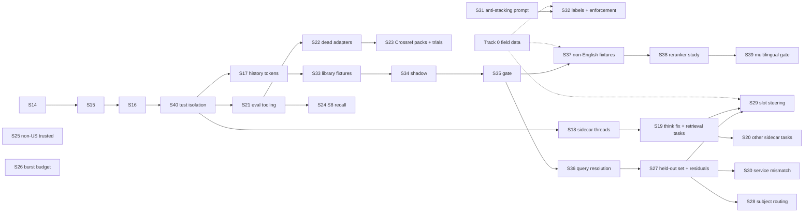

# Qube Knowledge Retrieval — Follow-up Plan (S14+)

**Status:** Plan of record for the work after S1–S13 · created 2026-11-25 · Phases 0–1 merged (PRs #75, #76); Phase 2 in progress (S21, S22 done)
**Predecessor:** `docs/knowledge_retrieval_quality_assessment.md` (the assessment, the S1–S13 plan in its §12, and its progress log). That document is now the closed record of S1–S13; this one carries everything after it.
**Audience:** Engineering, and any new session resuming this work. Start with §7 "Resuming work in a new session".

References such as "V24", "D21" or "§12.4 S8" point into the predecessor document. Numbering continues from it: stages **S14+**, owner decisions **D23+**, validated findings **V33+**.

---

## 1. Purpose and scope

S1–S13 shipped the relevance gate, query resolution, wider recall, the evidence pack, grounding telemetry, robustness fixes and the S13 consolidation (main, PR #73). This plan covers everything they left open:

| Source | Items |
|---|---|
| S13 follow-ups (predecessor §12.4 S13, progress log) | Crossref in the discipline packs; the institutional adapters that return 0 rows (V30); tighter trial-name matching (V31) |
| Future iterations (predecessor §12.7) | Library and memory retrieval (D5); multilingual retrieval (D4); how-to questions sent to scholarly sources ("service mismatch") |
| Carry-overs (predecessor progress log, "Carry-overs") | Sidecar `<think>` truncation (D9); sidecar thread counts (V18); history windowing by tokens (V20); the native engine's `max_tokens` clamp (V21); shadow slot logs and the steering decision (D11); `active_topic` → `subject`; citation enforcement (D13); citation stacking; DuckDuckGo burst budget (V27); reranker in the frozen build (S3); non-US `@trusted` fixtures (V28); chapter-numbered duplicate titles; pool-relative metrics; `test_v2_scientific_bundle` live requests |
| Acceptance rows still **Partial** | S4 (irrelevant kept 8–9 % vs ≤ 5 %), S8 (scientific recall never measured), S9 (LLM resolves 50 % of residuals vs ≥ 70 %). S5 is superseded by S6 |
| Documentation | Out-of-date status lines in the predecessor (closed in S14) |

Out of scope unless the owner adds it: new knowledge services, UI redesign, and changes to the D1–D22 decisions without new evidence.

## 2. Starting state (2026-11-25)

- **Code.** `main` at `0e6944a` (Release 1.3.60) contains S1–S13 as the squash commit `c651eb2` (PR #73), after the phase 0/1 WIP in `f5949e2` (PR #72). The per-stage commits (S1 `2fda486` … S13 `f2492bc`, S8 live re-run `2800b62`) exist only on `feat/knowledge-retrieval-quality`; keep that branch, or its hashes stop resolving. Its merge base with `main` is still `2f4b180`, so a PR from it would show all of S1–S13 again: new work branches from `main`.
- **Release.** 1.3.60 is the first release that ships the reranker (D1) and the spelling variant (D6).
- **Offline eval** (re-run 2026-11-25 on this code; all six replays match `kq_s13_*`, 63 fixtures). Cells: P@k · nDCG@5 · irrelevant kept · relevant recall · abstain correct.

  | Ranker | production queries | standalone queries |
  |---|---|---|
  | token (reranker-free fallback) | 0.72 · 0.75 · 0.28 · 0.81 · 0.86 | 0.77 · 0.74 · 0.23 · 0.80 · 0.92 |
  | embed | 0.74 · 0.76 · 0.26 · 0.83 · 0.86 | 0.79 · 0.76 · 0.21 · 0.84 · 0.92 |
  | ce (shipped, `--pool-mode widened`) | 0.92 · 0.71 · 0.08 · 0.78 · 1.00 | 0.94 · 0.71 · 0.06 · 0.83 · 1.00 |

- **Tests.** The S1–S13 stage test files: 428 passed (2026-11-25). Full suite on `main` `0e6944a`: 4233 tests collected, so **4228 pass** plus the 5 known failures listed in §7. The S13 log's "4209 passed" undercounted; the true S13 figure is 4216 (V34).
- **Field data: none yet.** `~/.qube/logs/qube.log` holds 0 `[QuerySlots] shadow` lines, `llm_debug.log` 0 `citation_grounding` events (last written 2026-11-24 16:48), `routing_debug.log` 1 `query_slots_gate`, and `web_search.log` is empty because the web-search audit log is off. Decisions that need real use start with Track 0 (§4).

## 3. Rules

- **The predecessor's §12.5 rules 1–7 and its working agreement apply unchanged:** one stage at a time; fallback-first; no assertion changed just to pass; telemetry before enforcement; every stage logs before / after metrics; a false assumption stops the stage; no category may regress by more than 1 fixture or 5 points.
- **Branches and PRs.** One branch per phase, from `main` (`feat/kr-followups-phase<N>`), one PR per phase, one or more commits per stage. Ask before every commit and push.
- **Commit messages:** a one-line summary ending in "(SN)", a bullet body, a short metrics paragraph, then `Co-Authored-By: Claude Opus 5.5 <noreply@anthropic.com>`.
- **Documentation.** Each stage adds an "As built (date)" block under its entry in §6, progress-log rows in §8 (deliverables, acceptance with ✓ / ✗ / **Partial**, tests with the full-suite count, baselines), and updates "Last reviewed". New findings become V-rows and owner decisions become D-rows (§8). The plan text in §5–§6 may be amended only by a recorded D-row or a stage's "As built" deviation.
- **Predecessor document.** Closed. Only factual corrections go there, never into its §1–11.
- **Privacy.** Real-use logs stay on the owner's machine. Only aggregate counts and metrics go into this document. Scripts that read real-use logs stay outside the repo. No real conversation text is committed: committed corpora use fixture-generated text, as S11 did, unless the owner decides otherwise. Adapters keep the generic contact `local@qube.app`.

## 4. Track 0 — field data (runs throughout)

Several decisions need data only real use produces. Collection starts now and runs in parallel with every phase. The owner uses the app normally (`@evidence`, `@internet`, `@trusted`, plain web turns, multi-turn follow-ups).

| Signal | Where it lands | Needs | Used by |
|---|---|---|---|
| Shadow LLM slots: `[QuerySlots] shadow {json}` | `~/.qube/logs/qube.log` | Sidecar enabled and loaded (`qube.sidecar.query_slots_shadow_enabled`, default on) | S29 |
| Slot gate per turn: `retrieval_outcome.query_slots_gate` | `~/.qube/logs/routing_debug.log` | Routing debug log on | S29 (invocation rate) |
| Citation grounding: `"event": "citation_grounding"` | `~/.qube/logs/llm_debug.log` (default on) | Reranker on | S31, S32 |
| Retrieval traces: rerank skip reasons (incl. `non_english`), sufficiency, `rerank_dropped`, discovery block cause | `~/.qube/logs/web_search.log` | **Settings → Privacy & data → Web search log** on (`qube.diagnostics.web_search_audit_log_enabled`, default off); query hashing optional | S26, S37, general |

- **Read with** `core/knowledge/retrieval_trace_reader.read_retrieval_traces` (it joins grounding events to their traces), or the Retrieval Inspector.
- **Checkpoint.** At the start of each phase, record the counts per signal in the progress log, so every data-dependent decision states how much data it rests on.

## 5. Phases and execution order

| Phase | Theme | Stages | Changes behaviour | Owner decisions expected | Size |
|---|---|---|---|---|---|
| 0 | Housekeeping and release safety | S14–S16 | Barely | Release CI change; the V21 fix | S |
| 1 | Fixes under every turn | S40, S17–S20 | Yes | Sidecar thread defaults; each re-enabled sidecar task | M–L |
| 2 | Scholarly routing and adapters | S21–S23 | Yes | Keep / gate / drop per adapter; Crossref in packs | M |
| 3 | Measurements that need live runs | S24–S26 | Maybe | Quota days; trusted scope (D19); burst budget | S–M |
| 4 | Follow-up understanding | S27–S30 | Yes | Slot steering; service routing | M |
| 5 | Citation faithfulness | S31–S32 | Yes | Prompt change; human labelling; enforcement | M |
| 6 | Library and memory retrieval | S33–S36 | Yes | Scope; "not found in your documents" wording | L |
| 7 | Reranker study and multilingual | S37–S39 | Yes | Model choice and download size | L |

**Execution order (agreed 2026-11-25):** Phase 0 → 1 → 2 → 6 → 4 → 5 → 7, with Phase 3's live sessions run whenever the API quotas allow (first run of a UTC day for OpenAlex; DuckDuckGo searches ≥ 5 min apart).

- Phases 0 and 1 come first: release safety, and fixes that later phases depend on (the sidecar for S29, the history budget for Phase 6).
- Phase 2 fixes live defects in scholarly routing (§6 S22).
- Phase 6 comes before 4 and 5 for two reasons. Library has had the most recent product work (#67, #68, #71), and its relevance floors are the kind V4 found dead on the web path. Its long run also gives Track 0 time to collect the data that Phases 4 and 5 decide on.
- Stage numbers follow phase numbers, not execution order. S40 was added after the plan was numbered (D25) and runs first in Phase 1.

## 6. Stage details

### Phase 0 — Housekeeping and release safety

#### S14 — Follow-up plan and predecessor close-out

- **Why:** the predecessor's status lines are out of date, and the post-S13 work needs a plan of record.
- **Changes:**
  - this document;
  - in the predecessor: a header pointer to this document; the "Resuming" heading and state (PR #73 → `c651eb2`, 1.3.60, branch kept); the full-suite reference updated to S13's 4209; the phase Summary table; the Git reference table; the "Last reviewed" line; a pointer from §12.7.
- **Acceptance:** documentation only; the predecessor's §1–11 are unchanged (`git diff` shows no edit above §12).

#### S15 — Reranker and spelling data in the packaged app

- **Why:** both features fail silently by design, so a packaging gap would not show as an error.
  - *Reranker:* 1.3.60 is the first release with the reranker. `qube.spec` adds the hidden import `fastembed.rerank.cross_encoder` (S3), but S3's frozen-build smoke test was never run, and no release smoke step loads the reranker. `rerank` never raises: a missing module puts every packaged user on the unscored legacy path, with no gate and no error.
  - *Spelling (suspected, to verify):* `core/knowledge/spelling.py` loads `pyspellchecker`'s word list (`spellchecker/resources/en.json.gz`) at runtime. `qube.spec` does not collect `spellchecker` data files (its `collect_data_files` list has no such entry), and the installed PyInstaller hooks have none for it. If the data is missing, `SpellChecker(language="en")` fails, `_get_checker` switches the feature off, and the S8 spelling variant (D6) never runs in packaged builds.
- **Changes:**
  1. Verify the published 1.3.60 artifacts (Linux first; Windows and macOS where they can be opened here): is `fastembed/rerank` present, is `spellchecker/resources/en.json.gz` present, and does the frozen binary load both? Record the result as a V-row.
  2. Fix `qube.spec` as needed (e.g. `collect_data_files("spellchecker")`, limited to `en.json.gz` if size matters).
  3. Add a release smoke check that the frozen binary can import the reranker module and build an English `SpellChecker`. It needs no model download: the model itself arrives through bootstrap. Covers Linux dist, Windows dist and macOS DMG through the existing smoke scripts (`scripts/release/smoke_linux_dist.sh`, `smoke_dist.ps1`, `smoke_dmg.sh`).
- **Risks:** release CI time; a smoke check that needs network. The check must be offline.
- **Acceptance:** findings recorded; the smoke check fails on a build without the files and passes on a fixed build; a patch release if 1.3.60 is affected (owner decision).
- **Decisions:** the release CI change; whether a patch release is needed.
- **As built (2026-11-25):**
  - **1.3.60 inspected (V33).** The Linux x86_64 CPU tarball and the macOS arm64 DMG were downloaded with `gh release download` and listed without running anything from them: `tar -t`, `7z l` for the DMG, and `pyi-archive_viewer -r -b` for the module archive inside the Linux executable. `SHA256SUMS.txt` covers only the three Windows installers, so these two could not be checksum-verified (carry-over in §7).
    - *Reranker:* `fastembed.rerank.cross_encoder` and its five submodules are in the module archive, and `onnxruntime` ships too. The model is not in the bundle, by design (bootstrap download).
    - *Spelling:* the `spellchecker` modules ship, but `spellchecker/resources/` is **absent** from both artifacts. Control: `language_tags/data`, which the same spec collects, is present in both (16 files each). pyspellchecker reads its word list with `pkgutil.get_data("spellchecker", "resources/en.json.gz")`; without the file that raises `FileNotFoundError`, re-raised as `ValueError: The provided dictionary language (en) does not exist!`. `spelling._get_checker` catches it, logs one INFO line and switches the feature off. **The D6 spelling variant has never run in a packaged build.**
    - *Reproduced* with two minimal frozen builds (PyInstaller 6.22.2, local): without the data, that `ValueError`; with `collect_data_files("spellchecker", includes=["resources/en.json.gz"])`, "inteligence" → "intelligence".
    - *Windows* was not opened: its Inno Setup installer cannot be listed here. It builds from the same spec with no platform-specific data entries, so it is taken to be the same.
    - *Sweep for the same class of gap:* every module that S1–S13 added or changed is in the module archive except `core.knowledge.quality_eval` (eval only). Every third-party import resolves except PyQt6 (compiled extensions, stored outside the archive) and `brotli` (optional, absent in the dev venv too, unchanged since 1.3.54). S1–S13 code reads no runtime data files other than test fixtures.
  - **Fix.** `qube.spec` collects only `resources/en.json.gz` (650 KB of the package's 7 MB; only English is used) and stops the build if the file is not found, rather than shipping without it.
  - **Self-check.**
    - `core/bundle_self_check.py` adds `Qube --self-check-bundle <result.json>`. `qube_entry.run()` dispatches it first, before validation bookkeeping, Qt, the single-instance guard or any model.
    - Checks: the reranker import that `rerank._load_model` performs, and spelling end to end (`spelling.correct_word("Inteligence")` must give "Intelligence").
    - It writes JSON and exits 0 or 1, and needs no network, model or settings. Normal launches pay about 2 ms for the import.
  - **Smoke scripts.** `smoke_linux_dist.sh` and `smoke_dist.ps1` run the self-check after their CUDA branch (CUDA CI still runs only the bundle-layout check, as before); `smoke_dmg.sh` runs it on the mounted, signature-checked app. `release.yml` is unchanged. It runs only on `v*` tags, so CI first exercises these steps at the next release.
  - **Verified on a full local build** (`pyinstaller qube.spec`, PyInstaller 6.22.2, Python 3.12, Linux CPU; 58 s; output outside the repo). The bundle holds only `spellchecker/resources/en.json.gz`. `Qube --self-check-bundle <file>` under a throwaway HOME: `frozen: true`, `reranker_module` ok, `spelling_en` ok ("Intelligence"), exit 0, 1.1 s, nothing written to `~/.qube`. **Negative control:** the same code built with the 1.3.60 spec has no `spellchecker/` data, and the self-check reports `spelling_en: spell checker unavailable` and exits 1, so the new smoke step would have failed the 1.3.60 release job.
  - **Not run here:** the PowerShell script (no `pwsh` on this machine), the macOS script (no macOS), and the full Linux smoke script, whose stale-process cleanup kills any process named `Qube` on the machine. Its self-check command was run directly instead, as above.

#### S16 — Test hygiene and the engine clamp

- **Changes:**
  - `tests/test_scientific_evidence.py::test_v2_scientific_bundle` runs `run_v2_web_retrieval` against live adapters from local preferences (Europe PMC and others are not mocked). Mock the adapters and keep its assertions (bundle service, PubMed call, ≥ 1 source with a DOI).
  - V21: `workers/native_llama_engine.py` (~line 1768) does `int(getattr(self._llama, "n_ctx", 0) or …)`; in llama-cpp-python 0.3.35 `n_ctx` is a method, so `int()` raises and the `max_tokens` clamp is always skipped (`[OutputTokenBudget] clamp skipped`). Call it when callable, as `loaded_n_ctx()` already does (~line 501). llama-cpp itself cuts `max_tokens`, so this removes log noise and makes the clamp do what its code says.
- **Tests:** a unit test for the clamp with a callable `n_ctx`; the mocked test runs offline.
- **Acceptance:** the test makes no network calls; the clamp runs (no "clamp skipped" line in a smoke turn); the full suite matches the reference.
- **Decisions:** the V21 fix (engine owner).
- **As built (2026-11-25):**
  - **Hermetic scientific test (V35).** A probe that records and refuses every DNS lookup and socket connect showed `test_v2_scientific_bundle` reaching six live hosts on every run: `tools.cdc.gov`, `data.cdc.gov`, `ghoapi.azureedge.net` (WHO), `clinicaltrials.gov`, `api.fda.gov` and `www.ebi.ac.uk` (Europe PMC). Discipline routing for a medical question picks them on top of the three mocked adapters, and the test still passed offline because adapters swallow their own errors.
    - Now every adapter in `SEARCH_FUNCTIONS` (58) is replaced by an empty fake; PubMed and OpenAlex keep their fixture rows, and the original assertions are unchanged.
    - The test also asserts that no DNS lookup or connect is attempted. The same guard around the old three-adapter mapping records the six hosts, so the assertion catches a regression.
  - **Engine clamp (V21 → V36).** The clamp moved into `NativeLlamaEngine._clamp_max_tokens_for_prompt` and reads the window through `loaded_n_ctx()`, which calls `n_ctx()` and falls back to the loaded, then the requested window. The log lines are unchanged.
    - *Before:* `int(<bound method>)` raised `TypeError`, so every clamp was skipped and `max_tokens` reached llama-cpp unclamped. llama-cpp cut it to `n_ctx − prompt` itself, so nothing overflowed. This machine's `llm_debug.log` holds 17 "clamp skipped" lines, all this `TypeError`, and no clamp line.
    - *Behaviour change:* when the requested `max_tokens` does not fit, it becomes `n_ctx − prompt − 64` (at least 256), 64 tokens below llama-cpp's own cut. `effective_max_tokens`, which the truncation notice compares against, is now that real budget rather than the unclamped request, so a long prompt that leaves little room can now trigger the notice heuristic where it could not before.
    - *Real model:* Qwen3-1.7B Q6_K on CPU, `n_ctx=2048`, a 1500-token prompt. `type(llm.n_ctx)` is `method`; the clamp gives 4096 → 484 with and without the user cap, logs one `[OutputTokenBudget] max_tokens 4096 -> 484` line, and no "clamp skipped". This calls the method on a real `Llama`; it is not a full app turn.
  - **Tests write into the real `~/.qube` (V37).** Found because `~/.qube/models/search/reranker.download_failed` appeared during the S15 suite run. An audit hook on a full run recorded every write, remove and mkdir under `~/.qube`, per test.
    - Fixed here, as it is this plan's code (S3's back-off marker): `test_reranker_failure_is_reported_not_fatal` wrote the marker into the real `models/search/`, and `test_balanced_search_also_downloads_missing_reranker` deleted it on its success path, so a real failure marker could vanish during a test run. Both now patch `reranker_dir` to `tmp_path` and assert the marker is written or cleared there. With the audit hook, the S16 test files make no write or remove under `~/.qube`.
    - The rest is listed in V37 and is fixed suite-wide by the new stage S40 (D25).
  - **Flaky Qt test (V38).** `test_surface_fill_phase1.py::test_transcript_wallpaper_host_refresh_callback` leaves a background-build callback queued; when it fires after its widget is gone, Qt reports "wrapped C/C++ object of type BackgroundBuildBridge has been deleted". It hit that test itself (FAILED) in the audited run and the next test, `test_surface_fill_phase2.py::test_bundled_wallpaper_assets_exist` (setup ERROR), in the clean run. On a clean worktree of `1b6fb88` the phase-1 file fails this way in 3 of 6 runs. Pre-existing and untouched; §7 lists it as known-flaky.
  - **Full suite** (`-m "not packaging"`, final run, after the marker-test fix): **4251 passed** of 4256 collected (S15: 4244 of 4249, +7 clamp tests) and the 5 known failures; the V38 test passed and then errored at its own teardown. Qt teardown abort as before. The two earlier runs (audited, and clean before the marker fix) gave 4250, because V38 cost one result in each.

### Phase 1 — Fixes under every turn

#### S40 — Keep the test suite out of the real `~/.qube` (V37, D25)

- **Why:** a full run writes into the developer's own data directory (V37): `settings.json`, `model_performance_store.json` (a fake model entry accumulates there), companion state, `logs/`, bootstrap trace files and model markers. Later phases measure from those logs (Track 0) and from local stats, so the suite must not touch them.
- **Changes:**
  - In `tests/conftest.py`, before any app module is imported: point `HOME` (and `LOCALAPPDATA` on Windows) at a per-session temp directory, so `core.paths.user_data_root()` and the 37 direct `Path.home()` / `expanduser("~")` lines in `core/`, `workers/` and `ui/` resolve there. Copy nothing in.
  - Reset module-level switches that leak between tests, starting with `core.bootstrap_trace._ENABLED` (it made `test_knowledge_rerank` write trace files, V37).
  - Fix any test that relied on the real home directory, without weakening its assertions.
- **Tests:** re-run the S16 audit hook over the full suite; it must record **zero** writes, removes or mkdirs under the real `~/.qube`.
- **Risks:** tests that read real models or settings by accident (the S4 reranker fixture already hides the installed model); Windows CI, where `user_data_root()` reads `LOCALAPPDATA`; paths computed at import time before the fixture runs.
- **Acceptance:** zero real-home writes in the audit; the full suite matches the reference; Windows and macOS CI unchanged.
- **Decisions:** none beyond D25.
- **As built (2026-11-25):**
  - **Throwaway home.** `tests/conftest.py` runs `_isolate_user_home()` at import, before any app module is imported. It points `HOME` at `mkdtemp(prefix="qube-test-home-")`, plus `USERPROFILE`, `LOCALAPPDATA` and `APPDATA` on Windows, and puts `XDG_CONFIG_HOME`, `XDG_DATA_HOME` and `XDG_STATE_HOME` inside it, since the QSettings migration and other XDG users would otherwise keep the real home. A cache directory set in `XDG_CACHE_HOME` is left alone. The directory is removed in `pytest_sessionfinish`.
  - **One change from "copy nothing in".** An installed reranker (88 MB, 0.04 s) is copied in, not linked. The two `real_reranker` tests then still run on a developer machine, and no test can change the real model. CI has no model, so nothing is copied there.
  - **Trace switch.** The autouse fixture `_restore_bootstrap_trace_switch` restores `core.bootstrap_trace._ENABLED` and `QUBE_BOOTSTRAP_TRACE`, and removes any console handler a test added (resetting propagation and level).
  - **No test needed changing.** One known failure goes away (V41).
  - **Audit tool.** `tools/pytest_home_audit.py` is the S16 audit hook as a committed plugin; §7 has the command.
  - **Tests.** `tests/test_s40_home_isolation.py` (new, 6 tests):
    - the home is a throwaway directory, with `user_data_root()`, `models_root()` and the settings path inside it;
    - the reranker copy is a real directory;
    - a test that enables the trace leaves the next test with the state from before. Checked negatively: with the fixture's autouse turned off, that test fails.
  - **Cleanup.** The S16 and S17 suite runs before this fix had re-added the fake `registry-model.gguf` entry (2 requests) to the owner's `model_performance_store.json`. It was removed again, with a backup.
  - **Not run here:** Windows and macOS CI, where `LOCALAPPDATA` / `USERPROFILE` and the macOS home are the paths that change.

#### S17 — Token-aware history windowing (V20)

- **Why:** `LLMWorker._bound_session_history` (`workers/llm_worker.py` ~line 1429) keeps the last `max_history_messages` messages (default 10, 2–100), each capped at `CHAT_HISTORY_SINGLE_MESSAGE_MAX_CHARS`. Ten 1500-char turns already reach 4226–4292 real tokens: a 4k window overflows before any retrieval, and the S10 budget then sits at its 1000-char floor. Phase 6 adds library context to the same window.
- **Changes:** after the message-count window, trim the oldest messages until the history fits a token budget derived from the loaded `n_ctx`. Reuse the S10 estimate (`core/retrieval_budget.py`: 4.0 ASCII chars per token, one token per non-ASCII character), and keep the existing first-message-must-be-user rule and the memory v7 salvage hook. Split the window between history and retrieval explicitly, so neither starves the other.
- **Risks:** losing context the user expects on long threads; models with large windows must behave exactly as today.
- **Tests:** the S10 4k / 8k / 32k matrix with real tokenizers (Gemma 4 E4B, Qwen3.5-9B, Phi-4-mini) and history sizes up to the overflow case; unchanged output when everything fits.
- **Acceptance:** no prompt over `n_ctx` minus the answer reserve on the matrix; ≥ 8k windows unchanged on every existing test.
- **As built (2026-11-25, branch `feat/kr-followups-phase1`, stacked on Phase 0):**
  - **Where.** `core/retrieval_budget.py`: `history_token_budget`, `fit_history_to_token_budget`, `HistoryWindow`. Its fixed costs are a shared helper that S10's `retrieval_char_budget` now uses too, with the same numbers. In the worker, `_fit_history_for_turn` runs where the S10 budget is computed: after the sources are known, and before the retrieval budget, which then sizes the block from the kept history. The follow-up resolver, discourse state, query expansion and shadow slots still see the message-count window, unchanged.
  - **Budget.** The room is `n_ctx` − answer reserve − prompt overhead (skills, attachment and tool context included) − 128-token margin, as in S10. On a turn with sources, retrieval keeps `min(its cap, half the room)`, where the cap is 8000 chars = 2000 tokens, and history gets the rest. On a turn without sources, history gets the whole room. Unknown `n_ctx` means no limit.
    - With a 1200-char skills budget: 4k → 1444 tokens of room, so 722 for history with sources and 1444 without; 8k → 2516 / 4516; 32k → 25 044 / 27 044.
  - **Fit.** Newest message first.
    - The current question is always kept. If it alone exceeds the budget, the result is `over_budget` rather than an empty history.
    - If the next message does not fit whole, it is not an assistant turn, and at least 128 tokens remain, its head is kept with the existing "[…message truncated for context window]" marker. This is what keeps the last exchange on a small window.
    - A leading assistant message is still dropped. Kept messages are the original dicts (a truncated one is a copy), and messages older than the cut are never tokenized.
  - **Counting (V39; a change from the plan text, which said to reuse the S10 estimate).** On the native path the worker counts history with the loaded model's tokenizer: `NativeLlamaEngine.count_tokens` calls `llama_tokenize` on the vocabulary only and does not touch the context.
    - The same counter feeds the S10 budget's history term and its block re-fit, which until now re-fitted only non-ASCII blocks.
    - External engines keep the estimate. If a count fails, that text falls back to the estimate.
  - **Trace.** `decision["history_window"]` holds kept, dropped, tokens, budget_tokens, reason, truncated and counter. It is persisted in the routing-debug `retrieval_outcome`. When anything is dropped or truncated, the log shows `[LLM] Chat history token-fitted: kept … of … messages (…)`.
  - **Behaviour change.** Only when history and a full retrieval block do not both fit. Example: the S10 test history, estimate counter:
    - *4k, 10 × 1500 chars, with sources:* before, the block was at its 1000-char floor and the prompt overflowed the window. Now 3 of 11 messages are kept (the last exchange, one message truncated) and the block gets 2888 chars.
    - *8k, same history, with sources:* 7 of 11 messages kept, block 8000 chars (S10 alone: all 11 kept, block 2652).
    - *8k without sources, and 32k at every size up to 10 × 1500:* unchanged.
  - **Real-tokenizer matrix** (scratch script, not committed). Gemma 4 E4B, Qwen3.5-9B and Phi-4-mini tokenizers (vocab-only) × 4k / 8k / 32k × 7 history sizes (up to 30 × 1500 and 10 × 14 000 chars) × with and without sources: 126 cases. History and sources are English prose from the predecessor document with markdown stripped, number tables included.
    - Pipeline as on the native path (model counter, one block re-fit): **0 of 126** over `n_ctx` − answer reserve.
    - Estimate only (the external path): 5 cases over, all 8k with 30 × 1500, using up to 1270 of the 2048-token reserve. No prompt reaches `n_ctx`.
  - **Known limits.**
    - A boundary assistant message is not truncated, since it would lead the history. So with 10 × 14 000-char turns, 4k keeps only the question.
    - The fixed prompt overhead stays an estimate.
    - External engines count by the estimate (V39).
  - **Not changed:** memory v7 salvage, which does not work with or without S17 (V40); it is fixed in Phase 6 (D26).

#### S18 — Sidecar thread counts (V18)

- **Why:** the sidecar's `Llama(...)` (`workers/sidecar_llm_worker.py` ~line 289) passes no thread counts, so llama-cpp-python uses `n_threads = cpu_count // 2` and `n_threads_batch = cpu_count` (SMT included). Measured on the dev laptop: prompt evaluation 63 tok/s at 16 batch threads vs 177 at 8, total p50 5.1 s → 2.3 s. The `inference_transparency` snapshot reports `os.cpu_count()` as `n_threads`, not the model's values.
- **Changes:** pass `n_threads_batch` (and `n_threads`) from the physical core count (`psutil.cpu_count(logical=False)`, already used by `rerank.reranker_threads`; `core/cpu_threads.py` currently detects logical cores only), with a cap that leaves headroom for the main model. Report the real values in the snapshot.
- **Risks:** CPUs without SMT, Apple P / E cores, low-core machines, and contention with the main model during a turn.
- **Tests:** thread selection per CPU shape (mocked psutil); snapshot values.
- **Acceptance:** sidecar prompt evaluation measured before and after on the dev machine, plus at least one other CPU shape if available; no regression in title latency.
- **Decisions:** the default (inference-settings owner).
- **As built (2026-11-25, D27):**
  - **Selection.** `core/cpu_threads.sidecar_llama_threads()` returns `n_threads = min(4, cores)` and `n_threads_batch = cores`. Here `cores` is the physical core count (`psutil.cpu_count(logical=False)`, falling back to half the logical count), capped at the CPUs the process may run on (`os.sched_getaffinity`), because psutil reports the host's cores under `taskset` or in a container.
  - **Wiring.** `workers/sidecar_llm_worker._load_cognition_model` passes both values to `Llama(...)` and logs them on load (`threads=4/8`). The inference-transparency snapshot reports the values the `Llama` holds (`n_threads`, plus the new `n_threads_batch`) instead of `os.cpu_count()`, and the Settings row reads "… on CPU (n_gpu_layers=0, threads 4 / 8 prompt)". The native engine's snapshot is unchanged.
  - **Measured** (Qwen3-1.7B Q6_K, CPU-only llama-cpp-python 0.3.35, Ryzen 7 7840HS, 8 cores / 16 threads; 805-token prompt, median of 3 after a warm-up):

    | Threads (decode / prompt) | Prompt eval | Decode | Title p50 (real `run_title_generation`, profile B, 5 runs) |
    |---|---|---|---|
    | llama-cpp default (8 / 16) | 56 tok/s | 27.0 tok/s | 9270 ms |
    | 8 / 8 | 157 tok/s | 25.6 tok/s | — |
    | 6 / 6 | 139 tok/s | 25.8 tok/s | — |
    | 4 / 4 | 104 tok/s | 24.9 tok/s | — |
    | **4 / 8 (shipped)** | **164 tok/s** | 24.9 tok/s | **2842 ms** |

    Both configurations produce the same title ("Heat Pump vs Gas Boiler").
  - **Second CPU shape.** The process was pinned to 4 distinct cores (`taskset -c 0,2,4,6`), where the selection gives 4 / 4. Against llama-cpp's defaults (8 / 16): prompt 98 → 103 tok/s, decode 18.3 → 24.6 tok/s, title p50 4658 → 4376 ms.
  - **Contention (V42).** A stand-in main model (Phi-4-mini, CPU, 6 threads, the owner's setting) decoded throughout while the sidecar evaluated prompts:
    - with the defaults, the main model fell from 14.1 to **2.7 tok/s** and the sidecar managed 31 tok/s;
    - with 4 / 8, the main model ran at 9.8 tok/s and the sidecar at 76 tok/s;
    - with 4 / 4, 10.6 and 49 tok/s.

    This overlap happens in practice: the S9 shadow slot extraction runs on a background thread during the turn.
  - **Not measured:** GPU builds (this venv's llama-cpp has no offload), Apple P / E cores (psutil counts E cores as physical, so the prompt threads include them), and the main engine (V43, D28).

#### S19 — Sidecar `<think>` fix: mechanism and retrieval-related tasks (D9 follow-through)

- **Why:** on Qwen3, every sidecar task on the raw path (`SidecarLlmWorker._complete_prompt`, ~line 513) returns only `<think>`. Under `/no_think` the model opens an empty think block, and the `"\n\n"` stop from `cognition_stop_tokens` ends generation there. Only titles (chat path) and the S9 `query_slots` task (pre-filled) work. Affected tasks: `source_digest`, `contradiction_judge`, `reflection_label`, `episode_summary`, `ingest_blurb`, `companion_line` and raw prompts (`query_rewrite` is off, D10).
- **Changes:**
  - one mechanism: a per-task opt-in that pre-fills the empty think block on the raw path for Qwen3 formats, exactly as S9 does for `query_slots`;
  - then evaluate and enable the retrieval-related tasks first: `source_digest` and `contradiction_judge`. Each gets fixtures, an output-quality check and latency at S18's thread settings, and is enabled only with an owner D-row. The S9 spot check of `source_digest` without the stop produced an off-topic summary, so working output is not assumed.
- **Risks:** turning on behaviour that has never run in production (why D9 chose a scoped fix).
- **Tests:** recorded completions replayed offline, as `tests/fixtures/query_slots_recorded_s9.json` does; per-task parser tests.
- **Acceptance:** per task: success rate, quality on its fixtures, p95 latency, and an owner decision to enable, keep off, or retire.
- **As built (2026-11-25, D29, D30):**
  - **Mechanism.** `core/cognition_prompt_adapter.prefill_qwen3_empty_think()` appends `QWEN3_EMPTY_THINK` to a ChatML prompt that ends at the assistant header, for Qwen3 models only. `core/sidecar_prompts.QWEN3_THINK_PREFILL_TASKS` is the per-task opt-in that `build_prompt_for_task` checks. **It ships empty** (D29, D30), so no task's prompt changes. `query_slots` now uses the same helper; its prompt is byte-identical (S9 tests unchanged).
  - **Fixture.** `tests/fixtures/sidecar_tasks_recorded_s19.json` holds completions from the bundled Qwen3-1.7B-Q6_K, recorded through the real `SidecarLlmWorker._complete_prompt` (shipped params and stops, S18 threads 4 / 8):
    - **judge:** 36 synthetic fact pairs, 12 per class (duplicate, contradiction, complement), each recorded:
      - as shipped;
      - pre-filled (3 runs);
      - pre-filled with the definitions `EnrichmentWorker._judge_contradiction` builds but never sends (3 runs).
    - **judge gate:** each pair's position relative to the pre-judge gate, computed with the "balanced" embedder and a LanceDB table exactly as `_find_duplicate` searches.
    - **digest:** 6 cases of five chunks each from this repo's docs (4.7–5.6 KB, 1309–1476 prompt tokens), each recorded:
      - as shipped;
      - pre-filled (2 runs);
      - pre-filled without the `"\n\n"` stop (1 run).
    - **turn cost:** what the shipped digest costs a turn.

    `tests/test_s19_sidecar_think_prefill.py` replays all of it through the real parsers and `_judge_contradiction`, and pins every number below.
  - **contradiction_judge** (V44, V45, V46):
    - As shipped, 36 of 36 completions are `<think>`. The production fallback then answers "duplicate" for 35 pairs; the one exception is a keyword-rule hit (likes / dislikes).
    - Pre-filled, the outputs are clean single words, stable across repeats (36 of 36; with definitions 35 of 36), at p50 472 ms / p95 546 ms (with definitions 737 / 856 ms).
    - Label accuracy over all 36 pairs: shipped 13, pre-filled 21, with definitions 22.
    - Only 19 pairs reach the judge (11 of 12 duplicates, 6 of 12 contradictions, 2 of 12 complements), and both "duplicate" and "contradiction" replace the old row. Scored by storage action on those 19 pairs, **the shipped fallback is right 17 times, the pre-filled judge 11, and the definitions variant 8**. The working judge calls 7 of 11 paraphrases "complement", which keeps near-duplicate rows side by side.
  - **source_digest** (V44, V47, V48):
    - As shipped, 6 of 6 completions are `<think>`, and each run still spends 7.9–9.2 s evaluating the prompt.
    - Pre-filled, all 12 runs stop after source [1]: the model writes a blank line between sources and the `"\n\n"` stop ends there. The parser rejects every run (`citation_ids_missing`). The text it did write is faithful to source [1].
    - Pre-filled runs take 11.0–15.2 s (p50 11.8 s, p95 15.2 s) against a 1.5 s foreground timeout (the setting's maximum is 10 s).
    - Without the `"\n\n"` stop, all 6 runs hit the 400-token limit (25.8–27.3 s). 3 still miss source ids, 2 cite a `[6]` when there are five sources, and the parser keeps only the first 1200 chars.
    - **What it costs today:** `digest_rag_context` through the real client blocked the turn for 1501–1502 ms in 6 of 6 cases, and applied nothing (`timeout`). The sidecar then stayed busy for 8.2–9.4 s, overlapping the main model's answer (V42).
  - **Default change (D30).** `qube.sidecar.source_digest_enabled` now defaults to off (`DEFAULT_SIDECAR_SOURCE_DIGEST_ENABLED`). It has no Settings toggle, and an explicit `true` in `settings.json` still turns it on. Output is unchanged, since the digest was never applied; eligible turns no longer wait 1.5 s. `docs/sidecar_tasks.md` §6 notes it.
  - **Not measured:**
    - how often turns are eligible (≥ 4096 chars of retrieved context): the logs record digest outcomes only at debug level;
    - the real distribution of fact pairs reaching the judge: synthetic pairs, labelled by hand.

#### S20 — Sidecar `<think>` fix: remaining tasks

- Same method as S19 for `reflection_label`, `episode_summary`, `ingest_blurb`, `companion_line` and raw prompts. These are outside retrieval quality. They are here because they share S19's mechanism and are broken in production today, and they can be reordered or handed off by owner decision.
- **As built (2026-11-25, D31–D33):**
  - **Mechanism.** The opt-in now applies at the single exit of `build_prompt_for_task`, so prompts from their own builders (companion lines) are covered too; titles are excluded explicitly. `QWEN3_THINK_PREFILL_TASKS` ships `{ingest_blurb, episode_summary}`.
  - **Fixture.** `tests/fixtures/sidecar_tasks_recorded_s20.json` was recorded the same way as S19's:
    - 20 synthetic memories, 4 per reflection label;
    - 8 synthetic conversations: 5 real tasks and 3 small talk;
    - 19 ingest samples: the real first ingest chunk of repo docs, 6 of them heading-only, plus joined samples for those 6;
    - 6 companion payloads (v1, the default path) with 3 runs each.

    `tests/test_s20_sidecar_tasks.py` replays it through the production parsers, `MemoryReflectionWorker._call_llm` / `_parse_label`, and `EnrichmentWorker._summarise_session_now`.
  - **ingest_blurb** (V50, D31):
    - **As shipped:** 0 of 19 blurbs (`<think>`). The owner's library shows the same: 76 documents, 0 blurbs.
    - **Pre-filled:** 19 of 19 blurbs. They are grounded when the first chunk has content: overlap with the sample is 0.40–0.89 across 13 of 13 cases, all accurate on reading. They are invented when the first chunk is only a heading (16–32 chars): overlap 0.00–0.29 in 6 of 6, for example "an executive assessment of the company's financial performance".
    - **The fix:** `core/sidecar_prompts.build_ingest_blurb_sample()` joins the first chunks up to 2500 chars, and `workers/ingestion_worker.py` uses it. On the 6 heading-only cases this gave overlap 0.60–0.85, with every blurb on topic.
    - **How common:** 6 of the owner's 76 documents have a first chunk under 100 chars, and 35 under 200.
    - **Latency:** p50 1.6 s, p95 3.5 s; about 5 s with the joined sample (634–683 prompt tokens), in the background.
    - New imports only; existing documents are not backfilled.
  - **episode_summary** (V51, D32): runs only with memory enrichment on, which is off by default.
    - **As shipped:** `<think>`, so no episode has ever been written.
    - **Pre-filled:** 5 of 5 real conversations are summarised in 24–28 words, keeping 3 or 4 of their 3–4 key terms. The 3 small-talk chats never get SKIP (for example "The user thanked the assistant."), and the gates do not reject them either.
    - **The guard:** `EnrichmentWorker` now skips the summariser when the window's user messages total under `EPISODE_SUMMARY_MIN_USER_WORDS = 20` words. In the fixture the real chats have 33–54 user words and small talk 1–5. With the guard: 5 of 5 written, 0 of 3 small-talk chats (no sidecar call).
    - **Latency:** p50 3.3 s, p95 3.9 s.
    - **One existing test's input changed:** `tests/test_episode_summary.py::test_idle_gate_fires_on_second_turn` used four 3-word turns ("user turn i", 12 words). Its turns now carry content; its assertions are unchanged. A new test there checks that small talk is not summarised.
  - **reflection_label** (V49, D33): **works as shipped**, so S9's "every raw-path task returns only `<think>`" does not hold for it.
    - Its prompt is flat text with no chat template, so Qwen3 never opens a think block, and it answers `Just the JSON. {"label": ...}`.
    - 16 of 20 labels are right; the 4 "unclear" memories get "transient". All 20 flag decisions are right, since both labels are flagged.
    - Latency p50 4.0 s, because it runs to the 64-token limit. A ChatML-plus-pre-fill variant gives the same labels in 2.1 s. Not adopted (D33).
  - **companion_line** (V52, D33): off by default.
    - Pre-filled, all 18 runs return the example line from its own system prompt (`Good: {"line":"Still here if you need me.",...}`), whatever the trigger.
    - Kept off. The prompt needs separate rework.
  - **Raw prompts** (V53, D33): `SidecarLlmClient.generate` has no production callers. Left in place.
  - **Not measured:**
    - real memory payloads and conversations (synthetic fixtures; the owner's memory store is empty and enrichment is off);
    - companion cognition v2 payloads (off by default).

### Phase 2 — Scholarly routing and adapters

#### S21 — Eval tooling: shared-pool metrics and duplicate titles

- **Changes:**
  - `relevant_recall` and nDCG are scored against each run's own pool, so `--compare` across pool sizes or routing arms flags false regressions (predecessor S8 results). Add a shared-pool mode that scores every arm against the union of labelled rows, and use it in `tools/evaluate_heuristic_ab.py` and `--compare`.
  - Title dedupe in `core/knowledge/adapter_collection._normalize_title` misses chapter-numbered duplicates ("2 EVIDENCE FOR DARK MATTER…" vs "Evidence for Dark Matter…"). Strip a leading section number before comparing. This changes which rows survive a merge, so it is measured on the corpus like a behaviour change.
- **Acceptance:** existing baselines unchanged in the default mode; the shared-pool mode reproduces the S8 like-for-like table; the dedupe change passes rule 7.
- **As built (2026-11-25, D34):** three commits, each measured on the six replays and the A/B.
  - **Shared-pool scoring** (`359306e`).
    - `core/knowledge/quality_eval.py`: `shared_pool()` is the union of the compared runs' pools, every candidate one of them ranked. `shared_pool_reports()` re-scores each run's kept rows against it: nDCG@5, relevant recall, and abstain-correct through the derived `expect`. Precision and the irrelevant-kept rate depend only on the kept rows.
    - Reports now record `kept_labels`. Older stored runs are labelled from their kept titles. Where two rows share a title with different labels (one fixture per stored baseline: `trusted_census_texas_population` or `kq_trusted_who`), the run's own stored metrics settle which row was kept.
    - `tools/evaluate_knowledge_quality.py --compare <baseline> --pool-scoring shared` compares on shared pools, over the fixtures both runs evaluated, and lists any fixture it cannot score. `tools/evaluate_heuristic_ab.py` adds both arms' nDCG@5 and recall on the union of their pools; its gain counts are unchanged.
    - Why the union of the compared pools and not the whole capture: both reproduce the S8 web table, since web captures are 8 rows. But the whole capture scores scientific runs against about 13.5 rows that no shipped depth fetches (S7 → S8 scientific recall 0.63 instead of 0.82).
  - **Replay merge** (`7dca68c`; V54, D34). The scientific replay now leaves out the rows production's `rrf_merge` fuses into an earlier one (`adapter_collection.first_seen_unique` on `merge_keys`). This applies in `fixture_pool` and in shared pools. Reports record `replay_merge`; runs stored before S21 are rebuilt unmerged, so old baselines still re-score. New baselines `kq_s21_*`.
  - **Section-number title key** (`962f5d5`). `adapter_collection._normalize_title` strips a leading section number ("2 ", "2.1 ", "3. ", one or two digits per part) when at least 4 words remain. Generic chapter names ("2 Methods", "4 Results and discussion") keep their number, and so do "10-K", "27-hour …", "2001: …" and "100 Years …".
    - Of 950 fixture titles, one changes key: "5 The Scientific Consensus &amp; the Counterfactual" in `s13_trial_false_consensus`. Its unnumbered twin sits on the same general-route pool.
    - `pipeline_scientific._dedupe_rows` (cache path) and deep research keep their own normalisers. Cached rows are `rrf_merge` output.
  - **Shared-pool A/B** (the S23 starting point; unchanged by the title key). Cells give nDCG@5 and relevant recall, heuristic on / off:

    | heuristic | CE production | CE standalone | token production | token standalone |
    |---|---|---|---|---|
    | discipline routing | 0.583 / 0.598 · 0.513 / 0.590 | 0.588 / 0.620 · 0.571 / 0.643 | 0.556 / 0.561 · 0.474 / 0.449 | 0.551 / 0.564 · 0.512 / 0.464 |
    | trial boost | 0.735 / 0.735 · 0.758 / 0.758 | 0.737 / 0.737 · 0.819 / 0.819 | 0.692 / 0.681 · 0.697 / 0.697 | 0.670 / 0.659 · 0.674 / 0.674 |

    With the reranker, discipline routing keeps fewer of the relevant rows the two routes find together (recall 0.513 against 0.590 on production queries). This matches S13's five Crossref losses, which S23 measures.
  - **Not measured:** a live merge. The S8 dark-matter pair was never captured, and no fixture has a chapter-numbered pair on the default route.

#### S22 — Institutional adapters that return 0 rows (V30)

- **Why:** on the S13 cases NICE, WHO, NIST, IETF RFC, IEEE Xplore, USPTO PatentsView, EPO Espacenet, BLS and Eurostat returned 0 rows, and US Census failed on the 1 MB fetch limit. They stay in the discipline packs (`core/knowledge/scientific_discipline_packs.py`). **The engineering pack's *primary* adapters are IEEE Xplore, NIST and IETF RFC**, so keyless engineering turns rely on the arXiv / OpenAlex fallbacks. Chemistry lists PatentsView and Espacenet; economics lists Eurostat and BLS; medicine lists NICE and WHO.
- **Found while planning (2026-11-25, to confirm):** IEEE Xplore, NIST, NICE, PatentsView, EPO OPS, BLS and US Census look up credentials through `credential_resolver.authorization_token`. BLS skips its live search without a key ("API key required"). Several are therefore likely key-gated, as Semantic Scholar was (V8). IETF RFC and Eurostat have no key path, so their 0 rows have another cause.
- **Changes:**
  - per adapter, a live diagnosis (no OpenAlex quota needed): key-gated, broken query or endpoint, or genuinely empty for these questions;
  - then per adapter: fix it; skip it when no key is configured, so it costs no deadline time and the trace names the skip; or drop it from its pack.
  - The 1 MB limit: US Census uses the API path (`knowledge_get`), not the page fetch that S12 truncates. Decide whether that endpoint needs a larger limit or a narrower query.
- **Risks:** removing a source that works with a key some users have. Prefer "skip without key" to removal.
- **Acceptance:** each adapter has a recorded status (V-row); no pack's primary adapters are all dead for keyless users without a recorded decision; per-category replay passes rule 7.
- **Decisions:** keep / gate / drop per adapter.
- **As built (2026-11-25, D35–D39):** four code commits. Each was measured on the six replays, and the pack change also on the A/B.
  - **Status per adapter** (live and keyless, on the S13 questions and short terms; V55–V58):

    | adapter | where it was | status | outcome |
    |---|---|---|---|
    | IEEE Xplore | engineering primary | key required (403 "Developer Inactive" without one) | skipped without a key (D35) |
    | NICE | medicine fallback | key required (401) | skipped without a key (D35) |
    | EPO OPS | chemistry and engineering fallback | credentials required (403, fair use) | skipped without a key (D35) |
    | USPTO PatentsView | chemistry and engineering fallback | dead: `search.patentsview.org` does not resolve | retired (D36) |
    | BLS | economics fallback, finance default | dead: no series search (`/timeseries/search` 404) | retired (D36) |
    | Eurostat | economics fallback, finance default | dead: discovery search 404 | retired (D38) |
    | WHO GHO | medicine fallback | wrong query and corpus (first word, indicator names) | out of the pack (D37) |
    | NIST NVD | engineering primary | wrong corpus (CVE database) | out of the pack (D37) |
    | IETF RFC | engineering primary | wrong endpoint (the API index) | fixed (D38) |
    | US Census | no pack | 5.2 MB catalog over the 1 MB limit; stopword matching | unchanged (D38) |

  - **Key gate** (`1c9a85f`, D35). `core/knowledge/adapter_key_gate.py` (`missing_required_key`, `split_keyless`). The scientific, finance, legal and generic pipelines leave out every adapter whose credential spec is `key_required` and that has no key, before any task is built. They list each one in the diag as `adapter_skips` (`{"adapter", "reason": "no_key"}`; scientific under `scientific_pool`). Optional-key adapters and fixture mode are never gated. The replay is unchanged, since these adapters have no captured rows.
  - **Stamped route refreshes** (`78f2585`, D39). `quality_eval.POOL_REFRESHES` lists the refreshes, oldest first ("S22"). `tools/capture_knowledge_fixture.py --refresh-routes` requires `--refresh-stage` and records `{"refresh", "moved": "out" | "in"}` in `pool_moves` on each hit it moves. Reports record `pool_refresh`. `fixture_pool(as_of=…)` rebuilds a pool as of a refresh, and stored runs rebuild the pool they ranked, as `replay_merge` does since S21. All 64 committed baselines re-score on their own pools with no skipped fixture. Without the stamps, 29 production-mode baselines skipped 2–3 fixtures and 6 standalone ones skipped 1.
  - **Retirements and pack changes** (`0e2f58b`, D36–D38).
    - PatentsView, BLS and Eurostat leave `SEARCH_FUNCTIONS` (`registry.RETIRED_ADAPTERS`). Their 7 catalog entries are no longer implemented or default-enabled, so stored preferences cannot turn them back on, and readiness says why. The modules stay for a later rewrite.
    - WHO leaves the medicine pack and NIST the engineering pack. Both stay registered for explicit selection.
    - Packs now: medicine fallback without WHO; chemistry fallback `chembl, chemrxiv, epo_espacenet, openalex, pubmed`; economics fallback `world_bank, oecd, openalex, ssrn`; engineering primary `ieee_xplore, ietf_rfc`, fallback `epo_espacenet, arxiv, openalex`. Finance defaults are `sec_edgar, fred, world_bank, oecd`.
    - Fixtures: `--refresh-routes --refresh-stage S22` rewrote 12 scientific routes. 17 WHO hits left the default pool (`kq_ace_hf_single` 8, `sci_abstain_fictional_drug` 6, `s13_qt_trial_registry_psilocybin` 3), all labelled irrelevant. Rows and labels are unchanged. New baselines: `kq_s22_*`.
    - Against `kq_s21_*`: 0 regressions in all six runs, per category and per path. Token and CE keep the same rows. The embed fallback keeps better rows on 2 fixtures (V59): nDCG@5 0.762 → 0.770 on production queries (biomedical 0.716 → 0.785), 0.759 → 0.763 standalone. The S13 A/B summaries are unchanged.
  - **IETF RFC** (`0ac14f2`, D38). `core/knowledge/adapters/ietf_rfc.py` queries the document resource for RFCs (`/api/v1/doc/document/`, `type=rfc`, 50 per page). The query's most specific term goes in the title filter and the next one in the abstract filter; specificity ranks acronyms first, then terms with digits, then length. When that pair finds nothing, the title term runs alone. Results are ranked locally on whole words: a title match counts 2 and an abstract match 1. At least two terms must match (one for a one-term query), and ties go to the shorter title, then the newer RFC. The snippet carries the standards level and the abstract. There is no publication date, since Datatracker's `time` is the record's last change.
    - Live, on 18 questions (13 about networking, 2 S13 cases, 3 other engineering questions): the old adapter returned rows for 0 and the new one for 13, all the networking ones (RFC 9002 for QUIC congestion control, RFC 7636 for OAuth PKCE, RFC 9114 for HTTP/3). The 5 empty ones are outside networking, the NIST CSF question included. One search took 236–583 ms (one or two calls).
    - The replay is unchanged: no fixture holds an IETF row.
  - **Acceptance check.** For a keyless user, every pack has at least one primary adapter that runs. Engineering has 1 of 2 (IETF RFC; IEEE Xplore is skipped); before S22 it had 0 of 3.
  - **Not measured:** live S13 turns with the new packs; keyed runs of IEEE Xplore, NICE and EPO OPS; IETF rows in the labelled corpus.

#### S23 — Crossref in the discipline packs, and trial-name matching

- **Crossref (S13 follow-up):** all 5 losses from discipline routing in the S13 A/B are Crossref rows that the general route reaches but the discipline packs leave out (DAPA-HF and Bell-test commentaries, a QE retrospective, a euro-area unemployment report). The A/B already replays them offline. Re-run it with Crossref added to the packs as S22 leaves them, measured with S21's shared-pool scoring, then check live latency and Crossref's concurrency limit (S8 saw 429s on a second request).
- **Trial-name matching (V31):** the plain word "consensus" fires the CONSENSUS signal, and "dapa" inside "dapagliflozin" counts as a DAPA-HF title hit (`core/knowledge/ranking/trial_grounding.py`, `core/knowledge/entities/trials.py`). It affects only the reranker-free fallback (0 changes with the reranker in S13). Tighten it to case and word-boundary rules, and measure on the token ranker.
- **Acceptance:** rule 7 on both rankers; one commit per change with before / after metrics (S13 practice).

### Phase 3 — Measurements that need live runs

Run on quota days, alongside other phases. Each session is planned in advance with its search count.

#### S24 — S8 scientific recall (closes S8 Partial)

- Re-capture the `sufficient` scientific cases with the shipped union (query variants, spelling variant, Crossref), label the new rows blind (D3), and measure relevant-in-pool recall against the S2 captures: target ≥ 15 % relative.
- Cost: about 20–35 OpenAlex searches, one UTC day's first run.
- Needs S21 (shared-pool scoring).

#### S25 — Non-US `@trusted` fixtures (V28, D19)

- About 5 cases with non-US official sources (NHS, gov.uk, europa.eu, a non-US statistics office), captured with and without the S12 `site:` scope.
- Up to about 10 DuckDuckGo searches, ≥ 5 min apart, stopping at the first block (V27).
- May reopen D19 (the 4-site scope).

#### S26 — DuckDuckGo burst budget (V27)

- Qube's budget allows 6 searches per 10 minutes, and the S12 live check was challenged inside it.
- Decide from Track 0 traces (block causes per day of real use) plus the S25 session, not from a dedicated stress run.
- **Decision:** keep, lower, or make adaptive.

### Phase 4 — Follow-up understanding

#### S27 — Held-out follow-up set v2 and the deterministic residuals

- **Why:** the corpus said 100 %, and unseen phrasings got 5 of 13 (V19).
- **Changes:**
  - first, write a new held-out set (≥ 20 cases) before any code, frozen in the repo with its creation date;
  - then target the S9 residuals: list references ("And the second point?"), facet nouns read as new subjects ("Is the garbage collector a problem for latency?" after Go), a facet question about something else (sourdough → kitchen temperature), a multi-hop "there" (Canberra), and statement openers without an -ing verb ("My daughter was just diagnosed with asthma.").
- **Acceptance:** improvement on both the old and the new held-out sets; 0 false anchors on topic switches; `routing_text` unchanged on the router corpus unless S28 changes it.

#### S28 — Routing on `subject` instead of `active_topic`

- **Why:** `active_topic` still holds the legacy value (the S6 deviation). On the ANT turn it reads "Artificial Inteligence", and it feeds routing and the prompt salience hints.
- **Changes:** move these consumers to `subject`, measured on the 125-route router corpus (`tools/evaluate_router.py`) and the query-resolution cases.
- **Acceptance:** route changes listed case by case and owner-approved; no regression.

#### S29 — LLM slot steering decision (D11 follow-through)

- **Inputs:**
  - Track 0 shadow logs (how often the gate schedules, how often slots are valid, how often they beat the deterministic subject);
  - S18 / S19 sidecar latency;
  - the S27 held-out results. S9 resolved 50 % of residuals against a ≥ 70 % target.
- **Outcomes:** keep shadow, steer only when validated and the deterministic path left the turn unresolved, or retire.
- **Decision:** owner.

#### S30 — How-to questions sent to scholarly sources (predecessor §12.7)

- **Why:** the gate cannot detect "on topic but the wrong kind of source" (V1: an OAuth how-to sent to scholarly indexes).
- **Changes:** fixtures first (how-to and practical questions on `@evidence` and on the default service). Then measure a signal: an `answer_type` from the slots, or a deterministic one with corpus evidence (rule 7 forbids an untested keyword list).
- **Decision:** whether an explicit `@evidence` may fall back to web or trusted sources, as `@research` sub-questions already do (D14).

### Phase 5 — Citation faithfulness

#### S31 — Citation stacking prompt change

- **Why:** in S11, 19 % of cited pairs were unsupported, mostly stacks of citations after one sentence.
- **Changes:** a prompt change in `CITATION_DISCIPLINE_SUFFIX` (`core/memory_filters.py`) and the persona rules ("cite only the sources that state the sentence"), measured with `tools/evaluate_citation_grounding.py` on newly generated answers. Phi-4-mini is fast; Qwen3.5-9B takes about 43 s per answer on CPU, so it gets a subset.
- **Acceptance:** fewer unsupported cited pairs, no fall in supported citations per answer, Phase 1 contract flags ok.
- **Decision:** the prompt change.

#### S32 — Human labels and the enforcement decision (D13 follow-through)

- **Changes:**
  - The owner labels real-use cited pairs from Track 0 grounding events collected after S31 (the mix enforcement would face), locally. Target: a few hundred pairs, with at least 40 unsupported.
  - Calibrate the grounding score against these labels, then propose strip / caution / stay off for `get_citation_integrity_enforce()`.
  - Revisit the 8000-char cap (D12) only if the labels show harm from truncated sources.
- **Decision:** enforcement (owner).

### Phase 6 — Library and memory retrieval (predecessor §12.7, D5)

Correction to the planning summary given in chat: Library and memory search **do** have relevance floors. These are cosine floors on embedding scores:

- `mcp/rag_tool.MIN_RAG_SEMANTIC_SCORE = 0.30` (T4.1);
- `mcp/memory_tool.MIN_SEMANTIC_SCORE = 0.35` (v6.1).

What they lack is the cross-encoder gate, the sufficiency state and honest "not found" wording. V4 found the same kind of floor dead on the web path (jina-v2 cosine 0.62–0.91 for every row), so the first job is to measure whether these floors filter anything with the shipped embedders.

**Carried in (D26):** memory v7 salvage never receives dropped messages (V40). Fix it in this phase: keep message ids through `_bound_session_history`, and collect the ids of messages dropped by both the message-count window and S17's token fit (`HistoryWindow`). Salvage stays off by default; turning it on is a separate owner decision.

#### S33 — Library and memory fixtures, and a baseline

- **Fixtures:** library chunks (long, local) and memory entries (short stubs), built from a synthetic or owner-approved document set, never private documents, including:
  - abstain cases (the question is not in the library, e.g. T4.1's "Why is the sky blue?" against an unrelated library);
  - multi-turn cases.
- **Baseline:** what the current floors keep and drop. The existing `tests/test_rag_relevance_gate.py` behaviour stays pinned.
- **Paths:** `core/knowledge/pipeline_internal_corpus.py` (`@library`, `@help`), `mcp/rag_tool.rag_search` and `mcp/memory_tool.memory_search` (plain-chat RAG and memory, wired from `workers/llm_worker.py`).

#### S34 — Reranker in shadow on library and memory

- Score candidates with the S3 cross-encoder in shadow, record score distributions per corpus type, and calibrate thresholds separately for chunks and stubs. They score differently from web snippets and abstracts.

#### S35 — Library and memory gate, and "not found in your documents"

- Gate on the calibrated thresholds; set the sufficiency state; the insufficient wording for documents ("Your documents don't cover this…"), distinct from the web wording; dropped chunks only in the inspector (D2).
- Fallback-first: without the reranker, today's floors are unchanged.
- **Decision:** the wording.

#### S36 — Query resolution for library and memory

- S5 / S6 changed only `web_text`; `retrieval_text` (memory and RAG) and `routing_text` were left alone on purpose.
- Apply the S5 frame stripping, acronym expansion and S6 subject anchoring to library and memory retrieval, measured on S33's multi-turn cases.

### Phase 7 — Reranker study and multilingual (predecessor §12.7, D4)

#### S37 — Non-English fixtures and the size of the gap

- Count `non_english` reranker skips from Track 0 traces to size the gap.
- Add non-English fixtures (a few languages the owner chooses) across paths, labelled like S2.

#### S38 — Reranker model study

- **One study serves two needs:**
  - multilingual coverage;
  - the right-subject, wrong-facet rows that keep scientific irrelevant-kept at 8–9 % against S4's ≤ 5 %, plus the 3 web cases where a partial page beats a relevant one (predecessor carry-overs).
- **Candidates must be permissively licensed.** `jina-reranker-v2-base-multilingual` is ruled out (CC-BY-NC). `bge-reranker-base` / `-v2-m3`-class models need size and latency checks.
- **Criteria:** separation on the S2 corpus and S37's fixtures, latency for 40 × 800-char rows at 2 and 4 threads (S3's bar: p95 ≤ 1.0 s), download size and RSS.
- **Decision:** the model and its download (a D1-type decision).

#### S39 — Multilingual gate and cleanup

- If S38 picks a model:
  - language detection at the gate;
  - the multilingual model for non-English turns (or for all turns, if it wins on English too);
  - language-aware frame stripping and acronym rules (S5 is English-only).
- `UNSCORED` stays the fallback.

## 7. Resuming work in a new session

A new session has no memory of earlier ones. Read this section, then §3–§6, then the open stage's entry and the progress log.

**State.** Phase 0 (S14–S16) is merged to `main` as PR #75 (`267f042`, squash). Phase 1 (S40, S17–S20) is merged as PR #76 (`7997755`, squash); its stage commits (S17 `e2136dd`, S40 `57545a8`, S18 `4f88385`, S19 `b05a67c`, S20 `6695542`, CHANGELOG `da76bee`) live on `feat/kr-followups-phase1`. Phase 2 is in progress on `feat/kr-followups-phase2`, branched from `7997755`: S21 is done in three commits, shared-pool scoring `359306e`, the replay merge `7dca68c` (V54, D34) and the section-number title key `962f5d5`. S22 is done in four: the key gate `1c9a85f` (D35), stamped route refreshes `78f2585` (D39), the retirements and pack changes `0e2f58b` (D36–D38) and the IETF RFC fix `0ac14f2` (D38). **Next: S23**, the last stage of Phase 2; after Phase 2 the order is 6 → 4 → 5 → 7 (D23). D26: the salvage fix goes to Phase 6.

**Starting a phase** (Phase 2 next):

1. Check the previous phase's PR: `gh pr view <n> --json state,mergedAt` and `gh pr checks <n>`. If it is merged, `git fetch origin` and branch `feat/kr-followups-phase<N>` from `origin/main`. If it is still open and the owner wants to go on, branch from its head and rebase after the merge, as Phase 1 did. PRs land as one squash commit, so rebase with `git rebase --onto main <old base commit> <branch>`.
2. Record a Track 0 checkpoint row (§4, §8), as counts only. Run these in `~/.qube/logs`: `grep -c '\[QuerySlots\] shadow' qube.log`, `grep -c query_slots_gate routing_debug.log`, `grep -c '"event": "citation_grounding"' llm_debug.log`. For traces: `.venv/bin/python -c "from core.knowledge.retrieval_trace_reader import read_retrieval_traces as r; print(len(r(limit=100000)))"`.
3. Run the full suite with the home audit (below) and confirm the reference count before changing anything.
4. Read the phase's stages in §6, then work through them one stage at a time.

**Each stage:**

- **Measure before you change anything.** Put a finding that contradicts the plan in a V-row, and stop to check with the owner if it invalidates the stage (rule 6).
- **Owner decisions.** Present the measured options, with a recommendation, as a question. Record the answer as a D-row. Behaviour defaults, enabling or dropping a feature, and anything the stage's "Decisions" line names are the owner's.
- **Close out.** Write the "As built" block, the §8 rows (deliverables, tests with the full-suite count, acceptance) and "Last reviewed". Then ask before committing.

**Each phase:**

- Add a CHANGELOG `[Unreleased]` commit for the user-visible changes, in the existing `- **Area:** …` style. `tests/test_prepare_release.py` reads that file.
- Then ask before pushing and opening the PR.
- **PR description.**
  - Fill in `.github/pull_request_template.md`.
  - Claim only what was run, and state what was not.
  - Check every number against this document.
  - End with the Claude Code line.
- **CI.** `.github/workflows/ci.yml` runs one Windows `test` job on PRs to `main`, in about 25 min. `main` needs a review before merging, and the owner merges.
- **Editing the description.** `gh pr edit` fails with "Projects (classic) is being deprecated". Use `gh api -X PATCH repos/dagaza/Qube/pulls/<n> -F body=@<file>` instead.

**Commands** (repo root, `.venv`):

- Targeted tests: `.venv/bin/python -m pytest -q -p no:cacheprovider tests/<files>`.
- Full suite: `QT_QPA_PLATFORM=offscreen HF_HUB_OFFLINE=1 .venv/bin/python -m pytest -v -p no:cacheprovider -p no:warnings -m "not packaging" tests > <log> 2>&1`.
  - The process ends with the known Qt teardown abort (exit 134, no summary line), so count results from the log: `grep -o PASSED <log> | wc -l` and `grep -o FAILED <log> | wc -l`. Do **not** count ` PASSED` with a leading space: a test that prints output pushes its result to the start of the next line, and that count misses it (V34).
  - Cross-check against the collected count: `... -m "not packaging" --collect-only -q tests | tail -1` must equal passed + failed (+ skipped).
  - Reference (S22): **4409 passed** of 4413 collected, the 4 known failures below; S21 4366 of 4370; S20 4331 of 4335; S19 4319 of 4323 (measured 4318: the V38 flake hit once); S18 4298 of 4302; S40 4284 of 4288; S17 4277 of 4282 and S16 4251 of 4256 (5 failures then; S40 fixed the winget one, V41); S15 4244 of 4249; on `main` before S15, 4228 of 4233. Known-flaky (V38): `test_surface_fill_phase1.py::test_transcript_wallpaper_host_refresh_callback` can fail, error at its teardown (an extra ERROR, pass count unchanged), or leave `test_surface_fill_phase2.py::test_bundled_wallpaper_assets_exist` with a setup ERROR or a FAILED (pass count one lower; the FAILED form was seen at S19). Exactly these 4 failures: `test_linux_ggml_release_verify.py` ×2 (`test_broken_deb_lib_fails_avx_vnni_stub`, `test_broken_deb_q8_uses_vex_vnni`) and `test_type_to_search.py` ×2 (`test_skips_when_history_search_focused`, `test_skips_when_other_text_field_focused`). Any other failure is new. (`test_winget_validation.py::test_explicit_smoke_validation_skips_consent_and_applies_shortcut` failed only because the suite read the real home, V41.)
- Offline eval (needs the reranker model at `~/.qube/models/search/reranker/`): `HF_HUB_OFFLINE=1 .venv/bin/python tools/evaluate_knowledge_quality.py --corpus eval/retrieval_corpus/v1_knowledge_quality.json --ranker <token|embed|ce> --query-mode <production|standalone> [--pool-mode widened] [--json] [--compare <baseline>]`.
  - Compare against `eval/retrieval_corpus/baselines/kq_s22_*` (since S22 WHO's rows are out of the default pool, D37; before that `kq_s21_*`, whose replay merges its pool, D34, and `kq_s13_*`), using `--pool-mode widened` for `ce`. Always pass the relative `--corpus` path.
  - Runs with different pools (depth, routing arm, an older baseline): add `--pool-scoring shared` to `--compare` (S21).
  - After a pack change, refresh the fixtures' routes with `tools/capture_knowledge_fixture.py --refresh-routes --refresh-stage <SN>`. Add the stage to `quality_eval.POOL_REFRESHES` first: each moved hit records it, so older runs still rebuild the pool they ranked (D39). S23's Crossref change is the next refresh.
  - Under a scratch `HOME`, copy `~/.qube/models/search` (212 MB) into it first, or `embed` and `ce` report the model missing.
- Heuristic A/B: `HF_HUB_OFFLINE=1 .venv/bin/python tools/evaluate_heuristic_ab.py` (S13).
- Citation grounding: `HF_HUB_OFFLINE=1 .venv/bin/python tools/evaluate_citation_grounding.py [--json] [--compare eval/citation_grounding/baselines/s11.json]`.
- Follow-up subjects: `eval/router_corpus/followup_subjects_v1.json` (S9 held-out set); router: `tools/evaluate_router.py`.
- Scratch scripts and benchmark outputs stay outside the repo; only baselines and fixtures are committed.
- Real-home audit (S40): `QUBE_HOME_AUDIT_OUT=<file.jsonl> PYTHONPATH=tools .venv/bin/python -m pytest -p pytest_home_audit -m "not packaging" tests` (add the full-suite flags above). The file must stay empty; close a running Qube first, since it writes its own logs.

**Live checks.**

- OpenAlex runs keyless: 1000 credits a day at 10 per search, so about 100 searches, reset at 00:00 UTC. Check the budget with one search (`https://api.openalex.org/works?search=test&per_page=1`, User-Agent `Qube/1.0 (mailto:local@qube.app)`) and read `x-ratelimit-remaining`.
- DuckDuckGo: ≥ 5 min between searches; stop at the first block and wait out the 30-min backoff (V27).
- Before trusting an OpenAlex-dependent result, check `api.openalex.org` in `http_summary` shows no 429.
- The S8 live ANT check snippet is in the predecessor's "Resuming" section.

**Working practices (learned in Phases 0–1).**

- **Scratch home for scripts.** Run measurement scripts against a scratch home, `HOME=<scratch dir>`, as the suite does since S40. Then `~` expands to the scratch home, so pass model paths as absolute paths. Keep the scripts and their outputs outside the repo.
- **Sidecar and model behaviour: record, then replay.** S19 and S20 recorded real completions on the bundled sidecar, `~/.qube/models/cognition/Qwen3-1.7B-Q6_K.gguf`. The recordings go through the production worker method into a JSON fixture, and the tests replay the fixture offline through the production parsers.
  - Scan every fixture before committing it. It must contain no personal paths, names or e-mail addresses. S20 dropped a sample whose repo document contained a Windows user path.
  - Test inputs are synthetic.
  - Owner data, such as library or memory stores and logs, is read only as aggregate counts.
- **Qwen3 `<think>` pre-fill.** The pre-fill is per task: `QWEN3_THINK_PREFILL_TASKS` in `core/sidecar_prompts.py`. A sidecar task newly used on the raw path, including S29's slot steering, is evaluated the S19 way before it joins the set. Changing the `<think>` handling or the thread counts globally is the owner's call.
- **Measurement machine.** Ryzen 7 7840HS (8 cores / 16 threads), llama-cpp-python 0.3.35, CPU only. GPU builds, Apple P/E cores and the running app's turns were not measured in Phases 0–1. Say so when a result depends on them.
- **Release smoke script.** Do not run `scripts/release/smoke_linux_dist.sh` locally: it kills processes named `Qube`.

**Open items from Phases 0–2.**

- **V60 (S22).** Stored source preferences drop OECD from finance and World Bank from scientific. This is pre-existing and was not changed in S22; a fix is the owner's call.

- **PR #76 CI: passed** (Windows `test` job, 25 min 24 s). It was the first Windows run of S40's isolation (`USERPROFILE` / `LOCALAPPDATA` redirected).
- **D28.** The main engine's `n_threads_batch` is undecided; it belongs to the inference-settings work.
- **Phase 6 candidates.**
  - D26: the salvage fix.
  - V46: half of the contradictions never reach the judge. That is the memory gate, and it is the owner's call.
  - D31 applies to new imports only, so existing documents have no blurbs. A backfill was not discussed.
- **Track 0 has collected nothing yet** (2026-11-25 checkpoints). Phases 4 and 5 decide on its data, so raise it with the owner before they start.

**Decisions in force:** D1–D22 (predecessor §12.6), plus any D23+ below.

**Carry-overs not planned as stages** (recorded so they are not lost):

- Wikipedia rows are always `undated`, so a "newest iPhone" question can keep old models as `sufficient` + `undated_sources` (predecessor S7 known limits).
- `@trusted` via Brave: a user with Brave configured gets Brave as the primary `@trusted` provider through `site_bias`, unmeasured (S12).
- Release checksums: `SHA256SUMS.txt` lists only the three Windows installers. The Linux tarballs, AppImages, `.deb` / `.rpm` and macOS DMGs have no published checksum (found in S15; release tooling, outside this plan).

## 8. Progress log

> **Last reviewed:** 2026-11-25, S22 implemented (the V30 adapters diagnosed, V55–V58: key-required adapters without a key are skipped and named, D35; PatentsView, BLS and Eurostat retired, D36, D38; WHO and NIST out of their packs, D37; IETF RFC fixed, D38; route refreshes stamped so older runs rebuild their pools, D39; baselines `kq_s22_*`; noise rows move the embed fallback, V59; stored preferences drop multi-service adapters, V60); Phase 2 started (PR #76 merged as `7997755`, its CI passed; Track 0 checkpoint: still nothing collected); S21 implemented (shared-pool scoring reproduces the S8 like-for-like table; the scientific replay now merges its pool as production does, V54, D34, baselines `kq_s21_*`; chapter-numbered duplicate titles fuse in the merge); Phase 1 opened as PR #76; §7 extended for a new session (starting a phase, working practices, open items), Track 0 checkpoint; S20 implemented (ingest blurbs and episode summaries pre-filled, with a joined blurb sample and a small-talk guard, D31, D32; reflection already works, companion copies its example, raw path unused: V49–V53, D33); S19 implemented (pre-fill mechanism with an empty opt-in set; contradiction_judge kept off, D29, because a working judge stores worse, V45; source_digest kept off and its default turned off, D30, because it cannot meet its 1.5 s budget yet cost every eligible turn 1.5 s, V47–V48); S18 implemented (sidecar 4 / 8 threads, D27: prompt eval 56 → 164 tok/s, title p50 9.3 → 2.8 s; contention, V42; main engine batch threads recorded, V43, D28); S40 implemented (suite runs against a throwaway home: audit 0 records; winget failure was a home artifact, V41); S17 implemented (token-fitted history, counted by the loaded model on the native path, V39; salvage finding, V40, fix in Phase 6 per D26); S16 implemented (hermetic scientific test, V35; engine clamp fixed, V36; suite writes into `~/.qube`, V37, new stage S40 per D25; flaky Qt test, V38); S15 implemented (1.3.60 spelling data missing, V33; release self-check; count method fixed, V34); plan created (S14, `1b6fb88`).

### Deliverables

| Date | Stage | Item | Status | Evidence | Gaps / follow-ups |
|---|---|---|---|---|---|
| 2026-11-25 | S14 | Follow-up plan | Done | `docs/knowledge_retrieval_followups.md` | — |
| 2026-11-25 | S14 | Predecessor close-out | Done | `docs/knowledge_retrieval_quality_assessment.md`: header pointer, Resuming state, full-suite reference, Summary, Git reference, Last reviewed, §12.7 pointer | — |
| 2026-11-25 | S15 | 1.3.60 inspection (V33) | Done | Linux x86_64 CPU tarball and macOS arm64 DMG listed (`tar -t`, `7z l`, `pyi-archive_viewer`): reranker module present; `spellchecker/resources/` absent on both (control `language_tags/data` present); reproduced with a minimal frozen build | Windows installer not opened (same spec) |
| 2026-11-25 | S15 | Spec fix | Done | `qube.spec`: `collect_data_files("spellchecker", includes=["resources/en.json.gz"])`, build stops if not found | — |
| 2026-11-25 | S15 | Release self-check | Done | `core/bundle_self_check.py`, `qube_entry.py` (`--self-check-bundle <file>`); `scripts/release/smoke_linux_dist.sh`, `smoke_dist.ps1`, `smoke_dmg.sh`. Full local build: exit 0, both checks ok, 1.1 s; 1.3.60-spec control: `spelling_en` fails, exit 1 | PowerShell and macOS scripts not run here; CI runs them at the next `v*` tag |
| 2026-11-25 | S15 | Tests | Done | `tests/test_bundle_self_check.py` (new, 16 tests): dev checks pass, failure reported not raised, missing word list and wrong correction fail, flag forms, JSON + exit code, no stdout (windowed build), entry dispatch before validation and Qt, spec text, smoke scripts call the flag. Full suite (`-m "not packaging"`): **4244 passed** of 4249 collected (main before S15: 4228 of 4233, +16), the same 5 known failures, Qt teardown abort as before. No existing test changed | — |
| 2026-11-25 | S15 | Acceptance | Done | Findings recorded ✓ (V33); the self-check fails on a build without the files and passes on the fixed build ✓ (local full build and control); patch release decided: none, the fix ships with the next release (D24) | CI first runs the new smoke steps at the next `v*` tag; packaged builds keep the spelling variant off until then |
| 2026-11-25 | S16 | Hermetic scientific test (V35) | Done | `tests/test_scientific_evidence.py`: all 58 `SEARCH_FUNCTIONS` faked, zero DNS/connect asserted; the same guard on the old mapping records 6 live hosts | — |
| 2026-11-25 | S16 | Engine clamp (V21, V36) | Done | `workers/native_llama_engine.py`: `_clamp_max_tokens_for_prompt` reads the window via `loaded_n_ctx()`. Real `Llama` (Qwen3-1.7B, CPU, `n_ctx` 2048): 4096 → 484, clamp line logged, no "clamp skipped" | Not checked in a full app turn |
| 2026-11-25 | S16 | `~/.qube` writes (V37) | Partly | Audit hook over a full run; `tests/test_bootstrap_search_download.py`: the two marker tests use `tmp_path`; fake model entry removed from the owner's `model_performance_store.json` (backup kept) | Suite-wide isolation: S40 (D25) |
| 2026-11-25 | S16 | Tests | Done | `tests/test_output_token_budget.py` +7 (old expression raises on a method; clamp to the loaded window; cap kept when it fits; uncapped; no prompt; tokenizer failure; unexpected error logs "clamp skipped"). Full suite: **4251 passed** of 4256 (S15 4244, +7), the 5 known failures; the V38 test errored at teardown after passing. No assertion weakened | — |
| 2026-11-25 | S16 | Acceptance | Done | No network calls ✓ (V35); the clamp runs ✓ (real `Llama`, no "clamp skipped"); full suite matches the reference ✓ (+7, known failures only, apart from V38) | A smoke turn in the app was not run |
| 2026-11-25 | S17 | Token-fitted history (V20) | Done | `core/retrieval_budget.py` (`history_token_budget`, `fit_history_to_token_budget`); `workers/llm_worker.py` (`_fit_history_for_turn` before the S10 budget; trace `history_window`); `mcp/routing_debug.py` | Boundary assistant turns are not truncated (10 × 14 000 on 4k keeps only the question) |
| 2026-11-25 | S17 | Model-token counting (V39) | Done | `NativeLlamaEngine.count_tokens`; `_turn_token_counter` feeds the history fit, the S10 history term and the block re-fit | External engines keep the estimate |
| 2026-11-25 | S17 | Real-tokenizer matrix | Done | 3 tokenizers × 4k/8k/32k × 7 history sizes × with/without sources = 126 cases: 0 over `n_ctx` − reserve with the model counter; estimate only: 5 over (8k, 30 × 1500, up to 1270 of 2048 reserve), no prompt ≥ `n_ctx` | Scratch script, not committed; not a full app turn |
| 2026-11-25 | S17 | Tests | Done | `tests/test_s17_history_window.py` (new, 26 tests): budget split, fit (identity when it fits, oldest first, truncated boundary, leading assistant, current question kept, nothing older tokenized), estimate and dense-counter matrices, V20 case, everything-fits-unchanged (S10 budget identical), engine and worker counters with fallbacks, routing-debug trace. Full suite: **4277 passed** of 4282 (S16 4251, +26), the 5 known failures, V38 teardown ERROR. No existing test changed | — |
| 2026-11-25 | S17 | Acceptance | Done | No prompt over `n_ctx` − reserve on the matrix ✓ (native path; external path within `n_ctx`, V39); ≥ 8k unchanged on every existing test ✓ (all pass, S10 tests unedited) | Salvage (V40) left as found; fixed in Phase 6 (D26) |
| 2026-11-25 | S40 | Throwaway test home (V37, D25) | Done | `tests/conftest.py`: `_isolate_user_home()` (HOME / USERPROFILE / LOCALAPPDATA / APPDATA / XDG dirs; reranker copied, not linked; removed at session end), `_restore_bootstrap_trace_switch` | Windows and macOS CI not run here |
| 2026-11-25 | S40 | Audit tool | Done | `tools/pytest_home_audit.py` (§7 command) | — |
| 2026-11-25 | S40 | Tests | Done | `tests/test_s40_home_isolation.py` (new, 6 tests; the trace-reset test fails with the fixture off). Full suite with the audit plugin: **4283 passed** of 4288, the 4 known failures, 1 V38 setup ERROR (4284 without it); the winget "known failure" passes (V41); both `real_reranker` tests ran. No existing test changed | — |
| 2026-11-25 | S40 | Acceptance | Done | Zero real-home writes ✓ (two full runs, 0 audit records; real `settings.json` and `model_performance_store.json` mtimes unchanged); full suite matches the reference ✓ (+6, one fewer known failure) | Windows and macOS CI unchecked until the Phase 1 PR runs |
| 2026-11-25 | S18 | Sidecar thread counts (V18, D27) | Done | `core/cpu_threads.py` (`detect_physical_cpu_count`, `usable_cpu_count`, `sidecar_llama_threads`); `workers/sidecar_llm_worker.py` passes 4 / 8 here; snapshot and Settings row report the real values (`core/inference_transparency.py`) | GPU builds and Apple P / E cores not measured |
| 2026-11-25 | S18 | Measurements | Done | Prompt eval 56 → 164 tok/s, decode 27.0 → 24.9 tok/s, title p50 9270 → 2842 ms (same title); 4-core shape 98 → 103 tok/s prompt, 18.3 → 24.6 decode, title 4658 → 4376 ms; contention V42 | Scratch scripts, not committed |
| 2026-11-25 | S18 | Main engine batch threads (V43) | Recorded | Stand-in CPU main model: 50 → 59 tok/s prompt eval at 8 batch threads | Decision deferred (D28) |
| 2026-11-25 | S18 | Tests | Done | `tests/test_s18_sidecar_threads.py` (new, 14 tests): selection per CPU shape (mocked psutil), fallbacks, affinity cap, decode cap, snapshot and Settings row, `Llama` kwargs and snapshot on a real `_load_cognition_model` call. Full suite with the home audit: **4297 passed** of 4302 (4298 without the V38 setup ERROR; S40 4284, +14), the 4 known failures, 0 audit records. No existing test changed | — |
| 2026-11-25 | S18 | Acceptance | Done | Prompt eval before / after on the dev machine ✓ and a second CPU shape (4 cores via affinity) ✓; title latency improved, not regressed ✓ | Contention measured with a CPU stand-in for the main model |
| 2026-11-25 | S19 | Pre-fill mechanism (D9) | Done | `prefill_qwen3_empty_think()` in `core/cognition_prompt_adapter.py`; `QWEN3_THINK_PREFILL_TASKS` in `core/sidecar_prompts.py` (ships empty); `query_slots` uses the shared helper, prompt unchanged | — |
| 2026-11-25 | S19 | Evaluation: contradiction_judge, source_digest | Done | Fixture `tests/fixtures/sidecar_tasks_recorded_s19.json` (36 judge pairs, 6 digest cases, gate, turn cost); V44–V48 | Synthetic judge pairs; eligible-turn frequency not measured |
| 2026-11-25 | S19 | Owner decisions | Done | Judge stays off (D29); digest pre-fill stays off and its default is now off (D30, `core/app_settings.py`, `docs/sidecar_tasks.md` §6) | — |
| 2026-11-25 | S19 | Tests | Done | `tests/test_s19_sidecar_think_prefill.py` (new, 21 tests): helper and opt-in per format and model, title never pre-filled, slot prompt unchanged, worker sends the pre-filled prompt; replay of the fixture pinning V44–V48; digest default and explicit setting (both fail with the old default). Full suite with the home audit: **4318 passed** of 4323 (S18 4298 of 4302, +21), the 4 known failures plus the V38 flake (`test_bundled_wallpaper_assets_exist` FAILED; the pair run reproduces "BackgroundBuildBridge has been deleted"), 0 audit records. No existing test changed | — |
| 2026-11-25 | S19 | Acceptance | Done | Per task: success rate (shipped 0 of 36 / 0 of 6; pre-filled 36 of 36 parseable verdicts / 0 of 12 accepted digests), quality on fixtures (V45, V47), p95 latency (judge 546 ms; digest 15.2 s), owner decisions (D29, D30) ✓ | — |
| 2026-11-25 | S20 | Mechanism | Done | Opt-in moved to the exit of `build_prompt_for_task` (covers builder prompts; title excluded); set = `{ingest_blurb, episode_summary}` | — |
| 2026-11-25 | S20 | Evaluation: reflection_label, episode_summary, ingest_blurb, companion_line, raw prompts | Done | Fixture `tests/fixtures/sidecar_tasks_recorded_s20.json`; V49–V53; field counts from the owner's data (76 documents, 0 blurbs; memory store empty) | Synthetic memories and conversations |
| 2026-11-25 | S20 | Owner decisions and changes | Done | D31: `build_ingest_blurb_sample()` (`core/sidecar_prompts.py`), used by `workers/ingestion_worker.py`; D32: `EPISODE_SUMMARY_MIN_USER_WORDS = 20` in `workers/enrichment_worker.py`; D33: no change | — |
| 2026-11-25 | S20 | Tests | Done | `tests/test_s20_sidecar_tasks.py` (new, 10 tests) replays the fixture through the production parsers, the reflection worker and `EnrichmentWorker._summarise_session_now`, and checks the joined sample and the guard; S19 file +1 (builder prompts), `tests/test_episode_summary.py` +1 (small talk not summarised) and one input changed (the idle-gate test's turns, assertions unchanged); S19's shipped-set test now pins D31–D32. Without the guard the guard tests fail. Full suite with the home audit: **4331 passed** of 4335 (S19 4319, +12), the 4 known failures, 0 audit records | — |
| 2026-11-25 | S20 | Acceptance | Done | Per task: success rate (shipped: blurb 0 of 19, episode 0 of 8, companion 0 of 6, reflection 20 of 20 parseable; pre-filled: 19 of 19, 8 of 8, 18 of 18), quality on fixtures (V49–V52), p95 latency (blurb 3.5 s, about 5 s with the joined sample; episode 3.9 s; companion 2.2 s; reflection 4.2 s), owner decisions (D31–D33) ✓ | — |
| 2026-11-25 | S21 | Shared-pool scoring | Done | `core/knowledge/quality_eval.py` (`shared_pool`, `shared_pool_reports`, `rescore_on_pool`, `kept_labels`), `--pool-scoring shared`, A/B shared columns (`359306e`). Default mode unchanged: the six replays equal `kq_s13_*` field for field (63 fixtures each), and the A/B gain output is identical. The S7 / S8 stored runs reproduce the S8 like-for-like table. 2586 stored baseline results re-score to their own stored metrics. Today's CE run against `kq_s7_ce_production`: own-pool `--compare` 7 regressions (all from pool size), shared 0 | — |
| 2026-11-25 | S21 | Replay merge (V54, D34) | Done | `fixture_pool(merge=True)`, baselines `kq_s21_*` (`7dca68c`). Against `kq_s13_*`: per ranker, scientific pools shrink in 4 fixtures (production queries) and 3 (standalone). Kept sets change only on `sci_abstain_fictional_drug` (token and embed production, a duplicate dropped, metrics unchanged). `s13_qt_standard_nist_csf` nDCG@5 rises in all six runs: token and embed 0.51 → 0.57; CE 0.56 → 0.62 production, 0.64 → 0.71 standalone. Aggregates move only on nDCG, +0.001 to +0.005, and `--compare` passes for all six. A/B gain counts unchanged; `kq_ace_hf_single` (CE standalone, general route) goes `sufficient` → `partial` | — |
| 2026-11-25 | S21 | Section-number title key | Done | `adapter_collection._normalize_title` (strip when ≥ 4 words remain). 1 of 950 fixture titles changes key. The six replays equal `kq_s21_*` and `--compare` passes. A/B: the `s13_trial_false_consensus` general-route pool shrinks 9 → 8 (CE and token, both query modes); token keeps the unnumbered twin of one irrelevant row; counts, states and shared metrics unchanged | No live merge measured |
| 2026-11-25 | S21 | Tests | Done | `tests/test_s21_shared_pool.py` (new, 20), `tests/test_s21_replay_merge.py` (new, 9), `tests/test_s21_title_dedupe.py` (new, 6; 7 subtests fail on the old key). Full suite with the home audit: **4366 passed** of 4370 (S20 4331 of 4335, +35), the 4 known failures, the V38 teardown ERROR (pass count unchanged), 0 audit records. No existing test changed | — |
| 2026-11-25 | S21 | Acceptance | Done | Existing baselines unchanged in the default mode ✓ (shared-pool commit: all six replays equal `kq_s13_*`). The shared-pool mode reproduces the S8 like-for-like table ✓ (general_web nDCG 0.62 → 0.64, recall 0.75 → 0.79; standalone 0.61 → 0.64, 0.76 → 0.82; pinned by a test). The dedupe change passes rule 7 ✓ (0 kept-set or metric changes on both rankers, measured on the merged replay, D34) | The replay merge changed default numbers by design (D34): compare with `kq_s21_*` from now on |
| 2026-11-25 | S22 | Live diagnosis (V55–V58) | Done | Ten adapters probed live and keyless on the S13 questions and short terms (scratch scripts, not committed): 3 need a key, 3 are dead, 2 search the wrong corpus, 1 called the wrong endpoint, 1 exceeds the fetch limit | Keyed runs of IEEE Xplore, NICE and EPO OPS not made (no keys) |
| 2026-11-25 | S22 | Key gate (D35) | Done | `core/knowledge/adapter_key_gate.py`; scientific, finance, legal and generic pipelines; `adapter_skips` in the diag (`1c9a85f`). Replay identical to `kq_s21_token_production` | — |
| 2026-11-25 | S22 | Stamped route refreshes (D39) | Done | `quality_eval.POOL_REFRESHES`, `route_added_as_of`, `as_of`; `--refresh-stage`; reports record `pool_refresh` (`78f2585`). All 64 committed baselines re-score on their own pools with no skips (without stamps: 29 production-mode baselines skipped 2–3 fixtures, 6 standalone ones 1) | — |
| 2026-11-25 | S22 | Retirements and packs (D36–D38) | Done | `registry.RETIRED_ADAPTERS`, 7 catalog entries, readiness text; medicine, chemistry, economics and engineering packs; 12 fixtures refreshed as of S22 (17 WHO hits out); baselines `kq_s22_*` (`0e2f58b`). Against `kq_s21_*`: 0 regressions in six runs; token and CE kept sets unchanged; embed nDCG@5 0.762 → 0.770 (production), 0.759 → 0.763 (standalone); S13 A/B summaries unchanged | Live S13 turns with the new packs not run |
| 2026-11-25 | S22 | IETF RFC (D38) | Done | `core/knowledge/adapters/ietf_rfc.py`: document resource, `type=rfc`, title and abstract terms, a title-only fallback, local ranking, standards level and abstract in the snippet, no date (`0ac14f2`). Live, 18 questions: rows for 0 with the old adapter, 13 with the new (every networking one; the 5 outside networking empty), 236–583 ms per search. Replay unchanged (no captured IETF rows) | IETF rows are not in the labelled corpus |
| 2026-11-25 | S22 | Tests | Done | `tests/test_s22_key_gate.py` (new, 11; the 5 wiring tests fail without the gate), `tests/test_s22_pool_refresh.py` (new, 13), `tests/test_s22_packs.py` (new, 8), `tests/test_s22_ietf.py` (new, 11; 10 fail on the old adapter). Five existing files that pinned the old packs, finance defaults or registrations now assert the decided state (`test_knowledge_source_preferences`, `test_scientific_discipline_packs`, `test_slice12_p0_adapters`, `test_slice13_adapters`, `test_slice18_adapters`). The S21 "baselines are today's replay" test now replays as of S21 (`as_of=None`), with its assertions unchanged. Full suite with the home audit: **4409 passed** of 4413 (S21 4366 of 4370, +43), the 4 known failures, no V38 error this run, 0 audit records | — |
| 2026-11-25 | S22 | Acceptance | Done | Each adapter has a recorded status ✓ (V55–V58, the §6 table). No pack's primaries are all dead for keyless users ✓: every pack has at least one keyless primary that runs; engineering 1 of 2 (IETF RFC; IEEE Xplore skipped), before S22 0 of 3. The per-category replay passes rule 7 ✓ (0 regressions per category and path in all six runs) | The packs were not run live |

### Validated findings (V33+)

| # | Assumption | Finding | Consequence |
|---|---|---|---|
| **V33** | The packaged app ships every S1–S13 feature (S3's frozen-build smoke test was never run) | **No: the spelling variant is off in every 1.3.60 build.** The reranker module ships. pyspellchecker's `resources/en.json.gz` does not (Linux tarball and macOS arm64 DMG inspected; Windows builds from the same spec), so `SpellChecker(language="en")` raises and the D6 variant switches itself off with one INFO line. Reproduced with a minimal frozen build, and fixed by collecting the file. No other S1–S13 module or data file is missing. | S15 fixes `qube.spec` and adds a release self-check (§6 S15) |
| **V34** | Counting ` PASSED` lines gives the full-suite pass count (the predecessor's method) | **No, it undercounts.** A test that prints output pushes its result to the start of the next line, without the leading space. The S15 run had 8 such results (` PASSED` 4236, `PASSED` 4244, 4249 collected = 4244 + 5 failures). `--collect-only` on `2800b62` gives 4221 tests, so the S13 figure was **4216**, not the recorded 4209. Earlier stage counts (S1–S12) used the same method and may be low by a few. | §7 counts every `PASSED` token and cross-checks against `--collect-only`; the predecessor's reference line is corrected |
| **V35** | `test_v2_scientific_bundle` runs offline (it mocks PubMed, OpenAlex and arXiv) | **No.** Discipline routing also picks CDC (two hosts), WHO, ClinicalTrials.gov, openFDA and Europe PMC, so every run made six live DNS lookups and calls. It passed offline only because adapters swallow their errors. | S16 fakes all 58 registered adapters and asserts zero network attempts |
| **V36** | V21: the native engine's `max_tokens` clamp never runs | **Confirmed in the field.** This machine's `llm_debug.log`: 17 "clamp skipped" lines, all `int() argument must be … not 'method'`, and 0 clamp lines. llama-cpp's own cut kept replies inside the window. | S16 reads the window via `loaded_n_ctx()`; verified on a real `Llama` (4096 → 484 at `n_ctx` 2048) |
| **V37** | The test suite leaves the developer's `~/.qube` alone | **No.** A full run writes, per the audit hook: `settings.json` (`test_settings_collapsible_cards`, `test_ui_nav_sidebar`, `test_theme_system`, `test_themes_action_buttons`, `test_lazy_main_stages`, `test_extensible_knowledge_platform`; its content was unchanged after the run); `model_performance_store.json` (`test_native_prompt_contract_runtime`, which has accumulated a fake `registry-model.gguf` entry with 32 requests next to the real models' stats); `companion/mood_state.json` and `motif_state.json`; `.winget-validation-boot-*` and five files in `logs/` (`test_winget_validation`); `logs/bootstrap-trace.jsonl` and `bootstrap-state.json` (from `test_knowledge_rerank`, only because an earlier test leaves the module-level trace switch on); `models/search/reranker.download_failed`, written by one `test_bootstrap_search_download` test and deleted by another. Many more create empty directories. `core.paths.user_data_root()` has no override, and 37 other lines in `core/`, `workers/` and `ui/` use `Path.home()` or `expanduser("~")` directly. | S16 fixes both marker tests; S40 runs the suite against a throwaway home (audit: 0 records) |
| **V38** | The 5 known failures are the only non-passing tests | **Not always.** `test_surface_fill_phase1.py::test_transcript_wallpaper_host_refresh_callback` leaves a callback queued that can fire after its widget is deleted ("BackgroundBuildBridge has been deleted"). It fails that test, errors it at teardown, or errors the next one at setup (`test_surface_fill_phase2.py::test_bundled_wallpaper_assets_exist`); 3 of 6 runs of the phase-1 file fail on a clean `1b6fb88`. | §7 lists it as known-flaky; one non-pass there alone is not a regression |
| **V39** | The S10 estimate (4.0 chars per token, the floor measured on English prose) is safe for sizing history | **Not for dense text.** Real tokenizers give 1.2–2.1 chars per token on number tables, 3.77 on the median chunk of the S17 matrix text and 3.76 on README prose (Qwen3.5-9B). Fitted by the estimate, 5 of 126 matrix cases (8k, 30 × 1500) use up to 1270 of the 2048-token answer reserve. No prompt reaches `n_ctx`, so since S16 the cost is a shorter answer, not a failed request. | S17 counts history with the loaded model's tokenizer on the native path (0 of 126 over); external engines keep the estimate |
| **V40** | Memory v7 salvage receives the messages that history windowing drops | **No.** `_bound_session_history` rebuilds each message as `{role, content}`, so the `id` that `get_session_history` returns is lost, `dropped_ids` is always empty, and `_process_salvage` returns at once. Salvage is off by default (`qube.memory.v7_salvage_enabled`), and its tests cover only the enrichment-worker side. | Fixed in Phase 6, including the messages S17's token fit drops (D26) |
| **V41** | The 5 known failures are code failures | **One is not.** `test_winget_validation.py::test_explicit_smoke_validation_skips_consent_and_applies_shortcut` asserts that the validation shortcut applies. On a machine whose real settings say `qube.bootstrap.completed`, the shortcut returns False (`already_completed`, the same reason the leaked `.winget-validation-boot-state.json` showed). Against S40's throwaway home it passes. | §7's known failures drop to 4 |
| **V42** | The sidecar's thread defaults only cost the sidecar time (V18) | **No, they also slow the main model.** While the sidecar evaluates a prompt with llama-cpp's defaults (16 batch threads on 8 cores), a main model decoding on 6 CPU threads drops from 14.1 to 2.7 tok/s (−81%). With 4 / 8 it drops to 9.8 tok/s and the sidecar runs 2.4× faster (31 → 76 tok/s). | S18 ships 4 / 8 (D27) |
| **V43** | The main engine's thread setting covers prompt evaluation | **No.** `NativeLlamaEngine` passes only the user's `n_threads` (6 here), so `n_threads_batch` stays at llama-cpp's default, every logical CPU (16). On a CPU-only build, a stand-in main model (Phi-4-mini) evaluated an 800-token prompt at 59 tok/s with 8 batch threads, against 50 with 16 and 49 with 6. GPU builds were not measured. | Recorded, not changed (D28) |
| **V44** | The S9 finding (raw-path sidecar tasks return only `<think>`) still holds on today's code | **Yes**, re-measured for the two retrieval-related tasks: 36 of 36 judge and 6 of 6 digest completions are `<think>` and parse as `empty_output`. Pre-filling the empty think block gives real output for both. | S19 mechanism ships with an empty opt-in set |
| **V45** | A working contradiction judge would improve memory dedup | **No, it makes it worse.** On the 19 synthetic pairs that pass the embedding gate, today's fallback (35 of 36 "duplicate", and duplicate also replaces the old row) gets the storage action right 17 times. The pre-filled judge gets it right 11 times (7 paraphrases kept as separate rows), and with the definitions `_judge_contradiction` builds but never sends, 8 times. Today's 2 errors delete an old fact whose new neighbour complements it. | Judge stays off (D29) |
| **V46** | Contradicting facts reach the judge | **Only half do.** `_find_duplicate` (LanceDB distance < 0.22, balanced embedder) passes 11 of 12 paraphrases, 6 of 12 contradictions (median distance 0.216) and 2 of 12 complements (0.272). A contradiction beyond the gate is stored next to the fact it contradicts. | Memory gate, not the sidecar: a candidate for Phase 6 (owner) |
| **V47** | The source digest can work on the CPU sidecar | **No.** It needs 11.0–15.2 s pre-filled (1309–1476 prompt tokens) against a 1.5 s foreground timeout (10 s at most). The `"\n\n"` stop cuts it after source [1] (12 of 12 runs rejected). Without that stop it takes 26–27 s, still misses ids in 3 of 6 and invents a `[6]` in 2 of 6. | Pre-fill stays off (D30) |
| **V48** | The shipped digest is harmless because it always falls back | **No, it costs every eligible turn 1.5 s.** On by default with no Settings toggle, it blocked `digest_rag_context` for 1501–1502 ms in 6 of 6 cases (`timeout`, never applied). The sidecar kept evaluating for 8.2–9.4 s at S18 threads (about 3× longer before S18), overlapping the main model's answer. | Default off (D30) |
| **V49** | Every raw-path sidecar task returns only `<think>` (S9, V44) | **Not `reflection_label`.** Its prompt is flat text with no ChatML template, so Qwen3 never opens a think block. On 20 synthetic memories it labels 16 right ("unclear" becomes "transient") and makes all 20 flag decisions right. It runs to its 64-token limit (p50 4.0 s); as ChatML with the pre-fill it gives the same labels in 2.1 s. | No change (D33) |
| **V50** | A working ingest blurb would describe the document | **Only when the first chunk has content.** As shipped, 0 of 19 (the owner's library: 76 documents, 0 blurbs). Pre-filled, 13 of 13 are grounded when the first chunk has content (overlap 0.40–0.89), but 6 of 6 are invented when it is only a heading (16–32 chars, overlap 0.00–0.29). The first chunks joined up to 2500 chars fix those 6 (0.60–0.85). 6 of the owner's 76 first chunks are under 100 chars. | Pre-fill + joined sample (D31) |
| **V51** | The episode summariser's SKIP rule filters small talk | **No.** Pre-filled, it summarises 5 of 5 real conversations well but answers SKIP for 0 of 3 small-talk chats, and the thin-content and assistant-failure gates pass them. The idle trigger fires after 2 user turns, so such sessions would get episodes. | Pre-fill + 20-user-word guard (D32) |
| **V52** | The companion line works once the think block is pre-filled | **No.** 18 of 18 pre-filled runs (6 triggers × 3) return the example line from the system prompt, "Still here if you need me.", unchanged. | Kept off (D33); prompt rework needed |
| **V53** | Raw prompts go through `SidecarLlmClient.generate` | **No production callers** in `core/`, `workers/`, `ui/` or `mcp/`. | Left in place (D33) |
| **V54** | The offline replay ranks the pool production ranks, so a change to the scholarly merge's title key shows on the corpus (S21) | **No: the replay had no merge step.** Fixtures key candidates by DOI, then URL, then title, so copies of one paper with different or missing DOIs stay separate rows. Production's `rrf_merge` fuses them (DOI or normalised title). 7 of 72 default-route and 8 of 44 general-route scientific pools held such copies: 17 fusable pairs, none with conflicting labels. Ranked unmerged, token and embed kept a duplicate on `sci_abstain_fictional_drug`, CE reported `kq_ace_hf_single` (general route, standalone) `sufficient` on a `partial` pool, and `s13_qt_standard_nist_csf` counted one relevant paper twice in its ideal ranking. | The replay merges (D34); baselines `kq_s21_*` |
| **V55** | The V30 adapters return 0 rows because the S13 questions found nothing | **Mostly not.** Of the ten, three need a key, three are dead, two search the wrong corpus (V56), one called the wrong endpoint (V57) and one exceeds the fetch limit (V58). Live and keyless (2026-11-25): IEEE Xplore answers 403 "Developer Inactive", NICE 401 and EPO OPS 403 (fair use). Without a key the adapters send no request and return `[]`, which a trace cannot tell from an empty result. PatentsView's `search.patentsview.org` does not resolve. BLS has no series search: `/timeseries/search` returns 404, and `/v2/surveys` lists 71 survey names. Eurostat's discovery search returns 404, with a 139 KB HTML page, on every economics and finance turn. Its keyless table of contents is 2.0 MB (1,543 tables, 8,920 datasets). Matched on title words, it answers the euro-area unemployment question with unit-labour-cost and exchange-rate tables, and an Apple 10-K question with "Total general government revenue". | Key gate (D35); PatentsView and BLS retired (D36), Eurostat retired (D38) |
| **V56** | WHO GHO and NIST NVD give the medicine and engineering packs guideline or standards evidence | **No: both search other corpora.** WHO GHO matches indicator names against the query's first word of 3+ letters. "What" matches none, so most questions get nothing, and "ACE" and "Are" each fill a 50-row page with unrelated indicators (antenatal care, contraceptive prevalence). Even a content term finds an indicator, not evidence ("General availability of statins in the public health sector"). All 17 of its corpus rows are labelled irrelevant. The NIST adapter searches the NVD CVE database: a whole question matches no CVE, and "cybersecurity framework" matches 2. | Both out of their packs, still registered (D37) |
| **V57** | IETF RFC searches RFC titles | **No: it called the API index.** `/api/v1/doc/` lists Datatracker's resources, the same 4,627 bytes for any query, so the adapter returned nothing for every question (0 of 18 live). The document resource (`/api/v1/doc/document/`, `type=rfc`) works, but it filters by substring and cannot order results. Repeated `title__icontains` filters do not combine either: TLS plus 1.3 gives 182 RFCs, the same as TLS alone. The whole question as one substring matches nothing. Its `time` field is the record's last change (RFC 8446: 2026-05-20), not the publication date. | Fixed (D38): a title and an abstract term, ranked locally, no date; 13 of 18 live questions answered |
| **V58** | US Census fails only on the 1 MB fetch limit (V30) | **The limit is one of two problems.** `data.json` is 5.2 MB (1,800 datasets). Under the limit, the adapter's matching counts every query term of 3+ letters as a substring, "for" and "from" included: the Lagos question matches 1,797 of the 1,800 datasets, topped by 1990 US county estimates. A single vintage's catalog (`/data/2023.json`) is 169 KB. Census is in no discipline pack and in no fixture's route. | Unchanged (D38) |
| **V59** | Irrelevant rows that are never kept do not change what is kept | **Not on the reranker-free fallback.** Diversity selection min-max scales token and embed scores across the whole pool (`core/knowledge/ranking/diversity.py:49`), so the lowest rows set the floor. Removing WHO's 17 rows, none of them ever kept, changed the embed fallback's picks on 2 fixtures: `kq_ace_hf_single` nDCG@5 0.504 → 0.712 (recall 0.333 → 0.667) and `s13_qt_trial_registry_psilocybin` 0.469 → 0.704. Token and CE kept the same rows. | A source of irrelevant rows can cost the embed fallback even when none of its rows are kept; worth checking in S23's Crossref A/B |
| **V60** | Stored source preferences keep every adapter the user listed for a service | **Not for adapters listed under two services.** `source_preferences.normalize_preferences` checks each id against `get_adapter_entry`, the adapter's first catalog entry. A stored list therefore loses an adapter whose first entry belongs to another service: OECD from finance (first entry scientific) and World Bank from scientific (first entry finance). Stored finance `["fred", "oecd"]` gives `("fred",)`. Pre-existing; S22's tests keep the behaviour. | Not changed; open item for the owner (§7) |

### Owner decisions (D23+)

| # | Question | Decision | Where it applies |
|---|---|---|---|
| D23 | How should the post-S13 work be structured? | **A new plan document** (this one) with S14+ / D23+ / V33+ numbering; the predecessor is closed. **One branch and PR per phase, from `main`.** **Order:** Phase 0 → 1 → 2 → 6 → 4 → 5 → 7, with Phase 3's live sessions run when quotas allow. (Recorded 2026-11-25.) | All |
| D24 | 1.3.60 ships without the spelling word list (V33). Cut a 1.3.61 patch release for the S15 fix? | **No.** The fix ships with the next regular release, bundled with more work; until then the spelling variant stays off in packaged builds. (Recorded 2026-11-25, after S15.) | S15 |
| D25 | The suite writes into the developer's real `~/.qube` (V37). Fix it in this plan, and when? | **Yes, as a new stage S40, first in Phase 1** (before S17, on the Phase 1 branch). The fake `registry-model.gguf` entry in the owner's `model_performance_store.json` was removed after S16, with a backup; the test-written reranker marker was already gone (deleted by the other marker test). (Recorded 2026-11-25.) | S40 |
| D26 | Memory v7 salvage never receives dropped messages (V40). Fix it, including the messages S17's token fit drops? | **Yes, in Phase 6** (Library and memory), collecting ids from both the message window and the token fit; the default (off) is unchanged. (Recorded 2026-11-25.) | Phase 6, V40 |
| D27 | S18: the sidecar's default thread counts | **`n_threads = min(4, physical cores)`, `n_threads_batch = physical cores`**, capped at the usable CPUs. Chosen over "all physical cores" (the same prompt speed, slightly faster decode alone, the same under contention) and "half the cores" (most room for the main model, but sidecar prompts 1.6× slower under contention). (Recorded 2026-11-25.) | S18 |
| D28 | The main engine's `n_threads_batch` also defaults to every logical CPU (V43). Change it? | **Record it and decide later**: it belongs to the inference-settings work, and GPU builds were not measured. (Recorded 2026-11-25.) | V43 |
| D29 | S19: pre-fill `contradiction_judge`? | **Keep it off.** On pairs that reach it, a working judge stores worse than today's fallback (V45). Leave it out of `QWEN3_THINK_PREFILL_TASKS`; behaviour unchanged. Retiring the LLM call is a possible later change. (Recorded 2026-11-25.) | V45 |
| D30 | S19: pre-fill `source_digest`, and its default? | **Keep the pre-fill off and make the digest's default off.** It cannot finish within its foreground budget (V47), and turned on it only cost turns 1.5 s (V48). An explicit setting still enables it. (Recorded 2026-11-25.) | V47, V48 |
| D31 | S20: pre-fill `ingest_blurb`? | **Yes, with the sample built from the first chunks joined up to 2500 chars**, because heading-only first chunks made the sidecar invent blurbs (V50). Applies to new imports; no backfill. (Recorded 2026-11-25.) | V50 |
| D32 | S20: pre-fill `episode_summary`? | **Yes, with a small-talk guard**: no summary when the window's user messages total under 20 words, because the sidecar never answers SKIP (V51). (Recorded 2026-11-25.) | V51 |
| D33 | S20: `companion_line`, `reflection_label`, raw prompts | **Leave all three as they are.** The companion line stays off, since it copies its example (V52). Reflection already works (V49); its faster ChatML variant is not adopted. The raw-prompt path has no callers (V53). (Recorded 2026-11-25.) | V49, V52, V53 |
| D34 | S21: the replay cannot measure the title-key change (V54). Measure it with a scratch merge replay, or add the merge to the replay? | **Add the merge to the replay**, as its own commit with new baselines (`kq_s21_*`). The title-key change is then measured on that replay, and S23's Crossref A/B counts fused rows once. Chosen over a scratch-only measurement, which would leave the replay counting some duplicates twice. (Recorded 2026-11-25.) | S21, S23, V54 |
| D35 | S22: key-required adapters without a key (IEEE Xplore, NICE, EPO OPS) return nothing and send no request, which a trace cannot tell from an empty result (V55). Gate them, leave them, or drop them from the packs? | **Gate generically.** Before tasks are built, every adapter whose credential is `key_required` and missing is left out and listed in `adapter_skips` (`no_key`). This also covers FRED, Semantic Scholar and CanLII. Chosen over no change, and over dropping them from the packs, which would also remove them for users with a key. (Recorded 2026-11-25.) | S22, V55 |
| D36 | S22: PatentsView's search host is gone and BLS has no series search (V55); both fail even with a key. | **Retire both.** They leave the packs and the scientific and finance defaults, the catalog shows them as unavailable, and the code stays for a later rewrite. Chosen over keeping them as "key required" (a key gets nothing) and over rewriting them now (the USPTO Open Data Portal, which needs its own key; a keyless BLS survey-list search). (Recorded 2026-11-25.) | S22, V55 |
| D37 | S22: WHO GHO and NIST NVD search other corpora (V56). | **Drop both from their packs**, keeping them registered for explicit selection. Measured: 0 regressions; embed nDCG@5 0.762 → 0.770 on production queries (V59). Chosen over fixing their queries (the new rows would be unlabelled, so the replay could not measure them), over dropping WHO and fixing NIST, and over no change. (Recorded 2026-11-25.) | S22, V56, V59 |
| D38 | S22: IETF RFC called the wrong endpoint (V57); Eurostat's search returns 404 and its keyless table of contents matches poorly (V55); US Census exceeds the fetch limit and is in no pack (V58). | **Fix IETF, retire Eurostat, leave Census as it is.** IETF searches the document resource with the query's most specific terms and ranks locally. Eurostat is retired as BLS is (D36). Census stays out of the packs, with its status recorded. Chosen over also searching Eurostat's 2 MB table of contents (its rows are table titles, not evidence), over also fixing Census, and over retiring all three. (Recorded 2026-11-25.) | S22, V55, V57, V58 |
| D39 | S22: the route refresh moved WHO's 17 hits out of the default pool, so 35 of the 58 older baselines could no longer rebuild their pools on 1–3 fixtures, and shared-pool scoring skipped those. S23 needs another refresh. | **Stamp each refresh.** `--refresh-routes` needs a stage id and records it on every hit it moves; results record the refresh they saw, and older runs rebuild their pool as it was. Chosen over accepting the skips, which would leave the refreshed fixtures out of every comparison with an older baseline. (Recorded 2026-11-25.) | S22, S23 |

### Track 0 checkpoints

| Date | Shadow slot lines | Slot gate records | Grounding events | Audit traces | Notes |
|---|---|---|---|---|---|
| 2026-11-25 | 0 | 1 | 0 | 0 (log off) | Baseline before collection |
| 2026-11-25 | 0 | 1 | 0 | 0 | End of Phase 1 (no checkpoint was taken at its start): nothing collected since the baseline |
| 2026-11-25 | 0 | 1 | 0 | 0 | Start of Phase 2: nothing collected since the baseline (`llm_debug.log` and `routing_debug.log` last written 2026-11-24, `web_search.log` empty) |
