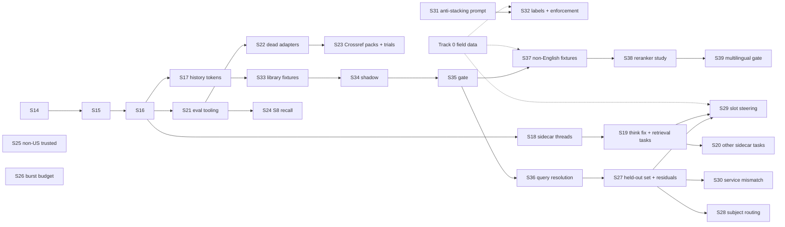

# Qube Knowledge Retrieval — Follow-up Plan (S14+)

**Status:** Plan of record for the work after S1–S13 · created 2026-11-25 · Phase 0 in progress (S14 done)
**Predecessor:** `docs/knowledge_retrieval_quality_assessment.md` (the assessment, the S1–S13 plan in its §12, and its progress log). That document is now the closed record of S1–S13; this one carries everything after it.
**Audience:** Engineering, and any new session resuming this work. Start with §7 "Resuming work in a new session".

References such as "V24", "D21" or "§12.4 S8" point into the predecessor document. Numbering continues from it: stages **S14+**, owner decisions **D23+**, validated findings **V33+**.

---

## 1. Purpose and scope

S1–S13 shipped the relevance gate, query resolution, wider recall, the evidence pack, grounding telemetry, robustness fixes and the S13 consolidation (main, PR #73). This plan covers everything they left open:

| Source | Items |
|---|---|
| S13 follow-ups (predecessor §12.4 S13, progress log) | Crossref in the discipline packs; the institutional adapters that return 0 rows (V30); tighter trial-name matching (V31) |
| Future iterations (predecessor §12.7) | Library and memory retrieval (D5); multilingual retrieval (D4); how-to questions sent to scholarly sources ("service mismatch") |
| Carry-overs (predecessor progress log, "Carry-overs") | Sidecar `<think>` truncation (D9); sidecar thread counts (V18); history windowing by tokens (V20); the native engine's `max_tokens` clamp (V21); shadow slot logs and the steering decision (D11); `active_topic` → `subject`; citation enforcement (D13); citation stacking; DuckDuckGo burst budget (V27); reranker in the frozen build (S3); non-US `@trusted` fixtures (V28); chapter-numbered duplicate titles; pool-relative metrics; `test_v2_scientific_bundle` live requests |
| Acceptance rows still **Partial** | S4 (irrelevant kept 8–9 % vs ≤ 5 %), S8 (scientific recall never measured), S9 (LLM resolves 50 % of residuals vs ≥ 70 %). S5 is superseded by S6 |
| Documentation | Out-of-date status lines in the predecessor (closed in S14) |

Out of scope unless the owner adds it: new knowledge services, UI redesign, and changes to the D1–D22 decisions without new evidence.

## 2. Starting state (2026-11-25)

- **Code.** `main` at `0e6944a` (Release 1.3.60) contains S1–S13 as the squash commit `c651eb2` (PR #73), after the phase 0/1 WIP in `f5949e2` (PR #72). The per-stage commits (S1 `2fda486` … S13 `f2492bc`, S8 live re-run `2800b62`) exist only on `feat/knowledge-retrieval-quality`; keep that branch, or its hashes stop resolving. Its merge base with `main` is still `2f4b180`, so a PR from it would show all of S1–S13 again: new work branches from `main`.
- **Release.** 1.3.60 is the first release that ships the reranker (D1) and the spelling variant (D6).
- **Offline eval** (re-run 2026-11-25 on this code; all six replays match `kq_s13_*`, 63 fixtures). Cells: P@k · nDCG@5 · irrelevant kept · relevant recall · abstain correct.

  | Ranker | production queries | standalone queries |
  |---|---|---|
  | token (reranker-free fallback) | 0.72 · 0.75 · 0.28 · 0.81 · 0.86 | 0.77 · 0.74 · 0.23 · 0.80 · 0.92 |
  | embed | 0.74 · 0.76 · 0.26 · 0.83 · 0.86 | 0.79 · 0.76 · 0.21 · 0.84 · 0.92 |
  | ce (shipped, `--pool-mode widened`) | 0.92 · 0.71 · 0.08 · 0.78 · 1.00 | 0.94 · 0.71 · 0.06 · 0.83 · 1.00 |

- **Tests.** The S1–S13 stage test files: 428 passed (2026-11-25). Full-suite reference (S13): **4209 passed** plus the 5 known failures listed in §7.
- **Field data: none yet.** `~/.qube/logs/qube.log` holds 0 `[QuerySlots] shadow` lines, `llm_debug.log` 0 `citation_grounding` events (last written 2026-11-24 16:48), `routing_debug.log` 1 `query_slots_gate`, and `web_search.log` is empty because the web-search audit log is off. Decisions that need real use start with Track 0 (§4).

## 3. Rules

- **The predecessor's §12.5 rules 1–7 and its working agreement apply unchanged:** one stage at a time; fallback-first; no assertion changed just to pass; telemetry before enforcement; every stage logs before / after metrics; a false assumption stops the stage; no category may regress by more than 1 fixture or 5 points.
- **Branches and PRs.** One branch per phase, from `main` (`feat/kr-followups-phase<N>`), one PR per phase, one or more commits per stage. Ask before every commit and push.
- **Commit messages:** a one-line summary ending in "(SN)", a bullet body, a short metrics paragraph, then `Co-Authored-By: Claude Opus 5.5 <noreply@anthropic.com>`.
- **Documentation.** Each stage adds an "As built (date)" block under its entry in §6, progress-log rows in §8 (deliverables, acceptance with ✓ / ✗ / **Partial**, tests with the full-suite count, baselines), and updates "Last reviewed". New findings become V-rows and owner decisions become D-rows (§8). The plan text in §5–§6 may be amended only by a recorded D-row or a stage's "As built" deviation.
- **Predecessor document.** Closed. Only factual corrections go there, never into its §1–11.
- **Privacy.** Real-use logs stay on the owner's machine. Only aggregate counts and metrics go into this document. Scripts that read real-use logs stay outside the repo. No real conversation text is committed: committed corpora use fixture-generated text, as S11 did, unless the owner decides otherwise. Adapters keep the generic contact `local@qube.app`.

## 4. Track 0 — field data (runs throughout)

Several decisions need data only real use produces. Collection starts now and runs in parallel with every phase. The owner uses the app normally (`@evidence`, `@internet`, `@trusted`, plain web turns, multi-turn follow-ups).

| Signal | Where it lands | Needs | Used by |
|---|---|---|---|
| Shadow LLM slots: `[QuerySlots] shadow {json}` | `~/.qube/logs/qube.log` | Sidecar enabled and loaded (`qube.sidecar.query_slots_shadow_enabled`, default on) | S29 |
| Slot gate per turn: `retrieval_outcome.query_slots_gate` | `~/.qube/logs/routing_debug.log` | Routing debug log on | S29 (invocation rate) |
| Citation grounding: `"event": "citation_grounding"` | `~/.qube/logs/llm_debug.log` (default on) | Reranker on | S31, S32 |
| Retrieval traces: rerank skip reasons (incl. `non_english`), sufficiency, `rerank_dropped`, discovery block cause | `~/.qube/logs/web_search.log` | **Settings → Privacy & data → Web search log** on (`qube.diagnostics.web_search_audit_log_enabled`, default off); query hashing optional | S26, S37, general |

- **Read with** `core/knowledge/retrieval_trace_reader.read_retrieval_traces` (it joins grounding events to their traces), or the Retrieval Inspector.
- **Checkpoint.** At the start of each phase, record the counts per signal in the progress log, so every data-dependent decision states how much data it rests on.

## 5. Phases and execution order

| Phase | Theme | Stages | Changes behaviour | Owner decisions expected | Size |
|---|---|---|---|---|---|
| 0 | Housekeeping and release safety | S14–S16 | Barely | Release CI change; the V21 fix | S |
| 1 | Fixes under every turn | S17–S20 | Yes | Sidecar thread defaults; each re-enabled sidecar task | M–L |
| 2 | Scholarly routing and adapters | S21–S23 | Yes | Keep / gate / drop per adapter; Crossref in packs | M |
| 3 | Measurements that need live runs | S24–S26 | Maybe | Quota days; trusted scope (D19); burst budget | S–M |
| 4 | Follow-up understanding | S27–S30 | Yes | Slot steering; service routing | M |
| 5 | Citation faithfulness | S31–S32 | Yes | Prompt change; human labelling; enforcement | M |
| 6 | Library and memory retrieval | S33–S36 | Yes | Scope; "not found in your documents" wording | L |
| 7 | Reranker study and multilingual | S37–S39 | Yes | Model choice and download size | L |

**Execution order (agreed 2026-11-25):** Phase 0 → 1 → 2 → 6 → 4 → 5 → 7, with Phase 3's live sessions run whenever the API quotas allow (first run of a UTC day for OpenAlex; DuckDuckGo searches ≥ 5 min apart).

- Phases 0 and 1 come first: release safety, and fixes that later phases depend on (the sidecar for S29, the history budget for Phase 6).
- Phase 2 fixes live defects in scholarly routing (§6 S22).
- Phase 6 comes before 4 and 5 for two reasons. Library has had the most recent product work (#67, #68, #71), and its relevance floors are the kind V4 found dead on the web path. Its long run also gives Track 0 time to collect the data that Phases 4 and 5 decide on.
- Stage numbers follow phase numbers, not execution order.

## 6. Stage details

### Phase 0 — Housekeeping and release safety

#### S14 — Follow-up plan and predecessor close-out

- **Why:** the predecessor's status lines are out of date, and the post-S13 work needs a plan of record.
- **Changes:**
  - this document;
  - in the predecessor: a header pointer to this document; the "Resuming" heading and state (PR #73 → `c651eb2`, 1.3.60, branch kept); the full-suite reference updated to S13's 4209; the phase Summary table; the Git reference table; the "Last reviewed" line; a pointer from §12.7.
- **Acceptance:** documentation only; the predecessor's §1–11 are unchanged (`git diff` shows no edit above §12).

#### S15 — Reranker and spelling data in the packaged app

- **Why:** both features fail silently by design, so a packaging gap would not show as an error.
  - *Reranker:* 1.3.60 is the first release with the reranker. `qube.spec` adds the hidden import `fastembed.rerank.cross_encoder` (S3), but S3's frozen-build smoke test was never run, and no release smoke step loads the reranker. `rerank` never raises: a missing module puts every packaged user on the unscored legacy path, with no gate and no error.
  - *Spelling (suspected, to verify):* `core/knowledge/spelling.py` loads `pyspellchecker`'s word list (`spellchecker/resources/en.json.gz`) at runtime. `qube.spec` does not collect `spellchecker` data files (its `collect_data_files` list has no such entry), and the installed PyInstaller hooks have none for it. If the data is missing, `SpellChecker(language="en")` fails, `_get_checker` switches the feature off, and the S8 spelling variant (D6) never runs in packaged builds.
- **Changes:**
  1. Verify the published 1.3.60 artifacts (Linux first; Windows and macOS where they can be opened here): is `fastembed/rerank` present, is `spellchecker/resources/en.json.gz` present, and does the frozen binary load both? Record the result as a V-row.
  2. Fix `qube.spec` as needed (e.g. `collect_data_files("spellchecker")`, limited to `en.json.gz` if size matters).
  3. Add a release smoke check that the frozen binary can import the reranker module and build an English `SpellChecker`. It needs no model download: the model itself arrives through bootstrap. Covers Linux dist, Windows dist and macOS DMG through the existing smoke scripts (`scripts/release/smoke_linux_dist.sh`, `smoke_dist.ps1`, `smoke_dmg.sh`).
- **Risks:** release CI time; a smoke check that needs network. The check must be offline.
- **Acceptance:** findings recorded; the smoke check fails on a build without the files and passes on a fixed build; a patch release if 1.3.60 is affected (owner decision).
- **Decisions:** the release CI change; whether a patch release is needed.

#### S16 — Test hygiene and the engine clamp

- **Changes:**
  - `tests/test_scientific_evidence.py::test_v2_scientific_bundle` runs `run_v2_web_retrieval` against live adapters from local preferences (Europe PMC and others are not mocked). Mock the adapters and keep its assertions (bundle service, PubMed call, ≥ 1 source with a DOI).
  - V21: `workers/native_llama_engine.py` (~line 1768) does `int(getattr(self._llama, "n_ctx", 0) or …)`; in llama-cpp-python 0.3.35 `n_ctx` is a method, so `int()` raises and the `max_tokens` clamp is always skipped (`[OutputTokenBudget] clamp skipped`). Call it when callable, as `loaded_n_ctx()` already does (~line 501). llama-cpp itself cuts `max_tokens`, so this removes log noise and makes the clamp do what its code says.
- **Tests:** a unit test for the clamp with a callable `n_ctx`; the mocked test runs offline.
- **Acceptance:** the test makes no network calls; the clamp runs (no "clamp skipped" line in a smoke turn); the full suite matches the reference.
- **Decisions:** the V21 fix (engine owner).

### Phase 1 — Fixes under every turn

#### S17 — Token-aware history windowing (V20)

- **Why:** `LLMWorker._bound_session_history` (`workers/llm_worker.py` ~line 1429) keeps the last `max_history_messages` messages (default 10, 2–100), each capped at `CHAT_HISTORY_SINGLE_MESSAGE_MAX_CHARS`. Ten 1500-char turns already reach 4226–4292 real tokens: a 4k window overflows before any retrieval, and the S10 budget then sits at its 1000-char floor. Phase 6 adds library context to the same window.
- **Changes:** after the message-count window, trim the oldest messages until the history fits a token budget derived from the loaded `n_ctx`. Reuse the S10 estimate (`core/retrieval_budget.py`: 4.0 ASCII chars per token, one token per non-ASCII character), and keep the existing first-message-must-be-user rule and the memory v7 salvage hook. Split the window between history and retrieval explicitly, so neither starves the other.
- **Risks:** losing context the user expects on long threads; models with large windows must behave exactly as today.
- **Tests:** the S10 4k / 8k / 32k matrix with real tokenizers (Gemma 4 E4B, Qwen3.5-9B, Phi-4-mini) and history sizes up to the overflow case; unchanged output when everything fits.
- **Acceptance:** no prompt over `n_ctx` minus the answer reserve on the matrix; ≥ 8k windows unchanged on every existing test.

#### S18 — Sidecar thread counts (V18)

- **Why:** the sidecar's `Llama(...)` (`workers/sidecar_llm_worker.py` ~line 289) passes no thread counts, so llama-cpp-python uses `n_threads = cpu_count // 2` and `n_threads_batch = cpu_count` (SMT included). Measured on the dev laptop: prompt evaluation 63 tok/s at 16 batch threads vs 177 at 8, total p50 5.1 s → 2.3 s. The `inference_transparency` snapshot reports `os.cpu_count()` as `n_threads`, not the model's values.
- **Changes:** pass `n_threads_batch` (and `n_threads`) from the physical core count (`psutil.cpu_count(logical=False)`, already used by `rerank.reranker_threads`; `core/cpu_threads.py` currently detects logical cores only), with a cap that leaves headroom for the main model. Report the real values in the snapshot.
- **Risks:** CPUs without SMT, Apple P / E cores, low-core machines, and contention with the main model during a turn.
- **Tests:** thread selection per CPU shape (mocked psutil); snapshot values.
- **Acceptance:** sidecar prompt evaluation measured before and after on the dev machine, plus at least one other CPU shape if available; no regression in title latency.
- **Decisions:** the default (inference-settings owner).

#### S19 — Sidecar `<think>` fix: mechanism and retrieval-related tasks (D9 follow-through)

- **Why:** on Qwen3, every sidecar task on the raw path (`SidecarLlmWorker._complete_prompt`, ~line 513) returns only `<think>`. Under `/no_think` the model opens an empty think block, and the `"\n\n"` stop from `cognition_stop_tokens` ends generation there. Only titles (chat path) and the S9 `query_slots` task (pre-filled) work. Affected tasks: `source_digest`, `contradiction_judge`, `reflection_label`, `episode_summary`, `ingest_blurb`, `companion_line` and raw prompts (`query_rewrite` is off, D10).
- **Changes:**
  - one mechanism: a per-task opt-in that pre-fills the empty think block on the raw path for Qwen3 formats, exactly as S9 does for `query_slots`;
  - then evaluate and enable the retrieval-related tasks first: `source_digest` and `contradiction_judge`. Each gets fixtures, an output-quality check and latency at S18's thread settings, and is enabled only with an owner D-row. The S9 spot check of `source_digest` without the stop produced an off-topic summary, so working output is not assumed.
- **Risks:** turning on behaviour that has never run in production (why D9 chose a scoped fix).
- **Tests:** recorded completions replayed offline, as `tests/fixtures/query_slots_recorded_s9.json` does; per-task parser tests.
- **Acceptance:** per task: success rate, quality on its fixtures, p95 latency, and an owner decision to enable, keep off, or retire.

#### S20 — Sidecar `<think>` fix: remaining tasks

- Same method as S19 for `reflection_label`, `episode_summary`, `ingest_blurb`, `companion_line` and raw prompts. These are outside retrieval quality. They are here because they share S19's mechanism and are broken in production today, and they can be reordered or handed off by owner decision.

### Phase 2 — Scholarly routing and adapters

#### S21 — Eval tooling: shared-pool metrics and duplicate titles

- **Changes:**
  - `relevant_recall` and nDCG are scored against each run's own pool, so `--compare` across pool sizes or routing arms flags false regressions (predecessor S8 results). Add a shared-pool mode that scores every arm against the union of labelled rows, and use it in `tools/evaluate_heuristic_ab.py` and `--compare`.
  - Title dedupe in `core/knowledge/adapter_collection._normalize_title` misses chapter-numbered duplicates ("2 EVIDENCE FOR DARK MATTER…" vs "Evidence for Dark Matter…"). Strip a leading section number before comparing. This changes which rows survive a merge, so it is measured on the corpus like a behaviour change.
- **Acceptance:** existing baselines unchanged in the default mode; the shared-pool mode reproduces the S8 like-for-like table; the dedupe change passes rule 7.

#### S22 — Institutional adapters that return 0 rows (V30)

- **Why:** on the S13 cases NICE, WHO, NIST, IETF RFC, IEEE Xplore, USPTO PatentsView, EPO Espacenet, BLS and Eurostat returned 0 rows, and US Census failed on the 1 MB fetch limit. They stay in the discipline packs (`core/knowledge/scientific_discipline_packs.py`). **The engineering pack's *primary* adapters are IEEE Xplore, NIST and IETF RFC**, so keyless engineering turns rely on the arXiv / OpenAlex fallbacks. Chemistry lists PatentsView and Espacenet; economics lists Eurostat and BLS; medicine lists NICE and WHO.
- **Found while planning (2026-11-25, to confirm):** IEEE Xplore, NIST, NICE, PatentsView, EPO OPS, BLS and US Census look up credentials through `credential_resolver.authorization_token`. BLS skips its live search without a key ("API key required"). Several are therefore likely key-gated, as Semantic Scholar was (V8). IETF RFC and Eurostat have no key path, so their 0 rows have another cause.
- **Changes:**
  - per adapter, a live diagnosis (no OpenAlex quota needed): key-gated, broken query or endpoint, or genuinely empty for these questions;
  - then per adapter: fix it; skip it when no key is configured, so it costs no deadline time and the trace names the skip; or drop it from its pack.
  - The 1 MB limit: US Census uses the API path (`knowledge_get`), not the page fetch that S12 truncates. Decide whether that endpoint needs a larger limit or a narrower query.
- **Risks:** removing a source that works with a key some users have. Prefer "skip without key" to removal.
- **Acceptance:** each adapter has a recorded status (V-row); no pack's primary adapters are all dead for keyless users without a recorded decision; per-category replay passes rule 7.
- **Decisions:** keep / gate / drop per adapter.

#### S23 — Crossref in the discipline packs, and trial-name matching

- **Crossref (S13 follow-up):** all 5 losses from discipline routing in the S13 A/B are Crossref rows that the general route reaches but the discipline packs leave out (DAPA-HF and Bell-test commentaries, a QE retrospective, a euro-area unemployment report). The A/B already replays them offline. Re-run it with Crossref added to the packs as S22 leaves them, measured with S21's shared-pool scoring, then check live latency and Crossref's concurrency limit (S8 saw 429s on a second request).
- **Trial-name matching (V31):** the plain word "consensus" fires the CONSENSUS signal, and "dapa" inside "dapagliflozin" counts as a DAPA-HF title hit (`core/knowledge/ranking/trial_grounding.py`, `core/knowledge/entities/trials.py`). It affects only the reranker-free fallback (0 changes with the reranker in S13). Tighten it to case and word-boundary rules, and measure on the token ranker.
- **Acceptance:** rule 7 on both rankers; one commit per change with before / after metrics (S13 practice).

### Phase 3 — Measurements that need live runs

Run on quota days, alongside other phases. Each session is planned in advance with its search count.

#### S24 — S8 scientific recall (closes S8 Partial)

- Re-capture the `sufficient` scientific cases with the shipped union (query variants, spelling variant, Crossref), label the new rows blind (D3), and measure relevant-in-pool recall against the S2 captures: target ≥ 15 % relative.
- Cost: about 20–35 OpenAlex searches, one UTC day's first run.
- Needs S21 (shared-pool scoring).

#### S25 — Non-US `@trusted` fixtures (V28, D19)

- About 5 cases with non-US official sources (NHS, gov.uk, europa.eu, a non-US statistics office), captured with and without the S12 `site:` scope.
- Up to about 10 DuckDuckGo searches, ≥ 5 min apart, stopping at the first block (V27).
- May reopen D19 (the 4-site scope).

#### S26 — DuckDuckGo burst budget (V27)

- Qube's budget allows 6 searches per 10 minutes, and the S12 live check was challenged inside it.
- Decide from Track 0 traces (block causes per day of real use) plus the S25 session, not from a dedicated stress run.
- **Decision:** keep, lower, or make adaptive.

### Phase 4 — Follow-up understanding

#### S27 — Held-out follow-up set v2 and the deterministic residuals

- **Why:** the corpus said 100 %, and unseen phrasings got 5 of 13 (V19).
- **Changes:**
  - first, write a new held-out set (≥ 20 cases) before any code, frozen in the repo with its creation date;
  - then target the S9 residuals: list references ("And the second point?"), facet nouns read as new subjects ("Is the garbage collector a problem for latency?" after Go), a facet question about something else (sourdough → kitchen temperature), a multi-hop "there" (Canberra), and statement openers without an -ing verb ("My daughter was just diagnosed with asthma.").
- **Acceptance:** improvement on both the old and the new held-out sets; 0 false anchors on topic switches; `routing_text` unchanged on the router corpus unless S28 changes it.

#### S28 — Routing on `subject` instead of `active_topic`

- **Why:** `active_topic` still holds the legacy value (the S6 deviation). On the ANT turn it reads "Artificial Inteligence", and it feeds routing and the prompt salience hints.
- **Changes:** move these consumers to `subject`, measured on the 125-route router corpus (`tools/evaluate_router.py`) and the query-resolution cases.
- **Acceptance:** route changes listed case by case and owner-approved; no regression.

#### S29 — LLM slot steering decision (D11 follow-through)

- **Inputs:**
  - Track 0 shadow logs (how often the gate schedules, how often slots are valid, how often they beat the deterministic subject);
  - S18 / S19 sidecar latency;
  - the S27 held-out results. S9 resolved 50 % of residuals against a ≥ 70 % target.
- **Outcomes:** keep shadow, steer only when validated and the deterministic path left the turn unresolved, or retire.
- **Decision:** owner.

#### S30 — How-to questions sent to scholarly sources (predecessor §12.7)

- **Why:** the gate cannot detect "on topic but the wrong kind of source" (V1: an OAuth how-to sent to scholarly indexes).
- **Changes:** fixtures first (how-to and practical questions on `@evidence` and on the default service). Then measure a signal: an `answer_type` from the slots, or a deterministic one with corpus evidence (rule 7 forbids an untested keyword list).
- **Decision:** whether an explicit `@evidence` may fall back to web or trusted sources, as `@research` sub-questions already do (D14).

### Phase 5 — Citation faithfulness

#### S31 — Citation stacking prompt change

- **Why:** in S11, 19 % of cited pairs were unsupported, mostly stacks of citations after one sentence.
- **Changes:** a prompt change in `CITATION_DISCIPLINE_SUFFIX` (`core/memory_filters.py`) and the persona rules ("cite only the sources that state the sentence"), measured with `tools/evaluate_citation_grounding.py` on newly generated answers. Phi-4-mini is fast; Qwen3.5-9B takes about 43 s per answer on CPU, so it gets a subset.
- **Acceptance:** fewer unsupported cited pairs, no fall in supported citations per answer, Phase 1 contract flags ok.
- **Decision:** the prompt change.

#### S32 — Human labels and the enforcement decision (D13 follow-through)

- **Changes:**
  - The owner labels real-use cited pairs from Track 0 grounding events collected after S31 (the mix enforcement would face), locally. Target: a few hundred pairs, with at least 40 unsupported.
  - Calibrate the grounding score against these labels, then propose strip / caution / stay off for `get_citation_integrity_enforce()`.
  - Revisit the 8000-char cap (D12) only if the labels show harm from truncated sources.
- **Decision:** enforcement (owner).

### Phase 6 — Library and memory retrieval (predecessor §12.7, D5)

Correction to the planning summary given in chat: Library and memory search **do** have relevance floors. These are cosine floors on embedding scores:

- `mcp/rag_tool.MIN_RAG_SEMANTIC_SCORE = 0.30` (T4.1);
- `mcp/memory_tool.MIN_SEMANTIC_SCORE = 0.35` (v6.1).

What they lack is the cross-encoder gate, the sufficiency state and honest "not found" wording. V4 found the same kind of floor dead on the web path (jina-v2 cosine 0.62–0.91 for every row), so the first job is to measure whether these floors filter anything with the shipped embedders.

#### S33 — Library and memory fixtures, and a baseline

- **Fixtures:** library chunks (long, local) and memory entries (short stubs), built from a synthetic or owner-approved document set, never private documents, including:
  - abstain cases (the question is not in the library, e.g. T4.1's "Why is the sky blue?" against an unrelated library);
  - multi-turn cases.
- **Baseline:** what the current floors keep and drop. The existing `tests/test_rag_relevance_gate.py` behaviour stays pinned.
- **Paths:** `core/knowledge/pipeline_internal_corpus.py` (`@library`, `@help`), `mcp/rag_tool.rag_search` and `mcp/memory_tool.memory_search` (plain-chat RAG and memory, wired from `workers/llm_worker.py`).

#### S34 — Reranker in shadow on library and memory

- Score candidates with the S3 cross-encoder in shadow, record score distributions per corpus type, and calibrate thresholds separately for chunks and stubs. They score differently from web snippets and abstracts.

#### S35 — Library and memory gate, and "not found in your documents"

- Gate on the calibrated thresholds; set the sufficiency state; the insufficient wording for documents ("Your documents don't cover this…"), distinct from the web wording; dropped chunks only in the inspector (D2).
- Fallback-first: without the reranker, today's floors are unchanged.
- **Decision:** the wording.

#### S36 — Query resolution for library and memory

- S5 / S6 changed only `web_text`; `retrieval_text` (memory and RAG) and `routing_text` were left alone on purpose.
- Apply the S5 frame stripping, acronym expansion and S6 subject anchoring to library and memory retrieval, measured on S33's multi-turn cases.

### Phase 7 — Reranker study and multilingual (predecessor §12.7, D4)

#### S37 — Non-English fixtures and the size of the gap

- Count `non_english` reranker skips from Track 0 traces to size the gap.
- Add non-English fixtures (a few languages the owner chooses) across paths, labelled like S2.

#### S38 — Reranker model study

- **One study serves two needs:**
  - multilingual coverage;
  - the right-subject, wrong-facet rows that keep scientific irrelevant-kept at 8–9 % against S4's ≤ 5 %, plus the 3 web cases where a partial page beats a relevant one (predecessor carry-overs).
- **Candidates must be permissively licensed.** `jina-reranker-v2-base-multilingual` is ruled out (CC-BY-NC). `bge-reranker-base` / `-v2-m3`-class models need size and latency checks.
- **Criteria:** separation on the S2 corpus and S37's fixtures, latency for 40 × 800-char rows at 2 and 4 threads (S3's bar: p95 ≤ 1.0 s), download size and RSS.
- **Decision:** the model and its download (a D1-type decision).

#### S39 — Multilingual gate and cleanup

- If S38 picks a model:
  - language detection at the gate;
  - the multilingual model for non-English turns (or for all turns, if it wins on English too);
  - language-aware frame stripping and acronym rules (S5 is English-only).
- `UNSCORED` stays the fallback.

## 7. Resuming work in a new session

A new session has no memory of earlier ones. Read this section, then §3–§6, then the open stage's entry and the progress log.

**State.** Branch `feat/kr-followups-phase0` from `main` `0e6944a`. Phase 0 in progress: S14 done; next is S15.

**Commands** (repo root, `.venv`):

- Targeted tests: `.venv/bin/python -m pytest -q -p no:cacheprovider tests/<files>`.
- Full suite: `QT_QPA_PLATFORM=offscreen HF_HUB_OFFLINE=1 .venv/bin/python -m pytest -v -p no:cacheprovider -p no:warnings -m "not packaging" tests > <log> 2>&1`.
  - The process ends with the known Qt teardown abort (exit 134, no summary line), so count ` PASSED` / ` FAILED` lines.
  - Reference (S13): **4209 passed**, and exactly these 5 failures: `test_linux_ggml_release_verify.py` ×2 (`test_broken_deb_lib_fails_avx_vnni_stub`, `test_broken_deb_q8_uses_vex_vnni`), `test_type_to_search.py` ×2 (`test_skips_when_history_search_focused`, `test_skips_when_other_text_field_focused`), `test_winget_validation.py::test_explicit_smoke_validation_skips_consent_and_applies_shortcut`. Any other failure is new.
- Offline eval (needs the reranker model at `~/.qube/models/search/reranker/`): `HF_HUB_OFFLINE=1 .venv/bin/python tools/evaluate_knowledge_quality.py --corpus eval/retrieval_corpus/v1_knowledge_quality.json --ranker <token|embed|ce> --query-mode <production|standalone> [--pool-mode widened] [--json] [--compare <baseline>]`.
  - Compare against `eval/retrieval_corpus/baselines/kq_s13_*`, using `--pool-mode widened` for `ce`. Always pass the relative `--corpus` path.
- Heuristic A/B: `HF_HUB_OFFLINE=1 .venv/bin/python tools/evaluate_heuristic_ab.py` (S13).
- Citation grounding: `HF_HUB_OFFLINE=1 .venv/bin/python tools/evaluate_citation_grounding.py [--json] [--compare eval/citation_grounding/baselines/s11.json]`.
- Follow-up subjects: `eval/router_corpus/followup_subjects_v1.json` (S9 held-out set); router: `tools/evaluate_router.py`.
- Scratch scripts and benchmark outputs stay outside the repo; only baselines and fixtures are committed.

**Live checks.**

- OpenAlex runs keyless: 1000 credits a day at 10 per search, so about 100 searches, reset at 00:00 UTC. Check the budget with one search (`https://api.openalex.org/works?search=test&per_page=1`, User-Agent `Qube/1.0 (mailto:local@qube.app)`) and read `x-ratelimit-remaining`.
- DuckDuckGo: ≥ 5 min between searches; stop at the first block and wait out the 30-min backoff (V27).
- Before trusting an OpenAlex-dependent result, check `api.openalex.org` in `http_summary` shows no 429.
- The S8 live ANT check snippet is in the predecessor's "Resuming" section.

**Decisions in force:** D1–D22 (predecessor §12.6), plus any D23+ below.

**Carry-overs not planned as stages** (recorded so they are not lost):

- Wikipedia rows are always `undated`, so a "newest iPhone" question can keep old models as `sufficient` + `undated_sources` (predecessor S7 known limits).
- `@trusted` via Brave: a user with Brave configured gets Brave as the primary `@trusted` provider through `site_bias`, unmeasured (S12).

## 8. Progress log

> **Last reviewed:** 2026-11-25, plan created (S14 done).

### Deliverables

| Date | Stage | Item | Status | Evidence | Gaps / follow-ups |
|---|---|---|---|---|---|
| 2026-11-25 | S14 | Follow-up plan | Done | `docs/knowledge_retrieval_followups.md` | — |
| 2026-11-25 | S14 | Predecessor close-out | Done | `docs/knowledge_retrieval_quality_assessment.md`: header pointer, Resuming state, full-suite reference, Summary, Git reference, Last reviewed, §12.7 pointer | — |

### Validated findings (V33+)

| # | Assumption | Finding | Consequence |
|---|---|---|---|
| — | — | — | — |

### Owner decisions (D23+)

| # | Question | Decision | Where it applies |
|---|---|---|---|
| D23 | How should the post-S13 work be structured? | **A new plan document** (this one) with S14+ / D23+ / V33+ numbering; the predecessor is closed. **One branch and PR per phase, from `main`.** **Order:** Phase 0 → 1 → 2 → 6 → 4 → 5 → 7, with Phase 3's live sessions run when quotas allow. (Recorded 2026-11-25.) | All |

### Track 0 checkpoints

| Date | Shadow slot lines | Slot gate records | Grounding events | Audit traces | Notes |
|---|---|---|---|---|---|
| 2026-11-25 | 0 | 1 | 0 | 0 (log off) | Baseline before collection |
