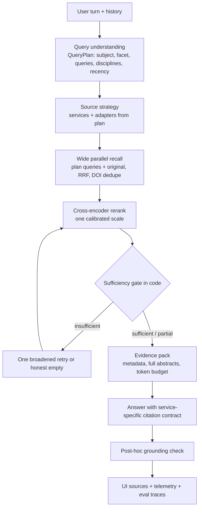
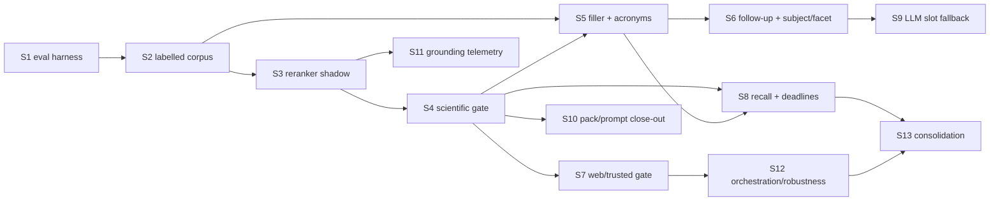

# Qube Knowledge Retrieval & Utilization — Technical Assessment

**Status:** Investigation complete · no implementation in this document  
**Context:** Independent assessment following the Actor–Network Theory `@evidence` session (2026-11-21) and prior agent recommendations  
**Audience:** Engineering — use as the strategy baseline for retrieval quality work  
**Plan of record:** §12 (pre-implementation review, 2026-11-23) supersedes §5 and §7 wherever they conflict. §1–11 are kept unchanged as the original assessment.  

---

## 1. Executive assessment

### What actually failed on the ANT turn

The failure was not one bug. It was a **stack of weak gates**, each letting poor material through because **nothing downstream was calibrated to catch it**:

1. **Query understanding** — Turn 2 was not classified as a follow-up (`confidence 0.0`). Discourse state had already **replaced** the conversation subject from actor-network theory with **“Artificial Inteligence”** (user’s spelling). The APIs received the raw sentence, typo included: `Yes, please tell me how ANT analyzes Artificial Inteligence for example`.
2. **Source selection** — Discipline detection scored **0 for every discipline** → `general_science` → **only OpenAlex + arXiv**, 3 results each, despite **39 enabled adapters**. arXiv is a poor default index for STS/sociology questions.
3. **Relevance filtering** — The `0.12` minimum score **cannot reject anything** while embeddings are on; unrelated text still scores ~**0.44**.
4. **Confidence labels** — “Adequate” coverage and “confidence 0.68” reflect **count of abstracts and index authority**, not topical fit.
5. **Answer generation** — Prompts say “You MUST use the TOOLS context” and “Every factual sentence … must end with a citation token.” The model complied and cited off-topic papers.
6. **Verification** — Post-generation checks only that citation **ids exist**. Nothing verifies that a cited source supports the sentence.

### Verdict on the previous agent’s analysis

| | |
|---|---|
| **Sound diagnoses** | Missed follow-up → no query expansion; sidecar expansion not wired to web; coverage ignores relevance; need multi-turn eval |
| **Missed entirely** | Tiny candidate pool + narrow source selection; non-functional relevance scale; prompt forces citation; `@[tool:evidence]` in model prompt; 600-char abstract truncation; no source metadata for model; dead reliability/freshness scores; medical-disclaimer branch drops citation rules |
| **Wrong or would not have helped** | “Always expand with discourse topic” would search `Regarding Artificial Inteligence: …` (wrong anchor). Coverage threshold 0.35 is below the broken score floor (turn averaged 0.63). Homograph penalty is ANT-specific |

### Core thesis

Qube does **not** need more layers. It needs **fewer, calibrated ones**:

1. One **structured query-understanding** step  
2. **Wide recall → one real reranker**  
3. **Sufficiency decision in code** (not the LLM)  
4. **Evidence pack** the model can reason over  
5. **Citation rules** that allow “sources don’t cover this”  
6. **Eval harness** measuring each stage  

Much of the current pile of regex heuristics is **compensating for weak upstream signals**; once those are fixed, complexity should **shrink**, not grow.

---

## 2. Current architecture (as implemented)

```text
Composer (@evidence) → attachment routing (force WEB) → discourse (often skipped)
  → build_resolved_retrieval_query → run_v2_web_retrieval (scientific_evidence)
  → ScientificEvidencePipeline (plan → adapters → score_rows → bundle)
  → _format_sources_for_llm_prompt → native LLM → citation renumber / integrity (id-level only)
```

| Stage | Key code | Behavior |
|--------|----------|----------|
| Composer | `core/composer_attachments.py` | Forces `web` / `attachment_tool_evidence`; bypasses cognitive router |
| Persistence | `workers/llm_worker.py` ~1906, ~2120 | **Raw** prompt (with `@[tool:…]`) stored and reloaded as history |
| Discourse | `core/discourse_intent.py`, `core/discourse_query.py` | Follow-up threshold 0.55; `web_text` expansion only when `follow_up.active` |
| Service | `core/knowledge/registry.py`, `web_retrieval.py` | `evidence` → `scientific_evidence` |
| Pipeline | `core/knowledge/pipeline_scientific.py` | `plan_scientific_query` → parallel adapters → `score_rows` (min 0.12) → MMR → bundle |
| Prompt | `workers/llm_worker.py`, `core/prompt_renderers.py`, `core/prompt_blocks.py` | Title + excerpt (often `abstract[:600]`); **4500 char** total slice; same WEB persona for all services |
| Post-gen | `core/citation_integrity.py`, `core/citation_renumber.py` | Id-level only; enforcement **off by default** |

**Other tools (same family, different gaps):**

- **`@trusted`** — Wikipedia + DDG, then allowlist filter; no `site:` restriction  
- **`@internet`** — DDG + optional page fetch; balanced profile often **single-page** bundle  
- **`@research`** — LLM/heuristic decompose; **scientific indexes only** (`conversations_view.py:4707`); merge/ranker issues documented in audit  

---

## 3. Identified weaknesses

### 3.1 Query understanding (verified)

- **Follow-up classifier** misses common continuations (`core/discourse_intent.py`):  
  - `why`/`how` only at line start → “Yes, please tell me **how**…” fails  
  - Capitalized multi-word phrases → `explicit_entity_penalty`  
  - Non-follow-ups capped at confidence **0.45**  
  - Reproduction: ANT turn 2 → `kind=NONE`, `confidence=0.0`; “Sure, go on” → `ELLIPSIS` at **0.50** (below 0.55)
- **Single-slot discourse state** (`core/discourse_state.py`): facet “Artificial Inteligence” **overwrites** subject; turn 1 topic retained stray `?>`
- **Filler/typos** hit APIs unchanged; OpenAlex returned *OPENING ADDRESS* (1893)
- **Composer token** reaches model in `USER QUERY:` and history
- **No current date / recency** in prompts (grep: no injection in prompt modules)

### 3.2 Source selection & recall (verified)

- `resolve_service_adapters` → `('openalex', 'arxiv')` for both raw and ideal STS query  
- Sociology patterns omit STS vocabulary (`core/knowledge/scientific_discipline.py`)  
- **`per_adapter = max(2, budget)`** → ~6 candidates max on balanced profile  
- `@research` scholarly-only; profile `materialize_budget` takes **min** with app profile (thorough clamped)

### 3.3 Relevance scoring (verified + measured)

`core/knowledge/ranking/relevance.py`:

- Semantic leg uses `(cosine + 1) / 2` → unrelated docs still ~0.43+ combined score  
- **`min_score=0.12` is dead** with embeddings on (Jina v2 small: unrelated trial cos ~0.58)  
- Token overlap counts filler words  
- Web gate uses **raw** cosine; scientific uses `(cos+1)/2` — inconsistent scales  
- **No cross-encoder reranker** in knowledge pipelines (fastembed `TextCrossEncoder` available in app venv)

### 3.4 Credibility & confidence signals (verified)

- `_compute_scientific_coverage` — counts only; ignores relevance  
- **`_reliability_score` computed then discarded** — object uses `authority * 0.9` (`bundle_builder.py` ~579 vs ~601)  
- **`apply_reliability_scores`** compares each row to a **copy**, so self-comparison bug (`reliability.py`)  
- **Freshness** computed, never stored on scientific objects  
- OpenAlex rows **`peer_reviewed: True`** for all works  
- Conflict detection: regex stance; positions not passed to model; scientific bundles `conflicts=()`  

### 3.5 Utilization in the answer (verified)

- Model sees title + **600-char** excerpt; full abstract unused; **4500-char** blunt total budget  
- No year, venue, preprint/peer-review, coverage, warnings in prompt  
- **WEB persona + mandatory citation exemplar** even for `@evidence`  
- **`scientific_medical_disclaimer` branch** runs before WEB branch → drops citation persona (`prompt_blocks.py` 241–243 vs 276–307)

### 3.6 Post-generation (verified)

- Citation integrity: ids only; enforce default **false**  
- `response_quality` `coherence_issue` false positives (“is not”, “cannot”)  
- **No claim ↔ source support check**

### 3.7 Robustness (per audit — verify before fixing)

- Pacing timeout → 30 min DDG backoff  
- DDG 429/403: no fallback  
- Unbounded `Retry-After`  
- Adapter exceptions swallowed  
- Evidence cache key ignores budget  

### 3.8 Evaluation (verified)

- `eval/retrieval_corpus/v1_scientific.json` — single-turn; adapter/abstract checks, not topical relevance  
- No multi-turn composer or “no good source” cases  

---

## 4. Assessment of previous recommendations

| Rec | Verdict |
|-----|---------|
| **A1** Composer + always discourse anchor expansion | **Modify** — real problem; wrong mechanism (wrong anchor = wrong query) → use **QueryPlan** (R1) |
| **A2** Sidecar dual web retrieval (PR3) | **Replace** — doubles DDG load; sidecar gated on failed follow-up → **multi-query from plan + RRF** |
| **A3** Relevance-aware coverage | **Sound goal** — only after fixing relevance scale (R3) |
| **A4** Anchor/homograph penalties | **Reject** — ANT-specific; porting broken deep-research anchor logic |
| **B1** Follow-up regex fixes | **Hygiene only** — doesn’t fix single-slot topic |
| **B2** Topic-aware planner | Subsumed by **R1** |
| **B3** Entity from resolved query | **Accept**, lower priority |
| **C1** Insufficient-evidence path | **Accept** — must **drop** weak sources in code, not prompt-only |
| **C2** Multi-turn eval corpus | **Accept** — add graded relevance + abstain cases |
| First PR = A1+B1+A3 | **Reject order** — perfect query still fails on pool + dead gate + forced cite |

---

## 5. Additional recommendations

### R1 — Structured query understanding (`QueryPlan`)

- Optional **one short JSON call** per retrieval turn (not plain chat)  
- Fields: `standalone_question`, `subject`, `facet`, 1–3 `search_queries`, `disciplines`, `recency_need`, `answer_type`, `ambiguous`  
- Fallback chain: main model → sidecar (timeout) → heuristics  
- Fixes typos, lost subject, facet vs subject  

### R2 — Wide recall

- 10–20 results per adapter (parallel); add Semantic Scholar + Crossref to general/social fallbacks  
- Plan queries + original → RRF + DOI dedupe  
- Watch Semantic Scholar rate limits  

### R3 — One cross-encoder reranker (all pipelines)

- fastembed `TextCrossEncoder` (e.g. `ms-marco-MiniLM-L-6-v2`, `jina-reranker-v1-tiny-en`)  
- Score `(standalone_question, title + abstract)`; calibrated keep/drop from eval  
- MMR for diversity only  

### R4 — Sufficiency gate (code)

- States: sufficient / partial / insufficient / none from reranker scores + agreement  
- Below threshold → **never in prompt**; one broadened retry from plan if insufficient  
- Aligns with single-tool / no chain policy  

### R5 — Evidence pack for the model

- Per-source header: year, venue, type, preprint vs peer-reviewed  
- Full abstracts (~1500 chars); drop whole sources, not mid-slice  
- Token budget tied to n_ctx (e.g. 6–8k tokens retrieval block on 32k)  
- Plain-language sufficiency + warnings line  

### R6 — Prompt contract rewrite

- Personas per service (scholarly / trusted / web)  
- “Cite only claims sources support; label general knowledge; if sources don’t address question, say so first”  
- Disclaimers **compose** with evidence rules, don’t replace WEB branch  
- Strip composer tokens from history; inject current date  

### R7 — Honest scores

- Wire reliability + freshness into objects and coverage/confidence  
- Fix OpenAlex `peer_reviewed` from work metadata  
- Fix adapter attribution labels  

### R8 — Post-generation grounding (telemetry first)

- Per cited sentence ↔ cited source (reranker proxy → optional NLI)  
- After calibration: strip unsupported cites or add caution  

### R9 — Recency

- `recency_need` from plan → adapter filters/sort where supported  

### R10 — Orchestration consistency

- `@research`: same plan + reranker; non-scholarly queries → trusted/web  
- Fix profile min clamp, merge top-K cap  
- `@internet` multi-page; `@trusted` `site:` scoping  

### R11 — Robustness

- DDG backoff mapping, 429 handling, bounded Retry-After  
- Surface adapter failures in sufficiency state  

### R12 — Consolidation (after eval proof)

- Demote redundant regex discipline/query-type/slot heuristics when plan + reranker wins  

---

## 6. Proposed target architecture



**Principles:**

- One plan per turn  
- **Code decides what evidence the model sees** (model-agnostic quality)  
- One relevance scale, calibrated on eval  
- Every displayed score means something  

---

## 7. Prioritized implementation roadmap

| Phase | Work | Impact | Complexity | Latency | Risk |
|-------|------|--------|------------|---------|------|
| **0** | Eval harness + record/replay fixtures; baseline metrics | Enables all work | M | None | None |
| **1** | R5–R7 prompt/evidence pack, token strip, citation contract, score bugs | High (honesty) | S–M | Neutral | Low |
| **2** | R2–R4 wide recall + cross-encoder + sufficiency gate | **Highest relevance** | M | +0.2–1s (est.) | Medium |
| **3** | R1 QueryPlan + subject/facet discourse + multi-query (R9) | High multi-turn | M | +1–8s (measure) | Medium |
| **4** | R8 grounding check, token-aware context budget | Faithfulness | M | Post-stream | Low–med |
| **5** | R10–R11 orchestration + robustness; R12 consolidation | Consistency | M–L | Mixed | Medium |

**Rationale:** Phase 1+2 stop garbage reaching the model and allow honest “sources don’t cover this” even before perfect query understanding.

---

## 8. Testing and validation strategy

### Corpus (~150 cases)

- Single-turn; multi-turn follow-ups (affirmation, pronoun, facet shift)  
- Acronyms/homographs; humanities/STS; recency; medical+disclaimer  
- **Expected abstain** (no good source)  

### Labels

- Human core (~50) with graded source relevance  
- Offline LLM judge calibrated to human labels (**eval only**)  

### Deterministic replay

- Snapshot adapter responses for offline ranking/prompt changes  
- Separate live runs for recall drift  

### Stage metrics

| Stage | Metrics |
|--------|---------|
| Plan | Subject/facet preserved; standalone question correct |
| Recall | Relevant doc in candidate pool |
| Rank | precision@k, nDCG@k on kept sources |
| Gate | Abstain precision/recall |
| Answer | Citation precision; unsupported-claim rate; answer relevance |
| Ops | p50/p95 latency; API calls per turn |

### Gates

- CI on replay corpus; periodic live eval for provider drift  
- Same corpus on multiple local models (Qwen 9B, Phi-4-mini, etc.)  

### Telemetry

- Extend `retrieval_trace`: reranker scores, sufficiency state, grounding scores; track insufficient-evidence rate  

### Open uncertainties

- QueryPlan latency on target hardware  
- Cross-encoder on humanities abstracts  
- Semantic Scholar quotas  
- Reranker model licenses  

**Phase 0 + replay fixtures resolve these before shipping.**

---

## 9. Key file reference (implementation hooks)

| Concern | Primary files |
|---------|----------------|
| Composer routing | `core/composer_attachments.py`, `workers/llm_worker.py` |
| Follow-up / discourse | `core/discourse_intent.py`, `core/discourse_state.py`, `core/discourse_query.py` |
| Sidecar expansion | `core/sidecar_query_rewrite.py`, `core/dual_query_retrieval.py` |
| Scientific retrieve | `core/knowledge/pipeline_scientific.py`, `scientific_query_planner.py`, `scientific_discipline.py` |
| Relevance | `core/knowledge/ranking/relevance.py`, `core/retrieval_relevance.py` |
| Coverage / bundle | `core/knowledge/bundle_builder.py`, `ranking/stopping.py` |
| Prompt / context | `core/prompt_blocks.py`, `core/prompt_renderers.py`, `workers/llm_worker.py` (`_format_sources_for_llm_prompt`) |
| Citations | `core/citation_integrity.py`, `core/citation_renumber.py`, `core/response_quality.py` |
| Deep research | `core/knowledge/deep_research.py`, `deep_research_merge.py`, `workers/deep_research_worker.py` |
| Eval | `eval/retrieval_corpus/`, `tools/evaluate_retrieval.py` |
| Platform plan | `docs/external_knowledge_platform_plan.md` |

---

## 10. Session reference (ANT repro)

- Session: `07014912-76ca-49b0-a878-dbee461f3766`  
- Turn 2: `@[tool:evidence]` + ANT / AI example  
- Stored `query_resolved`: raw sentence (no expansion)  
- Retrieved (examples): XAI healthcare review; *Artificial Ant Colonies*; *Artificial Scientist* (AGI)  
- Logs: `~/.qube/logs/llm_debug.log`, DB: `~/.qube/qube_data.db`  

---

## 11. Next step (when implementing)

1. **Phase 0** — fixtures from ANT session + 20–30 labeled cases; baseline metrics  
2. **Phase 1** — prompt contract, evidence pack, composer token strip, medical/WEB branch fix, wire dead scores  
3. **Phase 2** — cross-encoder + sufficiency gate + modest recall widening  

Do not start code changes until Phase 0 baseline exists (per product request at time of this document).

---

*Document generated from independent codebase investigation. Subagent audits: knowledge pipelines (`913a6f27`), prompt/citation path (`87e91ee2`).*

---

## 12. Pre-implementation review & staged plan (2026-11-23)

> **Plan of record for all remaining work.** Where this section conflicts with §5 (recommendations) or §7 (roadmap), this section wins. Stage ids **S1–S13** are used in the progress log from here on; R-numbers (§5) are kept as cross-references.

### 12.1 Assumptions validated before committing to the architecture

Measured on the dev laptop (Ryzen 7 7840HS, 8C/16T, 28 GB, CPU-only, normal desktop load). These were ad-hoc scripts. S1 and S3 turn them into repeatable `tools/` commands.

| # | Assumption (§5/§7) | Finding | Consequence for the plan |
|---|--------------------|---------|--------------------------|
| **V1** | A cross-encoder fixes relevance | `Xenova/ms-marco-MiniLM-L-6-v2` separates on- and off-topic rows strongly in 5 domains. OAuth papers scored +2.6…+7.5 vs fluid-"flow" arXiv papers ≤ −10. ANT/STS papers vs ant-colony / XAI papers separated the same way. **Fine ordering within a topic is mediocre**: for the ACE query, a paediatric-extrapolation paper ranked 1st. `jina-reranker-v1-tiny-en` / `-turbo-en` separated worse; an irrelevant IT-projects paper outscored most ANT papers. | Use MiniLM-L-6 as a **topical gate and coarse ranker**, not a quality oracle. Thresholds come from the S2 corpus, not from guesses. |
| **V2** | The reranker rescues the ANT turn | **No.** With the raw turn-2 text as the question, all 18 real candidates score −3…−11 (none positive), and "Artificial Ant Colonies" ranks 2nd. With a standalone question ("How does actor-network theory (ANT) analyze artificial intelligence systems?"), the real ANT papers rise to +0.4…+7.9 and every irrelevant row is ≤ −1.2. | Reranker + gate turns garbage into **honest abstention**. Only query resolution turns it into a **good answer**. Both are needed, and neither replaces the other. |
| **V3** | Recall is a main bottleneck (R2) | Same 3 adapters (OpenAlex, arXiv, Crossref), 10 rows each. Raw sentence: **0** rows with CE > 0. `actor-network theory artificial intelligence`: **13** rows with CE > 0, including papers exactly on ANT + AI (CE +8.6, +8.5, +8.0). | **Query resolution matters far more than recall widening** for this failure class. R2 becomes a modest, later stage (S8). |
| **V4** | `min_score=0.12` is dead | Confirmed. The combined token+embed score is 0.45–0.88 for every row. jina-v2 cosine is 0.62–0.91, and an ant-colony paper (0.84) beats the ANT papers (0.80). The web gate (`DEFAULT_WEB_MIN_SEMANTIC_SCORE=0.30` on raw cosine, `core/retrieval_relevance.py`) is dead for the same reason. Only the 0.15 token-overlap gate actually filters web hits. | Don't tune these thresholds; replace them with the CE scale (S4, S7). Keep the token gate as the fallback. |
| **V5** | Reranker latency +0.2–1 s | 20 docs at 1500 chars: 0.4–0.6 s. 60 docs: 1.5 s at 1500 chars, **0.73 s at 800 chars** (Pearson r 0.965 vs the 1500-char scores), 0.38 s at 400 chars (r 0.92). | Rerank on ~800 chars (title + abstract head). The prompt still gets ≤ 1500 chars per source. Cap the rerank pool at 40. |
| **V6** | QueryPlan costs +1–8 s | Sidecar Qwen3-1.7B Q6_K on CPU. Full JSON plan: **11–21 s** with JSON-grammar sampling at 16 threads; 4–8 s without grammar at 8 threads. Minimal `SUBJECT:` / `FACET:` two-liner (17–25 generated tokens): 3–8 s. On quality, the full JSON plan's `standalone_question` / `search_queries` were poor: ANT not expanded, "that group" unresolved, subject and facet split into separate queries. The minimal two-liner was **correct on all 3 cases** (ANT → Actor-Network Theory, OAuth → authorization code flow, statins → older adults). The app runs the sidecar at `n_threads=16` (user setting); 8 threads was ~2× faster. | An LLM QueryPlan **cannot be a blocking per-turn step** on CPU. Do deterministic resolution first (S5, S6). The LLM becomes a gated fallback that emits slots only, and code composes the queries (S9). |
| **V7** | The existing sidecar rewrite helps | `get_sidecar_foreground_timeout_ms()` defaults to **1500 ms**, below the measured 3–8 s, so `propose_query_expansion` probably almost always times out on CPU. **Not yet confirmed from telemetry.** | S9 starts with a telemetry audit before building on that path. |
| **V8** | Add Semantic Scholar to fallbacks | `search_semantic_scholar` returns `[]` without an API key (`authorization_token` check), so it does nothing silently for default users. Its rows also hard-code `peer_reviewed: True` (the same bug fixed for OpenAlex). Crossref is keyless, ~0.7 s, and returns abstracts. Europe PMC took **7.6 s** for one call. | Crossref is the default widening adapter. Semantic Scholar is used only when a key is set. Per-adapter deadlines must exist before any widening (S8). |
| **V9** | The ANT fixture is a replay | Its only `relevant` candidate is **synthetic** (`https://example.org/…`, author "Example, A"). The real pool had **zero** relevant rows. Real ANT/STS and ant-colony rows exist in `~/.qube/evidence_cache/*.json` (18 unique). | The real pool becomes an `expect: insufficient` case. The synthetic row is flagged and excluded from metrics (S1, S2). |
| **V10** | The planner strips conversational filler | `plan_scientific_query` leaves `"Yes, please tell me how ANT analyzes Artificial Inteligence for example"` unchanged for **every** adapter, and OpenAlex always receives `semantic_query`, the raw sentence (`adapter_query_for`). `actor-network theory` scores zero for every discipline and falls back to `general_science`. | S5 fixes filler and acronyms before any adapter call. STS vocabulary goes into S8. |
| **V11** | Dropping weak sources is a pure ranking change | If the gate drops every source, the worker falls into `explicit_web_empty_results` (`workers/llm_worker.py` ~4061). The model is then told the *web search did not return usable results*. That is false when retrieval succeeded and nothing was relevant. | S4 adds a distinct `retrieval_insufficient` state (prompt suffix + UI hint). |
| **V12** | A reranker is easy to ship | `TextCrossEncoder(model_name, specific_model_path=…, threads=N)` loads with `HF_HUB_OFFLINE=1`, the same pattern as `rag/backends/fastembed_backend.py`. MiniLM-L-6 is ~80 MB, Apache-2.0. Rejected alternatives: `jina-reranker-v2-base-multilingual` (CC-BY-NC) and `bge-reranker-base` (MIT, but 1 GB). | Ship it through the existing preset download path (`core/bootstrap_search_download.py`), never via a runtime HF fetch. The model is **English-only**, so non-English queries use the `UNSCORED` fallback (S3). |

Also found: the WIP commit raised `MAX_TOTAL_RETRIEVAL_CHARS` from 4500 to 8000 (`workers/llm_worker.py:344`). This was missing from the progress log and is added below.

**Caveat:** V1–V5 rest on ~110 candidates over 6 questions, labelled by inspection. They are enough to choose the **architecture**. They are **not** enough to set thresholds; those come from S2.

### 12.2 Revised ordering and why it differs from §7

1. **Phase 0 is not finished.** The harness can evaluate only one hard-coded fixture (`evaluate_ant_fixture`), and that fixture's only positive is synthetic (V9). Every later acceptance criterion depends on S1 and S2.
2. **The reranker ships in shadow mode first (S3).** This gives real score distributions with zero behaviour change before any gating.
3. **Gate before query rewriting (S4 → S5/S6).** Query rewriting can anchor to the wrong subject; the gate is the safety net that keeps a wrong rewrite from producing confident, mis-cited answers.
4. **Deterministic query resolution moves up (S5, S6).** The LLM plan (old R1) moves down to S9 as a gated fallback (V6).
5. **Recall widening comes after gate + query fixes (S8).** Without a working gate, more candidates means more noise through dead thresholds.
6. **S7 is not lower priority than S5/S6.** It covers the default `general_web` path most users hit (§12.8). After S4, S5 and S7 are both next, and S7 may go first.



### 12.3 Stage summary

| Stage | Title | Old refs | Changes behaviour? | Hard deps | Size |
|-------|-------|----------|--------------------|-----------|------|
| S1 | Generic fixture eval + graded metrics | Phase 0 | No | — | S |
| S2 | Real labelled corpus + baseline | Phase 0, C2 | No | S1 | M |
| S3 | Reranker module, provisioning, shadow scoring | R3 | No (shadow) | S1 | M |
| S4 | Scientific sufficiency gate + honest "found but not relevant" | R3, R4, C1, A3 | **Yes** | S3, S2 | M |
| S5 | Deterministic query cleanup: filler + acronym expansion | R1 (part), A1 | **Yes** | S2; ship after S4 | S |
| S6 | Follow-up classification + subject/facet discourse | R1, B1, B3 | **Yes** | S5 | M |
| S7 | Gate for web / trusted / finance / legal pipelines + recency | R3, R4, R9 | **Yes** | S4 | M |
| S8 | Modest recall widening + adapter deadlines | R2, R11 (part) | **Yes** | S4, S5 | M |
| S9 | Gated LLM slot extraction (+ sidecar rewrite audit) | R1 | **Yes** (after shadow) | S6 | M |
| S10 | Evidence pack / prompt close-out | R5, R6, R7 | **Yes** | S4 (partly independent) | S |
| S11 | Post-generation grounding telemetry | R8 | No (log-only) | S3 | S–M |
| S12 | Orchestration & robustness | R10, R11 | **Yes** | S4, S7 | M–L |
| S13 | Consolidation of redundant heuristics | R12 | **Yes** | S4–S8 + eval | M |

### 12.4 Stage details

#### S1 — Generic fixture eval + graded metrics

- **Why:** Only one fixture can be evaluated, the eval logic is ANT-specific, and there are no ranking or abstention metrics. Without them, no later stage can prove it improved anything.
- **Changes**
  - `core/knowledge/quality_eval.py`:
    - add `evaluate_fixture(fixture, *, ranker="token" | "embed" | "ce") -> dict`
    - add pure metric functions: `precision_at_k`, `ndcg_at_k` (graded: relevant = 2, partial = 1, irrelevant = 0), `irrelevant_kept_rate`, `relevant_recall`, `abstain_correct`
    - keep `evaluate_ant_fixture` as a thin wrapper with unchanged return keys, because `tests/test_knowledge_quality_phase01.py` depends on it
  - Fixture schema v2 (reads v1). New top-level fields:
    - `expect`: `sufficient` | `partial` | `insufficient`
    - `standalone_question`, `gold_subject`, `gold_facet`
    - `adapter_queries`: what was actually sent to each adapter

    New per-candidate fields:
    - `label`: graded relevance
    - `label_source`: `human` | `model`
    - `synthetic: true`: such rows are excluded from metrics unless `--include-synthetic` is passed
  - `tools/evaluate_knowledge_quality.py`:
    - iterate fixtures generically
    - add `--ranker` and an aggregate metrics table; keep `--json`
    - keep the existing contract-flag exit gate unchanged
    - add optional `--min-<metric>` gates
    - the `embed` ranker skips cleanly, with a reason, when the embedding preset is not on disk
    - *as built:* S1 ships `token` and `embed` only. Both run the production `pipeline_scientific._rank_candidates`, so the eval measures shipped code. `ce` is added in S3 with the reranker module, not as a placeholder now.
    - *as built:* `--query-mode production|standalone`, per-path / per-category tables, and `--compare <baseline.json>` (§12.5 rule 7) are implemented in S1
- **Risks:** breaking the 30 existing Phase 0/1 tests, so names and keys stay stable. Metric definitions drifting between stages, so they are pinned by unit tests.
- **Tests:** unit tests per metric on hand-built rows (ties, empty, all-irrelevant). The existing Phase 0/1 suite passes unchanged.
- **Acceptance:**
  - the CLI evaluates every v1/v2 fixture in the corpus
  - ANT metrics are reported with the synthetic row excluded
  - each metric has a unit test
  - the offline token-ranker run takes < 10 s
- **Dependencies:** none.

#### S2 — Real labelled corpus + baseline

- **Why:** Thresholds for S4/S7 and success criteria for S5/S6/S9 need real candidates across domains, not one acronym collision.
- **Changes**
  - New `tools/capture_knowledge_fixture.py`:
    - runs the scientific adapters (and DDG/trusted for web cases) for a query
    - writes a fixture with the rows, the adapter query sent, and timestamps, with `label: null`
    - can import rows from `~/.qube/evidence_cache/*.json`
    - **writes no scores into the file**, so labelling stays blind to the reranker
  - `eval/fixtures/knowledge_quality/`, **≥ 45 cases**, weighted toward the paths ordinary users hit most (§12.8). Plain chat web turns use `general_web` by default (`get_default_knowledge_service()`), so that path gets the largest share. ANT accounts for **2 of ≥ 45** cases.

    | Path | Category | Cases | Includes |
    |------|----------|-------|----------|
    | `general_web` (default) | Definitions / explainers | 3 | everyday concepts (e.g. "what is a Roth IRA", "how does a heat pump work") |
    | `general_web` | How-to / practical | 3 | software, home, cooking |
    | `general_web` | Entity / product / place lookup | 3 | including an ambiguous name |
    | `general_web` | News / recency | 3 | "latest …", "current …", a year-pinned question |
    | `trusted_knowledge` | Health guidance / official statistics | 3 | WHO, CDC, government sources |
    | `finance_knowledge` | Market / economic data | 2 | |
    | `scientific_evidence` | Biomedical | 3 | |
    | `scientific_evidence` | Social science / psych | 3 | |
    | `scientific_evidence` | STS / humanities | 4 | ANT raw pool = `insufficient`; ANT resolved = `sufficient` |
    | `scientific_evidence` | CS / engineering | 3 | OAuth "how does the flow work" via scholarly sources: a service mismatch, recorded but not gated |
    | `scientific_evidence` | Physics / chemistry / economics | 3 | |
    | any | Acronym / homograph | 3 | spread across paths (e.g. "ACE", "Jaguar", "Mercury") |
    | any | Multi-turn follow-ups | ≥ 6 | affirmation, pronoun, facet shift, ellipsis, and a true topic switch; each with `history`, gold `standalone_question` and gold subject/facet; spread across ≥ 3 paths |
    | any | Abstain | ≥ 4 | at least one each on web and scholarly |

    Each fixture records `path` and `category`, so every metric can be reported per category (§12.5 rule 7).
  - The ANT fixture: flag the synthetic candidate and add the real recorded pool.
  - Record token and embed baselines in the progress log.
  - **Labelling (decision D3):** labels are model-proposed (`label_source: "model"`) and accepted without a separate human review. The §12.6 safeguards apply: blind capture, and borderline labels listed in the progress log.
- **Risks:**
  - label bias: mitigated by blind capture
  - fixtures go stale as providers change: replay is for CI, a separate live run measures drift
  - adapter politeness during capture: sequential, with the existing throttles
- **Tests:** a schema test over all fixtures (every candidate labelled, ids unique, `expect` set).
- **Acceptance:**
  - ≥ 45 cases, of which ≥ 12 are `general_web` and ≥ 4 are recency cases
  - ≥ 400 labelled candidates
  - ≥ 8 `insufficient` cases
  - ≥ 6 multi-turn cases with gold slots
  - a **per-category** baseline table in the log
- **Dependencies:** S1.

#### S3 — Reranker module, provisioning, shadow scoring

- **Why:** Introduce the single relevance scale without changing behaviour, and collect real score distributions.
- **Changes**
  - New `core/knowledge/ranking/rerank.py`:
    ```python
    RERANKER_MODEL_ID = "Xenova/ms-marco-MiniLM-L-6-v2"

    @dataclass(frozen=True)
    class RerankResult:
        scores: tuple[float, ...]   # raw logits, same order as input
        model_id: str
        latency_ms: float
        text_chars: int

    def reranker_available() -> bool: ...
    def rerank_row_text(row: dict, *, text_chars: int = 800) -> str: ...  # title + ". " + (full_text or snippet)
    def rerank_texts(question: str, texts: Sequence[str]) -> RerankResult | None: ...
    def rerank_rows(question: str, rows: Sequence[dict], *, text_chars: int = 800,
                    max_rows: int = 40) -> RerankResult | None: ...
    ```
    - lazy, thread-safe singleton
    - `threads=min(4, physical cores)`
    - **never raises**; returns `None` when the model is missing, fails to load, is disabled, or the query is non-English (heuristic chosen in-stage), and callers then keep today's scorer
  - Provisioning (**decision D1: downloaded by default**):
    - register the model as a search-model asset in `core/bootstrap_search_download.py` and `core/bootstrap_manifest.py`, at `~/.qube/models/search/reranker/`
    - include it in the default first-run / search-model bootstrap download, using the same streamed download and integrity markers as the embedding presets
    - show it in Settings → Knowledge → Search quality
    - existing installs fetch it through the existing missing-model flow (`core/bootstrap_missing_models.py`)
    - a failed or skipped download must never block startup or retrieval
  - Setting: `core/app_settings.py` `get_knowledge_reranker_enabled()`, default `True`, effective only when the model is on disk.
  - Packaging: verify that `fastembed.rerank.cross_encoder` is collected by `qube.spec`; add a hidden import if not.
  - Warm-up: load in the background after bootstrap or idle, never on the first retrieval critical path when avoidable.
  - Eval: add the `ce` ranker to `core/knowledge/quality_eval.RANKER_NAMES`, skipping with a reason when the model is absent. Give `_rank_candidates` an explicit way to disable the reranker, so the `token` / `embed` rankers keep measuring the legacy path after S4.
  - Shadow scoring in `pipeline_scientific._rank_candidates`:
    - score the full candidate pool **after** the existing selection
    - attach `_rerank_score` to rows
    - add `rel_diag["rerank"] = {model, latency_ms, question, top_scores, would_keep_count, would_state}`
    - persist it through `core/knowledge/observability.build_retrieval_trace`
    - **selection is unchanged**
  - Reranker question: `ctx.semantic_query` until S5/S6 supply the cleaned / standalone question.
- **Risks:**
  - +80 MB download
  - load latency of ~0.5–3 s cold
  - onnxruntime contending with llama.cpp: turns are sequential, but sidecar background jobs can overlap, hence the thread cap
  - ~+150 MB RSS
  - the frozen build missing the module
  - the model is English-only: non-English queries stay on `UNSCORED` (decision D4) and are counted in telemetry (`rel_diag["rerank"]["skipped_reason"] = "non_english"`); multilingual coverage is a future iteration (§12.7)
- **Tests:**
  - unit tests with an injected fake scorer: order preserved, truncation, `None` paths, exceptions swallowed
  - a model-backed integration test, skipped when the model is absent
  - a pipeline test asserting kept sources are identical with shadow scoring on and off
- **Acceptance:**
  - kept sources are **identical** to pre-S3 on every S2 fixture
  - `--ranker ce` offline metrics are reported vs the token baseline
  - p95 rerank latency ≤ 1.0 s for 40 × 800-char docs at 4 threads on the dev machine, and is also reported at 2 threads to approximate low-end hardware
  - a frozen-build smoke test loads the model
  - the app is unchanged with the model absent
- **Dependencies:** S1 (and S2 for meaningful numbers).

#### S4 — Scientific sufficiency gate + honest "found but not relevant"

- **Why:** Code, not the prompt, decides what evidence the model sees (R3, R4, C1). This is the stage that stops off-topic citations.
- **Changes**
  - New `core/knowledge/ranking/sufficiency.py`:
    ```python
    class Sufficiency(str, Enum):
        SUFFICIENT = "sufficient"; PARTIAL = "partial"; INSUFFICIENT = "insufficient"
        NONE = "none"; UNSCORED = "unscored"

    @dataclass(frozen=True)
    class SufficiencyThresholds:
        keep: float
        strong: float
        min_strong_for_sufficient: int = 2

    @dataclass(frozen=True)
    class SufficiencyResult:
        state: Sufficiency
        kept_indices: tuple[int, ...]
        strong_count: int
        max_score: float | None
        rationale: str

    def assess_sufficiency(scores: Sequence[float] | None,
                           thresholds: SufficiencyThresholds) -> SufficiencyResult: ...
    ```
    - one thresholds constant per service, set from S2 calibration
    - starting hypothesis from V2 data: `keep ≈ −1.0`, `strong ≈ +3.0`
    - separate thresholds for title-only rows if S2 shows a gap (V1 showed rows without abstracts scoring lower)
  - `pipeline_scientific._rank_candidates`:
    - with the reranker: order by `_rerank_score`, drop rows below `keep`, run MMR only for diversity among survivors, then `apply_reliability_scores`
    - without it: today's path, labelled `UNSCORED`, with no silent weakening
  - Slot reservations (`_ensure_chemistry_pubchem_slot`, `_ensure_economics_repec_slot`, `_ensure_physics_arxiv_slot`) currently inject the best adapter row **regardless of relevance**. They will reserve a slot only for a row that passes `keep`.
  - `core/knowledge/bundle_builder.py`:
    - when scored, `_compute_scientific_coverage` and `_compute_scientific_confidence` derive from `SufficiencyResult`; the mapping is documented in code
    - `EvidenceObject.relevance_score = sigmoid(logit)`, so one meaning everywhere, UI included
  - `core/knowledge/types.py` `EvidenceBundle`:
    - new trailing field `sufficiency: str = "unscored"`
    - replace field-by-field copies (`pipeline_scientific._bundle_with_conflicts` and any found by grep) with `dataclasses.replace`, so the field is not silently dropped
    - `core/knowledge/graph/bundle_codec.py` encodes and decodes it with a default
    - `summary_for_skills` exposes it
  - Gate empties the pool:
    - `build_empty_bundle(stop_reason="relevance_filtered", …)` with `sufficiency="insufficient"`
    - dropped titles and scores go to `rel_diag` (trace only, **never** the prompt)
  - Dropped-source visibility (**decision D2**), applies whether or not the pool empties:
    - every source dropped by the gate is recorded in `rel_diag["rerank_dropped"]` as `{title, url, adapter, score}`
    - `ui/components/retrieval_inspector.py` and `core/knowledge/retrieval_trace_reader.format_retrieval_trace_summary` render a "Considered, not used" section from it
    - these rows are **never** in the sources panel, `bundle.sources`, or citation numbering
  - Prompt:
    - `core/prompt_blocks.build_prompt_blocks(..., retrieval_insufficient: bool = False)`
    - new `RETRIEVAL_INSUFFICIENT_SUFFIX`: search ran and found sources, but none address the question; say so first, then optionally answer from general knowledge, clearly labelled, with no citation tokens
    - `partial` state: a one-line note in the evidence pack
  - Worker (`workers/llm_worker.py` near the `explicit_web_empty_results` computation, ~4061):
    - derive `retrieval_insufficient` from `self._turn_evidence_bundle.sufficiency` **before** the web-empty branch
    - emit the UI hint "Sources found, none relevant enough" through the existing `web_search_outcome_hint`
    - check the mapping in `core/knowledge/search_outcome.py` (`RELEVANCE_FILTERED` already exists)
- **Risks:**
  - **over-abstention** on title-only rows, humanities phrasing, and non-English text: mitigated by calibration, `UNSCORED`, and insufficient-rate telemetry
  - deep research calls `run_v2_web_retrieval` per sub-question (`core/knowledge/deep_research.py:468`) and inherits the gate: an empty sub-bundle must not abort the merge (verify `apply_merged_relevance_gate`)
  - existing coverage/confidence assertions (`tests/test_scientific_evidence.py`, `tests/test_evidence_bundle.py`, Phase 0/1 tests) may change: update **only** where the intended semantics changed, and justify each in the commit message
- **Tests:**
  - unit tests for `assess_sufficiency` (boundaries, empty, `None`)
  - pipeline tests with a stub reranker:
    - irrelevant rows are dropped
    - slot reservation respects the gate
    - the `UNSCORED` path is identical to pre-S4
  - prompt-block tests: the insufficient suffix is present, and the web-empty wording is absent
  - a worker test: dropped sources never reach `retrieval_context`, the sources panel payload, or citation ids
  - an inspector test: dropped sources do appear in the "Considered, not used" section
  - a codec round-trip test
- **Acceptance (S2 corpus, CE on):**
  - `irrelevant_kept_rate` ≤ 5% (ANT baseline: 2 of 3 kept rows irrelevant)
  - relevant recall at budget ≥ 90% of the token baseline on `sufficient` cases
  - abstain precision ≥ 0.9 and recall ≥ 0.8 on `insufficient` cases
  - real ANT pool → `insufficient`: the prompt carries the suffix and zero sources
  - added p95 latency ≤ 1.0 s
  - the full test suite is green
- **Dependencies:** S3; S2 for thresholds.

#### S5 — Deterministic query cleanup: filler + acronym expansion

- **Why:** V3 and V10. This is the largest measured quality lever (0 → 13 relevant rows on ANT), and it is cheap, deterministic, and testable.
- **Changes**
  - New `core/discourse_acronyms.py`:
    - `extract_acronym_definitions(history, *, max_turns=6) -> dict[str, str]`
      - matches `Long Form (LF)` and `LF (Long Form)`
      - the acronym letters must match the word initials, so "Actor-network theory (ANT)" matches
      - skips acronyms with conflicting definitions
    - `expand_acronyms(text, defs) -> tuple[str, list[tuple[str, str]]]`
      - replaces whole-word acronym tokens with `Long Form (LF)`, keeping the acronym for lexical matching
  - Filler stripping:
    - a shared helper (new `core/retrieval_query_cleanup.py`, used by `scientific_query_planner._strip_conversational_phrasing` and the web path)
    - removes request frames only at phrase boundaries: leading `yes/sure/ok,`, `please`, `tell me`, `can you explain`, a trailing `for example`, and stray `?>`-style punctuation
    - applied to `semantic_query` as well, so OpenAlex stops receiving the raw sentence
  - Hook:
    - `core/discourse_query.build_resolved_retrieval_query` applies the acronym expansion to `web_text` **regardless of `follow_up.active`** (a definition in history is a safe signal)
    - records `web_rewrite_reason="acronym_expansion"` and logs it into the decision
  - Reranker question for S3/S4: the cleaned and expanded query (until S6/S9).
- **Risks:**
  - an ambiguous or redefined acronym: skipped on conflict
  - the user using an acronym in a different sense: rare, and the S4 gate catches the result
  - over-stripping ("example-based learning"): boundary-only frame phrases, with negative tests
  - this also changes `@internet` DuckDuckGo queries: verify in the live eval
- **Tests:**
  - table tests for both functions, including `ANT` without a definition, `WHO`, `US`, and a lowercase acronym
  - extend `tests/test_resolved_retrieval_query.py` and `tests/test_scientific_query_planner.py`
  - fixture check: the ANT multi-turn query contains "actor-network theory"
- **Acceptance:**
  - on multi-turn fixtures, the gold subject term is in the retrieval query in ≥ 80% of cases (baseline measured in S2)
  - zero regressions in existing discourse and planner tests
  - live: the ANT turn yields ≥ 5 candidates with CE > 0 (13 measured for the hand-resolved query)
- **Dependencies:** S2 for measurement. The code is independent of S3/S4 and can be built in parallel, but it **ships after S4** so the gate guards against wrong expansions.

#### S6 — Follow-up classification + subject/facet discourse state

- **Why:** §3.1. Continuation turns are misclassified (ANT turn 2: `kind=NONE`, `confidence 0.0`), and a facet overwrites the subject.
- **Changes**
  - `core/discourse_intent.py`:
    - affirmation-prefixed continuations ("yes, please tell me how…", "sure, go on") classify as a follow-up at or above threshold
    - `how`/`why` are recognised mid-sentence after an affirmation
    - review `explicit_entity_penalty`, so capitalised **facets** of the prior subject are not penalised
  - `core/discourse_state.py`:
    - split the single topic slot into `subject` + `facet`
    - keep `active_topic` as a back-compatible property that returns the subject
    - a facet never replaces the subject unless the turn is classified as a new topic
    - stray punctuation is stripped
  - `core/discourse_query.py`:
    - the follow-up retrieval text = subject + facet terms + the cleaned turn (S5)
    - no `Regarding X:` prefix
  - B3: the entity comes from the resolved query in the planner.
- **Risks:**
  - **topic stickiness**: a genuinely new question gets anchored to the old subject. Anchor only on a follow-up classification when the turn has no subject of its own; S4 and telemetry catch the rest.
  - large blast radius: discourse state also feeds RAG/memory routing (`routing_text`). This stage changes **only** the web/retrieval text; routing changes would need their own evidence.
- **Tests:**
  - the 6 existing `tests/test_discourse_*` modules plus `tests/test_resolved_retrieval_query.py`
  - new table tests from the S2 multi-turn fixtures, including topic-switch cases that **must not** anchor
- **Acceptance:**
  - multi-turn fixtures: follow-up detected ≥ 90%, subject preserved ≥ 90%
  - **0** false anchors on topic-switch cases
  - routing decisions unchanged on the existing routing tests
- **Dependencies:** S5.

#### S7 — Gate for web / trusted / finance / legal pipelines (+ recency)

- **Why:** This stage has the **widest user reach in the plan**. `general_web` is the default service for every plain chat web turn, `@internet` and `@trusted` are likely used more than `@evidence`, and their semantic gate is dead too (V4). It also carries R9 (recency), which §5 proposed and the first draft of §12 omitted.
- **Changes**
  - Recency (R9):
    - a deterministic `recency_need` detector in `core/retrieval_query_cleanup.py` (S5): "latest", "current", "today", "this year", explicit recent years, price / rate / score questions
    - when `recency_need` is set: dated sources outside a window (default 12 months, 7 days for news-like phrasing) cannot count as **strong**, and undated sources are marked as such in the evidence pack
    - sufficiency becomes `partial` with the warning `stale_sources` when no source falls in the window, and the prompt asks the model to state the source date
    - freshness uses the existing `core/knowledge/ranking/freshness.py` score, applied on web and trusted rows
  - Finance (`core/knowledge/pipeline_finance.py`) shares `filter_web_results`. It gets the same optional rerank path with its own threshold, or stays on the current path if there are no fixtures for it.
  - `core/retrieval_relevance.filter_web_results` gains an optional rerank path: CE on `title + snippet`, or the fetched page lead for rows fetched in `core/knowledge/pipeline_general_web._fetch_and_extract`.
  - Per-service thresholds (web, trusted), calibrated on S2 web fixtures, because snippets are short and score differently from abstracts.
  - The token-overlap gate stays as the `UNSCORED` fallback. The dead raw-cosine gate is removed only once the CE path is the measured default.
  - Sufficiency is set on `build_general_web_bundle`, `build_fetched_general_web_bundle`, and `build_trusted_knowledge_bundle`.
  - Legal (`core/knowledge/pipeline_legal.py:79`): same interface; gated only if fixtures exist, otherwise left unchanged.
  - Measure whether to gate before the fetch (saves time) or after it (more text to score).
- **Risks:**
  - noisy DuckDuckGo snippets cause over-rejection
  - recency/news queries: the CE has no notion of freshness
  - Wikipedia pages on the trusted path
- **Tests:** extend `tests/test_web_relevance_gate.py`; add captured DuckDuckGo and trusted fixtures.
- **Acceptance:**
  - web fixtures: `irrelevant_kept_rate` ≤ 10% and abstain precision ≥ 0.85
  - no increase in empty outcomes on S2 web cases labelled `sufficient`
  - recency fixtures: 100% of turns whose only sources are stale are marked `partial` / `stale_sources`; zero recency turns presented as `sufficient` with only out-of-window sources
  - per-category: no `general_web` / `trusted` / `finance` category regresses (§12.5 rule 7)
- **Dependencies:** S3, S4; web fixtures from S2.

#### S8 — Modest recall widening + adapter deadlines

- **Why:** Once a working gate exists, more candidates help instead of adding noise.
- **Changes**
  - `core/knowledge/pipeline_scientific.py`:
    - `per_adapter = max(2, budget)` becomes a profile-driven `candidate_pool_per_adapter` on `RetrievalProfileSpec` (fast 3, balanced 8, thorough 12)
    - pool capped at 40 before reranking
  - Crossref (keyless) added to the general-science / social fallback in `core/knowledge/scientific_adapters.py` and the discipline packs. Semantic Scholar only when a key is set (V8).
  - STS vocabulary added to `core/knowledge/scientific_discipline.py`.
  - `_collect_adapter_rows`:
    - per-adapter timeout and an overall deadline (`as_completed` with a timeout)
    - late adapters are recorded as `adapter_timeout` in the trace and the sufficiency rationale
  - Multi-query union: the cleaned raw query plus the resolved query, merged with RRF and DOI/title dedupe, **only** when S5/S6 produced a distinct resolved query.
  - `core/knowledge/evidence_cache.make_cache_key` includes the pool size and query variant (fixes the §3.7 bug).
- **Risks:**
  - rate limits: arXiv's 3-second politeness interval, PubMed's 3 rps without a key, the OpenAlex polite pool
  - added latency
  - widening must **not** be applied to DuckDuckGo
  - touch only the new profile field; leave the `materialize_budget` min clamp alone
- **Tests:** deadline handling with fake slow adapters; a cache-key test; a live corpus run (not in CI).
- **Acceptance (live corpus):**
  - relevant-in-pool recall improves by ≥ 15% relative on `sufficient` cases
  - p95 retrieval latency rises by ≤ 1.5 s
  - zero HTTP 429s over a full corpus run
  - `adapter_timeout` is visible in the trace
- **Dependencies:** S4, S5.

#### S9 — Gated LLM slot extraction (+ sidecar rewrite audit)

- **Why:** Some follow-ups remain that deterministic logic cannot resolve ("what about side effects in that group?").
- **Changes**
  - First, audit the success and timeout rate of `core/sidecar_query_rewrite.propose_query_expansion` from sidecar telemetry (V7). Fix, re-time, or retire it based on the data.
  - New `core/query_slots_llm.py`:
    - two-line `SUBJECT:` / `FACET:` prompt, **no JSON grammar**
    - invoked only when S6 classifies a follow-up **and** deterministic resolution has low confidence
    - configurable timeout (default from measurement, ~5 s); skipped when the sidecar is unavailable or busy
    - code composes the query from the slots
    - subjects are validated against history (reuse `expansion_adds_unanchored_proper_nouns`)
    - **runs in shadow mode first**, logging slots vs the deterministic output, before it steers retrieval
  - Report the sidecar thread-count finding (16 vs 8 threads) to the inference-settings owner. That change is outside this plan.
- **Risks:** latency on weaker CPUs (possibly > 10 s), hence the strict timeout and gating. Hallucinated subjects, hence anchoring validation plus the S4 gate.
- **Tests:** parser unit tests; a mocked sidecar client; replayable recorded LLM outputs for the multi-turn fixtures.
- **Acceptance:**
  - on the residual multi-turn cases (those S6 fails), subjects resolved ≥ 70%
  - invoked on ≤ 15% of retrieval turns
  - p95 added latency ≤ the timeout
  - zero impact when the sidecar is unavailable
- **Dependencies:** S6, S2.

#### S10 — Evidence pack / prompt close-out (Phase 1 leftovers)

- **Changes**
  - service-specific personas for trusted and internet (`core/prompt_blocks.py`)
  - a **token-aware** retrieval budget: `_format_sources_for_llm_prompt` `char_budget` derived from the active `n_ctx` minus the system + history estimate, with today's 8000-char default when `n_ctx` is unknown
  - a one-line sufficiency note in the pack, for example "Coverage: partial — 2 of 5 sources directly address the question"
  - honest `peer_reviewed` for Semantic Scholar and Crossref rows
  - adapter attribution labels (R7)
- **Risks:** context overflow on small-`n_ctx` models.
- **Tests:** prompt-block tests; formatter budget tests on a 4k / 8k / 32k `n_ctx` matrix.
- **Acceptance:** no prompt exceeds the `n_ctx` budget on the matrix, and the Phase 1 contract flags stay ok.
- **Dependencies:** S4 for the sufficiency note; everything else here is independent and can be interleaved.

#### S11 — Post-generation grounding telemetry (R8)

- **Changes**
  - New `core/citation_grounding.py`:
    - for each cited sentence, CE-score `(sentence, cited source text)` with the S3 reranker
    - log `grounding_scores` to the retrieval trace and citation-integrity telemetry
    - **no text mutation**
  - Enforcement, and revisiting the `get_citation_integrity_enforce()` default of `False`, is a **separate, later decision** made after calibration against human-labelled unsupported citations.
- **Risks:** MS MARCO CE measures relevance, not entailment, so it is a weak proxy and must be documented as such. Post-stream latency.
- **Acceptance:**
  - telemetry on 100% of cited WEB turns
  - ≤ 300 ms post-stream p95
  - correlation with human labels reported before any enforcement proposal
- **Dependencies:** S3.

#### S12 — Orchestration & robustness (R10, R11)

- **Verify each §3.7 audit claim before fixing it.** Then:
  - `@research` uses the same rerank/gate in `core/knowledge/deep_research_merge.py`, and non-scholarly sub-questions route to trusted/web
  - DuckDuckGo 429/403 handling and backoff mapping
  - bounded `Retry-After`
  - adapter failures surfaced in the sufficiency rationale
  - `@trusted` `site:` scoping
  - `@internet` multi-page fetch
- **Dependencies:** S4, S7.

#### S13 — Consolidation (R12)

- Demote or remove regex heuristics **only with A/B evidence from the corpus**: discipline slot reservations, query-type routing, `trial_grounding` boost, discipline regexes. One PR per heuristic, each with before/after metrics.
- **Dependencies:** S4–S8 + eval.

### 12.5 Rules for every stage

1. **One stage = one reviewable commit series.** Run the targeted tests during work, and the full `pytest tests/ -m "not packaging"` before and after. The baseline is in the progress log.
2. **Fallback-first:** every behaviour change keeps the current path, labelled `UNSCORED` or legacy, for when a model or sidecar is missing. A missing model never weakens today's behaviour.
3. **No assertion is changed just to pass.** Update a test only where the intended semantics changed, and state why in the commit.
4. **Telemetry before enforcement:** S3 shadow, S9 shadow, and S11 log-only all precede any steering.
5. **Every stage appends to the progress log:** deliverables, plus before/after metrics from `tools/evaluate_knowledge_quality.py` (replay), and from a live run where relevant.
6. **An assumption that turns out false stops the stage.** Record it in §12.1 and adjust the plan rather than forcing the design.
7. **Generalisation over the triggering case:**
   - every acceptance metric is reported **per category** (S2 `path` / `category`) as well as in aggregate
   - a stage passes only if **no category regresses** by more than 1 fixture or 5 percentage points (whichever is larger) against the previous stage's baseline; an aggregate gain does not excuse a per-category loss
   - ANT-specific checks (e.g. "real ANT pool → `insufficient`") are **regression checks only**, never the reason a stage passes
   - no topic- or domain-keyed logic (keyword lists, homograph penalties, discipline-specific boosts) is added without corpus-wide evidence of benefit; this is why §4 rejected A4

### 12.6 Product-owner decisions (recorded 2026-11-23)

| # | Question | Decision | Where it applies |
|---|----------|----------|------------------|
| D1 | Should the reranker model (~80 MB) download as part of the search-model bootstrap? | **Yes, by default.** The app must still work fully when the model is absent (failed or skipped download, offline first run). | S3 |
| D2 | Should sources dropped by the gate appear in the UI? | **Not as citations, and not in the sources panel.** They appear **only** in the retrieval inspector (`ui/components/retrieval_inspector.py`), read from the trace's `relevance_diag`. | S4, S7 |
| D3 | Do labels need a separate human review? | **Accepted without one.** The owner accepts model-proposed labels (`label_source: "model"`). The ~45-minute review step is dropped. | S2 |
| D4 | What happens with non-English queries? | **Keep the `UNSCORED` fallback** (today's scorer, no gate). Multilingual coverage is deferred to a future iteration (§12.7). | S3, S4, S7 |
| D5 | Should Library (`@library`) and plain-chat document/memory retrieval be in scope? | **Deferred until after S1–S13.** Recorded as a follow-on iteration (§12.7); not part of this plan. | §12.7, §12.8 |

**D3 safeguards** (labelling stays honest without a human pass):

- Capture is blind: no scores are written into fixtures (S2).
- Labels are assigned from title + abstract against the fixture's `standalone_question`, before any reranker run on that fixture.
- Borderline candidates (`partial`, or labelled with low confidence) are listed in the progress log, so they can be spot-checked later.
- If a later stage's metrics hinge on a handful of disputed labels, those labels are flagged for owner review before thresholds are fixed.

### 12.7 Future iterations (out of scope for S1–S13)

- **Library and memory retrieval (from D5), to start after S13.** Apply the proven pieces to users' own documents and memories: the `internal_corpus` pipeline (`@library`, `@help`; `core/knowledge/pipeline_internal_corpus.py`) and plain-chat RAG/memory search (`mcp/rag_tool.rag_search`, `mcp/memory_tool.memory_search`, wired from `workers/llm_worker.py`). The pieces to carry over are the S3 reranker, the S4 sufficiency state with honest "not found in your documents" wording, and the S5/S6 query resolution. Before any change it needs:
  - its own fixtures: library chunks are long and local, and memory entries are short stubs, so they score differently from web snippets and abstracts
  - a check against the existing RAG relevance gate (`tests/test_rag_relevance_gate.py`) and memory-tier behaviour
  - the same per-category no-regression rule (§12.5 rule 7)

- **Multilingual retrieval (from D4).** A later iteration of this work should extend reranking, gating, and query cleanup to non-English queries. It needs:
  - a permissively licensed multilingual cross-encoder: `jina-reranker-v2-base-multilingual` is ruled out (CC-BY-NC), and `bge-reranker-base` / `-v2-m3` class models need size and latency checks
  - language detection at the gate
  - non-English fixtures in the corpus
  - language-aware filler / acronym rules (S5 is English-only)

  Until then, non-English queries stay on the `UNSCORED` path and are counted in telemetry, so the size of the gap is measurable.
- **Service mismatch** (V1: OAuth how-to sent to scholarly indexes). The gate cannot detect "on-topic but wrong kind of source". A later iteration can use the plan's `answer_type` to route how-to questions to web/docs.

### 12.8 Generalisation: how the plan applies beyond the ANT case

The ANT turn is the **diagnostic case**, not the target. It exposed failures in mechanisms every topic goes through:

| ANT symptom | General mechanism at fault | Affects | Fixed by |
|-------------|----------------------------|---------|----------|
| Follow-up "Yes, please tell me how…" not recognised | Follow-up classifier; single-slot discourse state | Every multi-turn conversation on any topic | S5, S6, S9 |
| "ANT" sent unexpanded; filler sent to APIs | Query cleanup / acronym handling | Any acronym (ACE, CRISPR, ETF, GDPR…) and any conversational phrasing | S5 |
| Off-topic papers kept | Dead relevance thresholds (V4) | Every scientific, web, trusted, and finance turn | S3, S4, S7 |
| Off-topic papers cited | Code doesn't decide sufficiency; prompt forces citation | Every sourced answer | S4, S7, S10 |
| "Adequate / 0.68" shown for junk | Coverage and confidence ignore relevance | Every displayed score | S4, S10 |
| No honest "sources don't cover this" | No insufficient state | Every retrieval turn | S4, S7 |

**Coverage by retrieval path:**

| Path | Who hits it | Covered by | Status |
|------|-------------|------------|--------|
| `general_web`: plain chat web turns (default service), `@internet`, `@fetch`, `@recipe` | **Most users** | S5 (query cleanup), S6 (follow-ups), S7 (gate + recency), S10 (persona, budget), S11 | Covered |
| `trusted_knowledge` (`@trusted`) | Health, official facts | S5, S6, S7, S10, S12 (`site:` scoping) | Covered |
| `scientific_evidence` (`@evidence`, `@pubmed`, `@arxiv`) | Research questions | S3–S6, S8, S10, S11 | Covered |
| `@research` (deep research) | Multi-question research | Inherits S4 per sub-question; S12 for the merge | Covered (later) |
| `finance_knowledge`, `legal_knowledge` | Specialised | S7: gated only where fixtures exist, otherwise unchanged | Partial |
| `internal_corpus` (`@library`, `@help`) and plain-chat Library/memory RAG (`mcp/rag_tool.rag_search`, `mcp/memory_tool.memory_search`) | Users' own documents and memories | **Not in this plan** | Deferred until after S13 (D5, §12.7) |
| Non-English queries | Non-English users | `UNSCORED` fallback (D4) | Deferred (§12.7) |

**How the plan avoids overfitting to ANT:**

- thresholds are calibrated on the ≥ 45-case corpus, where ANT is 2 cases
- per-category no-regression rule (§12.5 rule 7)
- no topic-keyed code
- the reranker was validated on 5 unrelated domains (V1) before being chosen

---

## Implementation progress log

> **Do not edit sections 1–11 above.** Record shipped work here only.  
> **Last reviewed:** 2026-11-23, S1 complete (§12.4 S1); pre-implementation review (§12), branch `feat/knowledge-retrieval-quality`, commit `3ac2449` + doc edits. Remaining work is tracked as stages **S1–S13** (§12.3).

### Summary

| Phase (roadmap §7) | Status as of 2026-11-23 | Notes |
|--------------------|---------------------------|-------|
| **Phase 0** — eval harness + fixtures + baseline | **Partial / in progress** | Offline ANT replay fixture + eval CLI + tests. Corpus lists 6 cases, but only **1** has an offline fixture, and that fixture's only `relevant` candidate is **synthetic** (§12.1 V9). Completed by **S1 + S2** |
| **Phase 1** — prompt contract, evidence pack, score bugs | **Partial / in progress** | Most R5–R7 items landed; no sufficiency gate, no code-level source drop, citation enforce still default-off |
| **Phase 2+** | **Not started** | No cross-encoder reranker, no QueryPlan, no wide-recall change. Re-planned as S3–S13 (§12) |

### Deliverables table

| Date | Phase | Item | Status | Evidence (paths / commands) | Gaps / follow-ups |
|------|-------|------|--------|-----------------------------|-------------------|
| 2026-11-23 | 0 | Assessment doc captured in repo | Done | `docs/knowledge_retrieval_quality_assessment.md` (added in `3ac2449`) | — |
| 2026-11-23 | 0 | Knowledge-quality eval corpus (schema + cases) | Partial | `eval/retrieval_corpus/v1_knowledge_quality.json` — 6 queries; metrics list in `phase0` | 5 cases have **no** `fixture` → skipped by `tools/evaluate_knowledge_quality.py` (live/manual TODO) |
| 2026-11-23 | 0 | ANT `@evidence` replay fixture (labeled candidates) | Partial | `eval/fixtures/knowledge_quality/ant_ai_candidates.json` | Documents known gap: token ranker still keeps reject-title hits. **The only `relevant` row is synthetic** (`example.org`); the real pool had 0 relevant rows → flag it and add the real pool as `expect: insufficient` (S1/S2) |
| 2026-11-23 | 0 | Offline eval helpers + fixture scoring | Done | `core/knowledge/quality_eval.py` (`evaluate_ant_fixture`, `score_fixture_candidates`, …) | Uses token `score_rows` only (no embed path in fixture eval) |
| 2026-11-23 | 0 | Eval CLI + soft gate on Phase 1 contract flags | Done | `tools/evaluate_knowledge_quality.py` — exit 1 if contract checks fail on evaluated fixtures | Only **1/6** fixtures evaluated offline today |
| 2026-11-23 | 0 | Corpus README entry | Done | `eval/retrieval_corpus/README.md` | — |
| 2026-11-23 | 0 | Unit tests (Phase 0/1 regression suite) | Done | `tests/test_knowledge_quality_phase01.py` — 30 tests OK with `.venv/bin/python -m unittest …` | — |
| 2026-11-23 | 1 | **R6** — Strip `@[tool:…]` from model history; persist raw for UI | Done | `core/prompt_history.py`; `workers/llm_worker.py` (~4350 `strip_composer_tokens_from_history`) | DB still stores raw tokens (by design) |
| 2026-11-23 | 1 | **R6** — Service-specific scholarly persona + abstention-first wording | Done | `core/prompt_blocks.py` (`_SCIENTIFIC_EVIDENCE_PERSONA`, softened `_WEB_PERSONA`); `knowledge_service` passed from worker | Trusted/finance personas unchanged |
| 2026-11-23 | 1 | **R6** — Medical disclaimer **additive** (no longer replaces WEB/citation branch) | Done | `core/prompt_blocks.py` (~328–335): disclaimers appended after WEB branch | — |
| 2026-11-23 | 1 | **R6** — Inject **today's date** on retrieval turns | Done | `build_prompt_blocks(..., current_date=None)` → `Today's date is {iso}`; worker omits arg → default **on** | — |
| 2026-11-23 | 1 | **R6** — Citation discipline + user-turn exemplar allow abstention | Done | `core/memory_filters.py` (`CITATION_DISCIPLINE_SUFFIX`); `core/prompt_renderers.py` exemplar text | Still instructs citations when sources *do* support claims |
| 2026-11-23 | 1 | **R5** — Prefer full abstract in prompt (≤1500 chars, boundary truncate) | Done | `core/knowledge/ui_adapter.py` (`evidence_body_for_prompt`, `_PROMPT_SOURCE_BODY_CHARS=1500`) | Metadata in prompt via worker formatter, not separate header block |
| 2026-11-23 | 1 | **R5** — Source metadata in LLM context (venue, date, authors, preprint/peer-review) | Done | `workers/llm_worker.py` `_format_sources_for_llm_prompt` meta line; `evidence_to_ui_source` fields | — |
| 2026-11-23 | 1 | **R5** — Boundary-aware retrieval char budget | Done | `fit_source_blocks_to_budget` in `ui_adapter.py`; used from `_format_sources_for_llm_prompt` | Still char-based, not token/n_ctx aware (S10) |
| 2026-11-23 | 1 | **R5** — Total retrieval budget raised 4500 → 8000 chars | Done | `workers/llm_worker.py:344` `MAX_TOTAL_RETRIEVAL_CHARS = 8000` (in `3ac2449`; previously unlogged) | Not tied to `n_ctx` (S10) |
| 2026-11-23 | 1 | **R7** — Wire `_reliability_score` + `freshness_score` on scientific `EvidenceObject` | Done | `core/knowledge/bundle_builder.py` `_scientific_row_to_evidence` | — |
| 2026-11-23 | 1 | **R7** — Reliability peer compare identity skip (no self-match inflation) | Done | `core/knowledge/ranking/reliability.py` (`_row_identity`, compare original `rows`) | Heuristic stance logic unchanged |
| 2026-11-23 | 1 | **R7** — OpenAlex `peer_reviewed` / `preprint` from work type | Done | `core/knowledge/adapters/openalex.py` | — |
| 2026-11-23 | 1 | **R3 (partial)** — Scientific coverage/confidence include avg relevance | Partial | `_compute_scientific_coverage` caps **poor** if `avg_rel < 0.18`; excellent needs `avg_rel ≥ 0.28`; confidence blends relevance 30% | ANT fixture still **adequate** at ~0.65 avg token relevance — threshold too weak vs embed-compressed scores (Phase 2) |
| 2026-11-23 | 1 | `tests/test_prompt_blocks.py` updated for new WEB/scientific contract | Done | `tests/test_prompt_blocks.py` | — |
| 2026-11-23 | S1 | Generic fixture evaluator + graded metrics | Done | `core/knowledge/quality_eval.py`: `evaluate_fixture`, `precision_at_k`, `ndcg_at_k`, `irrelevant_kept_rate`, `relevant_recall`, `abstained`/`abstain_correct`, `aggregate_reports`, `compare_to_baseline`, `validate_fixture`, `fixture_pool`; rankers `token` / `embed` wrap production `pipeline_scientific._rank_candidates` | `ce` ranker arrives with S3 |
| 2026-11-23 | S1 | Phase 1 contract checks split out | Done | `evaluate_prompt_contract`; `evaluate_ant_fixture` keeps its return keys | Since S1 the synthetic row is excluded by default (pass `include_synthetic=True` for the old pool) |
| 2026-11-23 | S1 | Fixture schema v2 + ANT fixture upgraded | Done | `eval/fixtures/knowledge_quality/ant_ai_candidates.json`: `path`, `category`, `expect: insufficient`, gold standalone question / subject / facet, `budget`, `label_source: model`; example.org row flagged `synthetic: true`; change verified additive | Real ANT/STS pool from `~/.qube/evidence_cache` added in S2 |
| 2026-11-23 | S1 | Eval CLI rewrite | Done | `tools/evaluate_knowledge_quality.py`: `--ranker`, `--query-mode production\|standalone`, `--include-synthetic`, `--k`, `--min-*` / `--max-irrelevant-kept-rate` gates, `--compare` per-category regression check, schema validation; contract-flag exit gate unchanged; README entry in `eval/retrieval_corpus/README.md` | Still only 1 of 6 corpus cases has a fixture (S2) |
| 2026-11-23 | S1 | Tests | Done | `tests/test_knowledge_quality_eval.py`, 41 tests: metric conventions, schema (incl. every repo fixture), synthetic exclusion, stub-ranker eval, production token ranker, ANT baseline, aggregation, baseline compare, CLI smoke. Full suite: **3860 passed**, the same 8 pre-existing failures, no new failures | — |
| 2026-11-23 | — | **R4** sufficiency gate / drop weak sources before prompt | Not done | — | **S4** |
| 2026-11-23 | — | **R3** cross-encoder reranker (fastembed `TextCrossEncoder`) | Not done | Feasibility validated (§12.1 V1, V2, V5, V12) | **S3** (shadow) → S4 / S7 |
| 2026-11-23 | — | **R1** QueryPlan / multi-query / subject+facet discourse | Not done | LLM plan latency measured: 3–21 s on CPU (§12.1 V6) | Deterministic first: **S5, S6**; gated LLM fallback: **S9** |
| 2026-11-23 | — | **R8** post-generation claim↔source grounding check | Not done | — | **S11** (telemetry only) |
| 2026-11-23 | — | Follow-up classifier / composer retrieval query expansion | Not done | — | **S5, S6** |
| 2026-11-23 | — | Enable citation integrity enforce / missing-citation retry by default | Not done | — | Settings still default off; decide after S11 calibration |
| 2026-11-23 | — | Pre-implementation review + staged plan | Done | §12 of this document (validation V1–V12, stages S1–S13) | — |
| 2026-11-23 | — | D5 recorded: Library / memory RAG deferred until after S13 | Done | §12.6 D5, §12.7 | — |
| 2026-11-23 | — | Generalisation review: corpus rebalanced to ≥ 45 cases weighted to `general_web`; per-category no-regression rule; recency (R9) restored in S7; path coverage matrix | Done | §12.2 item 6, S2, S7, §12.5 rule 7, §12.8 | D5 resolved: deferred until after S13 |
| 2026-11-23 | — | Product-owner decisions D1–D4 recorded | Done | §12.6; future multilingual iteration noted in §12.7 | D1 reranker default download (S3); D2 dropped sources inspector-only (S4/S7); D3 model labels accepted (S2); D4 non-English → `UNSCORED` (S3) |

### Full-suite regression baseline (2026-11-23, before S1)

Command: `QT_QPA_PLATFORM=offscreen .venv/bin/python -m pytest tests/ -v -p no:warnings -m "not packaging"`

| Result | Count | Notes |
|--------|-------|-------|
| Passed | 3819 | Phase 0/1 suites included (`tests/test_knowledge_quality_phase01.py`, `tests/test_prompt_blocks.py`, `tests/test_web_veto_fallback.py`: 50 OK) |
| Failed | 8 | **Pre-existing**: identical on parent `8311d1e` (verified in a clean worktree), so not caused by the WIP. The 8 tests are `test_bootstrap_search_download` ×2, `test_bootstrap_search_models` ×1, `test_linux_ggml_release_verify` ×2, `test_type_to_search` ×2, `test_winget_validation` ×1 |
| Process exit | 134 | `QThread: Destroyed while thread '' is still running` **after** the last test, at interpreter teardown. Pre-existing; the suite summary line is never printed, so count `PASSED`/`FAILED` lines from `-v` output |

**Relevant to S3:** the `bootstrap_search_*` failures happen because fastembed 0.8.0 reports the HF repo id in lowercase (`xenova/jina-embeddings-v2-small-en` vs the expected `Xenova/…`). S3 extends this same download path for the reranker. Fix or normalise the repo-id case **first**, as a separate commit, so S3's acceptance runs on a green module.

### Baseline snapshot (ANT fixture, offline)

Command: `.venv/bin/python tools/evaluate_knowledge_quality.py`

| Metric | Value (2026-11-23) |
|--------|---------------------|
| Fixture | `kq_ant_ai_followup` |
| Phase 1 contract flags | token_strip, abstention, sci_persona, date, metadata, freshness — **ok** |
| `kept` by token ranker | 3 |
| `reject_title` hits still kept | 2 (documented `phase0_known_gap_token_ranker_keeps_irrelevant`) |
| Bundle coverage / confidence | adequate / ~0.65 |

**S1 re-baseline (synthetic row excluded; production ranking: `score_rows` → MMR → reliability, budget 3).** The fixture is `kq_ant_ai_followup`, expect `insufficient`: the real pool is 3 rows, all irrelevant.

| Ranker / query mode | kept | P@3 | irrelevant_kept_rate | abstained | abstain_correct | coverage / confidence |
|---------------------|------|-----|----------------------|-----------|-----------------|-----------------------|
| `token` / production | 2 | 0.00 | 1.00 | no | **no** | adequate / 0.577 |
| `token` / standalone | 3 | 0.00 | 1.00 | no | **no** | — |
| `embed` / production | 3 | 0.00 | 1.00 | no | **no** | — |
| `embed` / standalone | 3 | 0.00 | 1.00 | no | **no** | — |
| `token` / production + `--include-synthetic` (old pool) | 3 | 0.33 | 0.67 | no | no | adequate / 0.648 (matches the Phase 0 row above) |

How to read this:
- Today's ranking never abstains on a pool with nothing relevant, and still reports "adequate" coverage.
- With embeddings on, every irrelevant row clears the 0.12 floor (§12.1 V4).
- This is the gap S3 + S4 must close.

### Git reference

| Field | Value |
|-------|--------|
| Branch | `feat/knowledge-retrieval-quality` |
| Commit | `3ac2449690f71bb47984250d017481a62ae2eb30` |
| Author date | 2026-11-23 12:06 +0100 |
| Message | WIP: knowledge retrieval quality phase 0/1 (in progress) — *not ready for review yet* |