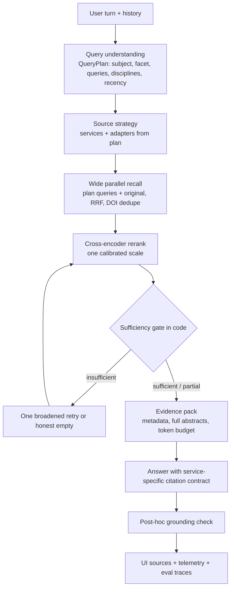

# Qube Knowledge Retrieval & Utilization — Technical Assessment

**Status:** Investigation complete · no implementation in this document  
**Context:** Independent assessment following the Actor–Network Theory `@evidence` session (2026-11-21) and prior agent recommendations  
**Audience:** Engineering — use as the strategy baseline for retrieval quality work  

---

## 1. Executive assessment

### What actually failed on the ANT turn

The failure was not one bug. It was a **stack of weak gates**, each letting poor material through because **nothing downstream was calibrated to catch it**:

1. **Query understanding** — Turn 2 was not classified as a follow-up (`confidence 0.0`). Discourse state had already **replaced** the conversation subject from actor-network theory with **“Artificial Inteligence”** (user’s spelling). The APIs received the raw sentence, typo included: `Yes, please tell me how ANT analyzes Artificial Inteligence for example`.
2. **Source selection** — Discipline detection scored **0 for every discipline** → `general_science` → **only OpenAlex + arXiv**, 3 results each, despite **39 enabled adapters**. arXiv is a poor default index for STS/sociology questions.
3. **Relevance filtering** — The `0.12` minimum score **cannot reject anything** while embeddings are on; unrelated text still scores ~**0.44**.
4. **Confidence labels** — “Adequate” coverage and “confidence 0.68” reflect **count of abstracts and index authority**, not topical fit.
5. **Answer generation** — Prompts say “You MUST use the TOOLS context” and “Every factual sentence … must end with a citation token.” The model complied and cited off-topic papers.
6. **Verification** — Post-generation checks only that citation **ids exist**. Nothing verifies that a cited source supports the sentence.

### Verdict on the previous agent’s analysis

| | |
|---|---|
| **Sound diagnoses** | Missed follow-up → no query expansion; sidecar expansion not wired to web; coverage ignores relevance; need multi-turn eval |
| **Missed entirely** | Tiny candidate pool + narrow source selection; non-functional relevance scale; prompt forces citation; `@[tool:evidence]` in model prompt; 600-char abstract truncation; no source metadata for model; dead reliability/freshness scores; medical-disclaimer branch drops citation rules |
| **Wrong or would not have helped** | “Always expand with discourse topic” would search `Regarding Artificial Inteligence: …` (wrong anchor). Coverage threshold 0.35 is below the broken score floor (turn averaged 0.63). Homograph penalty is ANT-specific |

### Core thesis

Qube does **not** need more layers. It needs **fewer, calibrated ones**:

1. One **structured query-understanding** step  
2. **Wide recall → one real reranker**  
3. **Sufficiency decision in code** (not the LLM)  
4. **Evidence pack** the model can reason over  
5. **Citation rules** that allow “sources don’t cover this”  
6. **Eval harness** measuring each stage  

Much of the current pile of regex heuristics is **compensating for weak upstream signals**; once those are fixed, complexity should **shrink**, not grow.

---

## 2. Current architecture (as implemented)

```text
Composer (@evidence) → attachment routing (force WEB) → discourse (often skipped)
  → build_resolved_retrieval_query → run_v2_web_retrieval (scientific_evidence)
  → ScientificEvidencePipeline (plan → adapters → score_rows → bundle)
  → _format_sources_for_llm_prompt → native LLM → citation renumber / integrity (id-level only)
```

| Stage | Key code | Behavior |
|--------|----------|----------|
| Composer | `core/composer_attachments.py` | Forces `web` / `attachment_tool_evidence`; bypasses cognitive router |
| Persistence | `workers/llm_worker.py` ~1906, ~2120 | **Raw** prompt (with `@[tool:…]`) stored and reloaded as history |
| Discourse | `core/discourse_intent.py`, `core/discourse_query.py` | Follow-up threshold 0.55; `web_text` expansion only when `follow_up.active` |
| Service | `core/knowledge/registry.py`, `web_retrieval.py` | `evidence` → `scientific_evidence` |
| Pipeline | `core/knowledge/pipeline_scientific.py` | `plan_scientific_query` → parallel adapters → `score_rows` (min 0.12) → MMR → bundle |
| Prompt | `workers/llm_worker.py`, `core/prompt_renderers.py`, `core/prompt_blocks.py` | Title + excerpt (often `abstract[:600]`); **4500 char** total slice; same WEB persona for all services |
| Post-gen | `core/citation_integrity.py`, `core/citation_renumber.py` | Id-level only; enforcement **off by default** |

**Other tools (same family, different gaps):**

- **`@trusted`** — Wikipedia + DDG, then allowlist filter; no `site:` restriction  
- **`@internet`** — DDG + optional page fetch; balanced profile often **single-page** bundle  
- **`@research`** — LLM/heuristic decompose; **scientific indexes only** (`conversations_view.py:4707`); merge/ranker issues documented in audit  

---

## 3. Identified weaknesses

### 3.1 Query understanding (verified)

- **Follow-up classifier** misses common continuations (`core/discourse_intent.py`):  
  - `why`/`how` only at line start → “Yes, please tell me **how**…” fails  
  - Capitalized multi-word phrases → `explicit_entity_penalty`  
  - Non-follow-ups capped at confidence **0.45**  
  - Reproduction: ANT turn 2 → `kind=NONE`, `confidence=0.0`; “Sure, go on” → `ELLIPSIS` at **0.50** (below 0.55)
- **Single-slot discourse state** (`core/discourse_state.py`): facet “Artificial Inteligence” **overwrites** subject; turn 1 topic retained stray `?>`
- **Filler/typos** hit APIs unchanged; OpenAlex returned *OPENING ADDRESS* (1893)
- **Composer token** reaches model in `USER QUERY:` and history
- **No current date / recency** in prompts (grep: no injection in prompt modules)

### 3.2 Source selection & recall (verified)

- `resolve_service_adapters` → `('openalex', 'arxiv')` for both raw and ideal STS query  
- Sociology patterns omit STS vocabulary (`core/knowledge/scientific_discipline.py`)  
- **`per_adapter = max(2, budget)`** → ~6 candidates max on balanced profile  
- `@research` scholarly-only; profile `materialize_budget` takes **min** with app profile (thorough clamped)

### 3.3 Relevance scoring (verified + measured)

`core/knowledge/ranking/relevance.py`:

- Semantic leg uses `(cosine + 1) / 2` → unrelated docs still ~0.43+ combined score  
- **`min_score=0.12` is dead** with embeddings on (Jina v2 small: unrelated trial cos ~0.58)  
- Token overlap counts filler words  
- Web gate uses **raw** cosine; scientific uses `(cos+1)/2` — inconsistent scales  
- **No cross-encoder reranker** in knowledge pipelines (fastembed `TextCrossEncoder` available in app venv)

### 3.4 Credibility & confidence signals (verified)

- `_compute_scientific_coverage` — counts only; ignores relevance  
- **`_reliability_score` computed then discarded** — object uses `authority * 0.9` (`bundle_builder.py` ~579 vs ~601)  
- **`apply_reliability_scores`** compares each row to a **copy**, so self-comparison bug (`reliability.py`)  
- **Freshness** computed, never stored on scientific objects  
- OpenAlex rows **`peer_reviewed: True`** for all works  
- Conflict detection: regex stance; positions not passed to model; scientific bundles `conflicts=()`  

### 3.5 Utilization in the answer (verified)

- Model sees title + **600-char** excerpt; full abstract unused; **4500-char** blunt total budget  
- No year, venue, preprint/peer-review, coverage, warnings in prompt  
- **WEB persona + mandatory citation exemplar** even for `@evidence`  
- **`scientific_medical_disclaimer` branch** runs before WEB branch → drops citation persona (`prompt_blocks.py` 241–243 vs 276–307)

### 3.6 Post-generation (verified)

- Citation integrity: ids only; enforce default **false**  
- `response_quality` `coherence_issue` false positives (“is not”, “cannot”)  
- **No claim ↔ source support check**

### 3.7 Robustness (per audit — verify before fixing)

- Pacing timeout → 30 min DDG backoff  
- DDG 429/403: no fallback  
- Unbounded `Retry-After`  
- Adapter exceptions swallowed  
- Evidence cache key ignores budget  

### 3.8 Evaluation (verified)

- `eval/retrieval_corpus/v1_scientific.json` — single-turn; adapter/abstract checks, not topical relevance  
- No multi-turn composer or “no good source” cases  

---

## 4. Assessment of previous recommendations

| Rec | Verdict |
|-----|---------|
| **A1** Composer + always discourse anchor expansion | **Modify** — real problem; wrong mechanism (wrong anchor = wrong query) → use **QueryPlan** (R1) |
| **A2** Sidecar dual web retrieval (PR3) | **Replace** — doubles DDG load; sidecar gated on failed follow-up → **multi-query from plan + RRF** |
| **A3** Relevance-aware coverage | **Sound goal** — only after fixing relevance scale (R3) |
| **A4** Anchor/homograph penalties | **Reject** — ANT-specific; porting broken deep-research anchor logic |
| **B1** Follow-up regex fixes | **Hygiene only** — doesn’t fix single-slot topic |
| **B2** Topic-aware planner | Subsumed by **R1** |
| **B3** Entity from resolved query | **Accept**, lower priority |
| **C1** Insufficient-evidence path | **Accept** — must **drop** weak sources in code, not prompt-only |
| **C2** Multi-turn eval corpus | **Accept** — add graded relevance + abstain cases |
| First PR = A1+B1+A3 | **Reject order** — perfect query still fails on pool + dead gate + forced cite |

---

## 5. Additional recommendations

### R1 — Structured query understanding (`QueryPlan`)

- Optional **one short JSON call** per retrieval turn (not plain chat)  
- Fields: `standalone_question`, `subject`, `facet`, 1–3 `search_queries`, `disciplines`, `recency_need`, `answer_type`, `ambiguous`  
- Fallback chain: main model → sidecar (timeout) → heuristics  
- Fixes typos, lost subject, facet vs subject  

### R2 — Wide recall

- 10–20 results per adapter (parallel); add Semantic Scholar + Crossref to general/social fallbacks  
- Plan queries + original → RRF + DOI dedupe  
- Watch Semantic Scholar rate limits  

### R3 — One cross-encoder reranker (all pipelines)

- fastembed `TextCrossEncoder` (e.g. `ms-marco-MiniLM-L-6-v2`, `jina-reranker-v1-tiny-en`)  
- Score `(standalone_question, title + abstract)`; calibrated keep/drop from eval  
- MMR for diversity only  

### R4 — Sufficiency gate (code)

- States: sufficient / partial / insufficient / none from reranker scores + agreement  
- Below threshold → **never in prompt**; one broadened retry from plan if insufficient  
- Aligns with single-tool / no chain policy  

### R5 — Evidence pack for the model

- Per-source header: year, venue, type, preprint vs peer-reviewed  
- Full abstracts (~1500 chars); drop whole sources, not mid-slice  
- Token budget tied to n_ctx (e.g. 6–8k tokens retrieval block on 32k)  
- Plain-language sufficiency + warnings line  

### R6 — Prompt contract rewrite

- Personas per service (scholarly / trusted / web)  
- “Cite only claims sources support; label general knowledge; if sources don’t address question, say so first”  
- Disclaimers **compose** with evidence rules, don’t replace WEB branch  
- Strip composer tokens from history; inject current date  

### R7 — Honest scores

- Wire reliability + freshness into objects and coverage/confidence  
- Fix OpenAlex `peer_reviewed` from work metadata  
- Fix adapter attribution labels  

### R8 — Post-generation grounding (telemetry first)

- Per cited sentence ↔ cited source (reranker proxy → optional NLI)  
- After calibration: strip unsupported cites or add caution  

### R9 — Recency

- `recency_need` from plan → adapter filters/sort where supported  

### R10 — Orchestration consistency

- `@research`: same plan + reranker; non-scholarly queries → trusted/web  
- Fix profile min clamp, merge top-K cap  
- `@internet` multi-page; `@trusted` `site:` scoping  

### R11 — Robustness

- DDG backoff mapping, 429 handling, bounded Retry-After  
- Surface adapter failures in sufficiency state  

### R12 — Consolidation (after eval proof)

- Demote redundant regex discipline/query-type/slot heuristics when plan + reranker wins  

---

## 6. Proposed target architecture



**Principles:**

- One plan per turn  
- **Code decides what evidence the model sees** (model-agnostic quality)  
- One relevance scale, calibrated on eval  
- Every displayed score means something  

---

## 7. Prioritized implementation roadmap

| Phase | Work | Impact | Complexity | Latency | Risk |
|-------|------|--------|------------|---------|------|
| **0** | Eval harness + record/replay fixtures; baseline metrics | Enables all work | M | None | None |
| **1** | R5–R7 prompt/evidence pack, token strip, citation contract, score bugs | High (honesty) | S–M | Neutral | Low |
| **2** | R2–R4 wide recall + cross-encoder + sufficiency gate | **Highest relevance** | M | +0.2–1s (est.) | Medium |
| **3** | R1 QueryPlan + subject/facet discourse + multi-query (R9) | High multi-turn | M | +1–8s (measure) | Medium |
| **4** | R8 grounding check, token-aware context budget | Faithfulness | M | Post-stream | Low–med |
| **5** | R10–R11 orchestration + robustness; R12 consolidation | Consistency | M–L | Mixed | Medium |

**Rationale:** Phase 1+2 stop garbage reaching the model and allow honest “sources don’t cover this” even before perfect query understanding.

---

## 8. Testing and validation strategy

### Corpus (~150 cases)

- Single-turn; multi-turn follow-ups (affirmation, pronoun, facet shift)  
- Acronyms/homographs; humanities/STS; recency; medical+disclaimer  
- **Expected abstain** (no good source)  

### Labels

- Human core (~50) with graded source relevance  
- Offline LLM judge calibrated to human labels (**eval only**)  

### Deterministic replay

- Snapshot adapter responses for offline ranking/prompt changes  
- Separate live runs for recall drift  

### Stage metrics

| Stage | Metrics |
|--------|---------|
| Plan | Subject/facet preserved; standalone question correct |
| Recall | Relevant doc in candidate pool |
| Rank | precision@k, nDCG@k on kept sources |
| Gate | Abstain precision/recall |
| Answer | Citation precision; unsupported-claim rate; answer relevance |
| Ops | p50/p95 latency; API calls per turn |

### Gates

- CI on replay corpus; periodic live eval for provider drift  
- Same corpus on multiple local models (Qwen 9B, Phi-4-mini, etc.)  

### Telemetry

- Extend `retrieval_trace`: reranker scores, sufficiency state, grounding scores; track insufficient-evidence rate  

### Open uncertainties

- QueryPlan latency on target hardware  
- Cross-encoder on humanities abstracts  
- Semantic Scholar quotas  
- Reranker model licenses  

**Phase 0 + replay fixtures resolve these before shipping.**

---

## 9. Key file reference (implementation hooks)

| Concern | Primary files |
|---------|----------------|
| Composer routing | `core/composer_attachments.py`, `workers/llm_worker.py` |
| Follow-up / discourse | `core/discourse_intent.py`, `core/discourse_state.py`, `core/discourse_query.py` |
| Sidecar expansion | `core/sidecar_query_rewrite.py`, `core/dual_query_retrieval.py` |
| Scientific retrieve | `core/knowledge/pipeline_scientific.py`, `scientific_query_planner.py`, `scientific_discipline.py` |
| Relevance | `core/knowledge/ranking/relevance.py`, `core/retrieval_relevance.py` |
| Coverage / bundle | `core/knowledge/bundle_builder.py`, `ranking/stopping.py` |
| Prompt / context | `core/prompt_blocks.py`, `core/prompt_renderers.py`, `workers/llm_worker.py` (`_format_sources_for_llm_prompt`) |
| Citations | `core/citation_integrity.py`, `core/citation_renumber.py`, `core/response_quality.py` |
| Deep research | `core/knowledge/deep_research.py`, `deep_research_merge.py`, `workers/deep_research_worker.py` |
| Eval | `eval/retrieval_corpus/`, `tools/evaluate_retrieval.py` |
| Platform plan | `docs/external_knowledge_platform_plan.md` |

---

## 10. Session reference (ANT repro)

- Session: `07014912-76ca-49b0-a878-dbee461f3766`  
- Turn 2: `@[tool:evidence]` + ANT / AI example  
- Stored `query_resolved`: raw sentence (no expansion)  
- Retrieved (examples): XAI healthcare review; *Artificial Ant Colonies*; *Artificial Scientist* (AGI)  
- Logs: `~/.qube/logs/llm_debug.log`, DB: `~/.qube/qube_data.db`  

---

## 11. Next step (when implementing)

1. **Phase 0** — fixtures from ANT session + 20–30 labeled cases; baseline metrics  
2. **Phase 1** — prompt contract, evidence pack, composer token strip, medical/WEB branch fix, wire dead scores  
3. **Phase 2** — cross-encoder + sufficiency gate + modest recall widening  

Do not start code changes until Phase 0 baseline exists (per product request at time of this document).

---

*Document generated from independent codebase investigation. Subagent audits: knowledge pipelines (`913a6f27`), prompt/citation path (`87e91ee2`).*