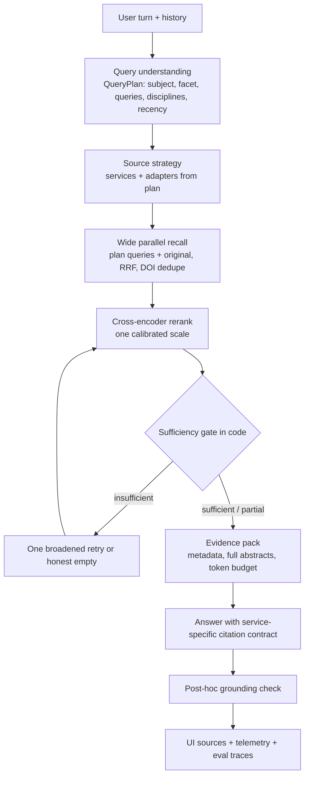
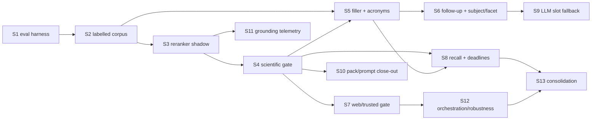

# Qube Knowledge Retrieval & Utilization — Technical Assessment

**Status:** Investigation complete · no implementation in this document  
**Context:** Independent assessment following the Actor–Network Theory `@evidence` session (2026-11-21) and prior agent recommendations  
**Audience:** Engineering — use as the strategy baseline for retrieval quality work  
**Plan of record:** §12 (pre-implementation review, 2026-11-23) supersedes §5 and §7 wherever they conflict. §1–11 are kept unchanged as the original assessment.  

---

## 1. Executive assessment

### What actually failed on the ANT turn

The failure was not one bug. It was a **stack of weak gates**, each letting poor material through because **nothing downstream was calibrated to catch it**:

1. **Query understanding** — Turn 2 was not classified as a follow-up (`confidence 0.0`). Discourse state had already **replaced** the conversation subject from actor-network theory with **“Artificial Inteligence”** (user’s spelling). The APIs received the raw sentence, typo included: `Yes, please tell me how ANT analyzes Artificial Inteligence for example`.
2. **Source selection** — Discipline detection scored **0 for every discipline** → `general_science` → **only OpenAlex + arXiv**, 3 results each, despite **39 enabled adapters**. arXiv is a poor default index for STS/sociology questions.
3. **Relevance filtering** — The `0.12` minimum score **cannot reject anything** while embeddings are on; unrelated text still scores ~**0.44**.
4. **Confidence labels** — “Adequate” coverage and “confidence 0.68” reflect **count of abstracts and index authority**, not topical fit.
5. **Answer generation** — Prompts say “You MUST use the TOOLS context” and “Every factual sentence … must end with a citation token.” The model complied and cited off-topic papers.
6. **Verification** — Post-generation checks only that citation **ids exist**. Nothing verifies that a cited source supports the sentence.

### Verdict on the previous agent’s analysis

| | |
|---|---|
| **Sound diagnoses** | Missed follow-up → no query expansion; sidecar expansion not wired to web; coverage ignores relevance; need multi-turn eval |
| **Missed entirely** | Tiny candidate pool + narrow source selection; non-functional relevance scale; prompt forces citation; `@[tool:evidence]` in model prompt; 600-char abstract truncation; no source metadata for model; dead reliability/freshness scores; medical-disclaimer branch drops citation rules |
| **Wrong or would not have helped** | “Always expand with discourse topic” would search `Regarding Artificial Inteligence: …` (wrong anchor). Coverage threshold 0.35 is below the broken score floor (turn averaged 0.63). Homograph penalty is ANT-specific |

### Core thesis

Qube does **not** need more layers. It needs **fewer, calibrated ones**:

1. One **structured query-understanding** step  
2. **Wide recall → one real reranker**  
3. **Sufficiency decision in code** (not the LLM)  
4. **Evidence pack** the model can reason over  
5. **Citation rules** that allow “sources don’t cover this”  
6. **Eval harness** measuring each stage  

Much of the current pile of regex heuristics is **compensating for weak upstream signals**; once those are fixed, complexity should **shrink**, not grow.

---

## 2. Current architecture (as implemented)

```text
Composer (@evidence) → attachment routing (force WEB) → discourse (often skipped)
  → build_resolved_retrieval_query → run_v2_web_retrieval (scientific_evidence)
  → ScientificEvidencePipeline (plan → adapters → score_rows → bundle)
  → _format_sources_for_llm_prompt → native LLM → citation renumber / integrity (id-level only)
```

| Stage | Key code | Behavior |
|--------|----------|----------|
| Composer | `core/composer_attachments.py` | Forces `web` / `attachment_tool_evidence`; bypasses cognitive router |
| Persistence | `workers/llm_worker.py` ~1906, ~2120 | **Raw** prompt (with `@[tool:…]`) stored and reloaded as history |
| Discourse | `core/discourse_intent.py`, `core/discourse_query.py` | Follow-up threshold 0.55; `web_text` expansion only when `follow_up.active` |
| Service | `core/knowledge/registry.py`, `web_retrieval.py` | `evidence` → `scientific_evidence` |
| Pipeline | `core/knowledge/pipeline_scientific.py` | `plan_scientific_query` → parallel adapters → `score_rows` (min 0.12) → MMR → bundle |
| Prompt | `workers/llm_worker.py`, `core/prompt_renderers.py`, `core/prompt_blocks.py` | Title + excerpt (often `abstract[:600]`); **4500 char** total slice; same WEB persona for all services |
| Post-gen | `core/citation_integrity.py`, `core/citation_renumber.py` | Id-level only; enforcement **off by default** |

**Other tools (same family, different gaps):**

- **`@trusted`** — Wikipedia + DDG, then allowlist filter; no `site:` restriction  
- **`@internet`** — DDG + optional page fetch; balanced profile often **single-page** bundle  
- **`@research`** — LLM/heuristic decompose; **scientific indexes only** (`conversations_view.py:4707`); merge/ranker issues documented in audit  

---

## 3. Identified weaknesses

### 3.1 Query understanding (verified)

- **Follow-up classifier** misses common continuations (`core/discourse_intent.py`):  
  - `why`/`how` only at line start → “Yes, please tell me **how**…” fails  
  - Capitalized multi-word phrases → `explicit_entity_penalty`  
  - Non-follow-ups capped at confidence **0.45**  
  - Reproduction: ANT turn 2 → `kind=NONE`, `confidence=0.0`; “Sure, go on” → `ELLIPSIS` at **0.50** (below 0.55)
- **Single-slot discourse state** (`core/discourse_state.py`): facet “Artificial Inteligence” **overwrites** subject; turn 1 topic retained stray `?>`
- **Filler/typos** hit APIs unchanged; OpenAlex returned *OPENING ADDRESS* (1893)
- **Composer token** reaches model in `USER QUERY:` and history
- **No current date / recency** in prompts (grep: no injection in prompt modules)

### 3.2 Source selection & recall (verified)

- `resolve_service_adapters` → `('openalex', 'arxiv')` for both raw and ideal STS query  
- Sociology patterns omit STS vocabulary (`core/knowledge/scientific_discipline.py`)  
- **`per_adapter = max(2, budget)`** → ~6 candidates max on balanced profile  
- `@research` scholarly-only; profile `materialize_budget` takes **min** with app profile (thorough clamped)

### 3.3 Relevance scoring (verified + measured)

`core/knowledge/ranking/relevance.py`:

- Semantic leg uses `(cosine + 1) / 2` → unrelated docs still ~0.43+ combined score  
- **`min_score=0.12` is dead** with embeddings on (Jina v2 small: unrelated trial cos ~0.58)  
- Token overlap counts filler words  
- Web gate uses **raw** cosine; scientific uses `(cos+1)/2` — inconsistent scales  
- **No cross-encoder reranker** in knowledge pipelines (fastembed `TextCrossEncoder` available in app venv)

### 3.4 Credibility & confidence signals (verified)

- `_compute_scientific_coverage` — counts only; ignores relevance  
- **`_reliability_score` computed then discarded** — object uses `authority * 0.9` (`bundle_builder.py` ~579 vs ~601)  
- **`apply_reliability_scores`** compares each row to a **copy**, so self-comparison bug (`reliability.py`)  
- **Freshness** computed, never stored on scientific objects  
- OpenAlex rows **`peer_reviewed: True`** for all works  
- Conflict detection: regex stance; positions not passed to model; scientific bundles `conflicts=()`  

### 3.5 Utilization in the answer (verified)

- Model sees title + **600-char** excerpt; full abstract unused; **4500-char** blunt total budget  
- No year, venue, preprint/peer-review, coverage, warnings in prompt  
- **WEB persona + mandatory citation exemplar** even for `@evidence`  
- **`scientific_medical_disclaimer` branch** runs before WEB branch → drops citation persona (`prompt_blocks.py` 241–243 vs 276–307)

### 3.6 Post-generation (verified)

- Citation integrity: ids only; enforce default **false**  
- `response_quality` `coherence_issue` false positives (“is not”, “cannot”)  
- **No claim ↔ source support check**

### 3.7 Robustness (per audit — verify before fixing)

- Pacing timeout → 30 min DDG backoff  
- DDG 429/403: no fallback  
- Unbounded `Retry-After`  
- Adapter exceptions swallowed  
- Evidence cache key ignores budget  

### 3.8 Evaluation (verified)

- `eval/retrieval_corpus/v1_scientific.json` — single-turn; adapter/abstract checks, not topical relevance  
- No multi-turn composer or “no good source” cases  

---

## 4. Assessment of previous recommendations

| Rec | Verdict |
|-----|---------|
| **A1** Composer + always discourse anchor expansion | **Modify** — real problem; wrong mechanism (wrong anchor = wrong query) → use **QueryPlan** (R1) |
| **A2** Sidecar dual web retrieval (PR3) | **Replace** — doubles DDG load; sidecar gated on failed follow-up → **multi-query from plan + RRF** |
| **A3** Relevance-aware coverage | **Sound goal** — only after fixing relevance scale (R3) |
| **A4** Anchor/homograph penalties | **Reject** — ANT-specific; porting broken deep-research anchor logic |
| **B1** Follow-up regex fixes | **Hygiene only** — doesn’t fix single-slot topic |
| **B2** Topic-aware planner | Subsumed by **R1** |
| **B3** Entity from resolved query | **Accept**, lower priority |
| **C1** Insufficient-evidence path | **Accept** — must **drop** weak sources in code, not prompt-only |
| **C2** Multi-turn eval corpus | **Accept** — add graded relevance + abstain cases |
| First PR = A1+B1+A3 | **Reject order** — perfect query still fails on pool + dead gate + forced cite |

---

## 5. Additional recommendations

### R1 — Structured query understanding (`QueryPlan`)

- Optional **one short JSON call** per retrieval turn (not plain chat)  
- Fields: `standalone_question`, `subject`, `facet`, 1–3 `search_queries`, `disciplines`, `recency_need`, `answer_type`, `ambiguous`  
- Fallback chain: main model → sidecar (timeout) → heuristics  
- Fixes typos, lost subject, facet vs subject  

### R2 — Wide recall

- 10–20 results per adapter (parallel); add Semantic Scholar + Crossref to general/social fallbacks  
- Plan queries + original → RRF + DOI dedupe  
- Watch Semantic Scholar rate limits  

### R3 — One cross-encoder reranker (all pipelines)

- fastembed `TextCrossEncoder` (e.g. `ms-marco-MiniLM-L-6-v2`, `jina-reranker-v1-tiny-en`)  
- Score `(standalone_question, title + abstract)`; calibrated keep/drop from eval  
- MMR for diversity only  

### R4 — Sufficiency gate (code)

- States: sufficient / partial / insufficient / none from reranker scores + agreement  
- Below threshold → **never in prompt**; one broadened retry from plan if insufficient  
- Aligns with single-tool / no chain policy  

### R5 — Evidence pack for the model

- Per-source header: year, venue, type, preprint vs peer-reviewed  
- Full abstracts (~1500 chars); drop whole sources, not mid-slice  
- Token budget tied to n_ctx (e.g. 6–8k tokens retrieval block on 32k)  
- Plain-language sufficiency + warnings line  

### R6 — Prompt contract rewrite

- Personas per service (scholarly / trusted / web)  
- “Cite only claims sources support; label general knowledge; if sources don’t address question, say so first”  
- Disclaimers **compose** with evidence rules, don’t replace WEB branch  
- Strip composer tokens from history; inject current date  

### R7 — Honest scores

- Wire reliability + freshness into objects and coverage/confidence  
- Fix OpenAlex `peer_reviewed` from work metadata  
- Fix adapter attribution labels  

### R8 — Post-generation grounding (telemetry first)

- Per cited sentence ↔ cited source (reranker proxy → optional NLI)  
- After calibration: strip unsupported cites or add caution  

### R9 — Recency

- `recency_need` from plan → adapter filters/sort where supported  

### R10 — Orchestration consistency

- `@research`: same plan + reranker; non-scholarly queries → trusted/web  
- Fix profile min clamp, merge top-K cap  
- `@internet` multi-page; `@trusted` `site:` scoping  

### R11 — Robustness

- DDG backoff mapping, 429 handling, bounded Retry-After  
- Surface adapter failures in sufficiency state  

### R12 — Consolidation (after eval proof)

- Demote redundant regex discipline/query-type/slot heuristics when plan + reranker wins  

---

## 6. Proposed target architecture



**Principles:**

- One plan per turn  
- **Code decides what evidence the model sees** (model-agnostic quality)  
- One relevance scale, calibrated on eval  
- Every displayed score means something  

---

## 7. Prioritized implementation roadmap

| Phase | Work | Impact | Complexity | Latency | Risk |
|-------|------|--------|------------|---------|------|
| **0** | Eval harness + record/replay fixtures; baseline metrics | Enables all work | M | None | None |
| **1** | R5–R7 prompt/evidence pack, token strip, citation contract, score bugs | High (honesty) | S–M | Neutral | Low |
| **2** | R2–R4 wide recall + cross-encoder + sufficiency gate | **Highest relevance** | M | +0.2–1s (est.) | Medium |
| **3** | R1 QueryPlan + subject/facet discourse + multi-query (R9) | High multi-turn | M | +1–8s (measure) | Medium |
| **4** | R8 grounding check, token-aware context budget | Faithfulness | M | Post-stream | Low–med |
| **5** | R10–R11 orchestration + robustness; R12 consolidation | Consistency | M–L | Mixed | Medium |

**Rationale:** Phase 1+2 stop garbage reaching the model and allow honest “sources don’t cover this” even before perfect query understanding.

---

## 8. Testing and validation strategy

### Corpus (~150 cases)

- Single-turn; multi-turn follow-ups (affirmation, pronoun, facet shift)  
- Acronyms/homographs; humanities/STS; recency; medical+disclaimer  
- **Expected abstain** (no good source)  

### Labels

- Human core (~50) with graded source relevance  
- Offline LLM judge calibrated to human labels (**eval only**)  

### Deterministic replay

- Snapshot adapter responses for offline ranking/prompt changes  
- Separate live runs for recall drift  

### Stage metrics

| Stage | Metrics |
|--------|---------|
| Plan | Subject/facet preserved; standalone question correct |
| Recall | Relevant doc in candidate pool |
| Rank | precision@k, nDCG@k on kept sources |
| Gate | Abstain precision/recall |
| Answer | Citation precision; unsupported-claim rate; answer relevance |
| Ops | p50/p95 latency; API calls per turn |

### Gates

- CI on replay corpus; periodic live eval for provider drift  
- Same corpus on multiple local models (Qwen 9B, Phi-4-mini, etc.)  

### Telemetry

- Extend `retrieval_trace`: reranker scores, sufficiency state, grounding scores; track insufficient-evidence rate  

### Open uncertainties

- QueryPlan latency on target hardware  
- Cross-encoder on humanities abstracts  
- Semantic Scholar quotas  
- Reranker model licenses  

**Phase 0 + replay fixtures resolve these before shipping.**

---

## 9. Key file reference (implementation hooks)

| Concern | Primary files |
|---------|----------------|
| Composer routing | `core/composer_attachments.py`, `workers/llm_worker.py` |
| Follow-up / discourse | `core/discourse_intent.py`, `core/discourse_state.py`, `core/discourse_query.py` |
| Sidecar expansion | `core/sidecar_query_rewrite.py`, `core/dual_query_retrieval.py` |
| Scientific retrieve | `core/knowledge/pipeline_scientific.py`, `scientific_query_planner.py`, `scientific_discipline.py` |
| Relevance | `core/knowledge/ranking/relevance.py`, `core/retrieval_relevance.py` |
| Coverage / bundle | `core/knowledge/bundle_builder.py`, `ranking/stopping.py` |
| Prompt / context | `core/prompt_blocks.py`, `core/prompt_renderers.py`, `workers/llm_worker.py` (`_format_sources_for_llm_prompt`) |
| Citations | `core/citation_integrity.py`, `core/citation_renumber.py`, `core/response_quality.py` |
| Deep research | `core/knowledge/deep_research.py`, `deep_research_merge.py`, `workers/deep_research_worker.py` |
| Eval | `eval/retrieval_corpus/`, `tools/evaluate_retrieval.py` |
| Platform plan | `docs/external_knowledge_platform_plan.md` |

---

## 10. Session reference (ANT repro)

- Session: `07014912-76ca-49b0-a878-dbee461f3766`  
- Turn 2: `@[tool:evidence]` + ANT / AI example  
- Stored `query_resolved`: raw sentence (no expansion)  
- Retrieved (examples): XAI healthcare review; *Artificial Ant Colonies*; *Artificial Scientist* (AGI)  
- Logs: `~/.qube/logs/llm_debug.log`, DB: `~/.qube/qube_data.db`  

---

## 11. Next step (when implementing)

1. **Phase 0** — fixtures from ANT session + 20–30 labeled cases; baseline metrics  
2. **Phase 1** — prompt contract, evidence pack, composer token strip, medical/WEB branch fix, wire dead scores  
3. **Phase 2** — cross-encoder + sufficiency gate + modest recall widening  

Do not start code changes until Phase 0 baseline exists (per product request at time of this document).

---

*Document generated from independent codebase investigation. Subagent audits: knowledge pipelines (`913a6f27`), prompt/citation path (`87e91ee2`).*

---

## 12. Pre-implementation review & staged plan (2026-11-23)

> **Plan of record for all remaining work.** Where this section conflicts with §5 (recommendations) or §7 (roadmap), this section wins. Stage ids **S1–S13** are used in the progress log from here on; R-numbers (§5) are kept as cross-references.

### 12.1 Assumptions validated before committing to the architecture

Measured on the dev laptop (Ryzen 7 7840HS, 8C/16T, 28 GB, CPU-only, normal desktop load). These were ad-hoc scripts. S1 and S3 turn them into repeatable `tools/` commands.

| # | Assumption (§5/§7) | Finding | Consequence for the plan |
|---|--------------------|---------|--------------------------|
| **V1** | A cross-encoder fixes relevance | `Xenova/ms-marco-MiniLM-L-6-v2` separates on- and off-topic rows strongly in 5 domains. OAuth papers scored +2.6…+7.5 vs fluid-"flow" arXiv papers ≤ −10. ANT/STS papers vs ant-colony / XAI papers separated the same way. **Fine ordering within a topic is mediocre**: for the ACE query, a paediatric-extrapolation paper ranked 1st. `jina-reranker-v1-tiny-en` / `-turbo-en` separated worse; an irrelevant IT-projects paper outscored most ANT papers. | Use MiniLM-L-6 as a **topical gate and coarse ranker**, not a quality oracle. Thresholds come from the S2 corpus, not from guesses. |
| **V2** | The reranker rescues the ANT turn | **No.** With the raw turn-2 text as the question, all 18 real candidates score −3…−11 (none positive), and "Artificial Ant Colonies" ranks 2nd. With a standalone question ("How does actor-network theory (ANT) analyze artificial intelligence systems?"), the real ANT papers rise to +0.4…+7.9 and every irrelevant row is ≤ −1.2. | Reranker + gate turns garbage into **honest abstention**. Only query resolution turns it into a **good answer**. Both are needed, and neither replaces the other. |
| **V3** | Recall is a main bottleneck (R2) | Same 3 adapters (OpenAlex, arXiv, Crossref), 10 rows each. Raw sentence: **0** rows with CE > 0. `actor-network theory artificial intelligence`: **13** rows with CE > 0, including papers exactly on ANT + AI (CE +8.6, +8.5, +8.0). | **Query resolution matters far more than recall widening** for this failure class. R2 becomes a modest, later stage (S8). |
| **V4** | `min_score=0.12` is dead | Confirmed. The combined token+embed score is 0.45–0.88 for every row. jina-v2 cosine is 0.62–0.91, and an ant-colony paper (0.84) beats the ANT papers (0.80). The web gate (`DEFAULT_WEB_MIN_SEMANTIC_SCORE=0.30` on raw cosine, `core/retrieval_relevance.py`) is dead for the same reason. Only the 0.15 token-overlap gate actually filters web hits. | Don't tune these thresholds; replace them with the CE scale (S4, S7). Keep the token gate as the fallback. |
| **V5** | Reranker latency +0.2–1 s | 20 docs at 1500 chars: 0.4–0.6 s. 60 docs: 1.5 s at 1500 chars, **0.73 s at 800 chars** (Pearson r 0.965 vs the 1500-char scores), 0.38 s at 400 chars (r 0.92). | Rerank on ~800 chars (title + abstract head). The prompt still gets ≤ 1500 chars per source. Cap the rerank pool at 40. |
| **V6** | QueryPlan costs +1–8 s | Sidecar Qwen3-1.7B Q6_K on CPU. Full JSON plan: **11–21 s** with JSON-grammar sampling at 16 threads; 4–8 s without grammar at 8 threads. Minimal `SUBJECT:` / `FACET:` two-liner (17–25 generated tokens): 3–8 s. On quality, the full JSON plan's `standalone_question` / `search_queries` were poor: ANT not expanded, "that group" unresolved, subject and facet split into separate queries. The minimal two-liner was **correct on all 3 cases** (ANT → Actor-Network Theory, OAuth → authorization code flow, statins → older adults). The app runs the sidecar at `n_threads=16` (user setting); 8 threads was ~2× faster. | An LLM QueryPlan **cannot be a blocking per-turn step** on CPU. Do deterministic resolution first (S5, S6). The LLM becomes a gated fallback that emits slots only, and code composes the queries (S9). |
| **V7** | The existing sidecar rewrite helps | `get_sidecar_foreground_timeout_ms()` defaults to **1500 ms**, below the measured 3–8 s, so `propose_query_expansion` probably almost always times out on CPU. **Not yet confirmed from telemetry.** | S9 starts with a telemetry audit before building on that path. |
| **V8** | Add Semantic Scholar to fallbacks | `search_semantic_scholar` returns `[]` without an API key (`authorization_token` check), so it does nothing silently for default users. Its rows also hard-code `peer_reviewed: True` (the same bug fixed for OpenAlex). Crossref is keyless, ~0.7 s, and returns abstracts. Europe PMC took **7.6 s** for one call. | Crossref is the default widening adapter. Semantic Scholar is used only when a key is set. Per-adapter deadlines must exist before any widening (S8). |
| **V9** | The ANT fixture is a replay | Its only `relevant` candidate is **synthetic** (`https://example.org/…`, author "Example, A"). The real pool had **zero** relevant rows. Real ANT/STS and ant-colony rows exist in `~/.qube/evidence_cache/*.json` (18 unique). | The real pool becomes an `expect: insufficient` case. The synthetic row is flagged and excluded from metrics (S1, S2). |
| **V10** | The planner strips conversational filler | `plan_scientific_query` leaves `"Yes, please tell me how ANT analyzes Artificial Inteligence for example"` unchanged for **every** adapter, and OpenAlex always receives `semantic_query`, the raw sentence (`adapter_query_for`). `actor-network theory` scores zero for every discipline and falls back to `general_science`. | S5 fixes filler and acronyms before any adapter call. STS vocabulary goes into S8. |
| **V11** | Dropping weak sources is a pure ranking change | If the gate drops every source, the worker falls into `explicit_web_empty_results` (`workers/llm_worker.py` ~4061). The model is then told the *web search did not return usable results*. That is false when retrieval succeeded and nothing was relevant. | S4 adds a distinct `retrieval_insufficient` state (prompt suffix + UI hint). |
| **V12** | A reranker is easy to ship | `TextCrossEncoder(model_name, specific_model_path=…, threads=N)` loads with `HF_HUB_OFFLINE=1`, the same pattern as `rag/backends/fastembed_backend.py`. MiniLM-L-6 is ~80 MB, Apache-2.0. Rejected alternatives: `jina-reranker-v2-base-multilingual` (CC-BY-NC) and `bge-reranker-base` (MIT, but 1 GB). | Ship it through the existing preset download path (`core/bootstrap_search_download.py`), never via a runtime HF fetch. The model is **English-only**, so non-English queries use the `UNSCORED` fallback (S3). |
| **V13** | Every path applies a relevance gate | **No.** `pipeline_trusted` keeps Wikipedia rows (up to `min(2, budget)`) with **no relevance check**. Only allowlisted SERP rows are gated. `pipeline_finance` gates only when rows exceed the budget, and never with embeddings. *(Found in S2 while writing path-faithful eval rankers.)* | S7 must cover the Wikipedia rows on the trusted path, not only the SERP rows. |
| **V14** | Web pools are a reasonable size | At the Balanced profile `pipeline_general_web._discovery_max_results` asks for **3** SERP rows, and only the top survivor is fetched into the prompt. Scholarly fan-out is wide instead: these preferences resolve 8 adapters for a medical query (PubMed, NICE, CDC, WHO, ClinicalTrials, openFDA, OpenAlex, Europe PMC), 3 rows each. Tiered retrieval is off by default (`QUBE_TIERED_SCIENTIFIC_RETRIEVAL`). | S8: a wider web pool (e.g. 8 rows) comes from the **same single SERP request**, so it costs no extra DuckDuckGo load. The earlier "never widen DuckDuckGo" rule only applies to *extra* requests. |
| **V15** | DuckDuckGo is the web provider | On 2026-11-23 the first DuckDuckGo request from this network got a bot challenge (HTTP 202 anomaly page). Discovery paused DuckDuckGo for 30 min and fell back to **Wikipedia** for every web query. Users see no clear signal that their web search silently became a Wikipedia search. | S12: surface degraded discovery in the sufficiency rationale / UI. S2: web fixtures record their `discovery_provider`, and fallback-provider captures are not used as production baselines. Also: Qube's own burst budget (`session_budget.py`, 6 live DuckDuckGo queries per 10 min, 30 per session) trips silently into the same Wikipedia fallback, and the discovery log reports it as `outcome=bot_challenge`. Discovery telemetry cannot tell "we throttled ourselves" from "DuckDuckGo challenged us". S12 must report the two separately. |
| **V16** | ANT is the only multi-turn failure | **No.** Running `build_discourse_resolution` on the 7 S2 multi-turn cases, **6 send the raw follow-up** ("Yes, please.", "and what about 3.14?", "And how much does it cost to install one?", "Yes, tell me how MS is treated", the ANT turn). The statins case gets the **wrong anchor**: "Regarding Evidence: what about side effects in that group?", where "Evidence" was taken from the assistant's reply. Only the true topic switch (ethanol) is correct, and only because it is self-contained. | Confirms S5 as the highest-leverage stage for multi-turn, and it is not ANT-specific. S5 tests must include the statins wrong-anchor case. |
| **V17** | V7 measured (S9 audit, 2026-11-24) | **Worse than suspected.** 0 of 21 follow-up rewrites finished inside 1500 ms (p50 4.4 s), and every completion was the two tokens `<think>`. Qwen3 under `/no_think` opens with an empty think block, and the sidecar's `"\n\n"` stop ends it there. This breaks every non-title sidecar task on the raw path, not only the rewrite. With the block pre-filled, rewrites still take p50 2.7–5.9 s and mostly repeat S6's text. | The rewrite defaults to off (D10). The bug is reported and fixed only on the new slot task (D9). S9 continues (D11). |
| **V18** | V6's thread figures | **Partly wrong.** The sidecar passes no thread counts, so it decodes at `cpu_count // 2` = 8 and evaluates prompts at `cpu_count` = 16 (llama-cpp-python defaults). The "16" in the log is `os.cpu_count()`, not a user setting. The slowdown is in prompt evaluation: 63 tok/s at 16 batch threads vs 177 at 8. | The inference-settings report (S9) is about `n_threads_batch`, not `n_threads`. |
| **V19** | S6 resolves follow-up subjects (`subject_in_query` 1.00) | **Only on the corpus phrasings.** On a held-out set written in S9 (16 cases), HEAD carries the subject on 5 of 13 non-switch follow-ups. Misses: statement openers ("My daughter was just diagnosed with asthma."), facet nouns read as new subjects ("Is the garbage collector a problem…" after "…backend in Go"), turns classified as follow-ups below threshold, and a framed-noun-phrase bug ("Tell me about metformin." gave no subject). | S9 fixes the two statement shapes that are grammatical and corpus-safe. The rest is the case for the shadow LLM slots (D11), and calibration data for S13. |

Also found: the WIP commit raised `MAX_TOTAL_RETRIEVAL_CHARS` from 4500 to 8000 (`workers/llm_worker.py:344`). This was missing from the progress log and is added below.

**Caveat:** V1–V5 rest on ~110 candidates over 6 questions, labelled by inspection. They are enough to choose the **architecture**. They are **not** enough to set thresholds; those come from S2.

### 12.2 Revised ordering and why it differs from §7

1. **Phase 0 is not finished.** The harness can evaluate only one hard-coded fixture (`evaluate_ant_fixture`), and that fixture's only positive is synthetic (V9). Every later acceptance criterion depends on S1 and S2.
2. **The reranker ships in shadow mode first (S3).** This gives real score distributions with zero behaviour change before any gating.
3. **Gate before query rewriting (S4 → S5/S6).** Query rewriting can anchor to the wrong subject; the gate is the safety net that keeps a wrong rewrite from producing confident, mis-cited answers.
4. **Deterministic query resolution moves up (S5, S6).** The LLM plan (old R1) moves down to S9 as a gated fallback (V6).
5. **Recall widening comes after gate + query fixes (S8).** Without a working gate, more candidates means more noise through dead thresholds.
6. **S7 is not lower priority than S5/S6.** It covers the default `general_web` path most users hit (§12.8). After S4, S5 and S7 are both next, and S7 may go first.



### 12.3 Stage summary

| Stage | Title | Old refs | Changes behaviour? | Hard deps | Size |
|-------|-------|----------|--------------------|-----------|------|
| S1 | Generic fixture eval + graded metrics | Phase 0 | No | — | S |
| S2 | Real labelled corpus + baseline | Phase 0, C2 | No | S1 | M |
| S3 | Reranker module, provisioning, shadow scoring | R3 | No (shadow) | S1 | M |
| S4 | Scientific sufficiency gate + honest "found but not relevant" | R3, R4, C1, A3 | **Yes** | S3, S2 | M |
| S5 | Deterministic query cleanup: filler + acronym expansion | R1 (part), A1 | **Yes** | S2; ship after S4 | S |
| S6 | Follow-up classification + subject/facet discourse | R1, B1, B3 | **Yes** | S5 | M |
| S7 | Gate for web / trusted / finance / legal pipelines + recency | R3, R4, R9 | **Yes** | S4 | M |
| S8 | Modest recall widening + adapter deadlines | R2, R11 (part) | **Yes** | S4, S5 | M |
| S9 | Gated LLM slot extraction (+ sidecar rewrite audit) | R1 | **Yes** (after shadow) | S6 | M |
| S10 | Evidence pack / prompt close-out | R5, R6, R7 | **Yes** | S4 (partly independent) | S |
| S11 | Post-generation grounding telemetry | R8 | No (log-only) | S3 | S–M |
| S12 | Orchestration & robustness | R10, R11 | **Yes** | S4, S7 | M–L |
| S13 | Consolidation of redundant heuristics | R12 | **Yes** | S4–S8 + eval | M |

### 12.4 Stage details

#### S1 — Generic fixture eval + graded metrics

- **Why:** Only one fixture can be evaluated, the eval logic is ANT-specific, and there are no ranking or abstention metrics. Without them, no later stage can prove it improved anything.
- **Changes**
  - `core/knowledge/quality_eval.py`:
    - add `evaluate_fixture(fixture, *, ranker="token" | "embed" | "ce") -> dict`
    - add pure metric functions: `precision_at_k`, `ndcg_at_k` (graded: relevant = 2, partial = 1, irrelevant = 0), `irrelevant_kept_rate`, `relevant_recall`, `abstain_correct`
    - keep `evaluate_ant_fixture` as a thin wrapper with unchanged return keys, because `tests/test_knowledge_quality_phase01.py` depends on it
  - Fixture schema v2 (reads v1). New top-level fields:
    - `expect`: `sufficient` | `partial` | `insufficient`
    - `standalone_question`, `gold_subject`, `gold_facet`
    - `adapter_queries`: what was actually sent to each adapter

    New per-candidate fields:
    - `label`: graded relevance
    - `label_source`: `human` | `model`
    - `synthetic: true`: such rows are excluded from metrics unless `--include-synthetic` is passed
  - `tools/evaluate_knowledge_quality.py`:
    - iterate fixtures generically
    - add `--ranker` and an aggregate metrics table; keep `--json`
    - keep the existing contract-flag exit gate unchanged
    - add optional `--min-<metric>` gates
    - the `embed` ranker skips cleanly, with a reason, when the embedding preset is not on disk
    - *as built:* S1 ships `token` and `embed` only. Both run the production `pipeline_scientific._rank_candidates`, so the eval measures shipped code. `ce` is added in S3 with the reranker module, not as a placeholder now.
    - *as built:* `--query-mode production|standalone`, per-path / per-category tables, and `--compare <baseline.json>` (§12.5 rule 7) are implemented in S1
- **Risks:** breaking the 30 existing Phase 0/1 tests, so names and keys stay stable. Metric definitions drifting between stages, so they are pinned by unit tests.
- **Tests:** unit tests per metric on hand-built rows (ties, empty, all-irrelevant). The existing Phase 0/1 suite passes unchanged.
- **Acceptance:**
  - the CLI evaluates every v1/v2 fixture in the corpus
  - ANT metrics are reported with the synthetic row excluded
  - each metric has a unit test
  - the offline token-ranker run takes < 10 s
- **Dependencies:** none.

#### S2 — Real labelled corpus + baseline

- **Why:** Thresholds for S4/S7 and success criteria for S5/S6/S9 need real candidates across domains, not one acronym collision.
- **Changes**
  - New `tools/capture_knowledge_fixture.py`:
    - runs the scientific adapters (and DDG/trusted for web cases) for a query
    - writes a fixture with the rows, the adapter query sent, and timestamps, with `label: null`
    - can import rows from `~/.qube/evidence_cache/*.json`
    - **writes no scores into the file**, so labelling stays blind to the reranker
  - `eval/fixtures/knowledge_quality/`, **≥ 45 cases**, weighted toward the paths ordinary users hit most (§12.8). Plain chat web turns use `general_web` by default (`get_default_knowledge_service()`), so that path gets the largest share. ANT accounts for **2 of ≥ 45** cases.

    | Path | Category | Cases | Includes |
    |------|----------|-------|----------|
    | `general_web` (default) | Definitions / explainers | 3 | everyday concepts (e.g. "what is a Roth IRA", "how does a heat pump work") |
    | `general_web` | How-to / practical | 3 | software, home, cooking |
    | `general_web` | Entity / product / place lookup | 3 | including an ambiguous name |
    | `general_web` | News / recency | 3 | "latest …", "current …", a year-pinned question |
    | `trusted_knowledge` | Health guidance / official statistics | 3 | WHO, CDC, government sources |
    | `finance_knowledge` | Market / economic data | 2 | |
    | `scientific_evidence` | Biomedical | 3 | |
    | `scientific_evidence` | Social science / psych | 3 | |
    | `scientific_evidence` | STS / humanities | 4 | ANT raw pool = `insufficient`; ANT resolved = `sufficient` |
    | `scientific_evidence` | CS / engineering | 3 | OAuth "how does the flow work" via scholarly sources: a service mismatch, recorded but not gated |
    | `scientific_evidence` | Physics / chemistry / economics | 3 | |
    | any | Acronym / homograph | 3 | spread across paths (e.g. "ACE", "Jaguar", "Mercury") |
    | any | Multi-turn follow-ups | ≥ 6 | affirmation, pronoun, facet shift, ellipsis, and a true topic switch; each with `history`, gold `standalone_question` and gold subject/facet; spread across ≥ 3 paths |
    | any | Abstain | ≥ 4 | at least one each on web and scholarly |

    Each fixture records `path` and `category`, so every metric can be reported per category (§12.5 rule 7).
  - The ANT fixture: flag the synthetic candidate and add the real recorded pool.
  - Record token and embed baselines in the progress log.
  - **Labelling (decision D3):** labels are model-proposed (`label_source: "model"`) and accepted without a separate human review. The §12.6 safeguards apply: blind capture, and borderline labels listed in the progress log.
- **Risks:**
  - label bias: mitigated by blind capture
  - fixtures go stale as providers change: replay is for CI, a separate live run measures drift
  - adapter politeness during capture: sequential, with the existing throttles
- **Tests:** a schema test over all fixtures (every candidate labelled, ids unique, `expect` set).
- **Acceptance:**
  - ≥ 45 cases, of which ≥ 12 are `general_web` and ≥ 4 are recency cases
  - ≥ 400 labelled candidates
  - ≥ 8 `insufficient` cases
  - ≥ 6 multi-turn cases with gold slots
  - a **per-category** baseline table in the log
- **Dependencies:** S1.

- **As built (2026-11-23):**
  - **Corpus:** 48 cases. 20 `general_web`, 21 `scientific_evidence`, 5 `trusted_knowledge`, 2 `finance_knowledge`; 15 categories, 7 multi-turn cases (6 of them `multi_turn`), 5 `abstain`, 4 recency. 672 captured candidates, **all labelled** (`label_source: model`).
  - **Capture** (`tools/capture_knowledge_fixture.py`):
    - calls the same adapter and discovery entry points as each path's pipeline, for the **production** query (from `build_discourse_resolution` for multi-turn cases) and the gold **standalone** query
    - captures 8 rows per adapter, deeper than production uses; each row records `retrieved` (variant, adapter, rank), and the fixture records `production_depth`
    - writes no scores; does not write `~/.qube/evidence_cache`
    - records `discovery_provider` per variant and flags `capture_degraded` when discovery fell back from DuckDuckGo, was challenged, or failed to parse
    - stops the run on the first degraded web capture; `--redo-degraded` resumes
    - paces web discovery at 110 s, under Qube's own burst budget (V15)
  - **Eval changes:**
    - `fixture_pool(query_mode=, pool_mode="production"|"full")` rebuilds the pool production would actually see; `full` is the whole capture, for S8
    - `expect` is derived from labels when not given (`derive_expect`: ≥ 2 relevant → `sufficient`; ≥ 1 useful → `partial`; else `insufficient`). An unlabelled pool gives no verdict.
    - path-faithful rankers in `production_rank` (scientific / general_web / trusted / finance)
    - a missing fixture file or a degraded capture fails the CLI
  - **Baselines:** saved in `eval/retrieval_corpus/baselines/kq_s2_{token,embed}_{production,standalone}.json` for `--compare`.
  - **Labelling rubric:**
    - *relevant*: addresses the subject and the facet
    - *partial*: on the subject and supports part of an answer
    - *irrelevant*: everything else, including the wrong entity that matches only on the facet (another drug, another device, another product model)
  - **Plan deviation (none weakening):** ANT has 3 cases, not 2 (the v1 fixture, a live multi-turn re-capture, and the LLM-deployment abstain case). The "found but not relevant" corpus share is therefore slightly higher than planned.

#### S3 — Reranker module, provisioning, shadow scoring

- **Why:** Introduce the single relevance scale without changing behaviour, and collect real score distributions.
- **Changes**
  - New `core/knowledge/ranking/rerank.py`:
    ```python
    RERANKER_MODEL_ID = "Xenova/ms-marco-MiniLM-L-6-v2"

    @dataclass(frozen=True)
    class RerankResult:
        scores: tuple[float, ...]   # raw logits, same order as input
        model_id: str
        latency_ms: float
        text_chars: int

    def reranker_available() -> bool: ...
    def rerank_row_text(row: dict, *, text_chars: int = 800) -> str: ...  # title + ". " + (full_text or snippet)
    def rerank_texts(question: str, texts: Sequence[str]) -> RerankResult | None: ...
    def rerank_rows(question: str, rows: Sequence[dict], *, text_chars: int = 800,
                    max_rows: int = 40) -> RerankResult | None: ...
    ```
    - lazy, thread-safe singleton
    - `threads=min(4, physical cores)`
    - **never raises**; returns `None` when the model is missing, fails to load, is disabled, or the query is non-English (heuristic chosen in-stage), and callers then keep today's scorer
  - Provisioning (**decision D1: downloaded by default**):
    - register the model as a search-model asset in `core/bootstrap_search_download.py` and `core/bootstrap_manifest.py`, at `~/.qube/models/search/reranker/`
    - include it in the default first-run / search-model bootstrap download, using the same streamed download and integrity markers as the embedding presets
    - show it in Settings → Knowledge → Search quality
    - existing installs fetch it through the existing missing-model flow (`core/bootstrap_missing_models.py`)
    - a failed or skipped download must never block startup or retrieval
  - Setting: `core/app_settings.py` `get_knowledge_reranker_enabled()`, default `True`, effective only when the model is on disk.
  - Packaging: verify that `fastembed.rerank.cross_encoder` is collected by `qube.spec`; add a hidden import if not.
  - Warm-up: load in the background after bootstrap or idle, never on the first retrieval critical path when avoidable.
  - Eval: add the `ce` ranker to `core/knowledge/quality_eval.RANKER_NAMES`, skipping with a reason when the model is absent. Give `_rank_candidates` an explicit way to disable the reranker, so the `token` / `embed` rankers keep measuring the legacy path after S4.
  - Shadow scoring in `pipeline_scientific._rank_candidates`:
    - score the full candidate pool **after** the existing selection
    - attach `_rerank_score` to rows
    - add `rel_diag["rerank"] = {model, latency_ms, question, top_scores, would_keep_count, would_state}`
    - persist it through `core/knowledge/observability.build_retrieval_trace`
    - **selection is unchanged**
  - Reranker question: `ctx.semantic_query` until S5/S6 supply the cleaned / standalone question.
- **Risks:**
  - +80 MB download
  - load latency of ~0.5–3 s cold
  - onnxruntime contending with llama.cpp: turns are sequential, but sidecar background jobs can overlap, hence the thread cap
  - ~+150 MB RSS
  - the frozen build missing the module
  - the model is English-only: non-English queries stay on `UNSCORED` (decision D4) and are counted in telemetry (`rel_diag["rerank"]["skipped_reason"] = "non_english"`); multilingual coverage is a future iteration (§12.7)
- **Tests:**
  - unit tests with an injected fake scorer: order preserved, truncation, `None` paths, exceptions swallowed
  - a model-backed integration test, skipped when the model is absent
  - a pipeline test asserting kept sources are identical with shadow scoring on and off
- **Acceptance:**
  - kept sources are **identical** to pre-S3 on every S2 fixture
  - `--ranker ce` offline metrics are reported vs the token baseline
  - p95 rerank latency ≤ 1.0 s for 40 × 800-char docs at 4 threads on the dev machine, and is also reported at 2 threads to approximate low-end hardware
  - a frozen-build smoke test loads the model
  - the app is unchanged with the model absent
- **Dependencies:** S1 (and S2 for meaningful numbers).
- **As built (2026-11-23):**
  - `core/knowledge/ranking/rerank.py` implements the API above. It never raises. Skip reasons are recorded in `rel_diag["rerank"]["skipped_reason"]`:
    - `disabled`, `model_missing`, `load_failed` (5-minute retry back-off), `non_english`, `empty`, `error`
    - `no_content` (new): content-free turns such as "Yes, please." or "tell me more". The S3 eval showed the cross-encoder scores these literally; it ranked dictionary pages for "Yes, please." highest. They stay on the legacy scorer until S5/S6 supply a real question.
    - `cold`: the model is on disk but not loaded yet. The shadow pass starts a background warm-up and skips this turn rather than loading on the critical path.
  - **Shadow placement:** the shadow pass runs in `pipeline_scientific.run()` right after `_rank_candidates` and the slot guarantees, not inside `_rank_candidates`. That function therefore stays reranker-free, and the `token` / `embed` eval rankers keep measuring the legacy path with no extra flag. S4 must add the explicit disable switch when it moves the reranker into selection.
    - Kept rows are **copies**: `_rerank_score` never touches cached rows.
    - Bundle builders copy fields explicitly, so the score never reaches the prompt.
    - `rel_diag["rerank"]` is persisted verbatim in the retrieval trace.
  - **Provisioning:**
    - The reranker is bundled into the existing **Balanced search** bootstrap entry, now 217 MB, instead of a new consent row. It downloads after the embedding preset through the same streamed `.part` helper.
    - `selected_models_needing_download` also flags Balanced search when only the reranker is missing, so existing installs fetch it on their next start. A failure becomes a non-fatal splash error ("continuing with available models"), and retrieval is unaffected. A failure marker (`~/.qube/models/search/reranker.download_failed`) stops startup retrying for 24 h, so offline installs do not hit the error on every launch. The Settings button ignores the back-off and clears the marker on success.
    - When the setting is off, nothing is downloaded.
    - Settings → Knowledge → Search quality gets the toggle and a "Download relevance reranker" row that is visible only while the reranker is enabled and missing. The toggle is included in the Knowledge section reset.
  - **Warm-up:** lazy. The first scientific turn, or switching the toggle on, starts a background load (~160 ms). No load happens at startup, so users who never use knowledge pay no ~150 MB RSS. S4 can load synchronously (~160 ms) if a cold first turn must be gated.
  - **Packaging:** `qube.spec` adds the hidden import `fastembed.rerank.cross_encoder`, because `fastembed/__init__` does not import its rerank package. A frozen-build smoke test was **not run**: no frozen build environment is available on this machine. It is still open before release.
  - **Shadow cost:** each scientific turn now pays the rerank latency (p95 0.67 s at 4 threads for 40 rows) for diagnostics only. Typical pools are smaller than 40 rows.

#### S4 — Scientific sufficiency gate + honest "found but not relevant"

- **Why:** Code, not the prompt, decides what evidence the model sees (R3, R4, C1). This is the stage that stops off-topic citations.
- **Changes**
  - New `core/knowledge/ranking/sufficiency.py`:
    ```python
    class Sufficiency(str, Enum):
        SUFFICIENT = "sufficient"; PARTIAL = "partial"; INSUFFICIENT = "insufficient"
        NONE = "none"; UNSCORED = "unscored"

    @dataclass(frozen=True)
    class SufficiencyThresholds:
        keep: float
        strong: float
        min_strong_for_sufficient: int = 2

    @dataclass(frozen=True)
    class SufficiencyResult:
        state: Sufficiency
        kept_indices: tuple[int, ...]
        strong_count: int
        max_score: float | None
        rationale: str

    def assess_sufficiency(scores: Sequence[float] | None,
                           thresholds: SufficiencyThresholds) -> SufficiencyResult: ...
    ```
    - one thresholds constant per service, set from S2 calibration
    - starting hypothesis from V2 data: `keep ≈ −1.0`, `strong ≈ +3.0`
    - separate thresholds for title-only rows if S2 shows a gap (V1 showed rows without abstracts scoring lower)
  - `pipeline_scientific._rank_candidates`:
    - with the reranker: order by `_rerank_score`, drop rows below `keep`, run MMR only for diversity among survivors, then `apply_reliability_scores`
    - without it: today's path, labelled `UNSCORED`, with no silent weakening
  - Slot reservations (`_ensure_chemistry_pubchem_slot`, `_ensure_economics_repec_slot`, `_ensure_physics_arxiv_slot`) currently inject the best adapter row **regardless of relevance**. They will reserve a slot only for a row that passes `keep`.
  - `core/knowledge/bundle_builder.py`:
    - when scored, `_compute_scientific_coverage` and `_compute_scientific_confidence` derive from `SufficiencyResult`; the mapping is documented in code
    - `EvidenceObject.relevance_score = sigmoid(logit)`, so one meaning everywhere, UI included
  - `core/knowledge/types.py` `EvidenceBundle`:
    - new trailing field `sufficiency: str = "unscored"`
    - replace field-by-field copies (`pipeline_scientific._bundle_with_conflicts` and any found by grep) with `dataclasses.replace`, so the field is not silently dropped
    - `core/knowledge/graph/bundle_codec.py` encodes and decodes it with a default
    - `summary_for_skills` exposes it
  - Gate empties the pool:
    - `build_empty_bundle(stop_reason="relevance_filtered", …)` with `sufficiency="insufficient"`
    - dropped titles and scores go to `rel_diag` (trace only, **never** the prompt)
  - Dropped-source visibility (**decision D2**), applies whether or not the pool empties:
    - every source dropped by the gate is recorded in `rel_diag["rerank_dropped"]` as `{title, url, adapter, score}`
    - `ui/components/retrieval_inspector.py` and `core/knowledge/retrieval_trace_reader.format_retrieval_trace_summary` render a "Considered, not used" section from it
    - these rows are **never** in the sources panel, `bundle.sources`, or citation numbering
  - Prompt:
    - `core/prompt_blocks.build_prompt_blocks(..., retrieval_insufficient: bool = False)`
    - new `RETRIEVAL_INSUFFICIENT_SUFFIX`: search ran and found sources, but none address the question; say so first, then optionally answer from general knowledge, clearly labelled, with no citation tokens
    - `partial` state: a one-line note in the evidence pack
  - Worker (`workers/llm_worker.py` near the `explicit_web_empty_results` computation, ~4061):
    - derive `retrieval_insufficient` from `self._turn_evidence_bundle.sufficiency` **before** the web-empty branch
    - emit the UI hint "Sources found, none relevant enough" through the existing `web_search_outcome_hint`
    - check the mapping in `core/knowledge/search_outcome.py` (`RELEVANCE_FILTERED` already exists)
- **Risks:**
  - **over-abstention** on title-only rows, humanities phrasing, and non-English text: mitigated by calibration, `UNSCORED`, and insufficient-rate telemetry
  - deep research calls `run_v2_web_retrieval` per sub-question (`core/knowledge/deep_research.py:468`) and inherits the gate: an empty sub-bundle must not abort the merge (verify `apply_merged_relevance_gate`)
  - existing coverage/confidence assertions (`tests/test_scientific_evidence.py`, `tests/test_evidence_bundle.py`, Phase 0/1 tests) may change: update **only** where the intended semantics changed, and justify each in the commit message
- **Tests:**
  - unit tests for `assess_sufficiency` (boundaries, empty, `None`)
  - pipeline tests with a stub reranker:
    - irrelevant rows are dropped
    - slot reservation respects the gate
    - the `UNSCORED` path is identical to pre-S4
  - prompt-block tests: the insufficient suffix is present, and the web-empty wording is absent
  - a worker test: dropped sources never reach `retrieval_context`, the sources panel payload, or citation ids
  - an inspector test: dropped sources do appear in the "Considered, not used" section
  - a codec round-trip test
- **Acceptance (S2 corpus, CE on):**
  - `irrelevant_kept_rate` ≤ 5% (ANT baseline: 2 of 3 kept rows irrelevant)
  - relevant recall at budget ≥ 90% of the token baseline on `sufficient` cases
  - abstain precision ≥ 0.9 and recall ≥ 0.8 on `insufficient` cases
  - real ANT pool → `insufficient`: the prompt carries the suffix and zero sources
  - added p95 latency ≤ 1.0 s
  - the full test suite is green
- **Dependencies:** S3; S2 for thresholds.
- **As built (2026-11-23):**
  - **Calibration** (21 scientific fixtures, production pools, real model; script in the session scratchpad, not the repo):
    - Labelled relevant rows score median +7.2; irrelevant rows score median −7.9, but p90 is +4.2.
    - The irrelevant rows that score high are on-subject but wrong-facet: Keyword Transformer for self-attention (7.06), OAuth plus blockchain (7.06), exercise with hypoxia for fasting (6.8). No threshold separates them from relevant rows.
    - The sweep chose **`keep = 0.0`, `strong = 2.0`, 2 strong rows for `sufficient`** (`core/knowledge/ranking/sufficiency.SCIENTIFIC_THRESHOLDS`). `keep = 0` is the only value with abstain precision = recall = 1.00 in both query modes: `keep = 2` makes `kq_no_good_sources` (a `partial` case) abstain, and `keep ≤ −1` keeps a row on the fictional drug.
    - `strong = 2` matched the labelled sufficient/partial split better than 3 or 4. The cross-encoder cannot separate `partial` from `relevant` (partial rows reach +8), so 4–5 partial cases are reported as `sufficient`. That error does no harm, since both states answer.
    - Title-only rows got **no** separate thresholds: there are 5 useful title-only rows and 1 irrelevant one in the corpus.
  - **Gate** `pipeline_scientific._rank_candidates_gated`:
    1. Pre-order the pool with the legacy scorer, so a row cap keeps the most promising rows and `_token_relevance` stays available for diagnostics.
    2. Score up to 40 rows, or 24 when the machine has fewer than 4 reranker threads.
    3. Drop rows below `keep`.
    4. Set `_scientific_relevance = sigmoid(logit)`, one meaning everywhere (MMR, bundle, slots, UI).
    5. Run MMR among the survivors on those probabilities **without min-max scaling** (`mmr_select_rows(..., normalize=False)`), then apply reliability. Eval on scientific/production: recall 0.83 with min-max → 0.86 without (0.84 → 0.91 standalone), at equal precision. Min-max stretched near-equal probabilities to 0 versus 1, so diversity could never win between close rows.
    - If the reranker cannot run, the gate is exactly `_rank_candidates`, labelled `UNSCORED`. A pipeline test asserts identical kept and rejected rows. `_rank_candidates` itself stays reranker-free, and it is what the `token` / `embed` eval rankers measure.
    - A cold model loads synchronously: 370 ms once on the dev laptop. The S3 shadow pass and its "cold" skip were removed.
  - **Slots:** the PubChem, RePEc and arXiv slots reserve only from `ranking.slot_pool`, the survivors; when `UNSCORED`, the whole pool as before.
  - **Bundle:**
    - `EvidenceBundle.sufficiency` and `EvidenceBundleSummary.sufficiency` are new trailing fields, default `"unscored"`. They are encoded and decoded by `bundle_codec`, with a default for old snapshots, and recorded in the retrieval trace (`RetrievalTrace.sufficiency`).
    - `_bundle_with_conflicts` and `deep_research.apply_merged_relevance_gate` now copy with `dataclasses.replace`.
    - Scored coverage: `sufficient` → `excellent` (≥ 3 sources, ≥ 2 abstracts, ≥ 2 indexes) or `adequate`; `partial` → `poor` with confidence ≤ 0.55; `insufficient` → `none`, confidence 0.
    - An empty insufficient bundle keeps `stop_reason="relevance_filtered"`; the legacy empty bundle still says `no_evidence`.
  - **D2:** `rel_diag["rerank_dropped"]` holds up to 40 `{title, url, adapter, score}` entries. `retrieval_trace_reader.format_relevance_gate_lines` renders a "Relevance gate: …" line and "Considered, not used (N)" in the trace summary, which the Retrieval Inspector and the Settings → Knowledge → Diagnostics trace panel both use.
    - Traces exist only when the web-search audit log is on (existing behaviour).
    - The inspector button sits in the sources dialog, so on a turn with **zero** sources the dropped list is reachable only through the diagnostics panel. S12 should add an entry point.
  - **Prompt / worker:**
    - `RETRIEVAL_INSUFFICIENT_SUFFIX` and `RETRIEVAL_PARTIAL_NOTE` (`core/memory_filters.py`) are added, along with `build_prompt_blocks(retrieval_insufficient=…)`. The insufficient branch takes precedence over the web-empty wording.
    - The worker derives `retrieval_insufficient` / `retrieval_partial` from the bundle **before** the route downgrade. It suppresses the composer "[WEB SEARCH: No live results…]" line and `explicit_web_empty_results`, emits "Sources found, none relevant enough" through `web_search_outcome_hint`, and prefixes the partial note to the evidence pack.
    - `search_outcome.py` needed no change: the scientific path sets no `search_outcome`, and `RELEVANCE_FILTERED` stays for the web gate.
  - **Deep research:** `merge_evidence_bundles` already skips empty sub-bundles, so a gated-empty sub-question cannot abort the merge. The merged bundle stays `unscored`, and its own gate is unchanged.
  - **Pre-existing bug fixed: MMR used the wrong relevance** (`core/knowledge/ranking/diversity.mmr_select_rows`). Relevance was indexed by position in the shrinking `remaining` list, so after the first pick every candidate used another row's score: a 0.10 row could displace a 0.95 one (`tests/test_evidence_mmr.py`). This affects the legacy path too; see the progress log for its effect.
    - The legacy path keeps min-max scaling (`normalize=True`, the default). Its token/embedding scores are compressed (0.2–0.4); without scaling, diversity overrode relevance and scientific P@3 fell 0.62 → 0.59 (embed/standalone 0.67 → 0.60).
    - `tests/test_ranking.py::test_mmr_prefers_adapter_diversity` passed before only **because of the bug**. Its intent, that near-equal rows from a different index beat a near-duplicate, now holds in calibrated mode (`normalize=False`). A new test documents the legacy-scaled behaviour, where the higher row wins.
  - **Tests are now environment-independent:** an autouse `tests/conftest.py` fixture hides an installed reranker unless a test is marked `real_reranker` (registered in `pyproject.toml`). Without it, scientific pipeline tests would run the gate on a developer machine and the legacy ranker on CI.

#### S5 — Deterministic query cleanup: filler + acronym expansion

- **Why:** V3 and V10. This is the largest measured quality lever (0 → 13 relevant rows on ANT), and it is cheap, deterministic, and testable.
- **Changes**
  - New `core/discourse_acronyms.py`:
    - `extract_acronym_definitions(history, *, max_turns=6) -> dict[str, str]`
      - matches `Long Form (LF)` and `LF (Long Form)`
      - the acronym letters must match the word initials, so "Actor-network theory (ANT)" matches
      - skips acronyms with conflicting definitions
    - `expand_acronyms(text, defs) -> tuple[str, list[tuple[str, str]]]`
      - replaces whole-word acronym tokens with `Long Form (LF)`, keeping the acronym for lexical matching
  - Filler stripping:
    - a shared helper (new `core/retrieval_query_cleanup.py`, used by `scientific_query_planner._strip_conversational_phrasing` and the web path)
    - removes request frames only at phrase boundaries: leading `yes/sure/ok,`, `please`, `tell me`, `can you explain`, a trailing `for example`, and stray `?>`-style punctuation
    - applied to `semantic_query` as well, so OpenAlex stops receiving the raw sentence
  - Hook:
    - `core/discourse_query.build_resolved_retrieval_query` applies the acronym expansion to `web_text` **regardless of `follow_up.active`** (a definition in history is a safe signal)
    - records `web_rewrite_reason="acronym_expansion"` and logs it into the decision
  - Reranker question for S3/S4: the cleaned and expanded query (until S6/S9).
- **Risks:**
  - an ambiguous or redefined acronym: skipped on conflict
  - the user using an acronym in a different sense: rare, and the S4 gate catches the result
  - over-stripping ("example-based learning"): boundary-only frame phrases, with negative tests
  - this also changes `@internet` DuckDuckGo queries: verify in the live eval
- **Tests:**
  - table tests for both functions, including `ANT` without a definition, `WHO`, `US`, and a lowercase acronym
  - extend `tests/test_resolved_retrieval_query.py` and `tests/test_scientific_query_planner.py`
  - fixture check: the ANT multi-turn query contains "actor-network theory"
- **Acceptance:**
  - on multi-turn fixtures, the gold subject term is in the retrieval query in ≥ 80% of cases (baseline measured in S2)
  - zero regressions in existing discourse and planner tests
  - live: the ANT turn yields ≥ 5 candidates with CE > 0 (13 measured for the hand-resolved query)
- **Dependencies:** S2 for measurement. The code is independent of S3/S4 and can be built in parallel, but it **ships after S4** so the gate guards against wrong expansions.
- **As built (2026-11-23):**
  - **`core/discourse_acronyms.py`**: `extract_acronym_definitions(history, max_turns=6)` and `expand_acronyms(text, defs)` as specified.
    - Long-form initials may skip small function words ("Food **and** Drug Administration (FDA)", "Department **of** Defense (DoD)"). Hyphen parts count as words ("Actor-network theory (ANT)"). A plural acronym's trailing "s" is not a letter ("GANs").
    - An acronym needs ≥ 2 capitals, so "(ant)" and "(p)" are not definitions. Initials must match exactly, so "Microsoft (MS)" and "deoxyribonucleic acid (DNA)" are **not** treated as definitions: conservative by design.
    - Expansion is case-sensitive and whole-word ("us", "ant", "ANTs", "MSc", "ANT-based" untouched). It applies to the **first** use only, and is skipped when the long form is already in the text.
  - **`core/retrieval_query_cleanup.strip_request_frames`**: leading affirmation + punctuation ("Yes,", "Sure!"), "please" (only before a comma or a question/request word, so "Please Please Me" survives), "tell me [more] [about]" before a question word or "about" (so "Tell Me Lies" survives), "can/could/would you [please] explain/tell me/describe/…"; trailing "for example / for instance / please / thanks"; stray "?>"; and a final "." once something was stripped.
    - If nothing but a frame would remain ("Yes, please.", "OK, thanks."), the original is returned. Bare affirmations are S6's job.
    - It is applied to the scientific planner's keyword **and** semantic queries (OpenAlex and the reranker question no longer get the raw sentence), and to the general-web and trusted discovery queries and their relevance-gate text.
    - The scientific-specific prefixes ("what does the literature say about") still apply to the keyword query only; existing planner tests pin that. `bundle.query_resolved` on the web paths now records the query actually searched.
  - **Hook:** `build_resolved_retrieval_query` expands acronyms in `web_text` regardless of `follow_up.active` (the ANT turn is classified `none`, confidence 0).
    - `web_rewrite_reason="acronym_expansion"` is set only when nothing else rewrote the query. Otherwise the discourse reason is kept, because the worker keys `discourse_web_query_expanded` / `web_query_rewritten_from_meta` on it.
    - The pairs go in the new `ResolvedRetrievalQuery.acronym_expansions` and into the decision as `web_query_acronym_expansions`.
    - `retrieval_text` / `routing_text` (memory, RAG, router) are unchanged, as specified.
  - **Eval harness:** `production` query mode now **rebuilds** the query with the current code (`quality_eval.resolved_production_query`: `build_discourse_resolution` on turn + history, then the path's cleanup). The S2–S4 meaning is the new `captured` mode, which reproduces `kq_s4_*` exactly.
    - New metric `subject_in_query`, for multi-turn fixtures with a `gold_subject`.
    - Side effect, not caused by S5: production scientific ranking always used the planner's sanitised semantic query, which has no trailing "?", and the eval now mirrors that. `sci_cs_rust_ownership` ce recall 1.0 → 0.5 is that difference (scientific/production ce recall 0.86 → 0.82, within tolerance).
  - **Live checks** (scripts in the session scratchpad):
    - Trusted, MS follow-up: before, Wikipedia + DDG kept "Jennifer Garner" and "Yes Minister"; after, "Multiple sclerosis", "National Multiple Sclerosis Society", "Inflammatory demyelinating diseases".
    - General web, "Yes, please tell me how a heat pump works for example.": before, 0 sources; after, "Heat pump" and "Air source heat pump".
    - DuckDuckGo itself handles request frames well either way, so the gain is in the literal APIs (Wikipedia, OpenAlex, arXiv). The expanded MS query fell back from DDG to Wikipedia in that run; DDG throttling is the likely cause, not confirmed.

#### S6 — Follow-up classification + subject/facet discourse state

- **Why:** §3.1. Continuation turns are misclassified (ANT turn 2: `kind=NONE`, `confidence 0.0`), and a facet overwrites the subject.
- **Changes**
  - `core/discourse_intent.py`:
    - affirmation-prefixed continuations ("yes, please tell me how…", "sure, go on") classify as a follow-up at or above threshold
    - `how`/`why` are recognised mid-sentence after an affirmation
    - review `explicit_entity_penalty`, so capitalised **facets** of the prior subject are not penalised
  - `core/discourse_state.py`:
    - split the single topic slot into `subject` + `facet`
    - keep `active_topic` as a back-compatible property that returns the subject
    - a facet never replaces the subject unless the turn is classified as a new topic
    - stray punctuation is stripped
  - `core/discourse_query.py`:
    - the follow-up retrieval text = subject + facet terms + the cleaned turn (S5)
    - no `Regarding X:` prefix
  - B3: the entity comes from the resolved query in the planner.
- **Risks:**
  - **topic stickiness**: a genuinely new question gets anchored to the old subject. Anchor only on a follow-up classification when the turn has no subject of its own; S4 and telemetry catch the rest.
  - large blast radius: discourse state also feeds RAG/memory routing (`routing_text`). This stage changes **only** the web/retrieval text; routing changes would need their own evidence.
- **Tests:**
  - the 6 existing `tests/test_discourse_*` modules plus `tests/test_resolved_retrieval_query.py`
  - new table tests from the S2 multi-turn fixtures, including topic-switch cases that **must not** anchor
- **Acceptance:**
  - multi-turn fixtures: follow-up detected ≥ 90%, subject preserved ≥ 90%
  - **0** false anchors on topic-switch cases
  - routing decisions unchanged on the existing routing tests
- **Dependencies:** S5.
- **As built (2026-11-23):**
  - **`core/discourse_subject.py` (new)**: replays the user turns in the last 12 messages and relates each to the tracked subject as `continuation`, `new_subject`, `none` (the subject is dropped, never guessed) or `no_prior`.
    - Rules, in order:
      1. a topic-change phrase starts a new subject;
      2. the turn names the subject, plural- and hyphen-insensitive, or names its defined acronym;
      3. it refers back with "its", "that group", "install one", "live there" or "why is that"; "you" / "we", a dummy "is it true", and clause "that" do not count;
      4. "what about the X / 3.14" is a facet, while "what about Rust / vaccines" is a new subject;
      5. a short lowercase facet question ("What are the symptoms?", "Is there a cure?") is a facet;
      6. the turn's own subject means `new_subject`;
      7. an affirmation is a continuation;
      8. a short ellipsis ("And in mobile apps?") is a continuation.
    - A facet never replaces the subject. An entity answer ("Kathmandu is the capital of Nepal.", via the existing answer patterns) becomes the subject.
    - Subject extraction reuses `discourse_state._extract_topic_from_text`, adds yes/no and wh-be fallbacks ("Are statins effective…" → `statins`), and normalises articles, "new in", dangling "made of" and stray "?>".
  - **`DiscourseState`**: new trailing fields `subject`, `facet` and `subject_relation`, set by `update_discourse_state` (the old body is now `_update_topic_and_referent`). They are in `to_dict`.
    - **Deviation from the plan text:** `active_topic` was **not** turned into a subject property; it keeps its legacy value. The plan's own risk note limits S6 to the web/retrieval text. `active_topic` feeds routing and the prompt salience hints, and on the ANT turn it still reads "Artificial Inteligence". Moving those consumers to `subject` needs its own evidence; proposed for S9/S13.
  - **`discourse_intent.classify_follow_up`**:
    - affirmation-led turns become `EXPAND` 0.60, or `WHY_HOW` 0.62 when "how/why" follows ("Yes, tell me how…");
    - when the subject tracker says `continuation`, a capitalised phrase is a facet (signal `facet_of_subject`, no `explicit_entity_penalty`) and the score is floored at threshold + 0.03 (signal `subject_continuation`);
    - topic-change phrases and explicit new entities behave as before.
  - **`discourse_query.build_resolved_retrieval_query` → `_subject_web_target`**:
    - continuation: subject + cleaned turn (frames and leading "and/so" removed), with the facet kept inside the turn text.
      - Bare acceptance becomes subject + the assistant's offer ("Would you like an example of the authorization code flow?" → `OAuth example of the authorization code flow`).
      - A version ellipsis is substituted into the subject's question (`What's new in Python 3.14?`).
      - When the existing inference rewrite already resolved the reference ("And its population?" → "…population of Kathmandu?"), that text is kept.
    - `new_subject` / `none`: **no anchor**, even where the legacy follow-up anchor would have added one.
    - `no_prior` (no user-stated subject in history; tests with session state only): the legacy result, minus its "Regarding X:" prefix.
    - Meta web requests and discourse-disabled turns are unchanged.
    - New `ResolvedRetrievalQuery.web_subject / web_facet / web_subject_relation`, in the decision as `web_query_subject*`.
    - The rewrite reason stays `topic_expansion`, so the worker's existing flags still fire.
  - **Blast radius, measured:** all 132 router-corpus and query-resolution cases were run through S5 (HEAD) and S6.
    - `follow_up.active`, `routing_text`, `retrieval_text`, `inference_text` and `active_topic`: **0 changes**.
    - `web_text`: 1 change (`fu_006`, "Search the web for more on this." → "quantum entanglement Search the web for more on this.").
    - `tools/evaluate_query_resolution.py`: 7/7.
  - **B3:** the scientific planner already reads `ctx.query`, which is the resolved web query. With S6 it finds the drug entity `Statins` for PubMed on the "that group" turn, where the raw turn yields none (test added).
  - One existing assertion changed: `test_discourse_source_venue.test_plain_check_that_keeps_topic_expansion` now checks "space" case-insensitively. The anchor comes from the user's wording ("What is space made of?") instead of the assistant's capitalised sentence, and search is case-insensitive.

#### S7 — Gate for web / trusted / finance / legal pipelines (+ recency)

- **Why:** This stage has the **widest user reach in the plan**. `general_web` is the default service for every plain chat web turn, `@internet` and `@trusted` are likely used more than `@evidence`, and their semantic gate is dead too (V4). It also carries R9 (recency), which §5 proposed and the first draft of §12 omitted.
- **Changes**
  - Recency (R9):
    - a deterministic `recency_need` detector in `core/retrieval_query_cleanup.py` (S5): "latest", "current", "today", "this year", explicit recent years, price / rate / score questions
    - when `recency_need` is set: dated sources outside a window (default 12 months, 7 days for news-like phrasing) cannot count as **strong**, and undated sources are marked as such in the evidence pack
    - sufficiency becomes `partial` with the warning `stale_sources` when no source falls in the window, and the prompt asks the model to state the source date
    - freshness uses the existing `core/knowledge/ranking/freshness.py` score, applied on web and trusted rows
  - Finance (`core/knowledge/pipeline_finance.py`) shares `filter_web_results`. It gets the same optional rerank path with its own threshold, or stays on the current path if there are no fixtures for it.
  - `core/retrieval_relevance.filter_web_results` gains an optional rerank path: CE on `title + snippet`, or the fetched page lead for rows fetched in `core/knowledge/pipeline_general_web._fetch_and_extract`.
  - Per-service thresholds (web, trusted), calibrated on S2 web fixtures, because snippets are short and score differently from abstracts.
  - The token-overlap gate stays as the `UNSCORED` fallback. The dead raw-cosine gate is removed only once the CE path is the measured default.
  - Sufficiency is set on `build_general_web_bundle`, `build_fetched_general_web_bundle`, and `build_trusted_knowledge_bundle`.
  - Legal (`core/knowledge/pipeline_legal.py:79`): same interface; gated only if fixtures exist, otherwise left unchanged.
  - Measure whether to gate before the fetch (saves time) or after it (more text to score).
- **Risks:**
  - noisy DuckDuckGo snippets cause over-rejection
  - recency/news queries: the CE has no notion of freshness
  - Wikipedia pages on the trusted path: today they are kept with no relevance check (V13), so the gate must cover them
- **Tests:** extend `tests/test_web_relevance_gate.py`; add captured DuckDuckGo and trusted fixtures.
- **Acceptance:**
  - web fixtures: `irrelevant_kept_rate` ≤ 10% and abstain precision ≥ 0.85
  - no increase in empty outcomes on S2 web cases labelled `sufficient`
  - recency fixtures: 100% of turns whose only sources are stale are marked `partial` / `stale_sources`; zero recency turns presented as `sufficient` with only out-of-window sources
  - per-category: no `general_web` / `trusted` / `finance` category regresses (§12.5 rule 7)
- **Dependencies:** S3, S4; web fixtures from S2.
- **As built (2026-11-24):**
  - **`core/knowledge/ranking/web_gate.py` (new):** `gate_rows` scores search rows with the S3 cross-encoder (`title + snippet`, or the page text when a row has one), drops rows below `keep` (D2: they go to `rerank_dropped`, inspector only), orders survivors by score and returns a `SufficiencyResult` for the rows actually kept. It returns `None` when the reranker cannot run, and every caller then keeps its legacy path unchanged (`unscored`).
    - **Deviation from the plan text:** the CE path lives in `web_gate`, not inside `retrieval_relevance.filter_web_results`. `filter_web_results` is unchanged and is the fallback. The raw-cosine gate is not removed yet (still the fallback's embedding check).
    - Per-service constants `WEB_THRESHOLDS`, `TRUSTED_THRESHOLDS` and `FINANCE_THRESHOLDS`. All three calibrated to the scientific values (`keep=0`, `strong=2`, 2 strong rows); see "S7 calibration" in the progress log.
    - Search ads (`duckduckgo.com/y.js?ad_domain=…`) are dropped before any gate, on both the CE and the legacy path (`drop_search_ads`). The S2 iPhone pool had two such rows, scoring 6.8.
  - **Recency (R9):**
    - `core.retrieval_query_cleanup.recency_need`: 7 days for news phrasing ("today", "this week", "breaking"); 12 months for "latest / newest / current(ly)", price / rate / score questions, and this or last year. Not for "electric current", "ocean currents", "price elasticity", or a question pinned to a historical year ("Who won the 2022 World Cup?").
    - `core/knowledge/ranking/recency.py` (new) dates each row:
      - *published*: `publication_date`, or a date in the URL path. It can prove a row fresh or stale.
      - *mentioned*: the latest non-future date in the title or snippet. It can prove a row fresh only, since a page mentioning Oct 2026 was written after it.
      - A row with neither is `undated`.
    - When the question needs recency:
      - stale rows never count as strong and are ordered after the others;
      - no fresh kept row but at least one stale → at most `partial`, warning `stale_sources`;
      - all kept rows undated → state unchanged, warning `undated_sources`;
      - `recency_requested` is always set.
    - Dates reach the prompt as `publication_date` when published, or "mentions 2026-10", "date unknown" or "may be out of date". A note (`RETRIEVAL_RECENCY_NOTE` / `RETRIEVAL_STALE_NOTE`) asks the model to state source dates; `memory_filters.prefix_evidence_notes` orders it before the S4 partial note.
    - `freshness_score` (the existing `ranking/freshness.py`) is now set on web and trusted rows.
    - Fetched sections carry the extractor's page date (`Document.date`).
  - **`pipeline_general_web`:**
    - The CE gate runs in the default `strict` mode. `@fetch` with a URL (`fetch_permissive`) and recipe fetches keep their lenient legacy gates.
    - Every survivor is a candidate, as before, and the top survivors are fetched.
    - **Gate before and after the fetch** (measured live: ≈25 ms for 3 snippets, ≈45 ms for 3 fetched sections, against a 0.5–1 s fetch):
      - before: picks what to fetch, so no fetch is spent on an irrelevant page;
      - after: scores the fetched sections, drops those below `keep`, and sets the bundle's state from them. If no section passes, the gated snippets are used, with warning `fetched_page_irrelevant`.
    - All rows dropped → empty bundle with `insufficient`. The worker's existing S4 "found but not relevant" handling then applies, not the "search failed" wording.
  - **`pipeline_trusted`:**
    - Wikipedia rows are gated like every other row (V13).
    - If fewer than `budget` Wikipedia rows survive, allowlisted search rows are fetched and the combined pool is gated, then ordered by score.
    - Without the reranker, Wikipedia rows are kept unconditionally as before.
  - **`pipeline_finance`:** the gate runs on every pool, not only when rows exceed the budget. Filings carry dates, so "latest 10-K" turns get real freshness.
  - **`pipeline_legal`:** unchanged (no fixtures), as planned.
  - **`bundle_builder`:**
    - The general-web, fetched, trusted and finance builders take `sufficiency` / `sufficiency_rationale` / `extra_warnings`.
    - The S4 mapping, shared by these builders: `sufficient` keeps the legacy coverage; `partial` → `poor` with confidence ≤ 0.55; `insufficient` → `none` / 0.
    - `relevance_score` = sigmoid(logit) on gated rows. `build_empty_bundle` passes `sufficiency` for these services.
  - **Worker:** an all-dropped `@finance` turn no longer adds "No SEC sources were retrieved, do not answer from general knowledge", which would contradict the S4 insufficient suffix.
  - **Eval:**
    - `ce` now replays the shipped gates for web, trusted and finance (`_ce_rank_non_scientific`). Freshness is judged against each fixture's `captured_at`, and `--recency-shift-days N` replays the pool as if it were N days older.
    - New per-fixture fields `recency_need`, `kept_freshness`, `stale_only`, `stale_marked`, `stale_presented_sufficient`, plus their aggregates.
    - The token ranker also drops ads, like production.
  - **Tests:**
    - `tests/test_recency.py` (new): recency-need table, URL / mention / published dates, freshness rules.
    - `tests/test_web_relevance_gate.py` (extended): gate states, budget, recency rules, ads; general-web snippet, fetch and fallback paths; trusted Wikipedia gating and no-search-when-full; finance; legacy fallbacks; evidence-pack dates; note order.
    - `tests/test_knowledge_quality_eval.py`: S7 replay, time shift, `fixture_today`.
  - **Known limits:**
    - Wikipedia rows are always `undated`. Live, "What is the newest iPhone model?" on the Wikipedia fallback kept "iPhone 4 / 7 / 12 Pro" as `sufficient` + `undated_sources`. The prompt says the dates are unknown, but nothing ranks a newer model first.
    - Most snippets are undated, so stale detection mostly fires on URL-dated news, filings and fetched pages with a date.
    - The trusted allowlist (Wikipedia, `.gov`, `.gov.uk`, `.edu`, `.ac.uk`) excludes `who.int`, the UN, the EU and the OECD. That caps `@trusted` recall (the WHO fixture); proposed for S8.

#### S8 — Modest recall widening + adapter deadlines

- **Why:** Once a working gate exists, more candidates help instead of adding noise.
- **Changes**
  - `core/knowledge/pipeline_scientific.py`:
    - `per_adapter = max(2, budget)` becomes a profile-driven `candidate_pool_per_adapter` on `RetrievalProfileSpec` (fast 3, balanced 8, thorough 12)
    - pool capped at 40 before reranking
  - Crossref (keyless) added to the general-science / social fallback in `core/knowledge/scientific_adapters.py` and the discipline packs. Semantic Scholar only when a key is set (V8).
  - STS vocabulary added to `core/knowledge/scientific_discipline.py`.
  - `_collect_adapter_rows`:
    - per-adapter timeout and an overall deadline (`as_completed` with a timeout)
    - late adapters are recorded as `adapter_timeout` in the trace and the sufficiency rationale
  - Multi-query union: the cleaned raw query plus the resolved query, merged with RRF and DOI/title dedupe, **only** when S5/S6 produced a distinct resolved query.
  - **Spelling variant (D6):** when the query contains a likely misspelt content word, add a correctly spelt variant to the same union; the user's wording is always searched too.
    - A correction is offered only for a confident, unique candidate. Names, acronyms, chemical and drug names, and words found in the conversation are left alone.
    - The variant is recorded in the trace.
    - Tests: the "Inteligence" case adds an "Intelligence" variant; "statins" is never turned into "stations".
    - Acceptance: the live ANT turn reaches ≥ 5 candidates with CE > 0 (S5 measured 12 with correct spelling).
  - `core/knowledge/evidence_cache.make_cache_key` includes the pool size and query variant (fixes the §3.7 bug).
- **Risks:**
  - rate limits: arXiv's 3-second politeness interval, PubMed's 3 rps without a key, the OpenAlex polite pool
  - added latency
  - no **extra** DuckDuckGo requests. Widening the web pool within the single SERP page already fetched (3 → up to 8 rows) is allowed and costs nothing in requests (V14)
  - touch only the new profile field; leave the `materialize_budget` min clamp alone
- **Tests:** deadline handling with fake slow adapters; a cache-key test; a live corpus run (not in CI).
- **Acceptance (live corpus):**
  - relevant-in-pool recall improves by ≥ 15% relative on `sufficient` cases
  - p95 retrieval latency rises by ≤ 1.5 s
  - zero HTTP 429s over a full corpus run
  - `adapter_timeout` is visible in the trace
- **Dependencies:** S4, S5.
- **As built (2026-11-24):**
  - **`core/knowledge/adapter_collection.py` (new):**
    - `collect_adapter_rows` runs one task per (adapter, query wording) on a pool of at most 6 threads. It stops waiting for a task after the profile's `adapter_timeout_s` (`adapter_timeout`), and for everything still pending at `collection_deadline_s` (`deadline`; `started: false` if the task never got a thread). A late thread is never joined (`shutdown(wait=False, cancel_futures=True)`); its rows are discarded. Adapter exceptions go to `adapter_errors` instead of being swallowed (§3.7).
    - `rrf_merge` fuses the per-task lists with reciprocal-rank fusion (k = 60) and de-duplicates by DOI or normalised title. Each row records `_query_variants` (which wordings found it) and `_rrf_score`. The pool is capped at 40 (`CANDIDATE_POOL_CAP`).
  - **Profile deadlines** (`RetrievalProfileSpec.adapter_timeout_s` / `collection_deadline_s`): fast 2.5 / 3.0 s, balanced 5.0 / 6.5 s, thorough 8.0 / 11.0 s, evidence-first 6.0 / 8.0 s, local-first 5.0 / 6.5 s. Tiered collection gets whatever remains of the deadline.
  - **Timeouts are visible:** `rel_diag["adapter_timeouts"]` and `rel_diag["scientific_pool"]` (tasks, timings, variants, candidates) in the trace; the warning `adapter_timeout` on the bundle (empty or not); "Sources that did not answer in time: …" in the sufficiency rationale. A pool with a timeout is not written to the evidence cache.
  - **Cache key (§3.7 bug):** `make_cache_key(..., pool_size=, query_variants=)`. Keys built without the new arguments are unchanged, so old entries stay valid for unchanged requests.
  - **Multi-query union.** Extra wordings run only when the relevance gate can score the pool (without it, more rows would only add noise), and only on OpenAlex (`_VARIANT_ADAPTERS`). Every other adapter gets one request per turn. The user's wording is always searched.
    - *Raw wording:* `RetrievalContext.query_raw` carries the user's text when S5 / S6 rewrote it (worker → `run_web_retrieval` → scientific service). It is searched only when it is distinct, has retrieval content, and **an OpenAlex API key is configured** (D8).
    - *Spelling (D6):* `core/knowledge/spelling.py` (new; `pyspellchecker==0.9.1`, MIT, pure Python, English word frequencies, offline). A word is corrected only if it is ≥ 5 letters, unknown to the word list, not an acronym or internally capitalised, not a drug / condition / trial entity or drug-shaped (INN stems), and not in the assistant's recent messages (`RetrievalContext.conversation_terms`), and its most frequent known neighbour one edit away (same first letter) is common (count ≥ 200) and ≥ 3× the runner-up. "Inteligence" → "Intelligence"; "polution" → "pollution" (not "solution", first letter); "statins", "statin", "covid", "mRNA", "OAuth", "CRISPR", "semaglutide", "Latour", "diabetis" (diabetes / diabetic tie) are left alone. Corrections are recorded in `scientific_pool.spelling_corrections`. Without the package the feature is off. About 0.1 s to load the word list once.
  - **Routing:** Crossref added to the psychology, sociology, political-science and general fallbacks (`scientific_adapters.py`, `scientific_discipline_packs.py`). STS vocabulary (actor-network theory, STS, SCOT, sociotechnical, Latour, Callon, …) counts double toward sociology (`scientific_discipline._STS_PATTERNS`). Semantic Scholar unchanged (key only, V8).
  - **Crossref review status:** `peer_reviewed` only for `journal-article` / `proceedings-article`; `posted-content` is a preprint (it was `True` for every row).
  - **Web pool (V14):** with strict relevance on and the reranker ready, `pipeline_general_web` reads `GATED_WEB_POOL = 8` rows from the same DuckDuckGo SERP (no extra request), gates them with the turn's budget, presents `gate.kept` and picks fetch candidates from `gate.survivors`. Survivors are ordered by `score − SERP_RANK_PRIOR · log2(2 + rank)` (prior 1.0, `web_gate.gate_rows(rank_prior=)`); only the order changes, `keep` / `strong` / the state use the raw score. Without the gate the pool stays 3.
  - **Trusted allowlist widened (D7):** `ranking/authority.is_allowlisted_url(url, widened=True)` adds government zones (`.gov`, `gouv`, `gob`, `govt`, `go`, `gv.<cc>`) and named government hosts, curated statistics and health agencies, intergovernmental bodies (`.int`, `europa.eu`, the UN system, OECD, World Bank, IMF, …; tier label `intergovernmental`), and the academic zones `.edu.<cc>` / `.ac.<cc>`. The legacy (reranker-free) trusted path keeps the narrow pre-S8 list (`widened=False`): without a gate, wider allowlisting let the WHO pages through on the fictional-drug query.
  - **Host scheduler:** NCBI requests are spaced at 1 / rate (burst 1). Burst 8, then burst = rate, both drew 429s in the live runs (`HostScheduler._effective_burst`, `TokenBucket.set_burst`).
  - **Eval:** `--pool-mode widened` replays the depth S8 requests (web 8, other paths at production depth); web replay uses the fixture budget like production.
  - **Deviations from the plan text:**
    - **Scholarly depth is unchanged** at `max(2, budget)`; `candidate_pool_per_adapter` was not added. Measured on the 21 scientific fixtures at depth 8: relevant rows kept 44 → 47–48 but P@3 0.90 → 0.85–0.87. Score-only ordering (no MMR) also drops to 0.867: the cross-encoder makes real false positives on the deeper rows. Recall comes from the union, Crossref and the deadlines instead.
    - **Web thresholds re-calibrated** to keep = 3, strong = 3, min 2 (`WEB_THRESHOLDS`). The S7 values (0 / 2 / 2) on 8 rows let noise into abstain cases. On 8 rows, keep 3: P@3 1.00, irrelevant kept 0.00, 82 `relevant` rows kept over both query modes (S7: 79), state agreement 0.97 (0.90), no missed or false abstentions. Keep 3 on 3 rows was worse (72 rows, one false abstention), so the two changes ship together. Fetched sections keep the S7 values (`SECTION_THRESHOLDS`), as do trusted and finance.
    - **SERP-rank prior (not in the plan).** On 8-row pages the cross-encoder sometimes put a deeper, partly relevant page above a higher-ranked one that answers the question (the official venv docs, Bled Castle's own opening-hours page). Against S7's kept sets (web, both query modes, labelled gain of the kept rows): no prior 11 better / 23 same / 6 worse, with standalone `entity_lookup` net −2 fixtures (fails §12.5 rule 7); prior 0.5: 10 / 25 / 5; **prior 1: 9 / 28 / 3**, no category net loss > 1, 84 `relevant` rows kept (82 without, S7 79); prior 2: 8 / 29 / 3, 81. The prior is position-based, not topic-keyed, and applies only to a single results page (general web); trusted and finance pools mix sources.
    - **`final_sufficiency`** counts non-stale strong rows directly. Capping a stale row "just below strong" also dropped it below `keep` once keep = strong.
    - **Variant adapters are OpenAlex only.** arXiv (3.5 s serialized interval) and Europe PMC (7–12 s) were excluded by design; Crossref (concurrency limit) and NCBI (3 rps without a key) answered the extra request with 429 live.
  - **Tests:** `tests/test_s8_recall_widening.py` (new: deadlines with fake slow adapters, errors, RRF and dedupe, cache keys, profile deadlines, raw / spelling variants and the key gate, "statins" never "stations", conversation terms, legacy path, Crossref and routing, allowlist, web pool, SERP-rank prior); `tests/test_web_relevance_gate.py` (calibrated thresholds, stale-row rule); `tests/test_host_scheduler.py` (NCBI spacing); `tests/test_scientific_discipline_packs.py` (expected psychology / sociology / political-science orders now include Crossref, the intended routing change).
  - **Known limits:**
    - The keyless OpenAlex budget is small: about 95 OpenAlex searches in one day (four live-corpus runs, ~24 searches per run) used it up, after which OpenAlex answers 429 until 00:00 UTC. Variants spend from the same budget; that is why the raw wording needs a key (D8). Spelling variants only fire on a confident misspelling.
    - SocArXiv (OSF) often returns 500 / 400 or times out; arXiv sometimes takes ~10 s. Both now end at the deadline instead of holding the turn.
    - Crossref matches the ANT question on "How … ANT" title phrases whichever way "Intelligence" is spelt, so the spelling variant only helps on OpenAlex.
  - **To do — live ANT acceptance (open):** re-run the live ANT turns (`kq_ant_ai_followup`, `mt_ant_followup_live`) with the reranker on, as the **first** live run of a UTC day, so the keyless OpenAlex budget is untouched. Before trusting the result, check that `api.openalex.org` in the trace's `http_summary` shows no 429 and a non-zero `rate_limit_remaining`. Pass: ≥ 5 candidates with CE > 0, and `scientific_pool.spelling_corrections` shows Inteligence → Intelligence. Record the result in the progress log (the "S8 · To do" row) and update the S8 "Acceptance" row.

#### S9 — Gated LLM slot extraction (+ sidecar rewrite audit)

- **Why:** Some follow-ups remain that deterministic logic cannot resolve ("what about side effects in that group?").
- **Changes**
  - First, audit the success and timeout rate of `core/sidecar_query_rewrite.propose_query_expansion` from sidecar telemetry (V7). Fix, re-time, or retire it based on the data.
  - New `core/query_slots_llm.py`:
    - two-line `SUBJECT:` / `FACET:` prompt, **no JSON grammar**
    - invoked only when S6 classifies a follow-up **and** deterministic resolution has low confidence
    - configurable timeout (default from measurement, ~5 s); skipped when the sidecar is unavailable or busy
    - code composes the query from the slots
    - subjects are validated against history (reuse `expansion_adds_unanchored_proper_nouns`)
    - **runs in shadow mode first**, logging slots vs the deterministic output, before it steers retrieval
  - Report the sidecar thread-count finding (16 vs 8 threads) to the inference-settings owner. That change is outside this plan.
- **Risks:** latency on weaker CPUs (possibly > 10 s), hence the strict timeout and gating. Hallucinated subjects, hence anchoring validation plus the S4 gate.
- **Tests:** parser unit tests; a mocked sidecar client; replayable recorded LLM outputs for the multi-turn fixtures.
- **Acceptance:**
  - on the residual multi-turn cases (those S6 fails), subjects resolved ≥ 70%
  - invoked on ≤ 15% of retrieval turns
  - p95 added latency ≤ the timeout
  - zero impact when the sidecar is unavailable
- **Dependencies:** S6, S2.
- **As built (2026-11-24):**
  - **V7 audit (sidecar rewrite).** Measured on the dev laptop (Ryzen 7 7840HS, 8 cores / 16 threads, `powersave` governor, normal desktop load) with the bundled `Qwen3-1.7B-Q6_K.gguf`, replaying `SidecarLlmWorker._do_task` exactly (scripts outside the repo).
    - *Field evidence:* sidecar telemetry is in memory only. The persisted `routing_debug.log` (17 turns, 2026-11-22/23, three of them rewritten follow-ups) shows **0** sidecar rewrites applied, but cannot tell a timeout from a skip.
    - *Timeout:* on the 21 active follow-ups among 23 multi-turn cases (the 8 corpus multi-turn fixtures and the 15 router / query-resolution follow-ups), **0 of 21** calls finished inside the 1500 ms foreground timeout (p50 4.4 s, p95 6.8 s). Every follow-up turn therefore waited the full 1.5 s.
    - *Output:* even untimed, **all 21** completions were the two tokens `<think>` and the parse failed. Under `/no_think`, Qwen3 starts its answer with an empty `<think>\n\n</think>\n\n` block, and the sidecar's `"\n\n"` stop token (`cognition_stop_tokens`) ends generation right after `<think>`. Titles are unaffected because they use the chat-completion path with `enable_thinking=False` (title profile B). The same failure was reproduced for `contradiction_judge` and `source_digest` (`empty_output`). By code path it applies to every task on `_complete_prompt`: query rewrite, source digest, contradiction judge, reflection label, episode summary, ingest blurb, companion line and raw prompts. Removing the stop token or pre-filling the empty think block makes the same calls succeed.
    - *With the think fix (measured, not shipped for the rewrite):* 11 of 21 rewrites were accepted, but the median was 5.9 s at the app's thread settings (2.7 s at 8 / 8 threads), and none finished within 1.5 s. Accepted rewrites mostly restated the S6 retrieval text the rewrite is given as input, and fixed none of the 3 residual cases. One was junk ("Regarding Evidence: what about side effects in that group?").
    - *Scope:* the rewrite only ever fed memory and Library search (`dual_query_retrieval`), never the web or scholarly pipelines.
    - **Verdict (D10):** `qube.sidecar.query_rewrite_enabled` now defaults to **off**; code, setting and tests are kept. The sidecar bug is reported below and fixed only on the new slot task (D9).
  - **Thread finding (correcting V6).** The sidecar passes no thread counts, so llama-cpp-python's defaults apply: `n_threads = cpu_count // 2` (8 here) for generation and `n_threads_batch = cpu_count` (16, SMT included) for prompt evaluation. The `"n_threads": 16` in the `inference_transparency` log is `os.cpu_count()` handed to the snapshot, not the model's value. On the rewrite prompt (≈ 250 tokens, 5 prompts × 3 runs):

    | n_threads / n_threads_batch | prompt tok/s | generation tok/s | total p50 | total p95 |
    |---|---|---|---|---|
    | 8 / 16 (app today) | 63 | 30 | 5.1 s | 6.7 s |
    | 8 / 8 | **177** | 28 | **2.3 s** | **3.2 s** |
    | 16 / 16 | 62 | 21 | 5.5 s | 6.4 s |
    | 4 / 4 | 112 | 26 | 3.1 s | 4.3 s |

    Prompt evaluation dominates, and 16 batch threads on 8 physical cores is 2.8× slower than 8. Setting `n_threads_batch` to the physical core count would roughly halve every sidecar call. This is reported to the inference-settings owner and is outside this plan.
  - **Deterministic subject fix first (D11), in `core/discourse_subject.extract_turn_subject`.** Two fallbacks run only when every existing rule returns nothing:
    - *First-person activity statements:* the object of "I'm / I've been / we're … ‑ing X" ("I'm learning Python decorators." → `Python decorators`; "I'm planning a trip to Lisbon." → `trip to Lisbon`). Rejected: infinitive or clause objects ("trying to …", "wondering whether …"), back-references, and objects longer than 6 words. The object is cut at a clause boundary.
    - *Framed noun phrases:* a turn that S5 frame stripping reduces to a short noun phrase is its own subject ("Tell me about metformin." → `metformin`). Before this, only multi-word proper names such as "Marie Curie" survived; "Tell me about photosynthesis." had no subject. Requirements: a leading frame was removed, at most 5 words, no wh-lead, no back-reference, not an acceptance ("Sure, show me."), and no first- or second-person pronoun.
    - **Blast radius** (all 180 router-corpus, query-resolution and knowledge-quality cases, HEAD vs S9): `web_text` changes on exactly 2 cases (`fu_004` "Tips for this?" → `Python decorators Tips for this?`; `fu_009` → `trip to Lisbon hotels there`). The tracked subject of `fu_002` / `qr_fu_population_short` changes from "capital of Nepal" to "Nepal", with an unchanged web text. `fu_009`'s follow-up confidence rises 0.56 → 0.81 (already active). `routing_text`, `retrieval_text`, `inference_text` and `active_topic` show 0 changes. `tools/evaluate_router.py`: 125/125 routes unchanged; only those 2 `web_text` values differ.
  - **`core/query_slots_llm.py` (new), shadow only.**
    - *Prompt:* a two-line `SUBJECT:` / `FACET:` prompt with no JSON grammar, built by `build_slot_prompt` from the last 4 prior messages and the cleaned turn. The assistant turn is pre-filled with `SUBJECT:`, and for Qwen3 also with the empty think block (the scoped D9 fix). Without the `SUBJECT:` pre-fill, the model left out the subject line on 6 of 23 cases.
    - *Sidecar task:* `SidecarTask.query_slots` at background priority (it never pre-empts titles or foreground work), greedy, `max_tokens` 32.
    - *Parsing:* `parse_slot_output` ignores think blocks, including an unterminated `<think>`, treats "none" as empty, and rejects subjects longer than 8 words.
    - *Validation (`validate_slots`):* rejects a subject that is a back-reference, adds an unanchored proper noun (`expansion_adds_unanchored_proper_nouns`, as the plan says), has no content word, or shares no content word (plural-insensitive) with the conversation.
    - *Composition:* `compose_slot_query` reuses the S6 composer (`compose_retrieval_text`), so code, not the LLM, writes the search text.
    - *Gate (`slot_gate`):* the turn is classified as a follow-up of any kind, **including one below the activation threshold**; S6 neither anchored it (`continuation`) nor rewrote it; a prior user turn exists; and the sidecar is loaded with an empty queue (`SidecarTelemetryBrain.queue_depth()`, new). Reasons: `scheduled`, `disabled`, `not_follow_up`, `deterministic_resolved`, `no_history`, `sidecar_unavailable`, `sidecar_busy`.
      - **Deviation:** the plan's "S6 classifies a follow-up" was first implemented as `follow_up.active`. That gated only 2 of the 8 residual cases, because most residuals classify as `ellipsis` 0.50, below the threshold. Any follow-up classification gates 6 of 8.
    - *Shadow:* `run_shadow_slot_extraction` runs on a daemon thread, so the turn never waits. It never changes retrieval and never raises. It logs one persisted INFO line, `[QuerySlots] shadow {json}`, with the deterministic web text / subject / relation next to the slots, status, reason, composed query and latency. This gives the field data the V7 audit lacked.
    - *Worker:* `workers/llm_worker.py` calls it after S6 resolution and stamps `decision["query_slots_gate"]`, which is persisted in the routing-debug `retrieval_outcome`, so the invocation rate is measurable in the field.
    - *Settings:* `qube.sidecar.query_slots_shadow_enabled` (default on, follows `qube.sidecar.enabled`) and `qube.sidecar.query_slots_timeout_ms` (default **8000**, clamped 1000–30000). The timeout is non-blocking, so it bounds only the shadow's wait. Measured production-path p95 was 2.8 s on a quiet machine, and up to 13 s at the app's thread settings under desktop load.
  - **Held-out set (new):** `eval/router_corpus/followup_subjects_v1.json` holds 16 follow-ups (statement openers, pronouns, deictics, facet questions, ellipsis, multi-hop and 3 topic switches). They were written before any resolver or LLM run on them. The S6 corpus result (`subject_in_query` 1.00 on the 6 multi-turn fixtures) does not carry over to new phrasings: HEAD carries the subject on **5 of 13** non-switch held-out turns. The framed-noun-phrase bug was found through `fs_implicit_side_effects`, so that one case is no longer blind.
  - **Tests:** `tests/test_query_slots_llm.py` (new) covers:
    - the parser and the sidecar task wiring;
    - the prompt, including the think and `SUBJECT:` pre-fill, and a non-Qwen format;
    - validation and the composer;
    - each gate reason;
    - extraction failures (timeout, parse fail, sidecar exception, rejected);
    - the shadow log record, the shadow running off the calling thread, and zero impact when the sidecar is unavailable (no thread started);
    - **replay of 39 recorded Qwen3 completions** (`tests/fixtures/query_slots_recorded_s9.json`, captured through `SidecarLlmWorker._do_task`) through parse, validation and composition;
    - settings defaults and clamping, and the queue-depth accessor.

    `tests/test_discourse_subject.py` gains `StatementSubjectTests` (activity and framed-noun-phrase subjects, their negatives, follow-ups they anchor, topic switches that must not anchor, and the affirmation-after-offer case). One assertion in a test written in this stage was corrected: the S6 composer keeps the turn's "?" (the existing behaviour).
  - **Report for the sidecar / inference-settings owner** (outside this plan; recorded per D9):
    1. **`<think>` truncation.** On Qwen3, every sidecar task except titles returns `<think>` and fails: `cognition_stop_tokens` has `"\n\n"`, and the raw path (`SidecarLlmWorker._complete_prompt`) does not pre-fill the empty think block that `enable_thinking=False` adds. Affected tasks: source digest, contradiction judge, reflection label, episode summary, ingest blurb, companion line, raw prompts (and the query rewrite, now off). A global fix would switch on behaviour that has never run in production. A spot check of `source_digest` with the stop removed produced an off-topic summary of a tides context, so each task needs its own evaluation before it is re-enabled.
    2. **Threads.** `n_threads_batch` defaults to the logical CPU count; on SMT CPUs, set it to the physical core count (table above). The `inference_transparency` snapshot should report `model.n_threads` / `model.n_threads_batch` instead of `os.cpu_count()`.

#### S10 — Evidence pack / prompt close-out (Phase 1 leftovers)

- **Changes**
  - service-specific personas for trusted and internet (`core/prompt_blocks.py`)
  - a **token-aware** retrieval budget: `_format_sources_for_llm_prompt` `char_budget` derived from the active `n_ctx` minus the system + history estimate, with today's 8000-char default when `n_ctx` is unknown
  - a one-line sufficiency note in the pack, for example "Coverage: partial — 2 of 5 sources directly address the question"
  - honest `peer_reviewed` for Semantic Scholar and Crossref rows
  - adapter attribution labels (R7)
- **Risks:** context overflow on small-`n_ctx` models.
- **Tests:** prompt-block tests; formatter budget tests on a 4k / 8k / 32k `n_ctx` matrix.
- **Acceptance:** no prompt exceeds the `n_ctx` budget on the matrix, and the Phase 1 contract flags stay ok.
- **Dependencies:** S4 for the sufficiency note; everything else here is independent and can be interleaved.

#### S11 — Post-generation grounding telemetry (R8)

- **Changes**
  - New `core/citation_grounding.py`:
    - for each cited sentence, CE-score `(sentence, cited source text)` with the S3 reranker
    - log `grounding_scores` to the retrieval trace and citation-integrity telemetry
    - **no text mutation**
  - Enforcement, and revisiting the `get_citation_integrity_enforce()` default of `False`, is a **separate, later decision** made after calibration against human-labelled unsupported citations.
- **Risks:** MS MARCO CE measures relevance, not entailment, so it is a weak proxy and must be documented as such. Post-stream latency.
- **Acceptance:**
  - telemetry on 100% of cited WEB turns
  - ≤ 300 ms post-stream p95
  - correlation with human labels reported before any enforcement proposal
- **Dependencies:** S3.

#### S12 — Orchestration & robustness (R10, R11)

- **Verify each §3.7 audit claim before fixing it.** Then:
  - `@research` uses the same rerank/gate in `core/knowledge/deep_research_merge.py`, and non-scholarly sub-questions route to trusted/web
  - DuckDuckGo 429/403 handling and backoff mapping, and a visible signal when a bot challenge silently degrades web search to Wikipedia (V15)
  - bounded `Retry-After`
  - adapter failures surfaced in the sufficiency rationale
  - `@trusted` `site:` scoping
  - `@internet` multi-page fetch
- **Dependencies:** S4, S7.

#### S13 — Consolidation (R12)

- Demote or remove regex heuristics **only with A/B evidence from the corpus**: discipline slot reservations, query-type routing, `trial_grounding` boost, discipline regexes. One PR per heuristic, each with before/after metrics.
- **Dependencies:** S4–S8 + eval.

### 12.5 Rules for every stage

1. **One stage = one reviewable commit series.** Run the targeted tests during work, and the full `pytest tests/ -m "not packaging"` before and after. The baseline is in the progress log.
2. **Fallback-first:** every behaviour change keeps the current path, labelled `UNSCORED` or legacy, for when a model or sidecar is missing. A missing model never weakens today's behaviour.
3. **No assertion is changed just to pass.** Update a test only where the intended semantics changed, and state why in the commit.
4. **Telemetry before enforcement:** S3 shadow, S9 shadow, and S11 log-only all precede any steering.
5. **Every stage appends to the progress log:** deliverables, plus before/after metrics from `tools/evaluate_knowledge_quality.py` (replay), and from a live run where relevant.
6. **An assumption that turns out false stops the stage.** Record it in §12.1 and adjust the plan rather than forcing the design.
7. **Generalisation over the triggering case:**
   - every acceptance metric is reported **per category** (S2 `path` / `category`) as well as in aggregate
   - a stage passes only if **no category regresses** by more than 1 fixture or 5 percentage points (whichever is larger) against the previous stage's baseline; an aggregate gain does not excuse a per-category loss
   - ANT-specific checks (e.g. "real ANT pool → `insufficient`") are **regression checks only**, never the reason a stage passes
   - no topic- or domain-keyed logic (keyword lists, homograph penalties, discipline-specific boosts) is added without corpus-wide evidence of benefit; this is why §4 rejected A4

### 12.6 Product-owner decisions (recorded 2026-11-23)

| # | Question | Decision | Where it applies |
|---|----------|----------|------------------|
| D1 | Should the reranker model (~80 MB) download as part of the search-model bootstrap? | **Yes, by default.** The app must still work fully when the model is absent (failed or skipped download, offline first run). | S3 |
| D2 | Should sources dropped by the gate appear in the UI? | **Not as citations, and not in the sources panel.** They appear **only** in the retrieval inspector (`ui/components/retrieval_inspector.py`), read from the trace's `relevance_diag`. | S4, S7 |
| D3 | Do labels need a separate human review? | **Accepted without one.** The owner accepts model-proposed labels (`label_source: "model"`). The ~45-minute review step is dropped. | S2 |
| D4 | What happens with non-English queries? | **Keep the `UNSCORED` fallback** (today's scorer, no gate). Multilingual coverage is deferred to a future iteration (§12.7). | S3, S4, S7 |
| D5 | Should Library (`@library`) and plain-chat document/memory retrieval be in scope? | **Deferred until after S1–S13.** Recorded as a follow-on iteration (§12.7); not part of this plan. | §12.7, §12.8 |
| D6 | How should misspelt query words be handled (S5 live finding: "Inteligence" removes every relevant OpenAlex result)? | **Search a correctly spelt variant alongside the user's wording**, inside S8's multi-query union. The user's word is never replaced. (Recorded 2026-11-23, after S5.) | S8 |
| D7 | Should the `@trusted` allowlist go beyond Wikipedia, `.gov`, `.gov.uk`, `.edu`, `.ac.uk` (S7 finding: `who.int`, the UN, the EU and the OECD are excluded)? | **Yes, widen it** to national government zones and agencies, intergovernmental bodies and national academic zones. The reranker-free fallback keeps the narrow list, since nothing would then filter the extra pages. (Recorded 2026-11-24, before S8.) | S8 |
| D8 | Should S8's raw-wording search (the user's own words next to the S5 / S6 rewrite) run for everyone? It spends a second OpenAlex search per rewritten turn, and the keyless daily budget is small. | **Only when an OpenAlex API key is configured.** Keyless users keep S7's single search; the spelling variant (D6) is unaffected. (Recorded 2026-11-24, during S8.) | S8 |
| D9 | The S9 audit found that every non-title Qwen3 sidecar task returns only `<think>` (V17). Fix it globally, scoped, or report only? | **Scoped fix plus a report.** The empty think block is pre-filled only on the new slot task. The bug is written up for the sidecar owner (§12.4 S9, "Report"). Other tasks stay as they are until each is evaluated, because a global fix would switch on behaviour that has never run. (Recorded 2026-11-24, during S9.) | S9 |
| D10 | What happens to `propose_query_expansion` (V7 verdict: never finished inside its timeout, never applied, ~1.5 s wait per follow-up turn)? | **Default off, code kept.** `qube.sidecar.query_rewrite_enabled` defaults to false; the setting, code and tests stay, so it can be turned back on. (Recorded 2026-11-24, during S9.) | S9 |
| D11 | S9's premise looked weak on the corpus (S6: 20 of 23 follow-ups). How should S9 proceed? | **Deterministic first, then the LLM in shadow.** Fix the statement-style subject gap in the S6 tracker, measured corpus-wide. Then build the slot extractor shadow-only and non-blocking (background thread, zero turn latency), gated to follow-ups S6 left unresolved. (Recorded 2026-11-24, during S9.) | S9 |

**D3 safeguards** (labelling stays honest without a human pass):

- Capture is blind: no scores are written into fixtures (S2).
- Labels are assigned from title + abstract against the fixture's `standalone_question`, before any reranker run on that fixture.
- Borderline candidates (`partial`, or labelled with low confidence) are listed in the progress log, so they can be spot-checked later.
- If a later stage's metrics hinge on a handful of disputed labels, those labels are flagged for owner review before thresholds are fixed.

### 12.7 Future iterations (out of scope for S1–S13)

- **Library and memory retrieval (from D5), to start after S13.** Apply the proven pieces to users' own documents and memories: the `internal_corpus` pipeline (`@library`, `@help`; `core/knowledge/pipeline_internal_corpus.py`) and plain-chat RAG/memory search (`mcp/rag_tool.rag_search`, `mcp/memory_tool.memory_search`, wired from `workers/llm_worker.py`). The pieces to carry over are the S3 reranker, the S4 sufficiency state with honest "not found in your documents" wording, and the S5/S6 query resolution. Before any change it needs:
  - its own fixtures: library chunks are long and local, and memory entries are short stubs, so they score differently from web snippets and abstracts
  - a check against the existing RAG relevance gate (`tests/test_rag_relevance_gate.py`) and memory-tier behaviour
  - the same per-category no-regression rule (§12.5 rule 7)

- **Multilingual retrieval (from D4).** A later iteration of this work should extend reranking, gating, and query cleanup to non-English queries. It needs:
  - a permissively licensed multilingual cross-encoder: `jina-reranker-v2-base-multilingual` is ruled out (CC-BY-NC), and `bge-reranker-base` / `-v2-m3` class models need size and latency checks
  - language detection at the gate
  - non-English fixtures in the corpus
  - language-aware filler / acronym rules (S5 is English-only)

  Until then, non-English queries stay on the `UNSCORED` path and are counted in telemetry, so the size of the gap is measurable.
- **Service mismatch** (V1: OAuth how-to sent to scholarly indexes). The gate cannot detect "on-topic but wrong kind of source". A later iteration can use the plan's `answer_type` to route how-to questions to web/docs.

### 12.8 Generalisation: how the plan applies beyond the ANT case

The ANT turn is the **diagnostic case**, not the target. It exposed failures in mechanisms every topic goes through:

| ANT symptom | General mechanism at fault | Affects | Fixed by |
|-------------|----------------------------|---------|----------|
| Follow-up "Yes, please tell me how…" not recognised | Follow-up classifier; single-slot discourse state | Every multi-turn conversation on any topic | S5, S6, S9 |
| "ANT" sent unexpanded; filler sent to APIs | Query cleanup / acronym handling | Any acronym (ACE, CRISPR, ETF, GDPR…) and any conversational phrasing | S5 |
| Off-topic papers kept | Dead relevance thresholds (V4) | Every scientific, web, trusted, and finance turn | S3, S4, S7 |
| Off-topic papers cited | Code doesn't decide sufficiency; prompt forces citation | Every sourced answer | S4, S7, S10 |
| "Adequate / 0.68" shown for junk | Coverage and confidence ignore relevance | Every displayed score | S4, S10 |
| No honest "sources don't cover this" | No insufficient state | Every retrieval turn | S4, S7 |

**Coverage by retrieval path:**

| Path | Who hits it | Covered by | Status |
|------|-------------|------------|--------|
| `general_web`: plain chat web turns (default service), `@internet`, `@fetch`, `@recipe` | **Most users** | S5 (query cleanup), S6 (follow-ups), S7 (gate + recency), S10 (persona, budget), S11 | Covered |
| `trusted_knowledge` (`@trusted`) | Health, official facts | S5, S6, S7, S10, S12 (`site:` scoping) | Covered |
| `scientific_evidence` (`@evidence`, `@pubmed`, `@arxiv`) | Research questions | S3–S6, S8, S10, S11 | Covered |
| `@research` (deep research) | Multi-question research | Inherits S4 per sub-question; S12 for the merge | Covered (later) |
| `finance_knowledge`, `legal_knowledge` | Specialised | S7: gated only where fixtures exist, otherwise unchanged | Partial |
| `internal_corpus` (`@library`, `@help`) and plain-chat Library/memory RAG (`mcp/rag_tool.rag_search`, `mcp/memory_tool.memory_search`) | Users' own documents and memories | **Not in this plan** | Deferred until after S13 (D5, §12.7) |
| Non-English queries | Non-English users | `UNSCORED` fallback (D4) | Deferred (§12.7) |

**How the plan avoids overfitting to ANT:**

- thresholds are calibrated on the ≥ 45-case corpus, where ANT is 2 cases
- per-category no-regression rule (§12.5 rule 7)
- no topic-keyed code
- the reranker was validated on 5 unrelated domains (V1) before being chosen

---

## Implementation progress log

> **Do not edit sections 1–11 above.** Record shipped work here only.  
> **Last reviewed:** 2026-11-24, S9 complete, acceptance Partial (§12.4 S9: V7 audit, rewrite off by default, statement-style subjects, shadow LLM slots; D9–D11); S8 complete except the live ANT check (open to-do, §12.4 S8 "To do"; §12.4 S8, deadlines + multi-query union + spelling variant + web pool 8 + trusted allowlist); S7 complete (§12.4 S7, web / trusted / finance gate + recency); S6 complete (§12.4 S6, subject/facet + follow-ups); S5 complete (§12.4 S5, acronyms + request frames); S4 complete (§12.4 S4, scientific gate on); S3 complete (§12.4 S3); S1 complete (§12.4 S1); pre-implementation review (§12), branch `feat/knowledge-retrieval-quality`, commit `3ac2449` + doc edits. Remaining work is tracked as stages **S1–S13** (§12.3).

### Resuming work in a new session (handoff, updated 2026-11-24 after S9)

A new session has no memory of earlier conversations. Read this section, then §12.3–§12.6, then the S8 and S9 "As built" notes (§12.4), before starting a stage.

**State.** Branch `feat/knowledge-retrieval-quality`, based on `main` (`2f4b180`). S1–S8 are committed, one commit per stage: S1 `2fda486`, S2 `355e661`, S3 `9f9a0ea` (+ `0db97bb` HF repo casing), S4 `4a07449` (+ `182ba04` MMR fix), S5 `b789420`, S6 `35a0ea3`, S7 `3e993e5`, S8 `2e278ad`, then S9 (see `git log`; the S9 commit follows `0ac4a77`). Next stage: **S10**. Open item: the S8 live ANT re-run (§12.4 S8 "To do"; progress-log row "S8 · To do"). It was still blocked at 07:58 UTC on 2026-11-24 (OpenAlex 429, `x-ratelimit-remaining: 0`, `retry-after` 57 688 s, i.e. until 00:00 UTC).

**Working agreement (from the product owner).**

- One stage at a time, in plan order. After each stage, run the tests, inspect the diff, and check that existing behaviour still works. Then report the results and **ask before committing**. Commit or push only when asked.
- Never weaken existing functionality, remove features, or add placeholder implementations to make tests pass. Change a test only when the intended behaviour changed, and say why in the commit (§12.5 rule 3).
- Validate uncertain assumptions by measuring them, and record the finding. If an assumption proves false, stop and adjust the plan (§12.5 rule 6). The goal is real quality across all topics, not the ANT case (§12.5 rule 7).
- Ask the owner before a decision that is theirs: new third-party dependencies, product behaviour, anything spending a user's API quota. Record each decision as a new D-row in §12.6.
- Privacy: never put the user's name, email or other personal details in a request to an outside service. Adapters use the generic contact `local@qube.app`.
- Commit messages: a one-line summary ending in "(SN)", a bullet body in the style of earlier stage commits, a short metrics paragraph, and finally the line `Co-Authored-By: Claude Opus 5.5 <noreply@anthropic.com>`.

**Documentation rules.** Never edit sections 1–11. For each stage add:

- an "As built (date)" block under the stage in §12.4, with any deviations from the plan text and the evidence for them;
- progress-log rows (deliverables, calibration, acceptance with ✓/✗, tests including the full-suite count, baselines);
- an "SN results" table before "Git reference";
- an update to the "Last reviewed" line.

Mark partial acceptance as **Partial** and say why.

**Commands** (from the repo root, with `.venv`):

- Targeted tests: `.venv/bin/python -m pytest -q -p no:cacheprovider tests/<files>`.
- Full suite: `QT_QPA_PLATFORM=offscreen HF_HUB_OFFLINE=1 .venv/bin/python -m pytest -v -p no:cacheprovider -p no:warnings -m "not packaging" tests > <log> 2>&1`.
  - The process ends with the known Qt teardown abort (exit 134, no summary line), so count ` PASSED` / ` FAILED` lines in the log.
  - S8 reference: **4073 passed**, and exactly these 5 pre-existing failures: `test_linux_ggml_release_verify.py` ×2 (`test_broken_deb_lib_fails_avx_vnni_stub`, `test_broken_deb_q8_uses_vex_vnni`), `test_type_to_search.py` ×2 (`test_skips_when_history_search_focused`, `test_skips_when_other_text_field_focused`), and `test_winget_validation.py::test_explicit_smoke_validation_skips_consent_and_applies_shortcut`. Any other failure is new.
- Offline eval, which needs the reranker model locally: `HF_HUB_OFFLINE=1 .venv/bin/python tools/evaluate_knowledge_quality.py --corpus eval/retrieval_corpus/v1_knowledge_quality.json --ranker <token|embed|ce> --query-mode <production|standalone> [--pool-mode widened] [--json] [--compare <baseline>]`.
  - Stage baselines are `eval/retrieval_corpus/baselines/kq_sN_{token,embed}_{production,standalone}.json` (default pool mode) and `kq_sN_ce_{production,standalone}.json` (with `--pool-mode widened`, the shipped depth since S8). Always pass the relative `--corpus` path above.
  - Compare new work against `kq_s9_*`, using the same flags as the baseline (S9 left all six identical to `kq_s8_*`).
- Follow-up subject checks (S9): the 16 held-out cases in `eval/router_corpus/followup_subjects_v1.json`; the recorded sidecar slot outputs in `tests/fixtures/query_slots_recorded_s9.json` replay offline in `tests/test_query_slots_llm.py`.
- Keep scratch scripts and benchmark outputs outside the repo; only baselines are committed.

**Live checks.** Live runs hit real APIs, so keep them few.

- Qube runs OpenAlex without a key. The keyless quota (response headers) is 1000 credits a day at 10 credits per search, so about 100 searches: four live runs of the 21-case scientific corpus used it up on 2026-11-24. OpenAlex then answers 429 until 00:00 UTC.
- To check the budget, send one search (`https://api.openalex.org/works?search=test&per_page=1`, User-Agent `Qube/1.0 (mailto:local@qube.app)`) and read `x-ratelimit-remaining` / `retry-after`. It costs 10 credits. `/rate-limit` needs a key (401).
- Do the important live check first in a UTC day. Before trusting any OpenAlex-dependent result, check that `api.openalex.org` in `http_summary` shows no 429.
- The S8 live ANT re-run (to do), from the repo root:

```bash
HF_HUB_OFFLINE=1 .venv/bin/python - <<'PY'
import os
os.environ["QUBE_EVIDENCE_CACHE"] = "0"
from unittest.mock import patch
from core.knowledge import quality_eval as qe
from core.knowledge.pipeline_scientific import ScientificEvidencePipeline
from core.knowledge.types import RetrievalBudget, RetrievalContext
from core.query_resolution_evaluation import build_discourse_resolution

for fid in ("ant_ai_candidates", "mt_ant_followup_live"):  # kq_ant_ai_followup, mt_ant_followup_live
    fx = qe.load_json(f"eval/fixtures/knowledge_quality/{fid}.json")
    q, raw = qe.fixture_ranking_query(fx, query_mode="production"), None
    if fx.get("history") and fx.get("query_clean"):
        _, _, r = build_discourse_resolution(fx["query_clean"], fx["history"])
        q = r.web_text or q
        raw = fx["query_clean"] if r.web_rewritten else None
    ctx = RetrievalContext(query=q, semantic_query=q, budget=RetrievalBudget(max_results=3), query_raw=raw)
    with patch("core.app_settings.get_knowledge_reranker_enabled", return_value=True):
        bundle, diag, _ = ScientificEvidencePipeline().run(ctx)
    rr, pool = diag.get("rerank") or {}, diag.get("scientific_pool") or {}
    oa = ((diag.get("http_summary") or {}).get("by_host") or {}).get("api.openalex.org", {})
    print(fid, "| state:", bundle.sufficiency, "| candidates:", pool.get("candidates"),
          "| CE>0 (survivors):", rr.get("survivors"), "| spelling:", pool.get("spelling_corrections"),
          "| openalex 429:", oa.get("429"), "remaining:", oa.get("rate_limit_remaining"),
          "| timeouts:", [t["adapter"] for t in diag.get("adapter_timeouts") or []])
PY
```

The scientific `keep` threshold is 0, so `survivors` is the number of candidates with CE > 0.

- **Pass** (the S8 plan acceptance): ≥ 5 candidates with CE > 0 on the ANT turns (S5 measured 12 with the correct spelling), and the "Inteligence → Intelligence" correction in the trace. Read the kept titles too: they should be papers on ANT and AI.
- **Measured on 2026-11-24:** the correction is generated, but OpenAlex was over budget, so only Crossref and SocArXiv answered (3 candidates, 0 with CE > 0).

**Carry-overs for S10–S13** (found during S1–S9; check them again before acting):

- **Outside the plan (reported in §12.4 S9, D9):** Qwen3 sidecar tasks other than titles return only `<think>` (the `"\n\n"` stop). `n_threads_batch` should be the physical core count. Do not fix either globally without the owner.
- **S9 follow-ups:**
  - The shadow slots log `[QuerySlots] shadow {json}` lines to `~/.qube/logs/qube.log`, and the routing-debug `retrieval_outcome.query_slots_gate`. Read them before proposing any steering role; that is an owner decision.
  - `active_topic` still holds the legacy value (S6 deviation), and the move to `subject` was not done in S9. It needs its own routing evidence (S13).
- **S10:**
  - Crossref `peer_reviewed` is already fixed (S8).
  - Semantic Scholar still hard-codes `peer_reviewed: True` (V8).
- **S12:**
  - Adapter **timeouts** already reach the sufficiency rationale (S8). Adapter **errors** are only in `scientific_pool.collection[*].adapter_errors`, not in the rationale.
  - SocArXiv (OSF) often returns 500 / 400 and arXiv sometimes takes about 10 s; both are now cut off by the deadline.
- **S13 / calibration candidates:**
  - On 8-row web pools the cross-encoder still sometimes keeps a `partial` page over a `relevant` one: 3 of 40 web cases are worse than S7 (ECB rate, iPhone guide, Bled Castle). The SERP-rank prior (`web_gate.SERP_RANK_PRIOR`) is the current mitigation.
  - Title dedupe misses chapter-numbered duplicates ("2 EVIDENCE FOR DARK MATTER…" vs "Evidence for Dark Matter…").
  - `relevant_recall` and nDCG are scored against each run's own pool, so `--compare` across different pool sizes flags false regressions. Compare kept sets on the same pool instead (S8 results).
  - Follow-up residuals (S9 results):
    - a list reference ("And the second point?");
    - facet nouns read as new subjects ("Is the garbage collector a problem for latency?" after a Go backend; "How do we cut the bill?" after Kubernetes);
    - a facet question about something else (sourdough → kitchen temperature);
    - a multi-hop "there" (Canberra) that S6 reads as a new subject;
    - statement openers without an -ing verb ("My daughter was just diagnosed with asthma.").
- **Decisions in force:** D1–D11 (§12.6). D10: the sidecar query rewrite is off by default. D11: LLM slots are shadow-only. D5: Library / memory RAG comes only after S13. D8: the raw-wording variant runs only with an OpenAlex key.

### Summary

| Phase (roadmap §7) | Status as of 2026-11-23 | Notes |
|--------------------|---------------------------|-------|
| **Phase 0** — eval harness + fixtures + baseline | **Partial / in progress** | Offline ANT replay fixture + eval CLI + tests. Corpus lists 6 cases, but only **1** has an offline fixture, and that fixture's only `relevant` candidate is **synthetic** (§12.1 V9). Completed by **S1 + S2** |
| **Phase 1** — prompt contract, evidence pack, score bugs | **Partial / in progress** | Most R5–R7 items landed; no sufficiency gate, no code-level source drop, citation enforce still default-off |
| **Phase 2+** | **Not started** | No cross-encoder reranker, no QueryPlan, no wide-recall change. Re-planned as S3–S13 (§12) |

### Deliverables table

| Date | Phase | Item | Status | Evidence (paths / commands) | Gaps / follow-ups |
|------|-------|------|--------|-----------------------------|-------------------|
| 2026-11-23 | 0 | Assessment doc captured in repo | Done | `docs/knowledge_retrieval_quality_assessment.md` (added in `3ac2449`) | — |
| 2026-11-23 | 0 | Knowledge-quality eval corpus (schema + cases) | Partial | `eval/retrieval_corpus/v1_knowledge_quality.json` — 6 queries; metrics list in `phase0` | 5 cases have **no** `fixture` → skipped by `tools/evaluate_knowledge_quality.py` (live/manual TODO) |
| 2026-11-23 | 0 | ANT `@evidence` replay fixture (labeled candidates) | Partial | `eval/fixtures/knowledge_quality/ant_ai_candidates.json` | Documents known gap: token ranker still keeps reject-title hits. **The only `relevant` row is synthetic** (`example.org`); the real pool had 0 relevant rows → flag it and add the real pool as `expect: insufficient` (S1/S2) |
| 2026-11-23 | 0 | Offline eval helpers + fixture scoring | Done | `core/knowledge/quality_eval.py` (`evaluate_ant_fixture`, `score_fixture_candidates`, …) | Uses token `score_rows` only (no embed path in fixture eval) |
| 2026-11-23 | 0 | Eval CLI + soft gate on Phase 1 contract flags | Done | `tools/evaluate_knowledge_quality.py` — exit 1 if contract checks fail on evaluated fixtures | Only **1/6** fixtures evaluated offline today |
| 2026-11-23 | 0 | Corpus README entry | Done | `eval/retrieval_corpus/README.md` | — |
| 2026-11-23 | 0 | Unit tests (Phase 0/1 regression suite) | Done | `tests/test_knowledge_quality_phase01.py` — 30 tests OK with `.venv/bin/python -m unittest …` | — |
| 2026-11-23 | 1 | **R6** — Strip `@[tool:…]` from model history; persist raw for UI | Done | `core/prompt_history.py`; `workers/llm_worker.py` (~4350 `strip_composer_tokens_from_history`) | DB still stores raw tokens (by design) |
| 2026-11-23 | 1 | **R6** — Service-specific scholarly persona + abstention-first wording | Done | `core/prompt_blocks.py` (`_SCIENTIFIC_EVIDENCE_PERSONA`, softened `_WEB_PERSONA`); `knowledge_service` passed from worker | Trusted/finance personas unchanged |
| 2026-11-23 | 1 | **R6** — Medical disclaimer **additive** (no longer replaces WEB/citation branch) | Done | `core/prompt_blocks.py` (~328–335): disclaimers appended after WEB branch | — |
| 2026-11-23 | 1 | **R6** — Inject **today's date** on retrieval turns | Done | `build_prompt_blocks(..., current_date=None)` → `Today's date is {iso}`; worker omits arg → default **on** | — |
| 2026-11-23 | 1 | **R6** — Citation discipline + user-turn exemplar allow abstention | Done | `core/memory_filters.py` (`CITATION_DISCIPLINE_SUFFIX`); `core/prompt_renderers.py` exemplar text | Still instructs citations when sources *do* support claims |
| 2026-11-23 | 1 | **R5** — Prefer full abstract in prompt (≤1500 chars, boundary truncate) | Done | `core/knowledge/ui_adapter.py` (`evidence_body_for_prompt`, `_PROMPT_SOURCE_BODY_CHARS=1500`) | Metadata in prompt via worker formatter, not separate header block |
| 2026-11-23 | 1 | **R5** — Source metadata in LLM context (venue, date, authors, preprint/peer-review) | Done | `workers/llm_worker.py` `_format_sources_for_llm_prompt` meta line; `evidence_to_ui_source` fields | — |
| 2026-11-23 | 1 | **R5** — Boundary-aware retrieval char budget | Done | `fit_source_blocks_to_budget` in `ui_adapter.py`; used from `_format_sources_for_llm_prompt` | Still char-based, not token/n_ctx aware (S10) |
| 2026-11-23 | 1 | **R5** — Total retrieval budget raised 4500 → 8000 chars | Done | `workers/llm_worker.py:344` `MAX_TOTAL_RETRIEVAL_CHARS = 8000` (in `3ac2449`; previously unlogged) | Not tied to `n_ctx` (S10) |
| 2026-11-23 | 1 | **R7** — Wire `_reliability_score` + `freshness_score` on scientific `EvidenceObject` | Done | `core/knowledge/bundle_builder.py` `_scientific_row_to_evidence` | — |
| 2026-11-23 | 1 | **R7** — Reliability peer compare identity skip (no self-match inflation) | Done | `core/knowledge/ranking/reliability.py` (`_row_identity`, compare original `rows`) | Heuristic stance logic unchanged |
| 2026-11-23 | 1 | **R7** — OpenAlex `peer_reviewed` / `preprint` from work type | Done | `core/knowledge/adapters/openalex.py` | — |
| 2026-11-23 | 1 | **R3 (partial)** — Scientific coverage/confidence include avg relevance | Partial | `_compute_scientific_coverage` caps **poor** if `avg_rel < 0.18`; excellent needs `avg_rel ≥ 0.28`; confidence blends relevance 30% | ANT fixture still **adequate** at ~0.65 avg token relevance — threshold too weak vs embed-compressed scores (Phase 2) |
| 2026-11-23 | 1 | `tests/test_prompt_blocks.py` updated for new WEB/scientific contract | Done | `tests/test_prompt_blocks.py` | — |
| 2026-11-23 | S1 | Generic fixture evaluator + graded metrics | Done | `core/knowledge/quality_eval.py`: `evaluate_fixture`, `precision_at_k`, `ndcg_at_k`, `irrelevant_kept_rate`, `relevant_recall`, `abstained`/`abstain_correct`, `aggregate_reports`, `compare_to_baseline`, `validate_fixture`, `fixture_pool`; rankers `token` / `embed` wrap production `pipeline_scientific._rank_candidates` | `ce` ranker arrives with S3 |
| 2026-11-23 | S1 | Phase 1 contract checks split out | Done | `evaluate_prompt_contract`; `evaluate_ant_fixture` keeps its return keys | Since S1 the synthetic row is excluded by default (pass `include_synthetic=True` for the old pool) |
| 2026-11-23 | S1 | Fixture schema v2 + ANT fixture upgraded | Done | `eval/fixtures/knowledge_quality/ant_ai_candidates.json`: `path`, `category`, `expect: insufficient`, gold standalone question / subject / facet, `budget`, `label_source: model`; example.org row flagged `synthetic: true`; change verified additive | Real ANT/STS pool from `~/.qube/evidence_cache` added in S2 |
| 2026-11-23 | S1 | Eval CLI rewrite | Done | `tools/evaluate_knowledge_quality.py`: `--ranker`, `--query-mode production\|standalone`, `--include-synthetic`, `--k`, `--min-*` / `--max-irrelevant-kept-rate` gates, `--compare` per-category regression check, schema validation; contract-flag exit gate unchanged; README entry in `eval/retrieval_corpus/README.md` | Still only 1 of 6 corpus cases has a fixture (S2) |
| 2026-11-23 | S1 | Tests | Done | `tests/test_knowledge_quality_eval.py`, 41 tests: metric conventions, schema (incl. every repo fixture), synthetic exclusion, stub-ranker eval, production token ranker, ANT baseline, aggregation, baseline compare, CLI smoke. Full suite: **3860 passed**, the same 8 pre-existing failures, no new failures | — |
| 2026-11-23 | S2 | Capture tool | Done | `tools/capture_knowledge_fixture.py`: per-path capture, production + standalone variants, `retrieved` provenance, `production_depth`, degraded-discovery detection and stop, `--redo-degraded`, `--from-evidence-cache`, `--keep-labels` | — |
| 2026-11-23 | S2 | Corpus + fixtures | Done | `eval/retrieval_corpus/v1_knowledge_quality.json`: 48 cases; 48 fixtures under `eval/fixtures/knowledge_quality/`; 672 candidates, all labelled; borderline labels listed below | — |
| 2026-11-23 | S2 | Eval: production pool rebuild, derived `expect`, path-faithful rankers | Done | `core/knowledge/quality_eval.py`: `fixture_pool(pool_mode=)`, `pool_variant`, `derive_expect`, `production_rank`; CLI `--pool-mode`; degraded capture fails validation | Existing assertion updated on purpose: a fixture with no `expect` now derives one from its labels |
| 2026-11-23 | S2 | Findings V13–V16 | Done | §12.1: trusted path keeps Wikipedia unchecked (V13); web pool is 3 rows (V14); DuckDuckGo challenge / burst budget silently degrades web search to Wikipedia and is logged as a bot challenge (V15); 6 of 7 multi-turn cases send the raw follow-up (V16) | S5, S7, S8, S12 updated |
| 2026-11-23 | S2 | Tests | Done | `tests/test_knowledge_quality_eval.py`: +19 tests. Covers captured-pool rebuild (depth, adapter order, variants, fallback), derived `expect` (including an unlabelled pool giving no verdict and an empty pool expecting abstention), degraded-capture validation, path-faithful rankers, and S2 corpus-composition acceptance (≥ 45 cases, ≥ 12 `general_web`, ≥ 4 recency, ≥ 6 multi-turn with gold slots, every production pool fully labelled, ≥ 400 labels, ≥ 8 `insufficient`). Full suite (verbose): **3879 passed** (3860 + 19). The 8 failures are **identical** to the S1 baseline set; one of them is order-dependent and passes in isolation. The suite still aborts at Qt teardown (pre-existing). | — |
| 2026-11-23 | S2 | Baselines | Done | Per-path and per-category tables below; JSON in `eval/retrieval_corpus/baselines/` | — |
| 2026-11-23 | S3 | Reranker module | Done | `core/knowledge/ranking/rerank.py`: `Xenova/ms-marco-MiniLM-L-6-v2` through fastembed `TextCrossEncoder`, offline from `~/.qube/models/search/reranker/`, `threads=min(4, physical cores)`. It never raises, and every skip records a reason. | Multilingual is future work (§12.7, D4) |
| 2026-11-23 | S3 | Setting | Done | `core/app_settings.py` `get/set_knowledge_reranker_enabled` (default on); in `core/settings_section_reset.py` Knowledge keys | — |
| 2026-11-23 | S3 | Provisioning (D1) | Done | `core/bootstrap_search_download.py` (`RERANKER_DOWNLOAD_SPEC`, `download_reranker`, `reranker_complete`); bundled into Balanced search in `core/bootstrap_download.py` / `core/bootstrap_manifest.py` (217 MB) / `core/bootstrap_hf_metadata.py`. Existing installs fetch it on the next start. Failures are non-fatal. Settings → Knowledge → Search quality has the toggle and a download row. | — |
| 2026-11-23 | S3 | Shadow scoring | Done | `pipeline_scientific.run()` → `shadow_rerank()`; `rel_diag["rerank"]` records `model, mode, question, pool_size, latency_ms, scored, top_scores, kept_scores, kept_below_threshold, would_keep_count, would_state` (or `skipped_reason`) and is persisted in the retrieval trace. **Selection unchanged.** | General web / trusted / finance shadow comes with S7/S8 |
| 2026-11-23 | S3 | Eval `ce` ranker | Done | `quality_eval._build_ce_ranker`: score the pool, keep rows above 0 up to the budget, and abstain when none pass. Content-free / non-English questions fall back to `token`. `--ranker ce` table below. | Threshold 0 is provisional; S4 tunes it on S2 |
| 2026-11-23 | S3 | Kept-identical check | Done | `token` / `embed` × production / standalone vs `kq_s2_*` baselines: kept titles identical on all 48 fixtures, aggregates byte-equal, 0 regressions. Pipeline test `ScientificPipelineShadowTests`: identical source ids with shadow on and off. | — |
| 2026-11-23 | S3 | Latency (dev laptop, 40 × ~794-char docs, 20 runs) | Done | 4 threads: load 159 ms, p50 629 ms, **p95 670 ms** (≤ 1.0 s ✓). 2 threads: p50 1042 ms, p95 1119 ms. | 2-thread hardware exceeds 1 s; S4 may cap at 24–30 rows on low-core machines |
| 2026-11-23 | S3 | Packaging | Partial | `qube.spec` hidden import `fastembed.rerank.cross_encoder` | **Frozen-build smoke test not run** (no build env here) — do before release |
| 2026-11-23 | S6 | Subject / facet tracker | Done | `core/discourse_subject.py`; `DiscourseState.subject / facet / subject_relation`; stray "?>" stripped from topics | `active_topic` keeps legacy meaning (deviation, see S6 "As built") |
| 2026-11-23 | S6 | Follow-up classifier | Done | Affirmation-led continuations, how/why after an affirmation, no entity penalty for facets of the tracked subject | — |
| 2026-11-23 | S6 | Follow-up retrieval text | Done | `_subject_web_target`: subject + facet + cleaned turn, offer acceptance, version ellipsis, no "Regarding X:", no anchor on topic switch / unrelated turns; `web_query_subject*` telemetry | Web text only; routing/retrieval text unchanged (measured: 0 of 132 cases) |
| 2026-11-23 | S6 | Tests | Done | `tests/test_discourse_subject.py` (17 follow-ups + 14 topic switches as table tests, fixture acceptance, B3, state, classifier); S5 tests in `tests/test_resolved_retrieval_query.py` updated for S6 (expansion still tested without a follow-up); one case-insensitive assertion in `tests/test_discourse_source_venue.py` | — |
| 2026-11-23 | S6 | Acceptance | Done | Multi-turn fixtures: follow-up detected **7/7** (100 %), subject preserved **7/7** (gold subject in query 8/8 incl. the topic switch); **0** false anchors on 1 fixture + 14 table topic switches; routing: existing routing/worker/prompt tests (1184) pass and 0 of 132 corpus routing texts change. Live (S5 → S6): OAuth "Yes, please." 0 → 3 authorization-code-flow sources; Python "what about 3.14?" Pi pages → Python 3.14 docs; heat pump EV-charger costs → heat pump pages; statins `insufficient` → `sufficient` ("Muscular Side Effects of Statins"). | ANT still blocked by the typo (S8, D6) |
| 2026-11-23 | S6 | Baselines | Done | `eval/retrieval_corpus/baselines/kq_s6_{token,embed,ce}_{production,standalone}.json` | — |
| 2026-11-24 | S7 | S7 calibration | Done | CE scores for the 27 web / trusted / finance fixtures. A first sweep on the full captured pools put `strong` at 4. The re-run on the **production-depth** pools (what the pipelines see; 54 runs over both query modes; keep ∈ {-1…2}, strong ∈ {2…6}, min ∈ {1, 2}) showed that was wrong: keep 0 → irrelevant_kept 0.029 / recall 0.889 (keep 2: recall 0.841, +1 false abstention). With min 2, strong 2 agreed with the labelled state best (0.80; 5 over-, 5 under-claims) vs strong 4 (0.72; 9 under). The over-claims are pages labelled "partial" that answer the question. Final thresholds equal the scientific ones. | Trusted (5) and finance (2) too few for their own fit |
| 2026-11-24 | S7 | Gate for web / trusted / finance | Done | `core/knowledge/ranking/web_gate.py`; wired into `pipeline_general_web` (pre- and post-fetch), `pipeline_trusted` (Wikipedia gated, V13), `pipeline_finance`; ads dropped on all web paths; bundle builders carry sufficiency | CE path outside `filter_web_results` (deviation, see "As built"); legal unchanged |
| 2026-11-24 | S7 | Recency (R9) | Done | `recency_need`, `core/knowledge/ranking/recency.py`, stale / undated warnings, dates and notes in the prompt, `freshness_score` on web / trusted rows, page dates on fetched sections | — |
| 2026-11-24 | S7 | Tests | Done | `tests/test_recency.py` (new), `tests/test_web_relevance_gate.py` (+S7 classes), `tests/test_knowledge_quality_eval.py` (+S7 replay) | — |
| 2026-11-24 | S7 | Acceptance | Done | Web (ce, production / standalone): irrelevant_kept **0.06 / 0.00** (≤ 0.10), abstain precision **1.00 / 1.00** (≥ 0.85); 0 web cases labelled sufficient abstain (same as before). Recency, replayed 730 days later: stale-only turns marked partial + `stale_sources` **100 %** (1/1 per mode), **0** stale-only turns reported sufficient (also 0 at capture date). Per-category vs legacy production (token, S6): no `general_web` / `trusted` / `finance` category regresses. Live: gate ≈25 ms / 3 snippets, sections ≈45 ms / 3. | `--compare` against the S6 **ce** baseline flags trusted recall / nDCG and multi_turn (via the trusted MS fixture). The S6 ce trusted numbers were a preview that ignored the allowlist and Wikipedia-first order; against legacy production (token) S7 is better on every trusted metric except standalone abstain_correct (WHO, allowlist). |
| 2026-11-24 | S7 | Baselines | Done | `eval/retrieval_corpus/baselines/kq_s7_{token,embed,ce}_{production,standalone}.json` | — |
| 2026-11-24 | — | D7 recorded: trusted allowlist widened (gov zones, agencies, intergovernmental, national academic zones); narrow list kept on the reranker-free path | Done | §12.6 D7 | — |
| 2026-11-24 | S9 | V7 audit: sidecar query rewrite | Done | 0 of 21 follow-up rewrites inside the 1500 ms timeout (p50 4.4 s, p95 6.8 s); all 21 completions `<think>` (the `"\n\n"` stop on Qwen3's empty think block; same for `contradiction_judge`, `source_digest`); with the block pre-filled, 11/21 accepted, p50 2.7–5.9 s, no residual fixed; persisted routing-debug log: 0 rewrites applied (§12.1 V17) | Sidecar-wide bug reported, not fixed globally (D9) |
| 2026-11-24 | S9 | Rewrite default off (D10) | Done | `get_sidecar_query_rewrite_enabled` default `False`; code, key `qube.sidecar.query_rewrite_enabled` and tests kept | — |
| 2026-11-24 | S9 | Thread finding (correcting V6) | Reported | Sidecar uses llama-cpp defaults: 8 decode / 16 batch threads; 8 / 8 gives prompt eval 63 → 177 tok/s, total p50 5.1 → 2.3 s (§12.1 V18, §12.4 S9 table) | Inference-settings owner; outside the plan |
| 2026-11-24 | S9 | Deterministic statement subjects (D11) | Done | `discourse_subject`: first-person activity objects and framed noun phrases; blast radius over 180 cases: 2 `web_text` changes (`fu_004`, `fu_009`), 0 routing / retrieval / inference / `active_topic` changes; router eval 125/125 routes unchanged; query-resolution 100 % | — |
| 2026-11-24 | S9 | Shadow LLM slots | Done | `core/query_slots_llm.py`; `SidecarTask.query_slots` (background priority, scoped think pre-fill, D9); gate, validation, S6 composer; background thread + `[QuerySlots] shadow` log line; `query_slots_gate` in routing debug; settings `query_slots_shadow_enabled` (on) / `query_slots_timeout_ms` (8000) | Never steers retrieval |
| 2026-11-24 | S9 | Held-out follow-up set | Done | `eval/router_corpus/followup_subjects_v1.json` (16 cases, written before any run); S6 at HEAD: 5 of 13 non-switch follow-ups (§12.1 V19) | `fs_implicit_side_effects` no longer blind (found the framed-NP bug) |
| 2026-11-24 | S9 | Acceptance | **Partial** | Subjects on 39 follow-ups: deterministic 28 → **31** (corpus multi-turn 8 → 8, router 12 → 14, held-out 8 → 9). **Residual subjects resolved by the LLM: 4 of 8 (50 %), 3 of the 6 the gate schedules, vs target ≥ 70 % ✗.** Invoked on **6.1 %** of 196 corpus turns ✓ (≤ 15 %). Added turn latency **0** (background thread) ✓; extraction p95 2.8 s ≤ 8 s timeout ✓ (quiet machine; up to 13 s under load at the app's threads). Zero impact without the sidecar ✓ (gate `sidecar_unavailable`, no thread; test). Offline retrieval eval identical to S8 in all six modes, so no category regresses ✓. 8 of 35 accepted LLM subjects are wrong (23 %), so the slots stay shadow-only | Steering needs field data + owner decision |
| 2026-11-24 | S9 | Tests | Done | `tests/test_query_slots_llm.py` (new, 27 incl. replay of 39 recorded Qwen3 completions from `tests/fixtures/query_slots_recorded_s9.json`); `tests/test_discourse_subject.py` +6 (`StatementSubjectTests`). Full suite (`-m "not packaging"`): **4106 passed**; the same 5 pre-existing failures (`test_linux_ggml_release_verify` ×2, `test_type_to_search` ×2, `test_winget_validation` ×1) and the known Qt teardown abort | — |
| 2026-11-24 | S9 | Baselines | Done | `eval/retrieval_corpus/baselines/kq_s9_{token,embed}_{production,standalone}.json`, `kq_s9_ce_{production,standalone}.json` (`--pool-mode widened`); identical to `kq_s8_*` | — |
| 2026-11-24 | — | D9–D11 recorded: scoped sidecar think fix + report; rewrite default off; deterministic first, LLM slots in shadow | Done | §12.6 D9–D11 | — |
| 2026-11-24 | S8 | Deadline-bounded collection + multi-query union | Done | `core/knowledge/adapter_collection.py` (`collect_adapter_rows`, `rrf_merge`); profile `adapter_timeout_s` / `collection_deadline_s`; `adapter_timeout` in trace, rationale and warnings; timed-out pools not cached; cache key with pool size + variants | Variants on OpenAlex only (deviation, see "As built") |
| 2026-11-24 | S8 | Scholarly depth | **Not shipped (measured)** | Depth 8 on the 21 scientific fixtures: relevant kept 44 → 47–48, P@3 0.90 → 0.85–0.87 (score-only order 0.867, so not an MMR effect) | `per_adapter = max(2, budget)` unchanged |
| 2026-11-24 | S8 | Web pool 3 → 8 + calibration | Done | `GATED_WEB_POOL = 8` from the same SERP; `WEB_THRESHOLDS` keep 3 / strong 3 / min 2 (8-row pools: P@3 1.00, irrelevant kept 0.00, 82 `relevant` rows kept vs 79, both query modes, state agreement 0.97 vs 0.90); `SECTION_THRESHOLDS` = S7 values; SERP-rank prior 1.0 on the survivor order (fixes a rule-7 loss: standalone `entity_lookup` net −2 → 0); `final_sufficiency` stale-row fix | Prior not in the plan (see "As built") |
| 2026-11-24 | S8 | Spelling variant (D6) | Done | `core/knowledge/spelling.py`; `pyspellchecker==0.9.1` added to `requirements.txt`; `conversation_terms` from the worker; `scientific_pool.spelling_corrections` in the trace | Live ANT check pending (OpenAlex budget, see Acceptance) |
| 2026-11-24 | S8 | Routing, Crossref, trusted, NCBI | Done | Crossref in psychology / social / general fallbacks; STS vocabulary ×2 toward sociology; Crossref `peer_reviewed` from `type`; `is_allowlisted_url(widened=)` (D7); NCBI requests spaced at 1 / rate | — |
| 2026-11-24 | — | D8 recorded: raw-wording variant only with an OpenAlex API key | Done | §12.6 D8 | — |
| 2026-11-24 | S8 | Live corpus (21 scientific turns) | Done | S7-like → S8 in one run: median **2955 → 1362 ms**, p95 **11 530 → 5356 ms** (deadlines cut the arXiv / Europe PMC / SocArXiv tails), candidates per turn 5.6 → 8.4. First S8 runs drew 429s (Crossref and NCBI on the second wording; NCBI burst); after the fixes, a full run had **0** 429s (median 2451 ms, p95 5371 ms; timeouts: Europe PMC ×2, SocArXiv ×1). Kept rows not in the S2 labels: about 15 of 21 on topic by inspection; one near-duplicate pair (book vs chapter, "Evidence for dark matter from astronomy") passed the DOI / title dedupe. | Later runs that day hit the keyless OpenAlex daily budget |
| 2026-11-24 | S8 | Acceptance | **Partial** | Relevant-in-pool recall on `sufficient` web cases **+131 %** relative (production queries; +156 % standalone) ✓ (≥ 15 %); scientific pool +50 % candidates live, but the new rows are unlabelled, so the scientific recall target is not measured. p95 latency **falls** 6.2 s ✓ (≤ +1.5 s). 0 HTTP 429s on a full run after the fixes ✓. `adapter_timeout` in trace ✓. §12.5 rule 7 ✓ on like-for-like metrics (S7's and S8's kept sets scored against the same 8-row pools): the largest category dip is production `recency` recall −0.17 (tolerance 0.25 = 1 of 4 fixtures). `--compare` against `kq_s7_ce_*` still lists nDCG / recall "regressions" because those baselines were scored against 3-row pools; see "S8 results". **Live ANT (≥ 5 candidates with CE > 0) not verified:** the corrected wording is generated (trace shows Inteligence → Intelligence), but OpenAlex, the one adapter that searches it, was over its keyless daily budget when the code was final. Offline on the captured ANT pool the corrected question raises the CE scores of the relevant rows (mean 1.97 → 3.21; rows > 0: 4 → 5). | Re-run `kq_ant_ai_followup` live after the OpenAlex reset |
| 2026-11-24 | S8 | **To do:** live ANT acceptance re-run | **Open** | Run `kq_ant_ai_followup` and `mt_ant_followup_live` live as the first OpenAlex-using run of a UTC day; pass = ≥ 5 candidates with CE > 0 and the spelling correction in the trace (procedure in §12.4 S8, "To do") | Blocked on 2026-11-24 by the keyless OpenAlex daily budget; still blocked at 07:58 UTC that day (429, `x-ratelimit-remaining: 0`, `retry-after` 57 688 s) |
| 2026-11-24 | S8 | Tests | Done | `tests/test_s8_recall_widening.py` (new), `tests/test_web_relevance_gate.py`, `tests/test_host_scheduler.py`, `tests/test_scientific_discipline_packs.py`. Full suite (`-m "not packaging"`): **4073 passed**; the same 5 pre-existing failures as before S8 (`test_linux_ggml_release_verify` ×2, `test_type_to_search` ×2, `test_winget_validation` ×1) and the known Qt teardown abort | — |
| 2026-11-24 | S8 | Baselines | Done | `eval/retrieval_corpus/baselines/kq_s8_{token,embed}_{production,standalone}.json`; `kq_s8_ce_{production,standalone}.json` with `--pool-mode widened` | — |
| 2026-11-23 | — | D6 recorded: misspellings handled with a correctly spelt variant alongside the user's wording, in S8 | Done | §12.6 D6, §12.4 S8 | — |
| 2026-11-23 | S5 | Acronym expansion | Done | `core/discourse_acronyms.py`; `build_resolved_retrieval_query` hook (regardless of follow-up); `ResolvedRetrievalQuery.acronym_expansions`; `web_query_acronym_expansions` in the decision | — |
| 2026-11-23 | S5 | Request-frame stripping | Done | `core/retrieval_query_cleanup.py`; scientific planner (keyword + semantic), general-web and trusted discovery + gate text; changes 3 of 48 corpus queries, all intended | Finance/legal planners keep their own prefix lists (S13) |
| 2026-11-23 | S5 | Eval harness | Done | `production` mode rebuilt by current code; `captured` mode (= S2–S4 semantics); `subject_in_query` metric; baselines `kq_s5_{token,embed,ce}_{production,standalone}.json` | — |
| 2026-11-23 | S5 | Tests | Done | `tests/test_discourse_acronyms.py`, `tests/test_retrieval_query_cleanup.py` (incl. negative over-stripping cases and web/trusted discovery receiving the clean query), additions to `tests/test_resolved_retrieval_query.py` (incl. ANT/MS fixture checks), `tests/test_scientific_query_planner.py`, `tests/test_knowledge_quality_eval.py` | — |
| 2026-11-23 | S5 | Acceptance | **Partial** | Zero regressions in existing discourse/planner tests ✓; 0 eval regressions vs S4 ✓. **Gold subject in query on multi-turn fixtures: 1/8 → 4/8 (12.5 % → 50 %) vs target ≥ 80 % ✗**: S5 fixes all 3 acronym cases; the other 4 (bare "Yes, please.", "and what about 3.14?", "install one", "that group") need S6. **Live ANT: 0 candidates with CE > 0 vs target ≥ 5 ✗**, caused by the user's typo "Inteligence": the identical S5 query with "Intelligence" yields **12** (OpenAlex 10/10), more than the hand-written keyword query (10). Before S5 the raw turn gave 3, the top being an ant-colony paper the gate would have cited; now the gate abstains. | Spelling robustness is not in any stage: proposed as a recorded follow-up (see S5 results) |
| 2026-11-23 | S4 | Calibration | Done | Sweep of `keep` ∈ {−2…2} and `strong` ∈ {2, 3, 4} on 21 scientific fixtures (both query modes) → `keep = 0`, `strong = 2`, `min_strong = 2`. Full reasoning in §12.4 S4 "As built". | No title-only split (too few rows) |
| 2026-11-23 | S4 | Sufficiency module | Done | `core/knowledge/ranking/sufficiency.py` (`Sufficiency`, `SufficiencyThresholds`, `SufficiencyResult`, `assess_sufficiency`, `relevance_probability`) | Thresholds for web/trusted/finance come with S7/S8 |
| 2026-11-23 | S4 | Scientific gate | Done | `pipeline_scientific._rank_candidates_gated` + `ScientificRanking`; slots reserve from survivors; `UNSCORED` fallback identical to `_rank_candidates` | — |
| 2026-11-23 | S4 | Bundle / codec / trace | Done | `EvidenceBundle.sufficiency`, `EvidenceBundleSummary.sufficiency`, `bundle_codec`, `RetrievalTrace.sufficiency`; scored coverage/confidence mapping in `bundle_builder._scored_scientific_coverage`; field-by-field copies replaced with `dataclasses.replace` | — |
| 2026-11-23 | S4 | Honest "found but not relevant" | Done | `RETRIEVAL_INSUFFICIENT_SUFFIX`, `RETRIEVAL_PARTIAL_NOTE`, `build_prompt_blocks(retrieval_insufficient=…)`, worker wiring and the "Sources found, none relevant enough" hint | — |
| 2026-11-23 | S4 | D2 "Considered, not used" | Done | `rel_diag["rerank_dropped"]` → `retrieval_trace_reader.format_relevance_gate_lines` (trace summary, Retrieval Inspector, diagnostics panel) | Needs audit log on; no inspector entry point on zero-source turns (S12) |
| 2026-11-23 | S4 | MMR relevance-alignment bug | Done | `diversity.mmr_select_rows` now carries relevance with each row, and gains `normalize` (legacy min-max; the gate uses calibrated probabilities). Legacy effect (scientific, production): nDCG 0.66 → 0.70, relevant recall 0.64 → 0.76 (token); embed 0.65 → 0.71, 0.61 → 0.82; precision unchanged; 0 regressions vs S2 except token/standalone `social_science` recall 1.00 → 0.67 (P@3 1.00 → 0.78), where correct MMR lets diversity override small token-score gaps. `test_mmr_prefers_adapter_diversity` moved to calibrated mode (it only passed because of the bug). | Legacy path only matters when the reranker is absent |
| 2026-11-23 | S4 | Acceptance (S2 corpus, CE on) | **Partial** | abstain precision **1.00** / recall **1.00** (both modes) ✓; relevant recall on `sufficient` cases **1.33× / 1.49×** the S2 token baseline (1.20× / 1.27× vs MMR-fixed token) ✓; real ANT pool → `insufficient`, suffix, 0 sources ✓ (`RealAntPoolAcceptanceTests`); added p95 latency **345 ms** (max 705 ms, 42 pools) ✓. **`irrelevant_kept_rate` 0.09 / 0.10 vs target ≤ 0.05 ✗**: the remaining rows score +6.8 to +7.1 and cannot be separated by any threshold. | Needs a stronger model or query facets (S5/S6) |
| 2026-11-23 | S4 | Baselines | Done | `eval/retrieval_corpus/baselines/kq_s4_{token,embed,ce}_{production,standalone}.json` (S2 files kept as the record) | — |
| 2026-11-23 | S4 | Tests | Done | `tests/test_knowledge_sufficiency.py` (26: thresholds and boundaries, pipeline gate with pinned adapters and no network, `UNSCORED` ≡ legacy, slot reservation, codec, conflict copy, insufficient prompt, dropped rows absent from UI sources / prompt / citation ids, inspector "Considered, not used", real-model ANT acceptance); `tests/test_evidence_mmr.py` (3); `tests/test_ranking.py`: diversity test moved to calibrated mode, plus 1 legacy-scaling test; autouse `conftest.py` fixture hiding an installed reranker (opt in with `@pytest.mark.real_reranker`). The S3 shadow tests were removed with the shadow pass. | — |
| 2026-11-23 | S3 | Tests | Done | `tests/test_knowledge_rerank.py` (28 tests: row text, scoring contract, availability, back-off, thread cap, language and content guards, shadow diag, `ce` ranker, pipeline on/off identity plus trace persistence, download spec, real-model integration, skipped when absent); `tests/test_bootstrap_search_download.py` +6 (bundled download, disabled → no download, failure non-fatal, needing-download detection, 24 h failure back-off). | — |
| 2026-11-23 | — | **R4** sufficiency gate / drop weak sources before prompt | Not done | — | **S4** |
| 2026-11-23 | — | **R3** cross-encoder reranker (fastembed `TextCrossEncoder`) | Not done | Feasibility validated (§12.1 V1, V2, V5, V12) | **S3** (shadow) → S4 / S7 |
| 2026-11-23 | — | **R1** QueryPlan / multi-query / subject+facet discourse | Not done | LLM plan latency measured: 3–21 s on CPU (§12.1 V6) | Deterministic first: **S5, S6**; gated LLM fallback: **S9** |
| 2026-11-23 | — | **R8** post-generation claim↔source grounding check | Not done | — | **S11** (telemetry only) |
| 2026-11-23 | — | Follow-up classifier / composer retrieval query expansion | Not done | — | **S5, S6** |
| 2026-11-23 | — | Enable citation integrity enforce / missing-citation retry by default | Not done | — | Settings still default off; decide after S11 calibration |
| 2026-11-23 | — | Pre-implementation review + staged plan | Done | §12 of this document (validation V1–V12, stages S1–S13) | — |
| 2026-11-23 | — | D5 recorded: Library / memory RAG deferred until after S13 | Done | §12.6 D5, §12.7 | — |
| 2026-11-23 | — | Generalisation review: corpus rebalanced to ≥ 45 cases weighted to `general_web`; per-category no-regression rule; recency (R9) restored in S7; path coverage matrix | Done | §12.2 item 6, S2, S7, §12.5 rule 7, §12.8 | D5 resolved: deferred until after S13 |
| 2026-11-23 | — | Product-owner decisions D1–D4 recorded | Done | §12.6; future multilingual iteration noted in §12.7 | D1 reranker default download (S3); D2 dropped sources inspector-only (S4/S7); D3 model labels accepted (S2); D4 non-English → `UNSCORED` (S3) |

### Full-suite regression baseline (2026-11-23, before S1)

Command: `QT_QPA_PLATFORM=offscreen .venv/bin/python -m pytest tests/ -v -p no:warnings -m "not packaging"`

| Result | Count | Notes |
|--------|-------|-------|
| Passed | 3819 | Phase 0/1 suites included (`tests/test_knowledge_quality_phase01.py`, `tests/test_prompt_blocks.py`, `tests/test_web_veto_fallback.py`: 50 OK) |
| Failed | 8 | **Pre-existing**: identical on parent `8311d1e` (verified in a clean worktree), so not caused by the WIP. The 8 tests are `test_bootstrap_search_download` ×2, `test_bootstrap_search_models` ×1, `test_linux_ggml_release_verify` ×2, `test_type_to_search` ×2, `test_winget_validation` ×1 |
| Process exit | 134 | `QThread: Destroyed while thread '' is still running` **after** the last test, at interpreter teardown. Pre-existing; the suite summary line is never printed, so count `PASSED`/`FAILED` lines from `-v` output |

**Relevant to S3:** the `bootstrap_search_*` failures happen because fastembed 0.8.0 reports the HF repo id in lowercase (`xenova/jina-embeddings-v2-small-en` vs the expected `Xenova/…`). S3 extends this same download path for the reranker. Fix or normalise the repo-id case **first**, as a separate commit, so S3's acceptance runs on a green module.

### Baseline snapshot (ANT fixture, offline)

Command: `.venv/bin/python tools/evaluate_knowledge_quality.py`

| Metric | Value (2026-11-23) |
|--------|---------------------|
| Fixture | `kq_ant_ai_followup` |
| Phase 1 contract flags | token_strip, abstention, sci_persona, date, metadata, freshness — **ok** |
| `kept` by token ranker | 3 |
| `reject_title` hits still kept | 2 (documented `phase0_known_gap_token_ranker_keeps_irrelevant`) |
| Bundle coverage / confidence | adequate / ~0.65 |

**S1 re-baseline (synthetic row excluded; production ranking: `score_rows` → MMR → reliability, budget 3).** The fixture is `kq_ant_ai_followup`, expect `insufficient`: the real pool is 3 rows, all irrelevant.

| Ranker / query mode | kept | P@3 | irrelevant_kept_rate | abstained | abstain_correct | coverage / confidence |
|---------------------|------|-----|----------------------|-----------|-----------------|-----------------------|
| `token` / production | 2 | 0.00 | 1.00 | no | **no** | adequate / 0.577 |
| `token` / standalone | 3 | 0.00 | 1.00 | no | **no** | — |
| `embed` / production | 3 | 0.00 | 1.00 | no | **no** | — |
| `embed` / standalone | 3 | 0.00 | 1.00 | no | **no** | — |
| `token` / production + `--include-synthetic` (old pool) | 3 | 0.33 | 0.67 | no | no | adequate / 0.648 (matches the Phase 0 row above) |

How to read this:
- Today's ranking never abstains on a pool with nothing relevant, and still reports "adequate" coverage.
- With embeddings on, every irrelevant row clears the 0.12 floor (§12.1 V4).
- This is the gap S3 + S4 must close.

**S2 baseline: 48 fixtures, production pool, budget 3, synthetic rows excluded.**

Columns:
- **P@3**: useful (relevant or partial) share of the kept top 3
- **nDCG**: nDCG@5
- **irrK**: irrelevant_kept_rate
- **aOK**: abstain_correct (did it abstain exactly when the pool had nothing useful?)

Small groups are noisy, so regressions use the tolerance max(0.05, 1/n) (§12.5 rule 7).

| Group | n | token / production<br>P@3 · nDCG · irrK · aOK | embed / production | token / standalone | embed / standalone |
|-------|---|------|------|------|------|
| **all** | 48 | 0.71 · 0.75 · 0.29 · 0.83 | 0.72 · 0.75 · 0.28 · 0.83 | 0.77 · 0.76 · 0.23 · 0.90 | 0.77 · 0.75 · 0.23 · 0.90 |
| `general_web` | 20 | 0.81 · 0.92 · 0.19 · 0.85 | 0.81 · 0.92 · 0.19 · 0.85 | 0.93 · 0.95 · 0.07 · 0.95 | 0.93 · 0.95 · 0.07 · 0.95 |
| `scientific_evidence` | 21 | 0.62 · 0.66 · 0.38 · 0.76 | 0.63 · 0.65 · 0.37 · 0.76 | 0.65 · 0.64 · 0.35 · 0.86 | 0.67 · 0.64 · 0.33 · 0.86 |
| `trusted_knowledge` | 5 | 0.75 · 0.34 · 0.25 · 1.00 | 0.75 · 0.34 · 0.25 · 1.00 | 0.71 · 0.32 · 0.29 · 1.00 | 0.71 · 0.32 · 0.29 · 1.00 |
| `finance_knowledge` | 2 | 0.67 · 1.00 · 0.33 · 1.00 | 0.67 · 1.00 · 0.33 · 1.00 | 0.50 · 1.00 · 0.50 · 0.50 | 0.50 · 1.00 · 0.50 · 0.50 |

| Category | n | token / production | embed / production | token / standalone | embed / standalone |
|----------|---|------|------|------|------|
| multi_turn | 6 | 0.27 · 0.58 · 0.73 · 0.50 | 0.27 · 0.58 · 0.73 · 0.50 | 0.94 · 0.85 · 0.06 · 1.00 | 0.94 · 0.85 · 0.06 · 1.00 |
| abstain | 5 | 0.08 · 0.17 · 0.92 · 0.40 | 0.08 · 0.17 · 0.92 · 0.40 | 0.08 · 0.17 · 0.92 · 0.40 | 0.08 · 0.17 · 0.92 · 0.40 |
| sts_humanities | 4 | 0.33 · 0.53 · 0.67 · 0.50 | 0.25 · 0.28 · 0.75 · 0.50 | 0.58 · 0.68 · 0.42 · 0.75 | 0.50 · 0.52 · 0.50 · 0.75 |
| recency | 4 | 0.83 · 0.88 · 0.17 · 1.00 | 0.83 · 0.88 · 0.17 · 1.00 | 0.88 · 0.85 · 0.12 · 1.00 | 0.88 · 0.85 · 0.12 · 1.00 |
| biomedical | 3 | 0.67 · 0.58 · 0.33 · 1.00 | 0.78 · 0.72 · 0.22 · 1.00 | 0.44 · 0.45 · 0.56 · 1.00 | 0.56 · 0.59 · 0.44 · 1.00 |
| cs_engineering | 3 | 0.78 · 0.48 · 0.22 · 1.00 | 0.89 · 0.47 · 0.11 · 1.00 | 0.78 · 0.48 · 0.22 · 1.00 | 0.89 · 0.47 · 0.11 · 1.00 |
| social_science | 3 | 1.00 · 1.00 · 0.00 · 1.00 | 1.00 · 1.00 · 0.00 · 1.00 | 1.00 · 0.94 · 0.00 · 1.00 | 1.00 · 0.94 · 0.00 · 1.00 |
| physical_econ | 3 | 1.00 · 0.71 · 0.00 · 1.00 | 1.00 · 0.71 · 0.00 · 1.00 | 1.00 · 0.68 · 0.00 · 1.00 | 1.00 · 0.68 · 0.00 · 1.00 |
| definition | 3 | 1.00 · 0.98 · 0.00 · 1.00 | 1.00 · 0.98 · 0.00 · 1.00 | 1.00 · 1.00 · 0.00 · 1.00 | 1.00 · 1.00 · 0.00 · 1.00 |
| how_to | 3 | 1.00 · 0.84 · 0.00 · 1.00 | 1.00 · 0.84 · 0.00 · 1.00 | 1.00 · 0.88 · 0.00 · 1.00 | 1.00 · 0.88 · 0.00 · 1.00 |
| entity_lookup | 3 | 1.00 · 0.94 · 0.00 · 1.00 | 1.00 · 0.94 · 0.00 · 1.00 | 1.00 · 1.00 · 0.00 · 1.00 | 1.00 · 1.00 · 0.00 · 1.00 |
| acronym_homograph | 3 | 1.00 · 1.00 · 0.00 · 1.00 | 1.00 · 1.00 · 0.00 · 1.00 | 0.89 · 0.99 · 0.11 · 1.00 | 0.89 · 0.99 · 0.11 · 1.00 |
| health_official | 2 | 1.00 · 0.45 · 0.00 · 1.00 | 1.00 · 0.45 · 0.00 · 1.00 | 0.58 · 0.25 · 0.42 · 1.00 | 0.58 · 0.25 · 0.42 · 1.00 |
| finance_filings | 2 | 0.67 · 1.00 · 0.33 · 1.00 | 0.67 · 1.00 · 0.33 · 1.00 | 0.50 · 1.00 · 0.50 · 0.50 | 0.50 · 1.00 · 0.50 · 0.50 |
| official_statistics | 1 | 0.67 · 0.26 · 0.33 · 1.00 | 0.67 · 0.26 · 0.33 · 1.00 | 0.67 · 0.28 · 0.33 · 1.00 | 0.67 · 0.28 · 0.33 · 1.00 |

What the baseline says, in priority order:
1. **Query resolution is the biggest lever (S5/S6), and not only for ANT.** On multi-turn cases, swapping today's query for the standalone question takes P@3 from 0.27 to 0.94 and irrelevant_kept from 0.73 to 0.06. Real examples from the captures: "Yes, please." returned dictionary entries and a cocktail bar; "and what about 3.14?" returned pages about π; "And how much does it cost to install one?" returned EV-charger prices; on the trusted path "Yes, tell me how MS is treated" returned Wikipedia pages on Jennifer Garner and Orgasm.
2. **Nothing abstains (S3/S4/S7).** On the 5 abstain cases 92 % of kept rows are irrelevant and abstain_correct is 0.40. Neither correct verdict comes from a relevance judgement:
   - `kq_no_good_sources` has partial rows, so not abstaining is right.
   - The fictional-implant trusted case abstains only because Wikipedia returned nothing and no SERP row passed the allowlist plus token gate.

   The fictional toaster, fictional drug and city-council cases each keep 2–3 irrelevant rows. A better query does not help here (identical numbers in standalone mode), so this has to be fixed by the gate.
3. **Today's embedding ranker is not a relevance filter.** embed ≈ token almost everywhere (V4: thresholds are below every observed score). The only differences are small, and they go both ways: biomedical/CS improve, sts_humanities gets worse.
4. **Trusted ordering is poor** (nDCG 0.34): Wikipedia rows are placed first unconditionally (V13), ahead of the relevant WHO/CDC pages.
5. **Single-turn general_web is already good** (definitions, how-to, entities: P@3 = 1.00). S3/S4 must not regress it; it is the largest no-regression group.
6. **Where standalone does worse** (biomedical, health_official, finance): the standalone wording retrieves a different pool, not a worse ranking. S5 must keep the user's own key terms and not paraphrase them away; the S5 acceptance criteria compare against both columns.

**S2 borderline labels (D3 safeguard).** Every other label follows the rubric in §12.4 S2 "As built" without judgement calls.

- kq_ace_hf_single #34: ACE-I/ARB meta-analysis in patients *without* heart failure -> partial (drug class matches, population excluded).
- kq_ace_hf_single #42: personal-perspective essay on heart-failure outcomes -> partial.
- kq_no_good_sources #6/#17/#18: ANT applied to microblogs/music/accounting -> partial (explains ANT method, not LLM deployment).
- kq_no_good_sources #11: "LLMs as SocioTechnical Systems" -> partial (sociotechnical lens on LLMs, not ANT-specific).
- sci_abstain_city_council #2: pop-up bike lanes in European cities -> irrelevant (cannot answer a specific council decision).
- sci_abstain_fictional_drug #1: rimegepant migraine RCT -> irrelevant (different drug; citing it would mislead).
- sci_bio_microplastics #5: environmental/aquatic effects review -> partial.
- sci_soc_social_media_depression #7: social media and adolescent well-being (not depression) -> partial.
- sci_psych_sleep_memory #2: sleep deprivation and memory in honeybees -> partial (non-human model).
- sci_hum_printing_press_reformation #1: causes and consequences of the Reformation -> partial.
- sci_cs_oauth_flow #0/#6/#7: OAuth 2.0 + blockchain extensions -> irrelevant (would not explain the code flow); #1/#2/#8 -> partial.
- sci_cs_self_attention #6: positional encodings in transformers -> partial.
- sci_econ_minimum_wage #1: Korean-language study (China) -> partial (on-topic but not usable for an English answer without translation).
- sci_homograph_python_everglades #13: eDNA detection of pythons -> irrelevant (on-subject, cannot support the mammal-impact answer).
- mt_pronoun_statins #28: statin muscle/skeletal side effects (not age-specific) -> relevant.
- fin_apple_10k #0 / fin_tesla_10q #0: SEC filing index rows (metadata snippet only, no figures) -> relevant (correct filing; the figure needs the fetched document).
- kq_ace_hf_single #29: valsartan in HF patients not on ACE-I (Val-HeFT) -> partial (comparator context).
- mt_ant_followup_live #11: management-literature review of AI (posthuman framing) -> partial.
- sci_soc_social_media_depression #10: social media and adolescent identity development -> partial.
- sci_psych_sleep_memory #11: one night of sleep deprivation and developer performance -> partial (performance, not consolidation).
- sci_hum_printing_press_reformation #9: printing press as an analogy for datafication/AI -> partial.
- sci_cs_self_attention #21: multiscale visualization of transformer attention -> partial (not a mechanism explainer).
- sci_homograph_python_everglades #4: mammal communities in the northern Everglades (python not central) -> partial.
- mt_pronoun_statins #30: statin therapy for prevention in older adults (review covers harms) -> relevant.
- web_howto_git_undo_commit #9: "how to revert to last commit" (discards changes) -> partial.
- web_howto_python_venv #0/#1/#3: generic venv guides not Windows-specific -> partial.
- web_entity_framework_laptop #0/#2/#3/#7/#9: reviews of the Framework Laptop 13 **Pro** (a different model) -> partial.
- kq_recency_news #6: Fed PCE inflation page (different measure) -> partial; #9: CPI forecast -> partial.
- web_recency_python_release #3/#8: 3.14 notes / 3.15.0 announcement (superseded by 3.15.2) -> partial (stale for "latest").
- web_recency_iphone_latest #5: iPhone 17 lineup guide (superseded) -> partial; #0/#1/#8: carrier/Amazon shopping ads -> irrelevant.
- web_abstain_fictional_product #7 (Revolution smart toaster FAQ) / #8 (generic smart-appliance firmware guide) -> irrelevant (wrong entity; would mislead about a product that does not exist).
- kq_trusted_who #7: correct WHO IRIS record but the captured snippet is a "500 Service Unavailable" page -> irrelevant (no usable content); #3 Particulate matter (Wikipedia) -> partial.
- trusted_cdc_mmr_doses #2/#12: Polio / HPV vaccine (Wikipedia, kept unconditionally today) -> irrelevant; #3 Vaccines and autism -> irrelevant.
- trusted_census_texas_population #0 Collin County / #3 United States (Wikipedia; kept unconditionally today) -> irrelevant; #1 Demographics of the US -> partial; #13 2020 decennial figure (not latest estimate) -> relevant.
- trusted_abstain_fictional #3/#8–#14: real Latera nasal-implant guidance/policies -> irrelevant (different device; Varnex-7 is fictional).

**S3 `--ranker ce` vs S2 token baseline** (48 fixtures, production pool, budget 3). Cells: P@3 · nDCG@5 · irrelevant_kept · abstain_correct.

| Group | n | token / production | **ce / production** | token / standalone | **ce / standalone** |
|-------|---|--------------------|---------------------|--------------------|---------------------|
| all | 48 | 0.71 · 0.75 · 0.29 · 0.83 | **0.89 · 0.84 · 0.11 · 0.94** | 0.77 · 0.76 · 0.23 · 0.90 | **0.96 · 0.84 · 0.04 · 1.00** |
| scientific_evidence | 21 | 0.62 · 0.66 · 0.38 · 0.76 | **0.93 · 0.78 · 0.07 · 1.00** | 0.65 · 0.64 · 0.35 · 0.86 | **0.92 · 0.77 · 0.08 · 1.00** |
| general_web | 20 | 0.81 · 0.92 · 0.19 · 0.85 | 0.82 · 0.92 · 0.18 · 0.85 | 0.93 · 0.95 · 0.07 · 0.95 | 0.98 · 0.92 · 0.02 · 1.00 |
| trusted_knowledge | 5 | 0.75 · 0.34 · 0.25 · 1.00 | **1.00 · 0.74 · 0.00 · 1.00** | 0.71 · 0.32 · 0.29 · 1.00 | **1.00 · 0.72 · 0.00 · 1.00** |
| finance_knowledge | 2 | 0.67 · 1.00 · 0.33 · 1.00 | 1.00 · 1.00 · 0.00 · 1.00 | 0.50 · 1.00 · 0.50 · 0.50 | 1.00 · 1.00 · 0.00 · 1.00 |
| abstain | 5 | 0.08 · 0.17 · 0.92 · 0.40 | 0.25 · 0.21 · 0.75 · 0.80 | 0.08 · 0.17 · 0.92 · 0.40 | 0.50 · 0.21 · 0.50 · 1.00 |
| multi_turn | 6 | 0.27 · 0.58 · 0.73 · 0.50 | 0.50 · 0.86 · 0.50 · 0.67 | 0.94 · 0.85 · 0.06 · 1.00 | 1.00 · 0.94 · 0.00 · 1.00 |
| sts_humanities | 4 | 0.33 · 0.53 · 0.67 · 0.50 | 1.00 · 0.82 · 0.00 · 1.00 | 0.58 · 0.68 · 0.42 · 0.75 | 1.00 · 0.85 · 0.00 · 1.00 |
| recency | 4 | 0.83 · 0.88 · 0.17 · 1.00 | 0.88 · 0.79 · 0.12 · 1.00 | 0.88 · 0.85 · 0.12 · 1.00 | 0.92 · 0.78 · 0.08 · 1.00 |

What S3 shows (input to S4/S7, nothing is enforced yet):
1. **The cross-encoder is the relevance scale the plan assumed.** On scientific it takes irrelevant_kept from 0.38 to 0.07 and abstain_correct to 1.00. The fictional-drug and city-council cases now abstain correctly at threshold 0. Trusted nDCG goes from 0.34 to 0.74 once Wikipedia is no longer placed first by default.
2. **Query resolution still matters (S5/S6).** CE plus the production query fixes only part of multi_turn (P@3 0.27 → 0.50). CE plus standalone reaches 1.00. Content-free follow-ups need the `no_content` guard, and before it the eval kept dictionary pages for "Yes, please.".
3. **Threshold 0 almost solves abstention.** With the standalone question, all 5 abstain cases are correct. With the production query, the web fictional toaster still keeps one wrong-product page ("Manually Update Firmware on Toast Flex"), which scores above 0. S4/S7 should tune the threshold on S2, and S5 should keep the product name in the query. A kept `partial` case (`kq_no_good_sources`) is correct by the rubric, but its kept SCALAR paper is off-topic, so precision there stays low (0.50 in the standalone column).
4. **General web has no regression but some trade-offs.** P@3 is equal or better, nDCG dips slightly on recency (CE keeps 2 instead of 3 on CPI / Python release), and relevant_recall goes 1.00 → 0.96. S7 must keep the "≥ 2 kept" floor for sufficient web answers.

**S4 results** (48 fixtures, production pool, budget 3). Cells: P@3 · nDCG@5 · irrelevant_kept · relevant_recall · abstain_correct. `token S4` = legacy ranking with the MMR fix; `ce S4` = the shipped scientific gate (other paths: gate preview, not production).

| Group | n | token S2 / prod | token S4 / prod | **ce S4 / prod** | token S2 / stand | token S4 / stand | **ce S4 / stand** |
|-------|---|-----------------|-----------------|------------------|------------------|------------------|-------------------|
| all | 48 | 0.71 · 0.75 · 0.29 · 0.80 · 0.83 | 0.71 · 0.77 · 0.29 · 0.84 · 0.83 | 0.88 · 0.84 · 0.12 · 0.93 · 0.94 | 0.77 · 0.76 · 0.23 · 0.80 · 0.90 | 0.77 · 0.77 · 0.23 · 0.83 · 0.90 | 0.95 · 0.84 · 0.05 · 0.95 · 1.00 |
| **scientific_evidence** | 21 | 0.62 · 0.66 · 0.38 · 0.64 · 0.76 | 0.62 · 0.70 · 0.38 · 0.76 · 0.76 | **0.91 · 0.77 · 0.09 · 0.86 · 1.00** | 0.65 · 0.64 · 0.35 · 0.66 · 0.86 | 0.65 · 0.66 · 0.35 · 0.72 · 0.86 | **0.90 · 0.78 · 0.10 · 0.91 · 1.00** |
| abstain | 5 | 0.08 · 0.17 · 0.92 · — · 0.40 | 0.08 · 0.17 · 0.92 · — · 0.40 | 0.25 · 0.21 · 0.75 · — · 0.80 | 0.08 · 0.17 · 0.92 · — · 0.40 | 0.08 · 0.17 · 0.92 · — · 0.40 | 0.50 · 0.21 · 0.50 · — · 1.00 |
| multi_turn | 6 | 0.27 · 0.58 · 0.73 · 0.67 · 0.50 | 0.27 · 0.58 · 0.73 · 0.67 · 0.50 | 0.50 · 0.86 · 0.50 · 1.00 · 0.67 | 0.94 · 0.85 · 0.06 · 0.86 · 1.00 | 0.94 · 0.85 · 0.06 · 0.86 · 1.00 | 1.00 · 0.94 · 0.00 · 1.00 · 1.00 |
| biomedical | 3 | 0.67 · 0.58 · 0.33 · 0.50 · 1.00 | 0.78 · 0.72 · 0.22 · 0.67 · 1.00 | 0.89 · 0.81 · 0.11 · 0.78 · 1.00 | 0.44 · 0.45 · 0.56 · 0.42 · 1.00 | 0.67 · 0.66 · 0.33 · 0.83 · 1.00 | 0.78 · 0.75 · 0.22 · 0.83 · 1.00 |
| cs_engineering | 3 | 0.78 · 0.48 · 0.22 · 0.25 · 1.00 | 0.78 · 0.54 · 0.22 · 0.50 · 1.00 | 0.89 · 0.64 · 0.11 · 0.75 · 1.00 | 0.78 · 0.48 · 0.22 · 0.25 · 1.00 | 0.78 · 0.54 · 0.22 · 0.50 · 1.00 | 0.89 · 0.64 · 0.11 · 0.75 · 1.00 |
| social_science | 3 | 1.00 · 1.00 · 0.00 · 1.00 · 1.00 | 0.89 · 0.97 · 0.11 · 1.00 · 1.00 | 1.00 · 1.00 · 0.00 · 1.00 · 1.00 | 1.00 · 0.94 · 0.00 · 1.00 · 1.00 | 0.78 · 0.76 · 0.22 · 0.67 · 1.00 | 0.89 · 0.95 · 0.11 · 1.00 · 1.00 |
| sts_humanities | 4 | 0.33 · 0.53 · 0.67 · 0.50 · 0.50 | 0.42 · 0.71 · 0.58 · 1.00 · 0.50 | 1.00 · 0.82 · 0.00 · 1.00 · 1.00 | 0.58 · 0.68 · 0.42 · 0.67 · 0.75 | 0.67 · 0.81 · 0.33 · 1.00 · 0.75 | 1.00 · 0.85 · 0.00 · 1.00 · 1.00 |
| physical_econ | 3 | 1.00 · 0.71 · 0.00 · 0.67 · 1.00 | 0.89 · 0.65 · 0.11 · 0.56 · 1.00 | 0.89 · 0.70 · 0.11 · 0.72 · 1.00 | 1.00 · 0.68 · 0.00 · 0.67 · 1.00 | 0.89 · 0.63 · 0.11 · 0.56 · 1.00 | 1.00 · 0.74 · 0.00 · 0.83 · 1.00 |

What S4 shows:
1. **Abstention is solved on the corpus:** the scientific path abstains exactly when it should (precision and recall 1.00), and the real ANT pool now yields the "found but not relevant" answer instead of off-topic citations.
2. **Off-topic citations drop from 38 % to 9–10 % of kept rows.** The rest are cross-encoder errors on on-subject, wrong-facet papers. Reaching ≤ 5 % needs better question facets (S5/S6) or a stronger model, not threshold tuning.
3. **The remaining errors are wrong-facet papers that score high.** cs_engineering improves (P@3 0.78 → 0.89, recall 0.25 → 0.75) but still keeps the OAuth-plus-blockchain row; the self-attention and fasting cases keep one wrong-facet row each.
4. **Diversity trades a little precision for recall.** Against S3's plain top-by-score preview on scientific/production, the gate scores P@3 0.91 vs 0.93 and irrelevant_kept 0.09 vs 0.07, but recall 0.86 vs 0.83. MMR prefers distinct sources over near-duplicate titles (S3 kept "The underlying structures of self-attention" twice), and in 2 cases the more diverse pick is a wrong-facet paper. This follows the spec ("MMR only for diversity among survivors"); dropping MMR on the gated path would be a one-line change if precision should win.

**S5 results.** Query resolution on the 8 multi-turn fixtures (`subject_in_query`): captured 0.125 → production **0.50** → standalone 1.00. Ranking on the existing pools is unchanged within tolerance (0 regressions vs `kq_s4_*`, all rankers and modes). That is expected: the pools were retrieved with the old query, so S5's effect is in *what is retrieved*, measured live:

| Live check | Before S5 | After S5 |
|---|---|---|
| ANT turn, production adapters (OpenAlex + arXiv), candidates with CE > 0 | 3 (top: "Artificial Ant Species on Solving Optimization Problems", +3.5; noise) | 0 (gate abstains honestly) |
| ANT turn, OpenAlex + arXiv + Crossref (the V3 setup), CE > 0 | — | 2 with the user's spelling "Inteligence"; **12** with "Intelligence" (OpenAlex 10/10); the plan's hand-written `actor-network theory artificial intelligence`: 10 |
| MS follow-up, trusted path | Jennifer Garner; Yes Minister; one MS page | Multiple sclerosis; National MS Society; Inflammatory demyelinating diseases |
| "Yes, please tell me how a heat pump works for example.", general web | 0 sources | Heat pump; Air source heat pump |

Spelling: OpenAlex is literal, so one misspelt content word removes every on-topic result. **Decided (D6):** S8 searches a correctly spelt variant alongside the user's wording, inside its multi-query union, and never replaces the user's word (a naive corrector would turn "statins" into "stations"). The live ANT acceptance moves to S8.

**S6 results** (48 fixtures, production queries, budget 3). Cells: P@3 · nDCG@5 · irrelevant_kept · relevant_recall · abstain_correct · subject_in_query. `ce` on general web / trusted is the gate **preview**; those paths still use the legacy ranker until S7.

| Group | token S5 | token S6 | ce S5 | ce S6 |
|---|---|---|---|---|
| all | 0.71 · 0.77 · 0.29 · 0.84 · 0.83 · 0.50 | 0.70 · 0.77 · 0.30 · 0.84 · 0.81 · **1.00** | 0.88 · 0.84 · 0.12 · 0.91 · 0.94 · 0.50 | **0.92** · 0.84 · **0.08** · 0.91 · **0.98** · **1.00** |
| multi_turn (6) | 0.27 · 0.58 · 0.73 · 0.67 · 0.50 · 0.33 | 0.22 · 0.58 · 0.78 · 0.67 · 0.33 · **1.00** | 0.50 · 0.86 · 0.50 · 1.00 · 0.67 · 0.33 | **1.00** · 0.86 · **0.00** · 1.00 · **1.00** · **1.00** |
| general_web (20) | 0.81 · 0.92 · 0.19 · 1.00 · 0.85 · 0.25 | 0.77 · 0.92 · 0.23 · 1.00 · 0.80 · 1.00 | 0.82 · 0.92 · 0.18 · 0.96 · 0.85 · 0.25 | 0.91 · 0.92 · 0.09 · 0.96 · 0.95 · 1.00 |

Standalone mode is unchanged (it already uses the gold question). The pools were captured with the S2-era queries, so these numbers only show how a better query **ranks the old pool**; the live table in the S6 progress-log row shows what the new queries **retrieve**.

The one token regression (multi_turn abstain_correct 0.50 → 0.33, category tolerance 0.17) is `kq_affirmation_followup`. Its pool, captured for the query "Yes, please.", holds only "Yes, please" dictionary pages. With the S6 query the legacy web gate keeps two of them instead of keeping nothing. That is a legacy-gate weakness on a stale pool, and S7 replaces that gate; live, the S6 query retrieves the right pages.

**S7 results** (48 fixtures, production queries, budget 3). Cells: P@3 · nDCG@5 · irrelevant_kept · relevant_recall · abstain_correct. `token` is the legacy (reranker-free) path; `ce` is now the shipped gate on every path.

| Group | token S6 | token S7 | ce S7 |
|---|---|---|---|
| all (48) | 0.70 · 0.77 · 0.30 · 0.84 · 0.81 | 0.71 · 0.78 · 0.29 · 0.84 · 0.81 | **0.93** · 0.82 · **0.07** · 0.86 · **0.98** |
| general_web (20) | 0.77 · 0.92 · 0.23 · 1.00 · 0.80 | 0.80 · 0.96 · 0.20 · 1.00 · 0.80 | **0.94** · 0.94 · **0.06** · 0.96 · **0.95** |
| trusted_knowledge (5) | 0.75 · 0.34 · 0.25 · 0.42 · 1.00 | 0.75 · 0.34 · 0.25 · 0.42 · 1.00 | **0.92** · **0.46** · **0.08** · **0.50** · 1.00 |
| finance_knowledge (2) | 0.67 · 1.00 · 0.33 · 1.00 · 1.00 | 0.67 · 1.00 · 0.33 · 1.00 · 1.00 | **1.00** · 1.00 · **0.00** · 1.00 · 1.00 |
| recency (4) | 0.83 · 0.88 · 0.17 · 1.00 · 1.00 | 1.00 · 1.00 · 0.00 · 1.00 · 1.00 | 1.00 · 0.88 · 0.00 · 0.83 · 1.00 |
| abstain (5) | 0.08 · 0.17 · 0.92 · — · 0.40 | 0.08 · 0.17 · 0.92 · — · 0.40 | 0.25 · 0.21 · 0.75 · — · **0.80** |

token S6 → S7 differs only by ad removal (the iPhone pool). The remaining abstain miss is `web_abstain_fictional_product`: "Manually Update Firmware on Toast Flex" scores 2.95 for the fictional Zorblax toaster and is presented as `partial` with the partial note. Recency recall 0.83 is the Python-release pool, where the gate keeps 2 of 3 rows.

**S8 results** (48 fixtures, budget 3). Cells: P@3 · nDCG@5 · irrelevant_kept · relevant_recall · abstain_correct. `ce S8` uses `--pool-mode widened` (web pools of 8 rows, the shipped depth); the other columns use production depth.

| Group | token S8 | ce S7 | ce S8 | ce S8 standalone |
|---|---|---|---|---|
| all (48) | 0.71 · 0.78 · 0.29 · 0.84 · 0.81 | 0.93 · 0.82 · 0.07 · 0.86 · 0.98 | **0.95** · 0.70 · **0.05** · 0.80 · **1.00** | 0.96 · 0.71 · 0.04 · 0.86 · 1.00 |
| general_web (20) | 0.80 · 0.96 · 0.20 · 1.00 · 0.80 | 0.94 · 0.94 · 0.06 · 0.96 · 0.95 | **1.00** · 0.64 · **0.00** · 0.79 · **1.00** | 1.00 · 0.64 · 0.00 · 0.82 · 1.00 |
| trusted_knowledge (5) | 0.75 · 0.34 · 0.25 · 0.42 · 1.00 | 0.92 · 0.46 · 0.08 · 0.50 · 1.00 | 0.92 · **0.55** · 0.08 · **0.67** · 1.00 | 1.00 · 0.65 · 0.00 · 0.83 · 1.00 |
| finance_knowledge (2) | 0.67 · 1.00 · 0.33 · 1.00 · 1.00 | 1.00 · 1.00 · 0.00 · 1.00 · 1.00 | 1.00 · 1.00 · 0.00 · 1.00 · 1.00 | 1.00 · 1.00 · 0.00 · 1.00 · 1.00 |
| scientific_evidence (21) | 0.62 · 0.70 · 0.38 · 0.76 · 0.76 | 0.91 · 0.76 · 0.09 · 0.82 · 1.00 | 0.91 · 0.76 · 0.09 · 0.82 · 1.00 | 0.90 · 0.78 · 0.10 · 0.91 · 1.00 |
| recency (4) | 1.00 · 1.00 · 0.00 · 1.00 · 1.00 | 1.00 · 0.88 · 0.00 · 0.83 · 1.00 | 1.00 · 0.51 · 0.00 · 0.50 · 1.00 | 1.00 · 0.57 · 0.00 · 0.67 · 1.00 |
| abstain (5) | 0.08 · 0.17 · 0.92 · — · 0.40 | 0.25 · 0.21 · 0.75 · — · 0.80 | **0.50** · 0.21 · **0.50** · — · **1.00** | 0.50 · 0.21 · 0.50 · — · 1.00 |

Token and embed results are identical to S7 on every fixture (the legacy paths are unchanged). Scientific is unchanged offline, as expected: its depth did not change and the union's extra rows are not in the captured pools. The Zorblax fictional-product case (`web_abstain_fictional_product`) now abstains.

On web, nDCG and recall in this table fall only because each column is scored against its own pool: S7's against the 3 rows it saw, S8's against 8 rows that hold more relevant pages than a budget of 3 can show. Scored against the **same** 8-row pools:

| general_web | nDCG@5 S7 → S8 | relevant_recall S7 → S8 |
|---|---|---|
| production queries | 0.62 → **0.64** | 0.75 → **0.79** |
| standalone | 0.61 → **0.64** | 0.76 → **0.82** |

Per fixture (labelled gain of the kept rows vs S7): production 4 better / 14 same / 2 worse, standalone 5 / 14 / 1. `relevant` rows kept 36 → 38 and 43 → 46; irrelevant 1 → 0. The three worse cases each swap one relevant row for a partial one: ECB rate (production), the iPhone guide (production; S7's WIRED "best iPhone to buy" → "Apple's iPhone 17 lineup", labelled partial), Bled Castle (standalone). Category dips on the like-for-like metrics stay within rule 7 (largest: production recency recall 0.67 → 0.50, i.e. less than one of four fixtures).

**S9 results.** Retrieval is unchanged offline: all six `kq_s9_*` baselines match `kq_s8_*` exactly, case by case and metric by metric (token / embed / ce × production / standalone; ce with `--pool-mode widened`). The 48 fixtures' production queries do not change, so every category is unchanged (rule 7 ✓). The S9 numbers are subject resolution on 39 follow-ups, scored by whether the web text carries the gold subject; a topic switch counts only if the prior subject is absent and the turn's own subject is kept:

| Follow-up set | n | S6 (HEAD) | S9 deterministic | LLM slots alone | LLM on S9 residuals |
|---|---|---|---|---|---|
| knowledge-quality multi-turn fixtures | 8 | 8 | 8 | 4 | — |
| router + query-resolution follow-ups | 15 | 12 | **14** | 11 | 0 / 1 |
| held-out (`followup_subjects_v1`) | 16 | 8 | **9** | 12 | 4 / 7 |
| **all** | **39** | **28** | **31** | 27 | **4 / 8** |

- *LLM slots:* production path (`SidecarLlmWorker._do_task`, app thread defaults, greedy).
  - **Latency:** p50 1.8 s, p95 2.8 s, max 3.2 s over 39 calls on a quiet machine. Earlier runs under desktop load reached p95 13 s at the same thread settings.
  - **Validation:** 4 rejections, all of wrong subjects: "Artificial Intelligence" ×2 on the ANT turns (the original failure mode), "MS", "Cutting Costs". Of the 35 accepted subjects, 8 are wrong (23 %): "Nepal" ×3 for Kathmandu, "side effects" for statins, "Mood", "garbage collector", "kitchen temperature", "borrow error"). This is why the slots stay in shadow.
- *Gate on all 196 corpus turns* (180 + the 16 held-out): scheduled on **12 (6.1 %)**; `deterministic_resolved` 26; `not_follow_up` 158. It covers 6 of the 8 residuals, and the LLM resolves 3 of those 6.
- *Remaining residuals* (S13 / calibration candidates):
  - a list reference ("And the second point?");
  - facet nouns read as new subjects ("Is the garbage collector a problem for latency?" after "…backend in Go"; "How do we cut the bill?" after "Kubernetes on AWS");
  - "What temperature should the kitchen be?" after a sourdough question;
  - a multi-hop "there" (Canberra) that S6 reads as a new subject. The LLM gets that one, but the gate does not schedule it (`not_follow_up`).

### Git reference

| Field | Value |
|-------|--------|
| Branch | `feat/knowledge-retrieval-quality` |
| Commit | `3ac2449690f71bb47984250d017481a62ae2eb30` |
| Author date | 2026-11-23 12:06 +0100 |
| Message | WIP: knowledge retrieval quality phase 0/1 (in progress) — *not ready for review yet* |