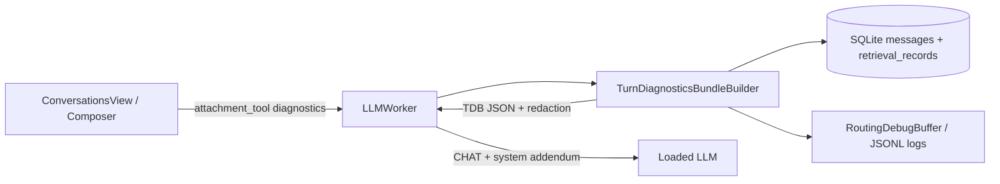

# Turn Diagnostics — Composer “Under the Hood” Plan

**Status:** Implemented (Phase 1 + Phase 2 core)  
**Audience:** Product, maintainers, contributors  
**Related:** [Logging & diagnostics](logging_and_diagnostics.md) · INSPECT RETRIEVAL (`ui/components/retrieval_inspector.py`) · Routing debug (`mcp/routing_debug.py`) · Composer tools (`core/composer_attachments.py`)

---

## 0. Problem statement

Users sometimes get answers that feel wrong, incoherent, or misaligned with what they asked. Causes may live in the **model**, **routing**, **retrieval**, **tools/skills**, **prompt layout**, or **settings** — not only in “bad luck” from the LLM.

Today Qube exposes strong **read-only** forensics (INSPECT RETRIEVAL, routing debug JSONL, diagnostic log viewers) but expects the user to **correlate** those surfaces manually. There is no guided, conversational path to say: *“Explain what happened on **this** reply”* and get a **grounded** narrative plus a **copyable issue-report block**.

**Goal:** A composer affordance that bundles evidence for one turn (or a short thread window), injects it into a **normal chat turn** (Tier 1 — no extra tool chain), and lets the **loaded** model explain orchestration outcomes in plain language — with explicit limits on what was and was not logged.

---

## 1. Product principles

| Principle | Rule |
|-----------|------|
| Evidence-first | The model must reason from a structured **Turn Diagnostics Bundle** (TDB), not raw unbounded logs. |
| Honest bounds | UI and system prompt state clearly: “only what Qube recorded for this turn.” |
| Privacy by default | Redact paths, tokens, memory text, and full prompts unless user opts into “technical detail.” |
| No hidden authority | Diagnostics explain **hypotheses**; they do not auto-file bugs or change settings. |
| Tier 1 chat | Single LLM completion; no multi-hop tools, no async enrichment blocking the reply. |
| Reuse INSPECT data | Do not fork retrieval explain logic; **serialize** the same facts INSPECT already shows. |

---

## 2. User experience

### 2.1 Primary flows

1. **Explain last reply (default)**  
   User types a question in composer with `@[tool:diagnostics]` (working name **`diagnostics`**, label **“Under the hood”**).  
   Target: **most recent assistant message** in the active session (or the turn that just failed if invoked from error toast — future).

2. **Explain a specific reply**  
   From assistant bubble context menu: **“Explain under the hood…”**  
   - Opens composer with `@[tool:diagnostics]` chip bound to `assistant_message_id=<uuid>`.  
   - User may add a short question: *“Why did it think I meant X?”*

3. **Explain a thread window (optional v2)**  
   Composer: `@[tool:diagnostics]` + `@[chat:<session>]` or multi-select last *N* turns — capped (e.g. 3 user/assistant pairs).

### 2.2 Output shape (model-facing template)

The assistant’s answer should follow a fixed outline (enforced via system addendum + few-shot stub in prompt):

1. **What you asked / what Qube tried to do** (route, tools, model mode)  
2. **Timeline** (ordered bullets: route → retrieve → prompt → generate)  
3. **Likely contributors** to the awkward outcome (fact vs hypothesis)  
4. **What you can try** (settings, composer tool, rephrase) — only if supported by bundle  
5. **Issue report snippet** — markdown block: version, session id (truncated), message id, route, model, 5-line summary (copy button in UI later)

### 2.3 Relationship to INSPECT RETRIEVAL

| Surface | User | Mechanism |
|---------|------|-----------|
| INSPECT RETRIEVAL | Deterministic, tabbed UI | No LLM |
| `@diagnostics` | Narration + teaching + report helper | LLM over TDB |

Cross-link in INSPECT Explain tab: *“Want a plain-language walkthrough? Use @diagnostics in the composer.”*

---

## 3. Architecture overview

**Routing:** New composer tool id `diagnostics` → `resolve_attachment_routing` returns a **dedicated strategy** (not web, not memory search):

- `route`: `none` or `chat` (no retrieval pipeline)  
- `strategy`: `attachment_tool_diagnostics`  
- `attachment_tool`: `diagnostics`  
- Optional: `diagnostics_target_message_id`, `diagnostics_thread_depth`

**Knowledge service:** None. Bypass cognitive router web/RAG paths except where the user’s *text* question still goes through normal history assembly.

**Injection point:** Same pattern as `@[tool:help]` context — but instead of LanceDB hits, inject `--- TURN DIAGNOSTICS BUNDLE ---` block into the user message or a transient system suffix (prefer **user-role appendix** to avoid fighting `PromptBlocks` system composition; exact placement decided in PR1 spike).

---

## 4. Turn Diagnostics Bundle (TDB) schema

Versioned JSON (`schema_version: 1`). Built by `core/turn_diagnostics_bundle.py` (new module).

### 4.1 Identity & scope

| Field | Source |
|-------|--------|
| `schema_version` | constant |
| `generated_at` | ISO timestamp |
| `app_version` | from package / qube.spec |
| `session_id` | active session |
| `target_assistant_message_id` | explicit or latest |
| `target_user_message_id` | preceding user msg |
| `routing_turn_id` | int, if known |
| `thread_excerpt` | optional last N pairs (truncated) |

### 4.2 Conversation excerpt (redacted)

- User + assistant text for target turn (and optional window), each capped (e.g. 4k chars).  
- Strip embedded secrets heuristic (API keys, bearer tokens) via existing redaction helpers where available.

### 4.3 Orchestration summary

Reuse and compress:

| Field | Source |
|-------|--------|
| `composer_attachments` | Persisted if available; else “unknown” |
| `effective_route` / `strategy` | `RoutingDebugRecord` or retrieval record |
| `turn_context` | `TurnContext.trace_fields()` — **requires capture (Phase 2)** |
| `reply_shape` / `generation_risk` | from turn context |
| `skills_applied` | routing debug / skills debug merge |
| `capability_steps` | `core/integrations/capability_inspect.py` serialization |

### 4.4 Retrieval & evidence

| Field | Source |
|-------|--------|
| `evidence_bundle_id` | `messages.evidence_bundle_id` |
| `retrieval_record` | `db.get_retrieval_record(bundle_id=...)` |
| `sources_summary` | count, adapters, top titles/urls (no full bodies) |
| `evidence_transparency` | `decode_sources_payload` → transparency dict |
| `inspect_summary` | Call shared formatters from `retrieval_inspector` / `routing_inspect_explain` (deterministic text fields in JSON, not UI widgets) |

### 4.5 Inference stack (static + per-turn)

| Field | Source |
|-------|--------|
| `inference_snapshot` | `core/inference_transparency.py` build snapshot |
| `engine_mode` / model path / `n_gpu_layers` | settings + telemetry |
| `execution_policy` | native engine telemetry projection when internal |
| `truncation_hints` | `core/output_token_budget.py` if logged |
| `degeneration` / `conversation_health` | worker turn capture — **Phase 2 persist** |

### 4.6 Log excerpts (optional, capped)

| Field | Source |
|-------|--------|
| `log_excerpts` | dict keyed by `DiagnosticLogSpec.id` |
| Window | `[turn_start, turn_end]` ± skew; if timestamps missing, last *K* JSONL lines matching `session_id` + `turn_id` |

**Caps:** Total injected TDB size ≤ **24k chars** (~6k tokens budget target); log excerpts ≤ **8k chars** combined. Truncate with `… [truncated]` markers.

### 4.7 Privacy tiers

| Tier | Setting | Content |
|------|---------|---------|
| `standard` (default) | — | No full prompts, no memory text, hashed queries if routing redaction on |
| `technical` | Settings toggle or one-shot dialog | Includes prompt hash + length, optional last 2k of llm_debug lines for session |

Persist tier choice in QSettings: `qube.diagnostics.detail_level`.

---

## 5. Data correlation — gaps and fixes

### 5.1 Today (Phase 1 — good enough)

| Artifact | Linked to message? |
|----------|-------------------|
| `sources_json` + transparency | Yes |
| `evidence_bundle_id` | Yes → `retrieval_records` |
| Routing debug buffer | `session_id` + `turn_id` only |
| JSONL routing log | `session_id` + `turn_id` if recording on |

**Phase 1 resolution order for routing record:**

1. `retrieval_records.turn_id` for bundle on target message  
2. `RoutingDebugBuffer` scan: match `session_id` + `turn_id`  
3. Parse `routing_debug.log` JSONL tail (e.g. last 200 lines) for matching turn  
4. Else: `routing: { "status": "not_recorded", "hint": "Enable Routing debug log in Privacy & data" }`

### 5.2 Phase 2 — durable forensics snapshot

At **end of each assistant turn**, append optional forensics snapshot:

**Option A (preferred):** Extend `sources_json` v2 with sibling key `forensics` (small routing summary + turn_context trace + turn_id), written in `LLMWorker` when saving assistant message.

**Option B:** New column `messages.turn_forensics_json TEXT`.

Also store `routing_turn_id` on the assistant row (integer) for O(1) lookup.

**Acceptance:** Reopening a session days later, `@diagnostics` on an old message still finds routing summary without relying on in-memory buffer.

---

## 6. Composer & worker wiring

### 6.1 `core/composer_attachments.py`

- Add to `COMPOSER_TOOLS`:
  - `id`: `diagnostics`
  - `label`: `Under the hood`
  - `description`: `Explain orchestration for a chat turn using recorded diagnostics`
  - Not in `_WEB_COMPOSER_TOOLS`
- `resolve_attachment_routing`: branch for `diagnostics` → strategy above.
- Optional token: `@[tool:diagnostics::<message_uuid>]` — parser extension if message-bound chips needed (mirror conversation ref pattern).

### 6.2 `workers/llm_worker.py`

On `attachment_tool == "diagnostics"`:

1. Resolve `target_message_id` from attachment id suffix or latest assistant in `session_id`.  
2. Call `build_turn_diagnostics_bundle(db, worker_state, ...)` on worker thread (DB + file IO OK here).  
3. Set `attachment_patch` route to skip web/RAG/memory retrieval (similar to bare `attachment_conversation` chat path).  
4. Inject TDB via dedicated helper `format_turn_diagnostics_context(tdb)` into prompt assembly **before** `render_messages`.  
5. Append **system or user addendum** from `core/turn_diagnostics_prompts.py` (`DIAGNOSTICS_SYSTEM_ADDENDUM`).

**Do not** set `_composer_knowledge_tool` to a web tool.

### 6.3 `ui/views/conversations_view.py`

- Context menu on assistant `AgentMessageLabel`: **Explain under the hood…**  
- Preloads composer draft with `@[tool:diagnostics]` + hidden metadata for message id (chip payload).  
- Optional shortcut: `/diagnostics` composer command (`core/composer_commands.py`).

### 6.4 Tiering / execution model

Explicitly **Tier 1**: diagnostics turns must not trigger enrichment, memory write, or secondary retrieval. Guard in `LLMWorker` early in turn setup (same class of guard as explicit remember).

---

## 7. Prompt contract (`core/turn_diagnostics_prompts.py`)

System addendum (abridged intent):

- You are explaining **Qube’s recorded behavior**, not defending the answer.  
- Separate **FACT** (fields present in TDB) vs **HYPOTHESIS** (inference).  
- If `routing.status == not_recorded`, say what to enable.  
- Never invent tool calls or sources not in the bundle.  
- End with the issue-report markdown block.

**Model choice:** User’s currently loaded model — no sidecar. Keep output budget moderate (`resolve_output_token_budget` — cap diagnostics replies e.g. 1200 tokens).

---

## 8. Security & privacy

- TDB must **not** include: full LanceDB memory rows, other users’ sessions, unredacted web audit snippets when privacy redaction is on.  
- Reuse `routing_debug_log_redact_query` behavior for query fields in bundle.  
- `technical` tier: confirm once per session via `PrestigeDialog` (“May include prompt excerpts from local logs”).  
- Exported issue snippet uses truncated ids only (no full filesystem paths in `standard` tier).

---

## 9. Testing plan

| Test | Module |
|------|--------|
| Bundle builder fixtures | `tests/test_turn_diagnostics_bundle.py` — message with transparency + bundle id |
| Routing correlation | buffer match + JSONL parse fallback |
| Redaction | queries hashed, memory omitted |
| Composer routing | `tests/test_composer_attachments.py` — strategy `attachment_tool_diagnostics` |
| Worker skip retrieval | mock turn: no web/RAG call when diagnostics attached |
| Prompt contains TDB | snapshot test on `format_turn_diagnostics_context` |
| Golden eval (optional) | static TDB → model stub; assert outline sections present |

Manual QA checklist:

1. CHAT-only turn — bundle shows route none/chat, no sources.  
2. `@internet` turn — bundle shows web pipeline + sources summary; INSPECT facts match.  
3. Old message after app restart (Phase 2) — routing still present.  
4. Routing log disabled — honest “not recorded” copy.  
5. Technical tier — larger log excerpt; privacy dialog shown once.

---

## 10. Documentation & help

- New FAQ: `assets/help/en/source/faq/turn-diagnostics-composer.md`  
- Manifest entry + cross-links from `inspect-retrieval.md`, `logging_and_diagnostics.md`  
- `core/help_reference_generator.py` / golden eval if composer tools list is generated  
- Settings blurb under **Privacy & data** (routing log recommendation for diagnostics)

---

## 11. Implementation phases

### Phase 1 — MVP (shippable)

**Estimate:** 3–5 focused PRs

| PR | Deliverable |
|----|-------------|
| 1 | `turn_diagnostics_bundle.py` + tests; JSON schema v1 |
| 2 | Composer tool + attachment routing + worker injection + prompts |
| 3 | UI: composer chip + “Explain under the hood” context menu |
| 4 | Help doc + composer palette tooltip |

**MVP limits:** Last message or explicit message id only; Phase 1 routing correlation; no persistence beyond existing DB fields.

### Phase 2 — Durable snapshots

- Persist `forensics` / `routing_turn_id` on assistant save  
- Include `TurnContext` + degeneration in bundle  
- Thread window (last 3 turns)

### Phase 3 — Polish

- Copy issue-report button on assistant bubble after diagnostics run  
- Link from INSPECT Explain tab  
- Optional export TDB JSON to `~/.qube/exports/`  
- Telemetry counters (local only): diagnostics turns per week

---

## 12. Open decisions

| # | Question | Recommendation |
|---|----------|----------------|
| 1 | Tool id: `diagnostics` vs `explain` vs `debug` | **`diagnostics`** — aligns with Settings naming; user label “Under the hood” |
| 2 | Inject TDB in user vs system role | **User appendix** after user question to reduce system prompt conflicts |
| 3 | Require routing log enabled? | **No** — degrade gracefully with INSPECT + DB fields |
| 4 | Pro-gated? | **No** — educational + support value for all users |
| 5 | Store diagnostics turns in memory enrichment? | **No** — exclude from memory extraction |

---

## 13. Success metrics

- Users can explain a bad reply without opening log files.  
- Support issues include structured snippet with route + model + message id.  
- No measurable increase in turn latency for non-diagnostics chats.  
- Diagnostics turn p95 bundle build < 150 ms (local DB + small log tail).

---

## 14. File touch list (expected)

| Area | Files |
|------|--------|
| Bundle | `core/turn_diagnostics_bundle.py`, `core/turn_diagnostics_prompts.py` |
| Composer | `core/composer_attachments.py`, `core/composer_commands.py` (optional) |
| Worker | `workers/llm_worker.py` |
| UI | `ui/views/conversations_view.py`, `ui/components/composer_context_chips.py`, `ui/components/retrieval_inspector.py` (link only) |
| DB (Phase 2) | `core/database.py`, encode path in worker save |
| Docs | `docs/turn_diagnostics_composer_plan.md`, `assets/help/en/source/faq/…` |
| Tests | `tests/test_turn_diagnostics_bundle.py`, extend `tests/test_composer_attachments.py` |

---

*This document is the source of truth for the Turn Diagnostics composer feature until implementation is complete; update sections 5.2 and 12 as decisions close.*